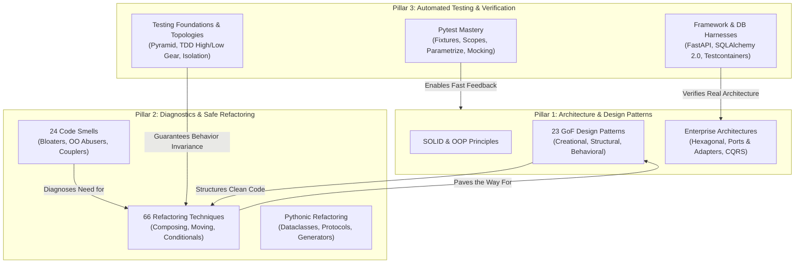

# All-in-One Software Engineering Knowledge System 📐🛠️🧪

> A curated digital garden, architectural encyclopedia, and production-grade engineering handbook based on foundational software engineering literature:
> 1. ***[Dive Into Design Patterns](design-patterns/)*** — Object-oriented architecture, SOLID principles, and the 23 Gang of Four design patterns (Alexander Shvets).
> 2. ***[Dive Into Refactoring](refactoring/)*** — The 24 classic code smells, 66 safe refactoring techniques, and comprehensive testing strategies (Alexander Shvets & Martin Fowler).
> 3. ***[Python Backend Testing & Quality Architecture](python-backend-testing/)*** — Test-driven development, modern pytest mastery, architecture & domain testing, and framework test harnesses (Brian Okken, Harry Percival & Bob Gregory).
> 4. ***[English Grammar Knowledge System](english-grammar/)*** — An enterprise-grade English grammar curriculum and professional communication handbook spanning CEFR A1 to C2 (Raymond Murphy & Michael Swan).
>
> All implementations are written in modern, type-hinted **Python 3 (Python 3.10+)** with companion **`pytest`** behavioral contracts and interactive text-based **Mermaid.js** diagrams.

---

## 🏛️ The Three Pillars of Engineering Excellence

This repository integrates architectural design, safe refactoring transformations, and deterministic quality assurance into a unified engineering workflow:

---

## 🧭 Master Navigation & Knowledge Hubs

### 1. 📐 [Design Patterns Knowledge System](design-patterns/) (46 Guides)
A comprehensive architecture reference for building flexible, loosely coupled software:
* 🏛️ **[Foundations](design-patterns/foundations/)**: [SOLID Principles](design-patterns/foundations/solid-principles.md), [OOP Pillars](design-patterns/foundations/oop-pillars.md), and [Object Relationships](design-patterns/foundations/object-relationships.md).
* 🏭 **[Creational Patterns (5)](design-patterns/creational/)**: Factory Method, Abstract Factory, Builder, Prototype, and Singleton.
* 🔌 **[Structural Patterns (7)](design-patterns/structural/)**: Adapter, Bridge, Composite, Decorator, Facade, Flyweight, and Proxy.
* 🚦 **[Behavioral Patterns (10)](design-patterns/behavioral/)**: Chain of Responsibility, Command, Iterator, Mediator, Memento, Observer, State, Strategy, Template Method, and Visitor.
* ⚖️ **[Direct Pattern Comparisons (6)](design-patterns/comparisons/)**: Strategy vs. State, Decorator vs. Proxy, Adapter vs. Facade vs. Proxy, etc.
* 💳 **[Enterprise System Case Studies (5)](design-patterns/practical-examples/)**: Payment Systems, Notifications, Document Editors, Logging Frameworks, and E-Commerce.
* ⚡ **[Revision Tools](design-patterns/resources/)**: [22-Pattern Cheat Sheet](design-patterns/resources/pattern-cheat-sheet.md), [Selection Decision Guide](design-patterns/resources/pattern-selection-guide.md), and [Interview Q&A](design-patterns/resources/interview-questions.md).

---

### 2. 🛠️ [Refactoring Knowledge System](refactoring/) (135 Guides)
A safe, disciplined playbook for recognizing code rot and systematically cleaning legacy software:
* 📖 **[Foundations (8)](refactoring/foundations/)**: [What is Refactoring?](refactoring/foundations/what-is-refactoring.md), [Technical Debt](refactoring/foundations/technical-debt.md), [Refactoring vs. Rewriting](refactoring/foundations/refactoring-vs-rewriting.md), and [Testing Preconditions](refactoring/foundations/safe-refactoring-and-testing.md).
* 🧪 **[Testing Strategy (5)](refactoring/testing/)**: Characterization Tests, Golden Master Testing, and Pytest Fixtures for legacy code.
* 👃 **[The 24 Code Smells (29)](refactoring/code-smells/)**: Diagnostic checklists across Bloaters, Object-Orientation Abusers, Change Preventers, Dispensables, and Couplers.
* ✂️ **[The 66 Refactoring Techniques (73)](refactoring/techniques/)**: Step-by-step transformations across Composing Methods, Moving Features, Organizing Data, Simplifying Conditionals, Simplifying Method Calls, and Generalization.
* 🐍 **[Pythonic Refactoring (7)](refactoring/python-refactoring/)**: Idiomatic refactorings using dataclasses, protocols, comprehensions, and generators.
* 🏰 **[Real-World Case Studies (5)](refactoring/case-studies/)**: Taming God classes, eliminating duplicate logic, and modernizing legacy services.
* 🗺️ **[Diagnostic & Connection Matrices (4)](refactoring/matrices/)**: Smell-to-Technique Matrix, Technique-to-Pattern Architectural Bridge, and Diagnostic Flowcharts.
* ⚡ **[Resources & Interview Prep (3)](refactoring/resources/)**: One-page Refactoring Cheat Sheet, 25 Senior Interview Q&As, and Complete Glossary.

---

### 3. 🧪 [Python Backend Testing Knowledge System](python-backend-testing/) (107 Guides across 14 Modules)
An enterprise-grade testing manual and quality architecture encyclopedia based on Brian Okken (*Python Testing with pytest*), Harry Percival & Bob Gregory (*Architecture Patterns with Python*), and Gerard Meszaros (*xUnit Test Patterns*):
* 🏛️ **[01. Foundations (8)](python-backend-testing/foundations/)**: [Testing Fundamentals](python-backend-testing/foundations/software-testing-fundamentals.md), [Testing Pyramid & Topologies](python-backend-testing/foundations/testing-pyramid.md), [Unit vs. Int vs. E2E](python-backend-testing/foundations/unit-vs-integration-vs-e2e.md), [TDD High & Low Gear](python-backend-testing/foundations/test-driven-development.md), [Coverage & Mutation Testing](python-backend-testing/foundations/test-coverage.md), and [Test Isolation & Sandboxing](python-backend-testing/foundations/test-isolation.md).
* ⚙️ **[02. Pytest Fundamentals (10)](python-backend-testing/pytest-fundamentals/)**: Fixture dependency injection graph, fixture scopes, parametrized tests, `conftest.py` cascades, custom markers, and plugin hooks.
* 🎛️ **[03. Advanced Pytest (9)](python-backend-testing/advanced-pytest/)**: `Mock` vs. `MagicMock`, `monkeypatch`, `pytest-mock`, async coroutines with `pytest-asyncio`, exception testing, and debugging workflows.
* 🔬 **[04. Unit Testing (7)](python-backend-testing/unit-testing/)**: Domain logic, service layer orchestration, business rules, boundary value analysis, and dependency isolation.
* 🗄️ **[05. Integration Testing (9)](python-backend-testing/integration-testing/)**: PostgreSQL with SQLAlchemy 2.0, nested transaction (`SAVEPOINT`) sandboxing, Testcontainers, and third-party APIs.
* ⚡ **[06. FastAPI Testing (9)](python-backend-testing/fastapi-testing/)**: Native `httpx.AsyncClient` with `ASGITransport`, lifespan management, dependency overrides, schema validation, and JWT security.
* 🧪 **[07. Flask Testing (7)](python-backend-testing/flask-testing/)**: WSGI test client, application factory fixtures, request/application contexts, and authentication session cookies.
* 🏛️ **[08. Architecture & Domain Testing (10)](python-backend-testing/architecture-and-testing/)**: Repository Pattern, Unit of Work, Service Layer, Domain Model invariants, Domain Events, Message Bus, and CQRS.
* 🌐 **[09. End-to-End Testing (6)](python-backend-testing/e2e-testing/)**: Playwright API context, full user journey workflows, database verification, and test environment isolation.
* 🤖 **[10. AI-Assisted Testing & Quality (6)](python-backend-testing/ai-assisted-testing/)**: Property-based fuzzing (`hypothesis`), mutation testing (`mutmut`), LLM test generation prompts, and 4-gate verification harnesses.
* 🚀 **[11. CI/CD & DevOps (6)](python-backend-testing/ci-cd-and-devops/)**: Multi-stage Docker builds, GitHub Actions test matrix, parallel execution (`pytest-xdist`), branch coverage merge gates, and flaky test quarantine.
* 💳 **[12. Practical Reference Projects (6)](python-backend-testing/practical-projects/)**: Production test suites for User Management, OAuth2/JWT Authentication, E-Commerce Inventory Reservation, Stripe Webhook Idempotency, and Complete Template Scaffold.
* ⚖️ **[13. Comparative Architecture (8)](python-backend-testing/comparisons/)**: Objective trade-off matrices: Unit vs. Int vs. E2E, Pytest vs. Unittest, Mocks vs. Fakes vs. Stubs, TestClient vs. HTTPX, SQLite vs. PostgreSQL, and Sync vs. Async.
* 📋 **[14. Resources & Senior Playbooks (6)](python-backend-testing/resources/)**: 30 Senior/Staff Interview Q&As, Complete Pytest CLI Cheat Sheet, Enterprise Testing Strategy RFC Template, Flaky Test Playbook, and Comprehensive Glossary.

---

### 4. 📚 [English Grammar Knowledge System](english-grammar/) (17 Modules)
A modular English language curriculum and technical communication reference spanning CEFR A1 to C2 based on Raymond Murphy (*Essential Grammar in Use*, *English Grammar in Use*) and Michael Swan (*Practical English Usage*):
* 🧱 **[01. Foundations](english-grammar/01-foundations/)**: [Parts of Speech](english-grammar/01-foundations/parts-of-speech.md), [Sentence Elements & S-V-O-C-A](english-grammar/01-foundations/sentence-elements-and-word-order.md), [Phrases & Clauses](english-grammar/01-foundations/phrases-and-clauses.md), [Sentence Types](english-grammar/01-foundations/sentence-types-and-purposes.md), [Punctuation Mastery](english-grammar/01-foundations/punctuation-mastery.md), and [Capitalization & Spelling Rules](english-grammar/01-foundations/capitalization-and-spelling-rules.md).
* ⚙️ **[Core Mechanics](english-grammar/)**: Verbs & Auxiliaries, All 12 Tenses, Nouns & Articles, Pronouns & Determiners, Adjectives & Adverbs, Prepositions, Conjunctions & Relative Clauses, Voice & Reported Speech, Conditionals 0–3, and Non-Finite Verbals.
* 🎯 **[Advanced & Workplace Communication](english-grammar/)**: Negative Inversion, Cleft Sentences, Subjunctive, 18 Disambiguation Matrices (*since* vs *for*, *make* vs *do*), Technical Documentation Writing, PR Review Phrasing, and Common ESL Diagnostic Antipatterns.

---

## 📋 The Golden Anatomy Standard

Every guide across this repository strictly adheres to an uncompromising quality standard:
1. **Source Traceability:** Direct attribution to Brian Okken, Harry Percival, Bob Gregory, Martin Fowler, Alexander Shvets, and Gang of Four literature.
2. **Interactive Visuals:** Standardized Mermaid.js diagrams (Architecture, Sequence, State, Flowchart).
3. **Runnable Modern Python 3:** Complete, runnable, type-hinted code implementations (`typing.Protocol`, `@dataclass`, `enum`).
4. **Behavioral Test Verification:** Companion `pytest` suites proving that observable functionality remains 100% invariant.
