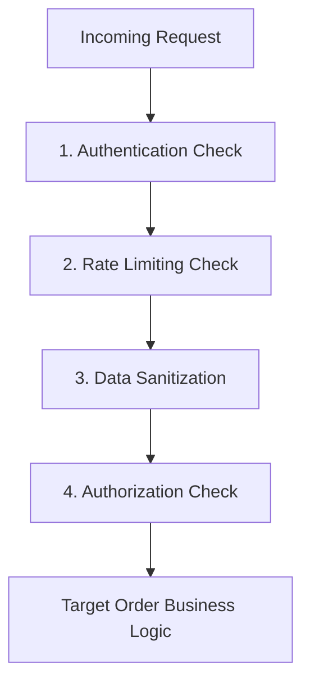
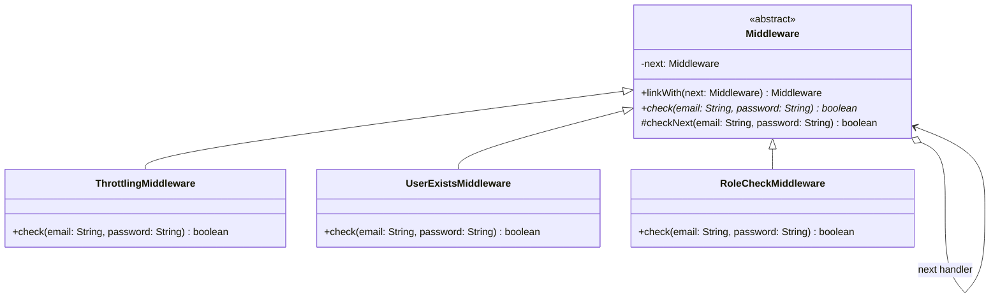
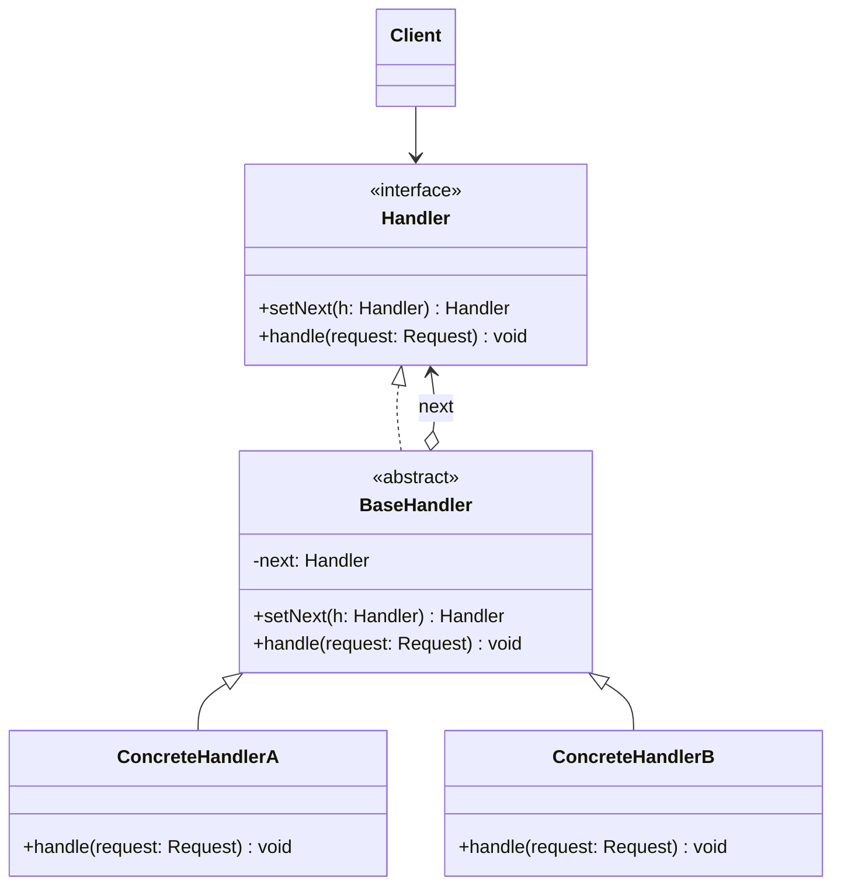
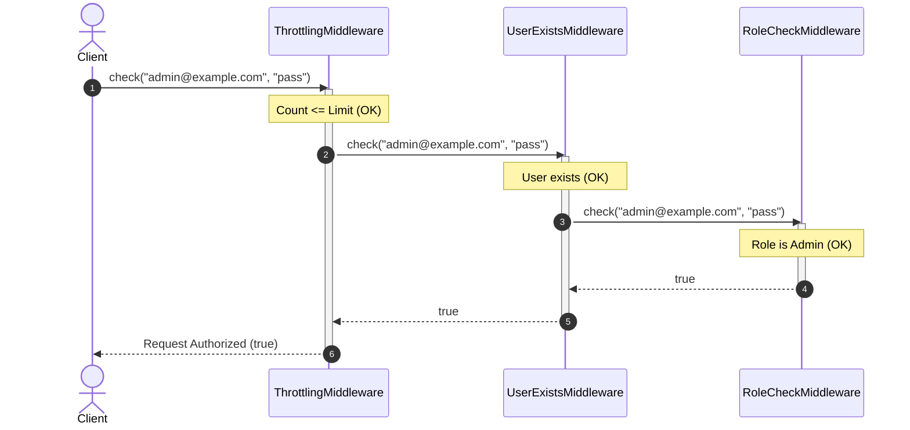

# Chain of Responsibility

> **Classification:** Behavioral Pattern  
> **Complexity:** ★★☆

---

## 1. Intent

**Chain of Responsibility** is a behavioral design pattern that lets you pass requests along a chain of handlers. Upon receiving a request, each handler decides either to process the request or to pass it to the next handler in the chain.

---

## 2. Problem

Imagine you are building an online ordering and checkout system. You want to restrict access to the ordering system so that only authenticated users can place orders. Additionally, users who have administrative permissions should be granted full access to all orders.

Soon, you realize that several sequential checks are required before an HTTP request can reach the order processing logic:

1. **Authentication Check:** Validate user login credentials.
2. **Rate Limiting (Brute Force Defense):** Check if repeated requests from the same IP address exceed safe limits.
3. **Data Sanitization:** Sanitize incoming input data to prevent SQL Injection or XSS attacks.
4. **Authorization Check:** Verify whether the user has sufficient permissions for the requested endpoint.
5. **Caching Check:** If the response was recently cached, return it directly without querying the database.



### The Monolithic Anti-Pattern
Initially, all these checks were crammed into a single bloated `Server` or `OrderService` class. Each time a new check is added (e.g., Two-Factor Authentication or Bot Detection), you must open and modify this massive class, risking regressions and creating a maintenance nightmare.

---

## 3. Motivation

Consider graphical user interface (GUI) context-sensitive help:
* A user clicks on an element on the screen and presses **F1** for help.
* The element might be a small `Button`. If the button has no specialized help text, it forwards the request to its parent `Panel`.
* If the panel has no help text, it forwards the request to the parent `DialogWindow`.
* If the dialog has no help, it delegates to the top-level `Application`.

The request travels up the component hierarchy until some component handles it or the chain terminates.

---

## 4. Solution

The Chain of Responsibility pattern suggests that you transform each discrete check into a standalone object called a **Handler**:

1. Each handler has a method to process the request.
2. Each handler holds a reference to the **next handler** in the chain.
3. A handler decides whether to process the request, pass it to the next handler, or short-circuit and terminate the chain immediately (e.g., if authentication fails).



---

## 5. Structure



---

## 6. Participants

1. **Handler Interface:** Declares the method for processing requests and optionally for setting the next handler in line.
2. **Base Handler (Optional):** Implements the boilerplate code for saving a reference to the next handler.
3. **Concrete Handlers:** Contain the actual request-processing logic. Upon receiving a request, each handler either processes it, passes it along, or halts execution.
4. **Client:** Composes the chain dynamically (linking handlers together) and triggers the request on the first handler.

---

## 7. Code Implementation (Python 3)

```python
from abc import ABC, abstractmethod
from typing import Optional


# ==========================================
# 1. Base Handler (Middleware)
# ==========================================
class Handler(ABC):
    def __init__(self) -> None:
        self._next_handler: Optional["Handler"] = None

    def set_next(self, next_handler: "Handler") -> "Handler":
        self._next_handler = next_handler
        return next_handler  # Returning next handler allows fluent chaining: h1.set_next(h2).set_next(h3)

    def handle(self, email: str, password: str, role: str) -> bool:
        if self._next_handler:
            return self._next_handler.handle(email, password, role)
        return True


# ==========================================
# 2. Concrete Handlers
# ==========================================
class RateLimitHandler(Handler):
    def __init__(self, max_requests_per_minute: int = 60) -> None:
        super().__init__()
        self._max = max_requests_per_minute
        self._current_requests = 0

    def handle(self, email: str, password: str, role: str) -> bool:
        self._current_requests += 1
        if self._current_requests > self._max:
            print("[429 RateLimitHandler] Request dropped: rate limit exceeded.")
            return False
        print("[RateLimitHandler] Rate limit check passed.")
        return super().handle(email, password, role)


class UserExistsHandler(Handler):
    def __init__(self) -> None:
        super().__init__()
        # Simulated user repository
        self._users = {"admin@example.com": "admin_pass", "user@example.com": "user_pass"}

    def handle(self, email: str, password: str, role: str) -> bool:
        if email not in self._users:
            print(f"[401 UserExistsHandler] Authentication failed: '{email}' not found.")
            return False
        if self._users[email] != password:
            print(f"[401 UserExistsHandler] Authentication failed: invalid password.")
            return False
        print(f"[UserExistsHandler] User '{email}' authenticated.")
        return super().handle(email, password, role)


class RoleAuthorizationHandler(Handler):
    def __init__(self, required_role: str = "ADMIN") -> None:
        super().__init__()
        self._required_role = required_role

    def handle(self, email: str, password: str, role: str) -> bool:
        if role.upper() != self._required_role.upper():
            print(f"[403 RoleHandler] Access Denied: User role '{role}' is not '{self._required_role}'.")
            return False
        print(f"[RoleHandler] Authorized with role '{role}'.")
        return super().handle(email, password, role)


# ==========================================
# 3. Client Execution Demo
# ==========================================
if __name__ == "__main__":
    # Construct the processing pipeline:
    # RateLimit -> UserExists -> RoleAuthorization
    rate_limiter = RateLimitHandler(max_requests_per_minute=2)
    user_verifier = UserExistsHandler()
    role_authorizer = RoleAuthorizationHandler(required_role="ADMIN")

    rate_limiter.set_next(user_verifier).set_next(role_authorizer)

    print("--- Test 1: Valid Admin Request ---")
    rate_limiter.handle("admin@example.com", "admin_pass", "ADMIN")

    print("\n--- Test 2: Invalid Password ---")
    rate_limiter.handle("admin@example.com", "wrong_pass", "ADMIN")

    print("\n--- Test 3: Insufficient Role ---")
    rate_limiter.handle("user@example.com", "user_pass", "VIEWER")
```

---

## 8. Execution Flow



---

## 9. When to Use (Applicability)

* **Sequential Execution Pipelines:** When your program needs to process different kinds of requests in various ways, but the exact types of requests and their sequences are unknown beforehand.
* **Dynamic Handler Reordering:** When it is essential to execute multiple handlers in a strict order or configure the order dynamically at runtime.
* **Separation of Filtering Rules:** When building middleware for HTTP request processing, input validation, or logging pipelines.

---

## 10. When NOT to Use (Anti-Scenarios)

* **Unhandled Requests:** In a Chain of Responsibility, a request can easily drop off the end of the chain without ever being processed. If every request **must** be handled by guaranteed logic, ensure a fallback default handler sits at the end.
* **Simple Sequential Method Calls:** If the sequence of checks is completely fixed, never changes, and requires no dynamic configuration, standard sequential private method calls inside a single service class are simpler.

---

## 11. Advantages

* **Control Request Handling Order:** You can dynamically assemble and reorder the chain of processing.
* **Single Responsibility Principle (SRP):** You can decouple classes that invoke operations from classes that perform operations.
* **Open/Closed Principle (OCP):** You can introduce new handlers without breaking existing ones.

---

## 12. Disadvantages

* **Uncertain Execution Guarantee:** Some requests may reach the end of the chain unhandled if no handler claims responsibility.
* **Debugging Friction:** Following the control flow through a deep chain of handlers can be harder to trace than direct calls.

---

## 13. Common Mistakes & Misconceptions

### Mistake 1: Confusing Chain of Responsibility with Decorator
* **Decorator:** Enhances an object’s behavior while preserving its interface. All decorators in the stack are executed.
* **Chain of Responsibility:** Any handler in the chain can **halt and short-circuit execution**, terminating downstream processing immediately.

---

## 14. Related Patterns

* **[Command](command.md):** You can implement a Chain of Responsibility where the request itself is encapsulated as a Command object.
* **[Composite](../structural/composite.md):** Chain of Responsibility is often used in conjunction with Composite, passing a request from a leaf node up through parent containers (e.g., UI event bubbling).
* **[Decorator](../structural/decorator.md):** Both patterns rely on recursive execution through linked objects, but Decorator executes all layers without stopping.

---

## 15. Real-World Applications

### Python Standard Library & Frameworks
* `javax.servlet.Filter` & `FilterChain`: The definitive enterprise example! Every web request passes through a chain of filters (`SecurityFilter`, `CorsFilter`, `EncodingFilter`).
* `logging.Logger`: Passes log records up through a hierarchy of parent loggers and filters.
* FastAPI / Starlette Middleware: Sequential request filter chain.
* **Spring Security `SecurityFilterChain`:** Processes authentication tokens, CSRF protection, and session fixation defense sequentially.

---

## 16. Interview Questions & Self-Assessment

### Q1: What happens if no handler in a Chain of Responsibility can process the request?
> **Answer:** The request silently drops off the end of the chain unhandled, unless a default terminating handler or null-check fallback is explicitly added to the end of the pipeline.

### Q2: How does Chain of Responsibility differ from Decorator?
> **Answer:** In a Decorator, every layer in the stack is guaranteed to execute to add behavior. In a Chain of Responsibility, any handler has the power to short-circuit and abort the chain (e.g., authentication failure).

### Q3: How is Web Middleware (e.g. in FastAPI or Django) an implementation of this pattern?
> **Answer:** `FilterChain.doFilter(request, response)` passes the HTTP request down a configured list of filters. If a filter decides the user is unauthorized, it writes an error response and does not call `chain.doFilter()`, halting the chain.

### Q4: Can handlers in a chain mutate the request?
> **Answer:** Yes. Handlers can inspect, sanitize, decorate, or enrich request headers and payloads before forwarding them downstream.

---

## 17. Key Takeaways

1. **Pipeline Architecture:** Chains discrete processing steps sequentially.
2. **Short-Circuit Power:** Any handler can abort execution immediately.
3. **Decouples Senders and Receivers:** The sender doesn't know which specific handler will service the request.
4. **Foundation of Web Middleware:** Powers HTTP filters, security pipelines, and event bubbling.
