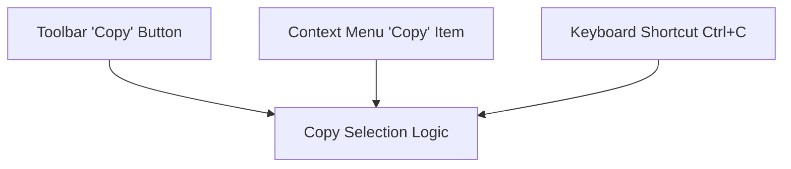
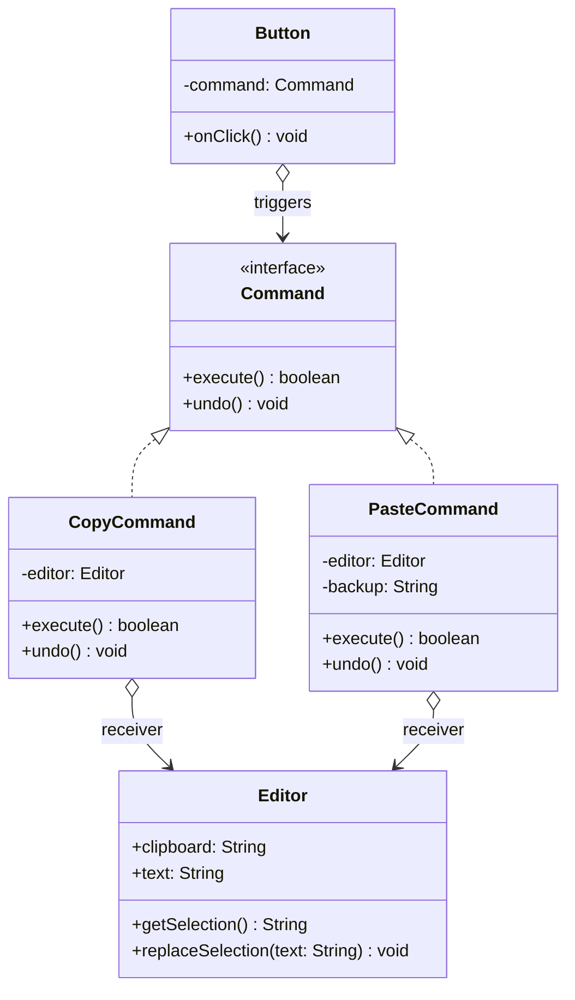
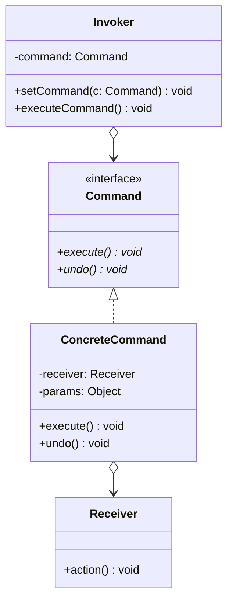
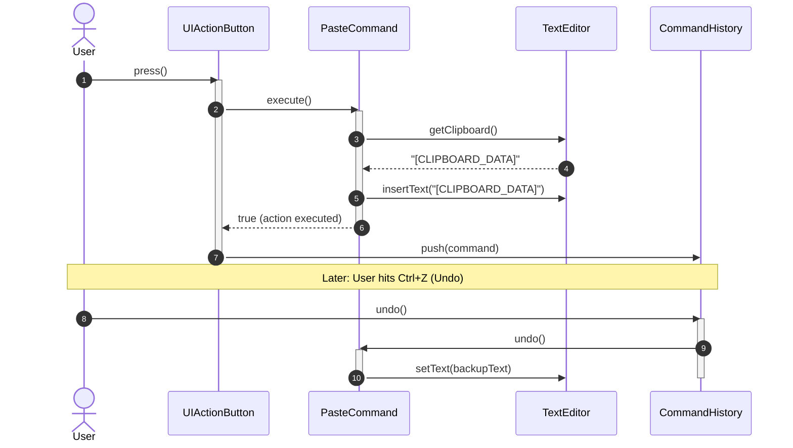

# Command

> **Also known as:** Action, Transaction  
> **Classification:** Behavioral Pattern  
> **Complexity:** ★★☆

---

## 1. Intent

**Command** is a behavioral design pattern that turns a request into a stand-alone object that contains all information about the request. This transformation lets you pass requests as method arguments, delay or queue a request's execution, and support undoable operations.

---

## 2. Problem

Imagine you are creating a modern text editor application. You are implementing a toolbar with various buttons (**Copy**, **Cut**, **Paste**, **Save**):

* You create a neat `Button` class for toolbar buttons.
* A naive approach is to create subclasses for each button: `CopyButton`, `PasteButton`, `SaveButton`.
* But wait: the **Copy** action can also be triggered from:
  1. A right-click context menu item.
  2. The main application menu bar (**Edit -> Copy**).
  3. A global keyboard shortcut (**Ctrl+C**).



### The Inadequacy of Subclassing
If you put copy logic inside `CopyButton`, you cannot reuse that logic in the shortcut handler without duplicating code or creating messy dependencies between UI components.

---

## 3. Motivation

Consider an automated smart-home home automation controller:
* A physical wall switch or remote smartphone app has configurable buttons (Button 1, Button 2).
* A user can configure Button 1 to **Turn on Living Room Light**, or **Open Garage Door**, or **Turn on Stereo**.
* The button switch (Invoker) shouldn't know anything about light bulbs, electric motors, or stereo amplifiers. It should simply invoke an encapsulated command.

---

## 4. Solution

The Command pattern suggests that GUI elements or invokers should **never send requests directly** to business logic objects. Instead, extract all the request details (the receiver object, method name, and arguments) into a separate **Command** class:

1. Every command implements a common interface with an `execute()` method.
2. An **Invoker** (e.g., a Button or Keyboard Shortcut) only holds a reference to a `Command` object and calls `command.execute()`.
3. The command delegates the work to the **Receiver** (the real business logic object).
4. By saving executed commands onto a history stack, the system can support **multi-level Undo/Redo**!



---

## 5. Structure



---

## 6. Participants

1. **Command Interface:** Declares the execution method (typically `execute()`) and optional `undo()` method.
2. **Concrete Commands:** Implement various kinds of requests. A concrete command doesn't perform the work on its own; it passes the call to the business logic object (**Receiver**).
3. **Receiver:** The business logic class that knows how to perform the actual work (e.g., `Editor`, `Light`, `DatabaseConnection`).
4. **Invoker (`Button`, `RemoteControl`):** Responsible for triggering the command. It holds a command reference and calls `execute()`. It does not know which receiver performs the work.
5. **Command History (Optional):** A stack data structure storing executed commands to provide undo/redo capabilities.

---

## 7. Code Implementation (Python 3)

```python
from abc import ABC, abstractmethod


# ==========================================
# 1. The Receiver (Performs Business Logic)
# ==========================================
class Editor:
    def __init__(self) -> None:
        self.text: str = ""
        self.clipboard: str = ""

    def get_selection(self) -> str:
        return self.text  # Simplified for demo

    def delete_selection(self) -> None:
        self.text = ""

    def replace_selection(self, new_text: str) -> None:
        self.text = new_text


# ==========================================
# 2. The Command Interface & Base Class
# ==========================================
class Command(ABC):
    def __init__(self, editor: Editor) -> None:
        self.editor = editor
        self._backup: str = ""

    def backup(self) -> None:
        self._backup = self.editor.text

    def undo(self) -> None:
        self.editor.text = self._backup

    @abstractmethod
    def execute(self) -> bool:
        """Executes command. Returns True if state changed (should save in history)."""
        pass


# ==========================================
# 3. Concrete Commands
# ==========================================
class CopyCommand(Command):
    def execute(self) -> bool:
        self.editor.clipboard = self.editor.get_selection()
        print(f"[Command] Copied to clipboard: '{self.editor.clipboard}'")
        return False  # State unchanged; no undo needed


class CutCommand(Command):
    def execute(self) -> bool:
        self.backup()
        self.editor.clipboard = self.editor.get_selection()
        self.editor.delete_selection()
        print(f"[Command] Cut text: '{self.editor.clipboard}'. Editor is now empty.")
        return True


class PasteCommand(Command):
    def execute(self) -> bool:
        self.backup()
        self.editor.replace_selection(self.editor.clipboard)
        print(f"[Command] Pasted clipboard contents: '{self.editor.text}'")
        return True


# ==========================================
# 4. The Invoker & Command History
# ==========================================
class Application:
    def __init__(self) -> None:
        self.editor = Editor()
        self.history: list[Command] = []

    def execute_command(self, command: Command) -> None:
        if command.execute():
            self.history.append(command)

    def undo(self) -> None:
        if not self.history:
            print("[Application] Nothing to undo.")
            return
        last_command = self.history.pop()
        last_command.undo()
        print(f"[Application] Undid last command. Current text: '{self.editor.text}'")


# ==========================================
# 5. Client Demo
# ==========================================
if __name__ == "__main__":
    app = Application()
    app.editor.text = "Design Patterns in Python"
    print(f"Initial State: '{app.editor.text}'")

    # Cut text
    app.execute_command(CutCommand(app.editor))

    # Paste text
    app.execute_command(PasteCommand(app.editor))

    # Undo Paste
    app.undo()

    # Undo Cut
    app.undo()
```

---

## 8. Execution Flow



---

## 9. When to Use (Applicability)

* **Parameterizing Actions:** When you want to parameterize UI elements with operations (e.g., buttons, menu items, shortcut handlers all sharing the same command).
* **Undo / Redo Support:** When you need reversible operations. The command stores a snapshot of the receiver's state prior to execution.
* **Queuing, Scheduling, and Thread Pools:** When you need to queue tasks, serialize actions to disk, or execute them asynchronously on background worker threads.

---

## 10. When NOT to Use (Anti-Scenarios)

* **Simple Synchronous Calls:** If an action has only one invoker, does not need queuing, logging, or undo, creating a separate Command class is pure overhead.
* **Complex Long-Running Sagas:** For long-running asynchronous distributed business workflows spanning multiple services, consider the **Saga Pattern** or an event-driven orchestrator rather than a memory-based Command stack.

---

## 11. Advantages

* **Single Responsibility Principle (SRP):** Decouples classes that invoke operations from classes that perform them.
* **Open/Closed Principle (OCP):** You can introduce new commands without breaking existing client code.
* **Enables Undo/Redo & Queuing:** Commands can be serialized, stacked, logged, and undone.

---

## 12. Disadvantages

* **Proliferation of Small Classes:** The code may become more complicated since you are introducing a whole new layer of command classes between senders and receivers.

---

## 13. Common Mistakes & Misconceptions

### Mistake 1: Putting Business Logic Inside the Command
Commands should be **thin wrappers**. A command should merely orchestrate and delegate to the **Receiver**. If a command contains 200 lines of business calculations, it violates SRP and bypasses domain model encapsulation.

---

## 14. Related Patterns

* **[Memento](memento.md):** Used in tandem with Command to save state snapshots for reliable undo operations.
* **[Strategy](strategy.md):** Both patterns look similar because both parameterize an object with some action. However, Strategy specifies **how an algorithm is executed**, while Command encapsulates **a discrete request to be performed**.
* **[Chain of Responsibility](chain-of-responsibility.md):** Handlers in a Chain of Responsibility can be implemented as Commands.

---

## 15. Real-World Applications

### Python Standard Library
* **Celery & RQ Tasks:** Encapsulates function calls, keyword arguments, and retry policies into discrete command tasks serialized over queues.
* `concurrent.futures.Future`: Represents asynchronous command execution.
* `javax.swing.Action`: Standard Swing command object attached to buttons and keystrokes.

### Enterprise Architecture
* **CQRS (Command Query Responsibility Segregation):** In microservices, write operations are modeled as explicit immutable Command DTOs handled by asynchronous Command Handlers.

---

## 16. Interview Questions & Self-Assessment

### Q1: What are the four core participants in the Command pattern?
> **Answer:** 
> 1. **Command:** The abstract interface (`execute()`).
> 2. **Concrete Command:** Glues the receiver and action together.
> 3. **Receiver:** The business logic object that performs the work.
> 4. **Invoker:** The object that asks the command to execute (e.g., a button).

### Q2: How does the Command pattern enable Undo/Redo?
> **Answer:** Each command saves the state of the receiver (or parameters needed to invert the operation) before mutating it. When `undo()` is called, the command restores the receiver's previous state. An undo stack tracks executed commands.

### Q3: How are Callables and Tasks (e.g., Celery or `concurrent.futures`) examples of the Command pattern?
> **Answer:** `Runnable` is a command interface declaring `public void run()`. It encapsulates a task into an object that can be passed as an argument, queued in an `ExecutorService`, and executed asynchronously on another thread.

### Q4: What is the difference between Command and Strategy?
> **Answer:** Strategy encapsulates different ways of doing the *same* operation (swapping algorithms). Command encapsulates *different* operations as objects so they can be queued, scheduled, or undone.

---

## 17. Key Takeaways

1. **Objectified Operations:** Turns actions into standalone first-class objects.
2. **Decouples UI from Logic:** Buttons and menus know nothing about business rules.
3. **The Engine of Undo/Redo:** Standard foundation for transactional rollback and command history.
4. **Asynchronous Ready:** The basis of task queues, thread pools, and CQRS architectures.
