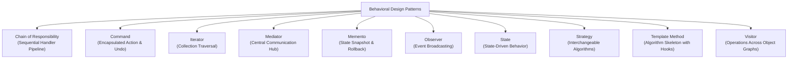

# Behavioral Design Patterns 🚦

> *"Behavioral design patterns are concerned with algorithms and the assignment of responsibilities between objects."*  
> — Alexander Shvets, *Dive Into Design Patterns*

Behavioral patterns do not just describe the static structural topology of classes and objects—they describe the **dynamic patterns of communication between them**. By organizing communication pipelines, behavioral patterns decouple senders from receivers, encapsulate operations into objects, and make algorithms swappable at runtime.

---

## 🧭 Behavioral Decision Rubric

| Pattern | Complexity | When to Choose |
| :--- | :--- | :--- |
| **[Chain of Responsibility](chain-of-responsibility.md)** | ★★☆ | When more than one object can handle a request, and you want to pass the request along a sequential pipeline of candidate handlers. |
| **[Command](command.md)** | ★★☆ | When you want to parameterize objects with operations, queue requests, schedule executions, or support multi-level undo/redo. |
| **[Iterator](iterator.md)** | ★☆☆ | When you need to traverse elements of a complex collection (trees, graphs, lists) sequentially without exposing its internal representation. |
| **[Mediator](mediator.md)** | ★★☆ | When multiple classes communicate chaotically with each other, creating tight coupling and making reuse difficult. |
| **[Memento](memento.md)** | ★★☆ | When you need to save and restore the previous state of an object without compromising encapsulation or exposing private fields. |
| **[Observer](observer.md)** | ★★☆ | When changes to the state of one object require changing other objects, and you don't know ahead of time how many objects need to change. |
| **[State](state.md)** | ★★☆ | When an object must alter its behavior when its internal state changes, appearing to change its class (eliminating large `switch` statements). |
| **[Strategy](strategy.md)** | ★☆☆ | When you have a family of related algorithms and want to interchange them dynamically inside an existing object at runtime. |
| **[Template Method](template-method.md)** | ★☆☆ | When you want to let clients extend particular steps of an algorithm, but not the overall invariant algorithm skeleton. |
| **[Visitor](visitor.md)** | ★★★ | When you need to perform an operation on all elements of a complex object hierarchy without modifying their classes. |

---

## 📦 The 10 Behavioral Patterns

1. ⛓️ **[Chain of Responsibility](chain-of-responsibility.md)** — Passes a request along a dynamic chain of potential handlers.
2. 📜 **[Command](command.md)** — Encapsulates a request as a standalone object with execution and undo capabilities.
3. 🔄 **[Iterator](iterator.md)** — Traverses elements of an aggregate collection sequentially without exposing internal structures.
4. 🚦 **[Mediator](mediator.md)** — Defines an object that encapsulates how a set of peer objects interact, eliminating chaotic coupling.
5. 💾 **[Memento](memento.md)** — Captures and externalizes an object's internal state so it can be restored later without breaking encapsulation.
6. 📡 **[Observer](observer.md)** — Defines a one-to-many subscription dependency between objects for event broadcasting.
7. 🚦 **[State](state.md)** — Allows an object to alter its behavior when its internal state changes, modeling clean state machines.
8. 🎯 **[Strategy](strategy.md)** — Defines a family of algorithms, encapsulates each one, and makes them interchangeable at runtime.
9. 📋 **[Template Method](template-method.md)** — Defines the skeleton of an algorithm in a superclass, deferring specific steps to subclasses.
10. 🚶 **[Visitor](visitor.md)** — Represents an operation to be performed on elements of an object graph without modifying the classes.
