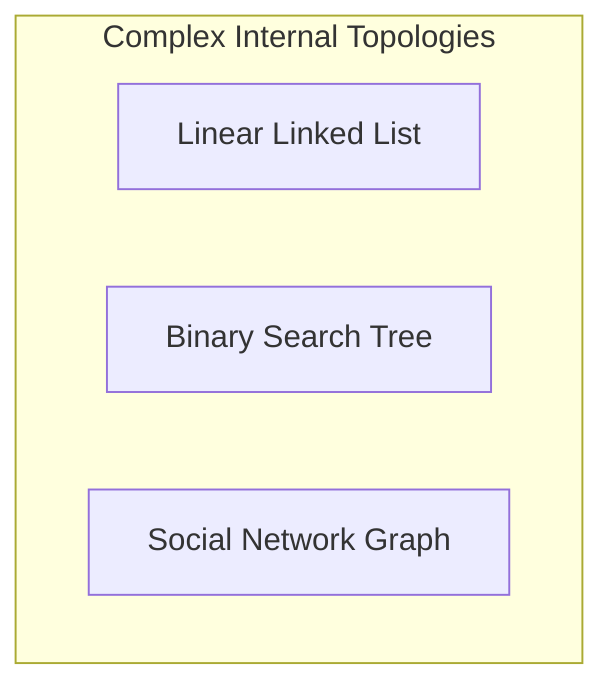
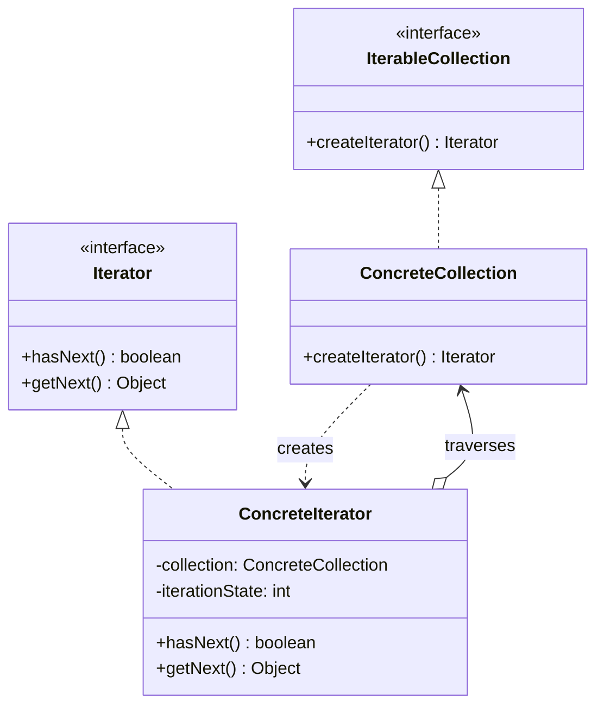
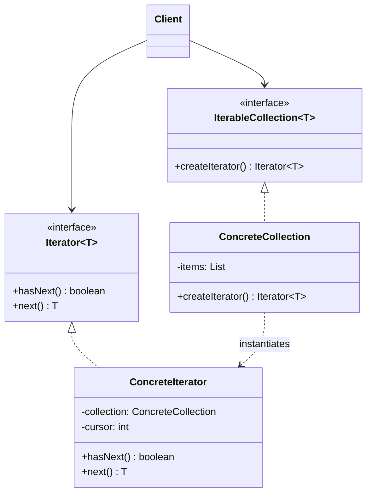
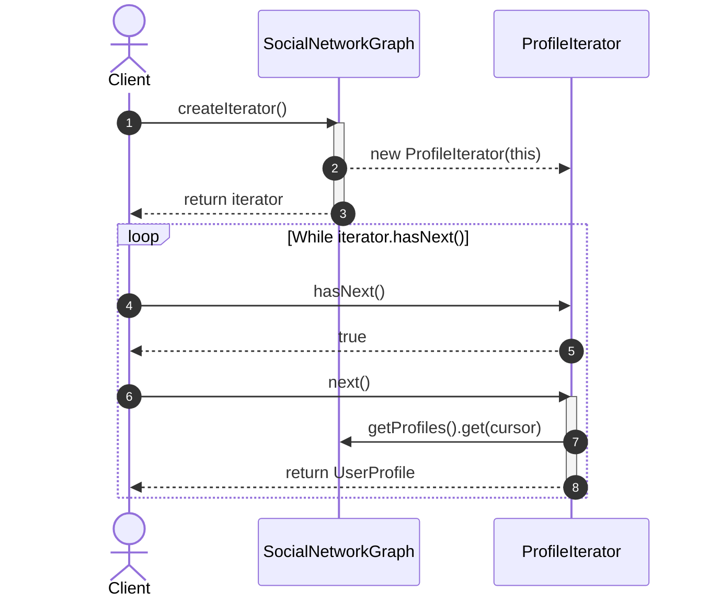

# Iterator

> **Classification:** Behavioral Pattern  
> **Complexity:** ★☆☆

---

## 1. Intent

**Iterator** is a behavioral design pattern that lets you traverse elements of a collection without exposing its underlying representation (list, stack, tree, hash table, or graph).

---

## 2. Problem

Collections are fundamental data structures in software. However, collections come in diverse internal representations:
* Some store elements in sequential linear arrays or linked lists.
* Others store elements in binary search trees, hash buckets, or interconnected directed graphs (like social network friendships).



### The Problem
* How do you traverse elements of a complex graph or tree without forcing client code to understand deep tree-traversal algorithms (DFS, BFS)?
* If you embed traversal algorithms directly inside the collection class, you pollute the collection with navigation logic, violating the **Single Responsibility Principle**.
* Different clients might require different traversal orders (e.g., depth-first vs breadth-first vs alphabetical).

---

## 3. Motivation

Consider a social networking platform (like LinkedIn or Facebook):
* Each user profile is connected to a network of friends and colleagues (forming a massive social graph).
* You want to send recruitment emails to:
  1. A user's direct connections (**Breadth-First** traversal).
  2. A user's colleagues working at the same company (**Filtered Profile** traversal).

The client code sending emails shouldn't need to navigate raw graph adjacency lists. It simply wants a clean iterator that returns the next relevant profile on demand.

---

## 4. Solution

The Iterator pattern extracts the traversal behavior of a collection into a separate object called an **Iterator**:

1. An Iterator object encapsulates all navigation state: the current index/pointer, how many elements remain, and the specific traversal algorithm (DFS, BFS, linear).
2. The collection implements an **Iterable** interface that declares a factory method (e.g., `createIterator()`) returning an iterator.
3. Multiple iterators can traverse the same collection simultaneously without interfering with one another because each iterator maintains its own position state.



---

## 5. Structure



---

## 6. Participants

1. **Iterator Interface:** Declares operations required for traversing a collection (`hasNext()`, `next()`, `reset()`).
2. **Concrete Iterator:** Implements a specific traversal algorithm. It tracks the current progress of iteration.
3. **Iterable Collection Interface:** Declares one or several methods for getting iterators compatible with the collection.
4. **Concrete Collection:** Returns a new instance of a particular concrete iterator class each time the client requests one.
5. **Client:** Works with both collections and iterators via interfaces.

---

## 7. Code Implementation (Python 3)

```python
from collections.abc import Iterable, Iterator
from typing import Optional


# ==========================================
# 1. Custom Iterator & Aggregate Collection
# ==========================================
class Profile:
    def __init__(self, user_id: str, email: str) -> None:
        self.user_id = user_id
        self.email = email


class SocialSpurIterator(Iterator):
    """Concrete Iterator navigating through profiles."""
    def __init__(self, profiles: list[Profile]) -> None:
        self._profiles = profiles
        self._index = 0

    def __next__(self) -> Profile:
        if self._index < len(self._profiles):
            profile = self._profiles[self._index]
            self._index += 1
            return profile
        raise StopIteration


class SocialNetwork(Iterable):
    """Concrete Aggregate supporting iteration."""
    def __init__(self) -> None:
        self._profiles: list[Profile] = []

    def add_profile(self, profile: Profile) -> None:
        self._profiles.append(profile)

    def __iter__(self) -> Iterator[Profile]:
        return SocialSpurIterator(self._profiles)


# ==========================================
# 2. Client Execution Demo
# ==========================================
if __name__ == "__main__":
    network = SocialNetwork()
    network.add_profile(Profile("user_101", "alice@example.com"))
    network.add_profile(Profile("user_102", "bob@example.com"))
    network.add_profile(Profile("user_103", "charlie@example.com"))

    print("--- Iterating via Python 'for' loop (calls __iter__ and __next__) ---")
    for profile in network:
        print(f"Profile -> ID: {profile.user_id}, Email: {profile.email}")
```

---

## 8. Execution Flow



---

## 9. When to Use (Applicability)

* **Hiding Complex Internal Data Structures:** When your collection has a complex data structure under the hood, but you want to hide its complexity from clients (for convenience or security).
* **Multiple Concurrent Traversals:** When you need to iterate over the same collection from multiple threads or multiple loops simultaneously without corrupting position indices.
* **Uniform Traversal API:** When your application works with different types of collections and you want a uniform way to traverse them all.

---

## 10. When NOT to Use (Anti-Scenarios)

* **Simple Contiguous Arrays:** If you are only iterating over a simple list or array in standard business logic, using standard built-in loops (`for-each`) or language primitives is cleaner than defining custom iterator classes.
* **Random-Access Dominated Operations:** If your algorithms primarily require instant random indexing (`list.get(500)`), an iterator provides no benefit over direct index lookup.

---

## 11. Advantages

* **Single Responsibility Principle (SRP):** Cleanly separates traversal algorithms from the storage responsibility of the collection.
* **Open/Closed Principle (OCP):** You can implement new types of iterators and collections without breaking existing code.
* **Parallel Independent Iterations:** Multiple iterators can navigate the same data structure at different speeds simultaneously.

---

## 12. Disadvantages

* **Overkill for Simple Collections:** Adding the pattern to straightforward collections adds needless architectural indirection.

---

## 13. Common Mistakes & Misconceptions

### Mistake 1: Concurrent Modification Exceptions
If a collection is mutated (items added or deleted) while an active iterator is traversing it, the iterator can become desynchronized or throw a `ConcurrentModificationException` unless designed as a fail-safe or snapshot iterator.

---

## 14. Related Patterns

* **[Composite](../structural/composite.md):** Iterators are frequently used to traverse complex, nested Composite trees.
* **[Factory Method](../creational/factory-method.md):** The collection’s `createIterator()` method is a canonical example of a Factory Method.
* **[Memento](memento.md):** Can be used together with Iterator to capture and restore the current state of iteration.

---

## 15. Real-World Applications

### Python Standard Library
* **Python Iterator Protocol (`__iter__()` & `__next__()`):** The built-in language protocol powering `for` loops, comprehensions, and generator expressions.
* `itertools` module: Provides composable iterator algebra.

---

## 16. Interview Questions & Self-Assessment

### Q1: What is the primary purpose of the Iterator pattern?
> **Answer:** To access and traverse the elements of an aggregate collection sequentially without exposing its underlying internal structure (trees, graphs, lists).

### Q2: What is the difference between `Iterable` and `Iterator` in Python?
> **Answer:** `Iterable` is an interface implemented by a collection declaring that it can be traversed (`iterator()` method). `Iterator` is the cursor object that actually performs the step-by-step traversal (`hasNext()`, `next()`).

### Q3: How does Iterator support multiple concurrent iterations on the same collection?
> **Answer:** Because the cursor position and state are stored inside the **Iterator object**, not inside the collection itself. Each iterator maintains its own independent pointer.

### Q4: How does Python handle mutation during iteration (`RuntimeError: dictionary changed size during iteration`)?
> **Answer:** An iterator that immediately aborts and throws `ConcurrentModificationException` if the underlying collection is structurally modified by another thread or outside the iterator's own methods during iteration.

---

## 17. Key Takeaways

1. **Decoupled Navigation:** Extracts traversal logic out of the collection.
2. **Encapsulates Complexity:** Hides graphs and trees behind `hasNext()` and `next()`.
3. **Powers Modern Loops:** The engine driving Python's `for` loops and comprehensions and stream pipelines.
