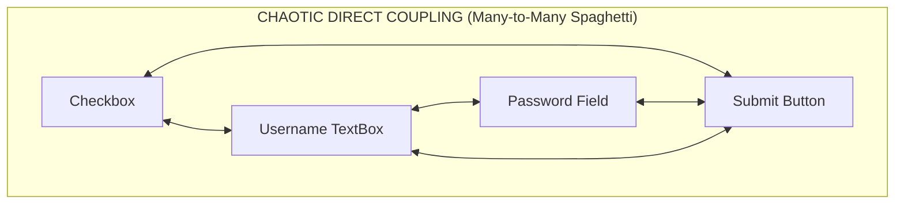
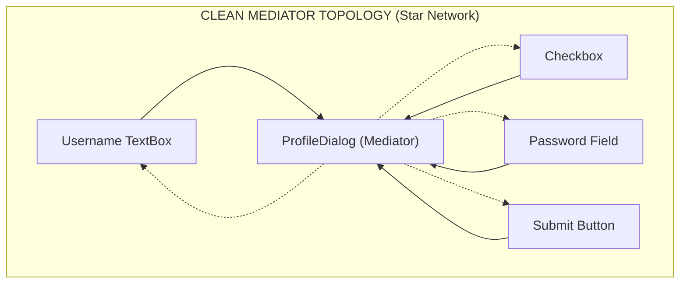
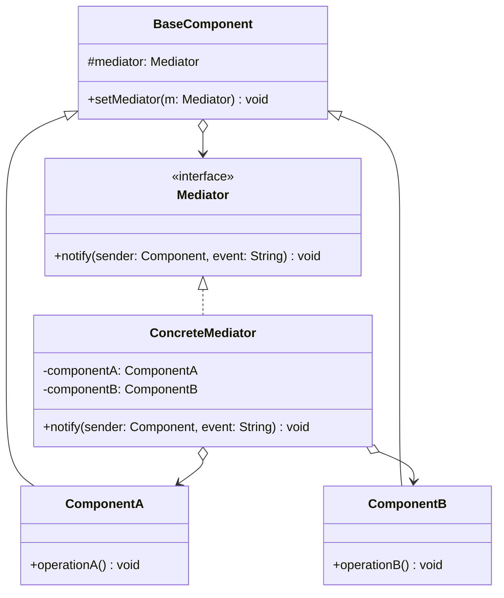
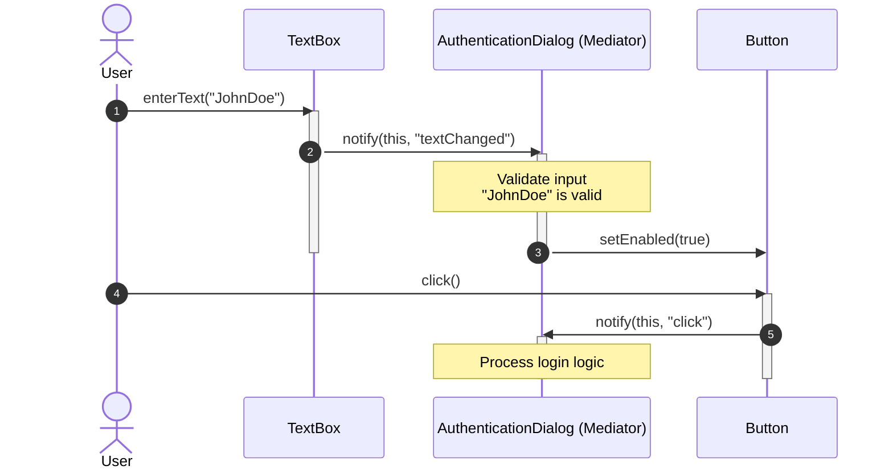

# Mediator

> **Classification:** Behavioral Pattern  
> **Complexity:** ★★☆

---

## 1. Intent

**Mediator** is a behavioral design pattern that lets you reduce chaotic dependencies between objects. The pattern restricts direct communications between the objects and forces them to collaborate only via a mediator object.

---

## 2. Problem

Imagine you have a dialog for creating and editing customer profiles:
* It consists of various GUI controls: text boxes, checkboxes, dropdowns, and buttons.
* Some elements must interact with others based on dynamic events:
  * Ticking the **"Register as Guest"** checkbox disables the password input fields.
  * The **"Submit"** button must remain disabled until the username text field contains valid input.
  * Selecting a country from a dropdown filters the options in the state/province dropdown.



### The Architectural Dilemma
If UI elements talk directly to one another, they form a tightly coupled web. You cannot reuse a simple `Button` or `TextBox` in another form because it has hardcoded references to specific checkboxes and dropdowns!

---

## 3. Motivation

Consider an airport runway and arriving flights:
* Aircraft pilots do not talk directly to each other to decide who lands first.
* If pilots communicated directly with each other over the radio, the sky would devolve into chaos.
* Instead, all aircraft communicate strictly with the **Air Traffic Control (ATC) Tower**. The tower coordinates runways, separation intervals, and landing slots.

The ATC tower is a classic real-world **Mediator**.

---

## 4. Solution

The Mediator pattern suggests that you cease all direct communication between the components. Instead, components must collaborate indirectly by notifying a special **Mediator** object:

1. Components know only about their mediator; they do not know about their sibling components.
2. When an event occurs (e.g., a button click), the component notifies the mediator: `mediator.notify(this, "click")`.
3. The mediator inspects the event and handles the coordination (e.g., enabling text fields, refreshing lists, or submitting the form).



---

## 5. Structure



---

## 6. Participants

1. **Components (Colleagues):** Various classes that contain business logic. Each component has a reference to a mediator, through which it reports events.
2. **Mediator Interface:** Declares methods of communication with components (often a single `notify()` method).
3. **Concrete Mediator:** Encapsulates relations between various components. It frequently keeps references to all components it manages.
4. **Client:** Typically instantiates the mediator and registers components with it.

---

## 7. Code Implementation (Python 3)

```python
from abc import ABC, abstractmethod


# ==========================================
# 1. Mediator Interface
# ==========================================
class Mediator(ABC):
    @abstractmethod
    def notify(self, sender: "Component", event: str) -> None:
        pass


# ==========================================
# 2. Base Component
# ==========================================
class Component:
    def __init__(self, mediator: Mediator = None) -> None:
        self._mediator = mediator

    def set_mediator(self, mediator: Mediator) -> None:
        self._mediator = mediator


# ==========================================
# 3. Concrete Components
# ==========================================
class Button(Component):
    def click(self) -> None:
        print("[Button] Clicked.")
        if self._mediator:
            self._mediator.notify(self, "click")


class TextBox(Component):
    def __init__(self, mediator: Mediator = None) -> None:
        super().__init__(mediator)
        self.text = ""

    def set_text(self, text: str) -> None:
        self.text = text
        print(f"[TextBox] Content changed to: '{self.text}'")
        if self._mediator:
            self._mediator.notify(self, "text_changed")


class Checkbox(Component):
    def __init__(self, mediator: Mediator = None) -> None:
        super().__init__(mediator)
        self.checked = False

    def toggle(self) -> None:
        self.checked = not self.checked
        print(f"[Checkbox] Toggled. Checked = {self.checked}")
        if self._mediator:
            self._mediator.notify(self, "check")


# ==========================================
# 4. Concrete Mediator (Dialog)
# ==========================================
class AuthenticationDialog(Mediator):
    def __init__(self) -> None:
        self.title = "Login Screen"
        self.login_checkbox = Checkbox(self)
        self.username_input = TextBox(self)
        self.ok_button = Button(self)

    def notify(self, sender: Component, event: str) -> None:
        if sender is self.login_checkbox and event == "check":
            if self.login_checkbox.checked:
                print(" -> Mediator: User selected 'Remember Me'. Auto-filling username...")
                self.username_input.set_text("remembered_user@example.com")
        elif sender is self.ok_button and event == "click":
            print(f" -> Mediator: Validating form and submitting login for '{self.username_input.text}'...")


# ==========================================
# 5. Client Execution Demo
# ==========================================
if __name__ == "__main__":
    dialog = AuthenticationDialog()
    dialog.login_checkbox.toggle()
    dialog.ok_button.click()
```

---

## 8. Execution Flow



---

## 9. When to Use (Applicability)

* **Eliminating Spaghetti Dependencies:** When it's hard to change some of the classes because they are tightly coupled to a dozen of other classes.
* **Component Reusability:** When you can't reuse a component in a different program because it's too dependent on other components.
* **Complex UI Dialog Coordination:** When designing complex dialog boxes, wizard steps, or multi-tab form controls.

---

## 10. When NOT to Use (Anti-Scenarios)

* **The God Object Trap:** A mediator can easily evolve into a monolithic **God Object** that knows and controls everything in the application. If a mediator grows too large, decompose it into smaller regional mediators or combine it with [Observer](observer.md).
* **Few Components:** If you only have two or three components that communicate infrequently, a mediator adds unnecessary indirection.

---

## 11. Advantages

* **Single Responsibility Principle (SRP):** You can extract the communication logic among various components into a single place.
* **Open/Closed Principle (OCP):** You can introduce new mediators without having to change the actual components.
* **Decouples Colleagues:** Components become independent and easily reusable.

---

## 12. Disadvantages

* **Risk of a God Object:** Over time a mediator can evolve into an oversized, complex monolith that is difficult to maintain.

---

## 13. Common Mistakes & Misconceptions

### Mistake 1: Confusing Mediator with Facade
* **Facade:** Provides a simplified, **unidirectional** interface to a complex subsystem. Subsystem classes don't know about the facade.
* **Mediator:** Centralizes **bidirectional communication** between peer components. Components know about the mediator and send notifications to it.

### Mistake 2: Confusing Mediator with Observer
* In **Observer**, subjects broadcast events dynamically to any number of anonymous subscribers (one-to-many).
* In **Mediator**, communication is centralized inside a single coordinating controller that orchestrates peer interactions (many-to-many reduced to star topology).

---

## 14. Related Patterns

* **[Facade](../structural/facade.md):** Facade defines a simple interface for subsystem clients; Mediator coordinates peer components.
* **[Observer](observer.md):** You can implement the communication between components and the mediator using the Observer pattern.

---

## 15. Real-World Applications

### Industry Architectures
* **Air Traffic Control Systems:** Centralized dispatch coordinating flights.
* **Chatroom Servers:** Chat clients do not connect directly to peer clients; all messages route through a central room mediator.
* **Event Brokers & Chat Hubs:** Central brokers coordinating WebSocket sessions without direct peer-to-peer coupling.

---

## 16. Interview Questions & Self-Assessment

### Q1: What problem does the Mediator pattern solve?
> **Answer:** It prevents many-to-many coupling between collaborating objects (spaghetti communication) by routing all interactions through a centralized coordinator, reducing dependencies to a clean star topology.

### Q2: What is the primary difference between Mediator and Facade?
> **Answer:** Facade provides a simplified, one-way entry point to an entire subsystem from the outside. Mediator coordinates two-way interactions among peer components from the inside.

### Q3: How do Mediator and Observer complement each other?
> **Answer:** The components can use Observer to publish events to the mediator (the mediator acts as an observer/subscriber), while the mediator acts as the central brain orchestrating downstream actions.

### Q4: What is the main architectural risk of using a Mediator?
> **Answer:** The mediator can easily become a "God Object"—an unmaintainably bloated class with too much knowledge and control over all other system entities.

---

## 17. Key Takeaways

1. **Star Network Topology:** Replaces chaotic mesh communication with a centralized hub.
2. **Component Reusability:** Colleagues know only their mediator, making them pluggable into different forms.
3. **Watch the Mediator's Size:** Guard against turning the mediator into a monolithic God Object.
