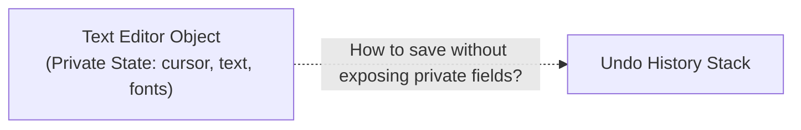
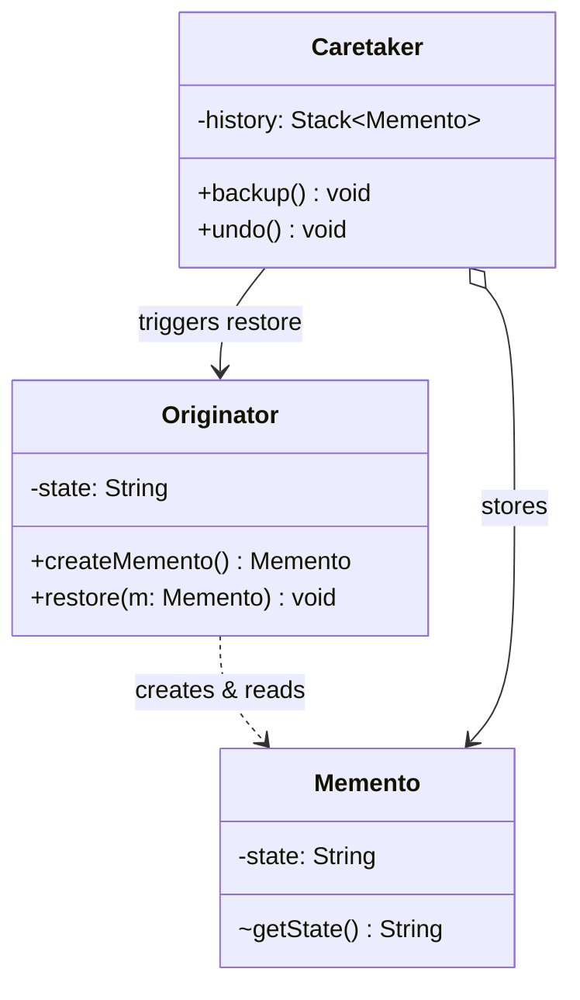
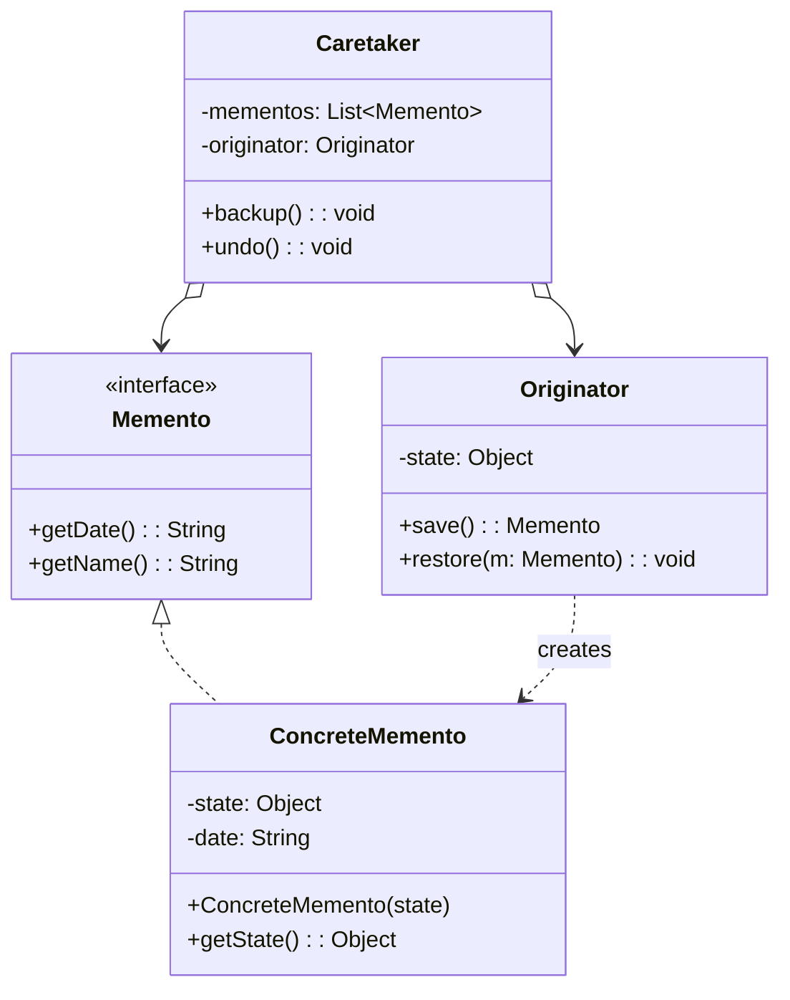
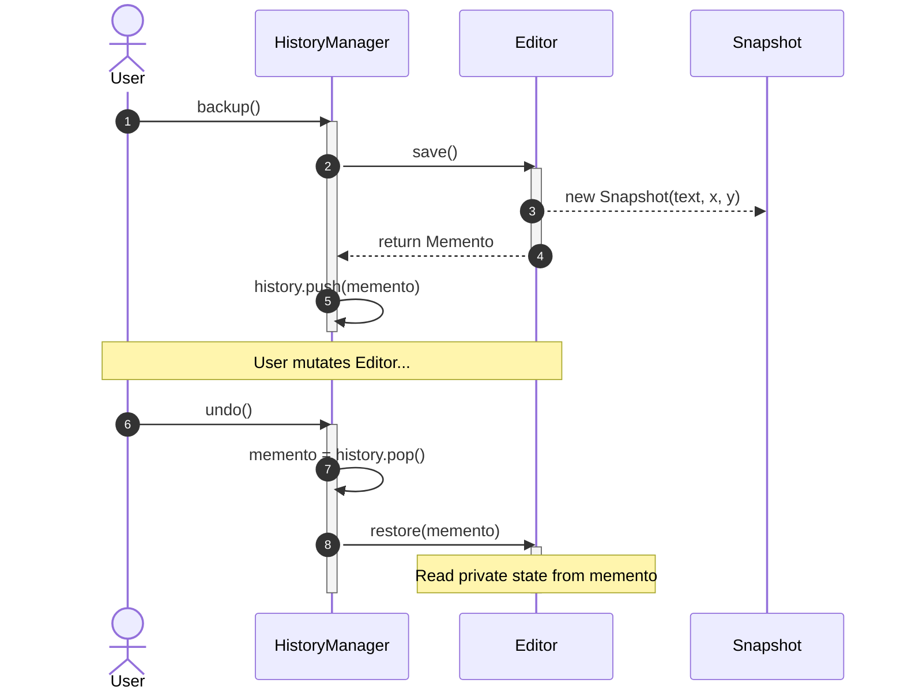

# Memento

> **Also known as:** Snapshot  
> **Classification:** Behavioral Pattern  
> **Complexity:** ★★☆

---

## 1. Intent

**Memento** is a behavioral design pattern that lets you save and restore the previous state of an object without revealing the details of its implementation.

---

## 2. Problem

Imagine you are building a text editor or graphic design tool. You want to implement an **Undo / Redo** feature:

* Before executing any mutation (e.g., typing text, resizing an image, formatting paragraphs), the application must take a snapshot of the object's current state.
* Later, when the user clicks **Undo**, the application must restore the previous state from the snapshot.



### The Encapsulation Dilemma
* How can an external history manager copy an object's state if the state resides in `private` fields?
* Making fields `public` breaks **encapsulation**, making the editor vulnerable to outside tampering and tightly coupling the history manager to internal data structures.

---

## 3. Motivation

Consider a video game checkpoint system:
* A player character has health, inventory items, active power-ups, and 3D coordinates.
* When reaching a checkpoint, the game saves a snapshot. If the player dies, the game rolls back to that exact checkpoint state.
* The save-game manager (Caretaker) needs to store and serialize the snapshot, but should not have access to alter or inspect the player's internal health mechanics.

---

## 4. Solution

The Memento pattern delegates the creation of state snapshots to the actual owner of that state: the **Originator** object:

1. The Originator creates a **Memento** object containing a snapshot of its own private state.
2. The Memento is an opaque object: it has a **wide interface** accessible only to the Originator (to read and write state), and a **narrow interface** accessible to the rest of the world (showing only metadata like creation date).
3. A **Caretaker** (e.g., Command History) stores a stack of mementos. The Caretaker never mutates or inspects the memento's internal payload.
4. When undo is requested, the Caretaker hands the memento back to the Originator: `originator.restore(memento)`.



---

## 5. Structure



---

## 6. Participants

1. **Originator:** The class that can produce snapshots of its own internal state, as well as restore its state from a memento.
2. **Memento:** A value object that acts as a snapshot of the originator's state. It is immutable and passes data only through its constructor.
3. **Caretaker:** Knows *when* and *why* to capture the originator’s state, and *when* the state should be restored. It tracks a stack of mementos, but never modifies their content.
4. **Client:** Typically interacts with the caretaker to trigger actions and rollbacks.

---

## 7. Code Implementation (Python 3)

```python
from datetime import datetime


# ==========================================
# 1. Memento (Stores Snapshot of State)
# ==========================================
class Snapshot:
    """Immutable snapshot of originator state."""
    def __init__(self, text: str, cursor_x: int, cursor_y: int) -> None:
        self._text = text
        self._cursor_x = cursor_x
        self._cursor_y = cursor_y
        self._timestamp = datetime.now()

    @property
    def text(self) -> str:
        return self._text

    @property
    def cursor_x(self) -> int:
        return self._cursor_x

    @property
    def cursor_y(self) -> int:
        return self._cursor_y

    def get_info(self) -> str:
        return f"[{self._timestamp.strftime('%H:%M:%S')}] text='{self._text}', cursor=({self._cursor_x},{self._cursor_y})"


# ==========================================
# 2. Originator (Creates & Restores Mementos)
# ==========================================
class TextEditor:
    def __init__(self) -> None:
        self.text = ""
        self.cursor_x = 0
        self.cursor_y = 0

    def type_text(self, words: str) -> None:
        self.text += words
        self.cursor_x += len(words)

    def save(self) -> Snapshot:
        print(f"[Editor] Saving snapshot: '{self.text}'")
        return Snapshot(self.text, self.cursor_x, self.cursor_y)

    def restore(self, snapshot: Snapshot) -> None:
        self.text = snapshot.text
        self.cursor_x = snapshot.cursor_x
        self.cursor_y = snapshot.cursor_y
        print(f"[Editor] Restored snapshot: '{self.text}' at ({self.cursor_x},{self.cursor_y})")


# ==========================================
# 3. Caretaker (Manages History Stack)
# ==========================================
class EditorHistory:
    def __init__(self, editor: TextEditor) -> None:
        self._editor = editor
        self._history: list[Snapshot] = []

    def backup(self) -> None:
        self._history.append(self._editor.save())

    def undo(self) -> None:
        if not self._history:
            print("[History] Nothing to undo.")
            return
        snapshot = self._history.pop()
        self._editor.restore(snapshot)


# ==========================================
# 4. Client Demo
# ==========================================
if __name__ == "__main__":
    editor = TextEditor()
    history = EditorHistory(editor)

    editor.type_text("Hello ")
    history.backup()

    editor.type_text("World!")
    history.backup()

    editor.type_text(" Extra Draft Text.")
    print(f"Current editor text: '{editor.text}'")

    print("\n--- Undoing Last Edit ---")
    history.undo()

    print("\n--- Undoing Previous Edit ---")
    history.undo()
```

---

## 8. Execution Flow



---

## 9. When to Use (Applicability)

* **Undo/Redo & Rollback:** When you need to produce snapshots of the operating state of an object to be able to restore a previous state.
* **Encapsulation Protection:** When direct access to the object's fields, getters, or setters would violate its encapsulation.
* **Database Transactions:** When building localized transaction rollback mechanisms in memory.

---

## 10. When NOT to Use (Anti-Scenarios)

* **Massive Heap Objects:** If the originator consumes huge amounts of memory and mutations occur every second, storing full snapshots will rapidly exhaust RAM. (Consider saving **delta differences** rather than full state clones).
* **Immutable State Systems:** In functional programming architectures (e.g., Redux, Event Sourcing) where state is already an immutable stream of events, Memento is redundant.

---

## 11. Advantages

* **Preserves Encapsulation:** Captures snapshots without breaking the originator's private field boundaries.
* **Simplifies Originator:** The originator doesn't need to track its own history stack; the Caretaker manages the lifecycle of snapshots.

---

## 12. Disadvantages

* **High Memory Consumption:** If clients create mementos too often, RAM usage grows significantly.
* **Hidden Caretaker Overhead:** The caretaker cannot know how much memory a memento consumes because it cannot inspect its contents.

---

## 13. Common Mistakes & Misconceptions

### Mistake 1: Exposing Memento State Publicly
If the Memento class exposes mutable references or attributes, anyone can mutate the snapshot. Mementos must be **strictly immutable**. In Python, using `@dataclass(frozen=True)` or private attributes with property getters is the gold standard.

---

## 14. Related Patterns

* **[Command](command.md):** Commands and Mementos are frequently combined: a Command executes an action and holds a Memento to execute an undo.
* **[Prototype](../creational/prototype.md):** Prototype is sometimes an alternative to Memento if an object's state can be simply duplicated via `clone()`.
* **[Iterator](iterator.md):** Mementos can capture the current iteration position of an Iterator.

---

## 15. Real-World Applications

### Python Standard Library & Frameworks
* `pickle` module: Serializes Python object state hierarchies into byte stream snapshots that can be stored and restored later.
* Database Savepoints: Transactional checkpoints allowing targeted rollback.
* **Database Savepoints:** Transaction managers create savepoints allowing partial rollbacks without rolling back the entire transaction.

---

## 16. Interview Questions & Self-Assessment

### Q1: What is the primary problem solved by the Memento pattern?
> **Answer:** It allows capturing and restoring an object's internal private state without violating encapsulation or exposing implementation details to outside classes.

### Q2: What is the difference between an Originator and a Caretaker?
> **Answer:** The **Originator** is the object whose state is being saved/restored (it creates and unpacks mementos). The **Caretaker** is the history manager that stores mementos on a stack, but never inspects or mutates their contents.

### Q3: How do you prevent external callers from mutating a Memento in Python?
> **Answer:** By declaring the concrete Memento as a `private static` inner class of the Originator. The Originator has complete access to its inner class's fields, while outside classes only see an empty marker interface.

### Q4: How does Memento pair with the Command pattern?
> **Answer:** Before a Command modifies the receiver, it asks the receiver for a Memento. If the command's `undo()` method is called later, it passes that Memento back to the receiver to restore previous state.

---

## 17. Key Takeaways

1. **Encapsulated Snapshots:** Safely freezes internal private state.
2. **Caretaker Holds, Never Touches:** The caretaker stores snapshots blindly without reading their data.
3. **Memory Awareness:** Be mindful of RAM consumption when storing long undo stacks.
