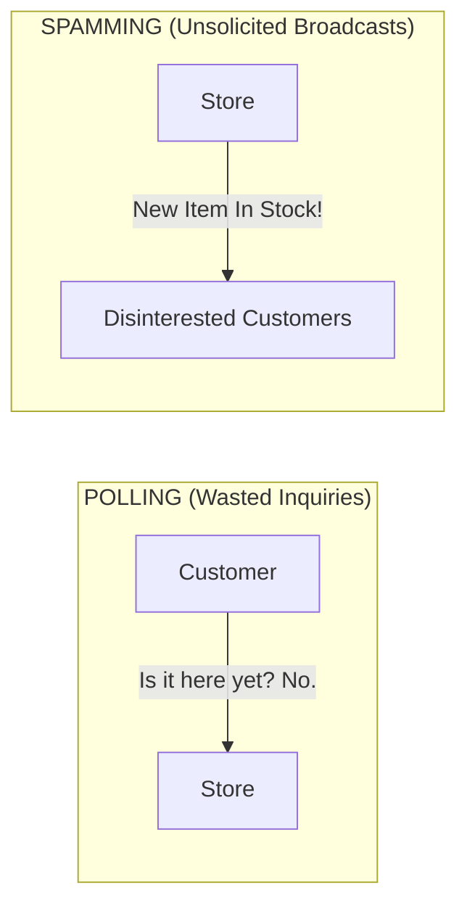
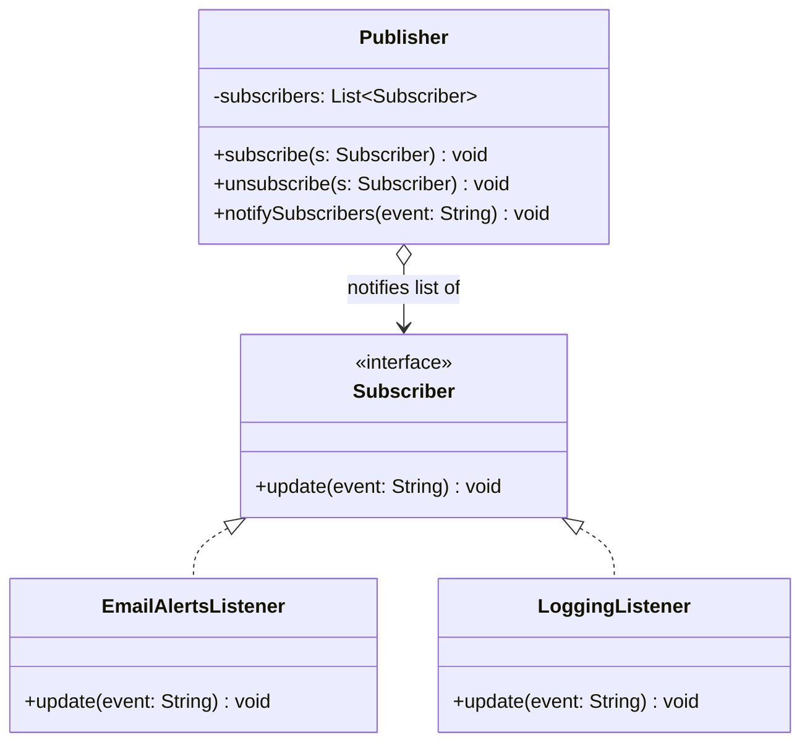
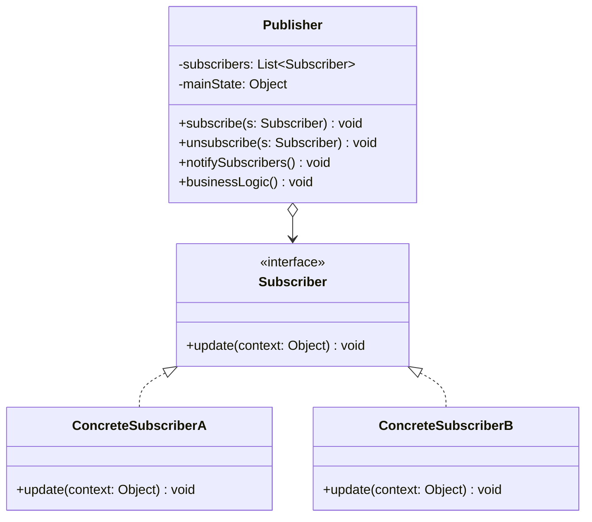
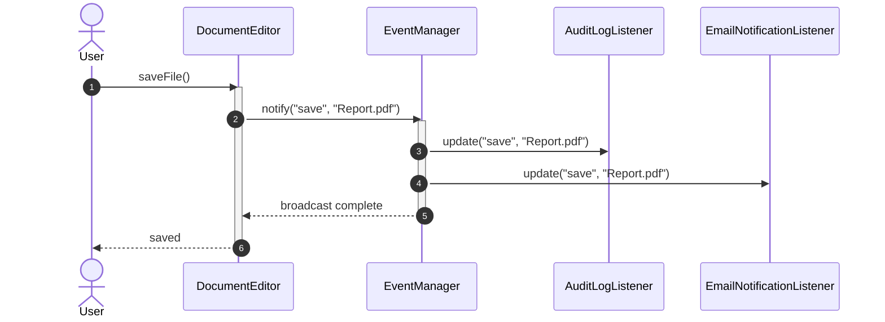

# Observer

> **Also known as:** Event-Subscriber, Listener, Publish-Subscribe  
> **Classification:** Behavioral Pattern  
> **Complexity:** ★★☆

---

## 1. Intent

**Observer** is a behavioral design pattern that lets you define a subscription mechanism to notify multiple objects about any events that happen to the object they're observing.

---

## 2. Problem

Imagine you have two types of objects: a `Customer` and a `Store`. The customer is very interested in a specific product (e.g., a new smartphone model) that will arrive in the store soon.

How can the customer find out when the item is in stock?

1. **Polling (Customer Checks Repeatedly):** The customer visits the store every day to check availability. Most trips are wasted, consuming time and server compute.
2. **Broadcasting (Store Spams Everyone):** The store sends marketing emails to all registered customers every time any new stock arrives. Customers are annoyed by irrelevant spam.



### The Conflict
Either customers waste time checking repeatedly, or the store wastes resources notifying customers who do not care.

---

## 3. Motivation

Consider an interactive spreadsheet application (like Microsoft Excel or Google Sheets):
* Cell `C1` contains the formula `=SUM(A1:B1)`.
* A 3D pie chart and a line graph both depend on the values in column `C`.
* When a user changes the number in `A1`, the spreadsheet engine must automatically update cell `C1`, re-render the pie chart, and refresh the line graph.

The cells shouldn't be hardcoded to specific charts. Instead, charts subscribe to cell change events.

---

## 4. Solution

The object that has an interesting state is called the **Subject** (or **Publisher**). All other objects that want to track changes to the publisher's state are called **Subscribers** (or **Observers**).

1. The Publisher maintains a list of subscribers and exposes methods to add or remove subscribers (`subscribe()`, `unsubscribe()`).
2. All subscribers implement a common **Observer** interface with an `update()` method.
3. When an important event occurs, the publisher iterates through its subscriber list and calls `update(eventData)` on each subscriber.



---

## 5. Structure



---

## 6. Participants

1. **Publisher (Subject):** Issues events of interest to other objects. Contains an internal list of subscribers and management methods (`subscribe`, `unsubscribe`).
2. **Subscriber (Observer Interface):** Declares the notification interface, consisting of a single or small set of `update()` methods.
3. **Concrete Subscribers:** Perform some action in response to a notification generated by the publisher.
4. **Client:** Connects concrete subscribers to publishers.

---

## 7. Code Implementation (Python 3)

```python
from abc import ABC, abstractmethod


# ==========================================
# 1. Subscriber / Listener Interface
# ==========================================
class EventListener(ABC):
    @abstractmethod
    def update(self, event_type: str, file_name: str) -> None:
        pass


# ==========================================
# 2. Publisher / EventManager
# ==========================================
class EventManager:
    def __init__(self, operations: list[str]) -> None:
        self._listeners: dict[str, list[EventListener]] = {op: [] for op in operations}

    def subscribe(self, event_type: str, listener: EventListener) -> None:
        if event_type in self._listeners:
            self._listeners[event_type].append(listener)

    def unsubscribe(self, event_type: str, listener: EventListener) -> None:
        if event_type in self._listeners and listener in self._listeners[event_type]:
            self._listeners[event_type].remove(listener)

    def notify(self, event_type: str, file_name: str) -> None:
        if event_type in self._listeners:
            for listener in self._listeners[event_type]:
                listener.update(event_type, file_name)


# ==========================================
# 3. Concrete Listeners
# ==========================================
class EmailNotificationListener(EventListener):
    def __init__(self, email: str) -> None:
        self.email = email

    def update(self, event_type: str, file_name: str) -> None:
        print(f"[Email to {self.email}] Event '{event_type}' occurred on file '{file_name}'.")


class LogOpenListener(EventListener):
    def __init__(self, log_path: str) -> None:
        self.log_path = log_path

    def update(self, event_type: str, file_name: str) -> None:
        print(f"[Log -> {self.log_path}] Audit record: '{event_type}' on '{file_name}'.")


# ==========================================
# 4. Context Business Object (Editor)
# ==========================================
class Editor:
    def __init__(self) -> None:
        self.events = EventManager(["open", "save"])

    def open_file(self, path: str) -> None:
        print(f"[Editor] Opening file: {path}")
        self.events.notify("open", path)

    def save_file(self, path: str) -> None:
        print(f"[Editor] Saving file: {path}")
        self.events.notify("save", path)


# ==========================================
# 5. Client Demo
# ==========================================
if __name__ == "__main__":
    editor = Editor()

    email_sub = EmailNotificationListener("admin@example.com")
    logger_sub = LogOpenListener("/var/log/audit.log")

    editor.events.subscribe("open", logger_sub)
    editor.events.subscribe("save", email_sub)
    editor.events.subscribe("save", logger_sub)

    print("--- User Action: Open File ---")
    editor.open_file("database_schema.sql")

    print("\n--- User Action: Save File ---")
    editor.save_file("database_schema.sql")
```

---

## 8. Execution Flow



---

## 9. When to Use (Applicability)

* **Dynamic State Syncing:** When changes to the state of one object require changing other objects, and the set of objects is unknown beforehand or changes dynamically.
* **Loose Coupling Requirement:** When an object must observe others only for a limited time or in specific cases.
* **Decoupled Architecture:** When building event-driven systems, GUI listeners, or webhook dispatchers.

---

## 10. When NOT to Use (Anti-Scenarios)

* **Lapsed Listener Memory Leaks:** If subscribers do not explicitly unsubscribe when destroyed, the publisher holds strong references to them, preventing the Garbage Collector from freeing their memory. (Use `WeakReference` or explicit lifecycle cleanup).
* **Cascading Circular Updates:** If Subscriber A updates Publisher B, which in turn notifies Subscriber A, you can easily cause infinite notification loops and stack overflows.

---

## 11. Advantages

* **Open/Closed Principle (OCP):** You can introduce new subscriber classes without having to change the publisher’s code (and vice versa).
* **Runtime Subscriptions:** You can establish relations between objects at runtime.
* **Broadcast Communication:** One notification easily updates dozens of disparate modules simultaneously.

---

## 12. Disadvantages

* **Unpredictable Notification Order:** Subscribers are usually notified in random or unspecified order.
* **Memory Leaks (Lapsed Listener Problem):** Subscribers that fail to deregister linger in memory indefinitely.

---

## 13. Common Mistakes & Misconceptions

### Mistake 1: The Lapsed Listener Problem
In Python, if a short-lived subscriber registers with a long-lived publisher (e.g., a GUI dialog registering with a static application event bus) and closes without unregistering, the publisher keeps the dialog alive in memory forever, creating a memory leak.

### Mistake 2: Pull vs Push Architecture
* **Push Model:** Publisher sends all detailed event data inside the `update()` call. Simple, but inflexible if some observers only need a tiny slice of data.
* **Pull Model:** Publisher sends only a minimal notification (or a reference to itself), and observers query the publisher for the specific data they need.

---

## 14. Related Patterns

* **[Mediator](mediator.md):** In Mediator, components communicate via a central hub that contains business coordination logic. In Observer, the subject simply broadcasts events blindly to subscribers.
* **[Chain of Responsibility](chain-of-responsibility.md):** In Chain of Responsibility, a request is passed sequentially until one handler processes it. In Observer, all subscribers receive the notification simultaneously.

---

## 15. Real-World Applications

### Python Standard Library
* **Django Signals (`django.dispatch`):** Built-in notification dispatcher for database model lifecycle events.
* **PyQt / PySide Signals & Slots:** Decoupled observer binding between UI components.

### Spring Framework
* `ApplicationEventPublisher` & `@EventListener`: Spring’s built-in application event bus.
* **Reactive Streams & RxJava / Project Reactor:** Modern asynchronous event pipelines (`Flux`, `Mono`, `Observable`).

---

## 16. Interview Questions & Self-Assessment

### Q1: What is the primary difference between Observer and Pub/Sub?
> **Answer:** In the classic GoF Observer pattern, the Subject typically knows its list of Observers directly (synchronous in-memory references). In modern distributed **Publish-Subscribe (Pub/Sub)**, an external message broker (like Apache Kafka or RabbitMQ) completely isolates publishers from subscribers across network boundaries.

### Q2: How do you prevent memory leaks with Observers in Python?
> **Answer:** A memory leak caused when a subscriber registers with a publisher but fails to unsubscribe when it is no longer needed. The publisher's listener collection holds a strong reference, preventing garbage collection.

### Q3: How do you prevent memory leaks in the Observer pattern?
> **Answer:** 
> 1. Implement strict lifecycle unregistration (e.g., in `close()` or `onDestroy()`).
> 2. Use `WeakReference` in the publisher's subscriber list (`WeakHashMap`), allowing garbage collection even if the subscriber forgot to unregister.

### Q4: How does Spring Framework implement the Observer pattern?
> **Answer:** Through `ApplicationEventPublisher`. Beans publish custom events via `publisher.publishEvent(new OrderPlacedEvent(order))`, and any Spring bean can listen by annotating a method with `@EventListener`.

---

## 17. Key Takeaways

1. **One-to-Many Eventing:** Subject broadcasts state transitions to anonymous subscribers.
2. **Decoupled Architecture:** The subject doesn't care who the subscribers are or what they do.
3. **Beware Memory Leaks:** Always deregister listeners or use weak references.
4. **Foundation of Reactive Systems:** The bedrock of UI frameworks, event-driven architectures, and reactive streams.
