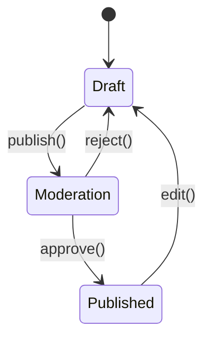
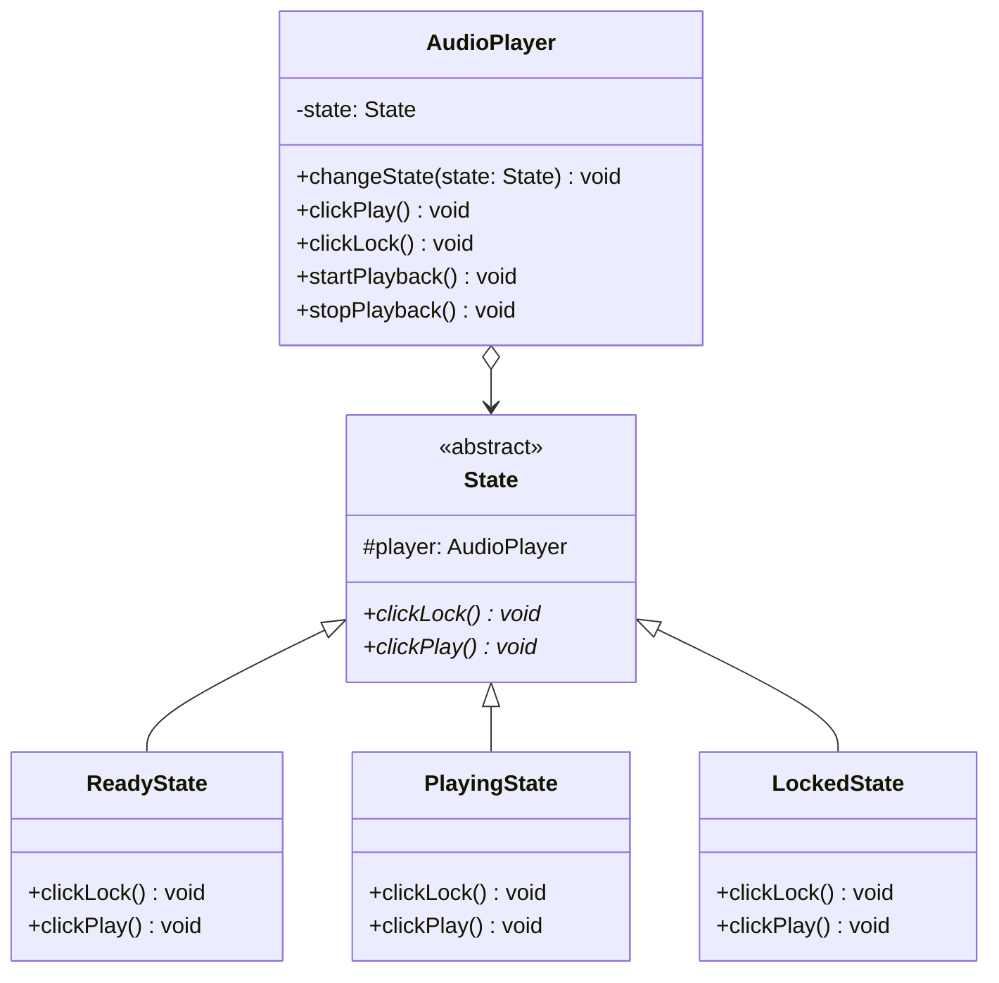
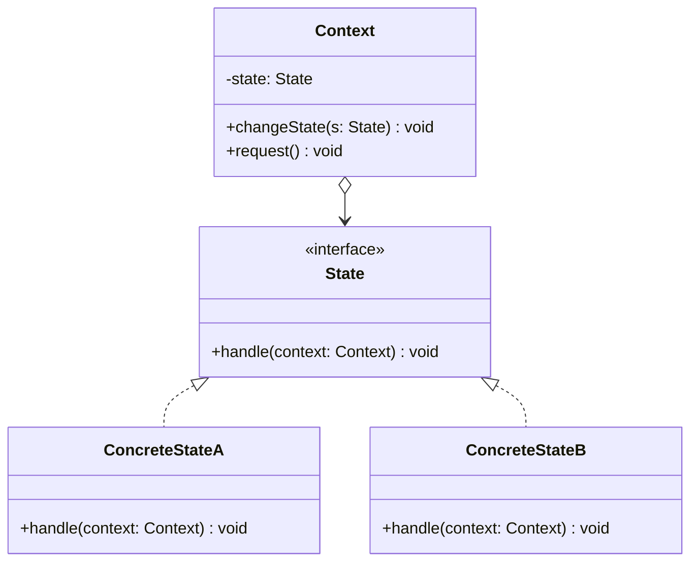
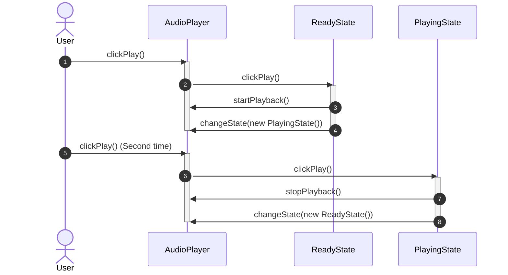

# State

> **Classification:** Behavioral Pattern  
> **Complexity:** ★★☆

---

## 1. Intent

**State** is a behavioral design pattern that lets an object alter its behavior when its internal state changes. It appears as if the object changed its class.

---

## 2. Problem

Imagine you are building a document management and publication system. A `Document` can exist in one of three states:
1. **Draft**
2. **Moderation**
3. **Published**

The document’s `publish()` and `edit()` methods must behave completely differently depending on its current state:
* While in **Draft**, calling `publish()` moves the document to **Moderation**.
* While in **Moderation**, calling `publish()` makes the document **Published** (if the current user is an admin), or fails.
* While in **Published**, calling `publish()` does nothing.
* Calling `edit()` on a **Published** document reverts it back to **Draft**, but on a **Draft** document simply mutates the text.



### The Giant Switch Anti-Pattern
A naive implementation relies on giant conditional statements (`if-else` or `switch (currentState)`) duplicated inside **every single method** of the document:

```python
# MONOLITHIC IF-ELSE ANTI-PATTERN
def publish(self):
    if self.state == "DRAFT":
        self.state = "MODERATION"
    elif self.state == "MODERATION":
        if self.user.is_admin:
            self.state = "PUBLISHED"
    elif self.state == "PUBLISHED":
        pass  # Do nothing
```

Whenever you introduce a new state (e.g., `Archived` or `Expired`), you must locate and rewrite every single `switch` statement in the class, inviting regressions.

---

## 3. Motivation

Consider an MP3 or smartphone Audio Player:
* Buttons: **Play/Pause**, **Lock**, **Next**.
* If the player is **Locked**, pressing Play/Pause or Next does nothing.
* If the player is **Playing**, pressing Play/Pause stops audio; pressing Next skips the track.
* If the player is **Paused**, pressing Play/Pause resumes audio.

Instead of writing `if (isLocked)` inside every button listener, each state becomes a separate class that dictates what the buttons do.

---

## 4. Solution

The State pattern suggests that you create dedicated classes for all possible states of an object and extract all state-specific behaviors into these classes:

1. The original object is called the **Context**. It stores a reference to a **State** interface representing its active state.
2. The Context delegates all state-dependent work to the state object: `state.clickPlay()`.
3. To transition states, the context simply swaps its internal state reference: `changeState(new PlayingState(this))`.



---

## 5. Structure



---

## 6. Participants

1. **Context:** Stores a reference to one of the concrete state objects and delegates state-specific work to it. Communicates with the state object via the State interface.
2. **State Interface:** Declares methods common to all concrete states.
3. **Concrete States:** Provide their own implementations for state-specific methods. To avoid code duplication, states can share a common abstract base class.
4. **State Transitions:** Either the Context or the Concrete State classes can trigger transitions by calling `context.changeState(...)`.

---

## 7. Code Implementation (Python 3)

```python
from abc import ABC, abstractmethod


# ==========================================
# 1. State Interface
# ==========================================
class State(ABC):
    def __init__(self, player: "AudioPlayer") -> None:
        self.player = player

    @abstractmethod
    def click_lock(self) -> None:
        pass

    @abstractmethod
    def click_play(self) -> None:
        pass

    @abstractmethod
    def click_next(self) -> None:
        pass


# ==========================================
# 2. Context Class
# ==========================================
class AudioPlayer:
    def __init__(self) -> None:
        self.is_playing = False
        self._state: State = ReadyState(self)

    def change_state(self, state: State) -> None:
        self._state = state
        print(f"[Player] Transitioned to: {state.__class__.__name__}")

    def click_lock(self) -> None:
        self._state.click_lock()

    def click_play(self) -> None:
        self._state.click_play()

    def click_next(self) -> None:
        self._state.click_next()


# ==========================================
# 3. Concrete States
# ==========================================
class ReadyState(State):
    def click_lock(self) -> None:
        self.player.change_state(LockedState(self.player))

    def click_play(self) -> None:
        self.player.is_playing = True
        print("[ReadyState] Starting audio playback.")
        self.player.change_state(PlayingState(self.player))

    def click_next(self) -> None:
        print("[ReadyState] Skipping to next track.")


class PlayingState(State):
    def click_lock(self) -> None:
        self.player.change_state(LockedState(self.player))

    def click_play(self) -> None:
        self.player.is_playing = False
        print("[PlayingState] Pausing audio playback.")
        self.player.change_state(ReadyState(self.player))

    def click_next(self) -> None:
        print("[PlayingState] Fast-forwarding current track.")


class LockedState(State):
    def click_lock(self) -> None:
        if self.player.is_playing:
            self.player.change_state(PlayingState(self.player))
        else:
            self.player.change_state(ReadyState(self.player))

    def click_play(self) -> None:
        print("[LockedState] Player locked. Play button disabled.")

    def click_next(self) -> None:
        print("[LockedState] Player locked. Next button disabled.")


# ==========================================
# 4. Client Execution Demo
# ==========================================
if __name__ == "__main__":
    player = AudioPlayer()

    player.click_play()  # Ready -> Playing
    player.click_lock()  # Playing -> Locked
    player.click_play()  # Locked (disabled)
    player.click_lock()  # Unlocks -> back to Playing
    player.click_play()  # Playing -> Ready (paused)
```

---

## 8. Execution Flow



---

## 9. When to Use (Applicability)

* **Behavior Dictated by State:** When you have an object that behaves differently depending on its current state, the number of states is enormous, and the state-specific code changes frequently.
* **Eliminating Massive Conditionals:** When a class is polluted with massive conditional statements (`switch` / `if-else`) that alter how its methods behave based on class field values.
* **Finite State Machines (FSM):** When explicitly modeling formal state machine transitions.

---

## 10. When NOT to Use (Anti-Scenarios)

* **Only 2 Trivial States:** If a class only has a boolean flag (`isActive = true/false`) and two lines of logic, State pattern is massive overkill.
* **Stateless Systems:** If the object's methods are pure functions independent of stored history.

---

## 11. Advantages

* **Single Responsibility Principle (SRP):** Organizes code related to particular states into separate classes.
* **Open/Closed Principle (OCP):** Introduces new states without changing existing state classes or context.
* **Eliminates Bulky Conditionals:** Replaces complex `switch` statements with clean polymorphic method calls.

---

## 12. Disadvantages

* **Overkill for Simple State Sets:** Can be needlessly complex if a state machine has only a couple of states and rarely changes.

---

## 13. Common Mistakes & Misconceptions

### Mistake 1: Confusing State with Strategy
* **Strategy:** Algorithms are **completely independent** of each other. The client explicitly selects a strategy, and the strategy rarely changes during execution.
* **State:** States **know about other states** and actively trigger transitions to replace one another dynamically based on context events.

---

## 14. Related Patterns

* **[Strategy](strategy.md):** State can be considered an extension of Strategy. Both rely on composition. In Strategy, alternative implementations are largely independent; in State, concrete states can trigger transitions to other states.
* **[Flyweight](../structural/flyweight.md):** State objects that store no internal instance data can be shared across multiple contexts as Flyweights.
* **[Singleton](../creational/singleton.md):** State objects are often implemented as Singletons.

---

## 15. Real-World Applications

### Enterprise Architectures
* **Order Status Lifecycle:** `PendingPaymentState` -> `PaidState` -> `ShippedState` -> `DeliveredState` -> `RefundedState`.
* **TCP Connection Protocols:** TCP sockets transitioning between `LISTEN`, `SYN_SENT`, `ESTABLISHED`, `FIN_WAIT`.
* **Spring State Machine Framework:** Enterprise workflow orchestration engine.

---

## 16. Interview Questions & Self-Assessment

### Q1: What is the primary difference between State and Strategy?
> **Answer:** In Strategy, the client selects an interchangeable algorithm that typically stays fixed throughout an operation, and strategies are oblivious to one another. In State, the states represent a finite state machine; states actively transition to sibling states dynamically as events occur.

### Q2: Who should trigger state transitions in the State pattern?
> **Answer:** It can be either the **Context** or the **Concrete State** classes. Having States trigger transitions (`player.changeState(new PlayingState())`) allows decentralized state machines, but introduces dependencies between concrete state classes. Having the Context trigger transitions centralizes state logic.

### Q3: How does the State pattern uphold the Open/Closed Principle?
> **Answer:** Adding a new state (e.g., `FastForwardState`) simply requires creating a new subclass of `State` and linking transitions, without modifying existing methods across the Context class.

### Q4: Can State objects be shared across multiple Contexts?
> **Answer:** Yes, provided the State objects are stateless (they hold no instance variables and receive the Context as a parameter in their methods). In such cases, states can be instantiated as Singletons or Flyweights.

---

## 17. Key Takeaways

1. **Object-Oriented State Machine:** Replaces spaghetti `switch` statements with polymorphic state classes.
2. **Context Delegates:** The main object delegates all state-sensitive behavior to its active state object.
3. **Dynamic Transitions:** States swap dynamically at runtime as operations execute.
