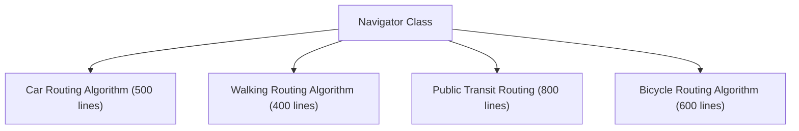
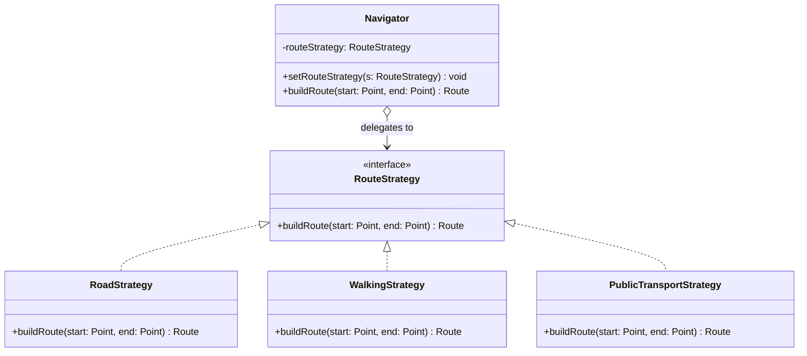
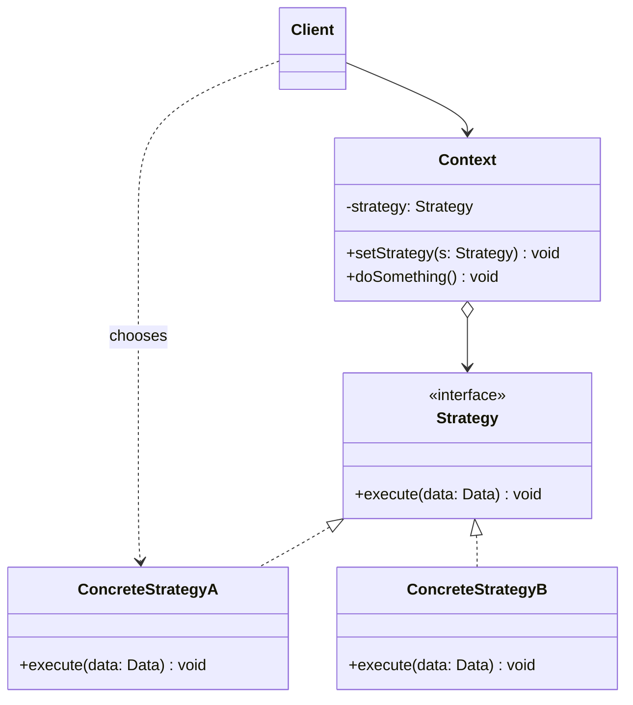
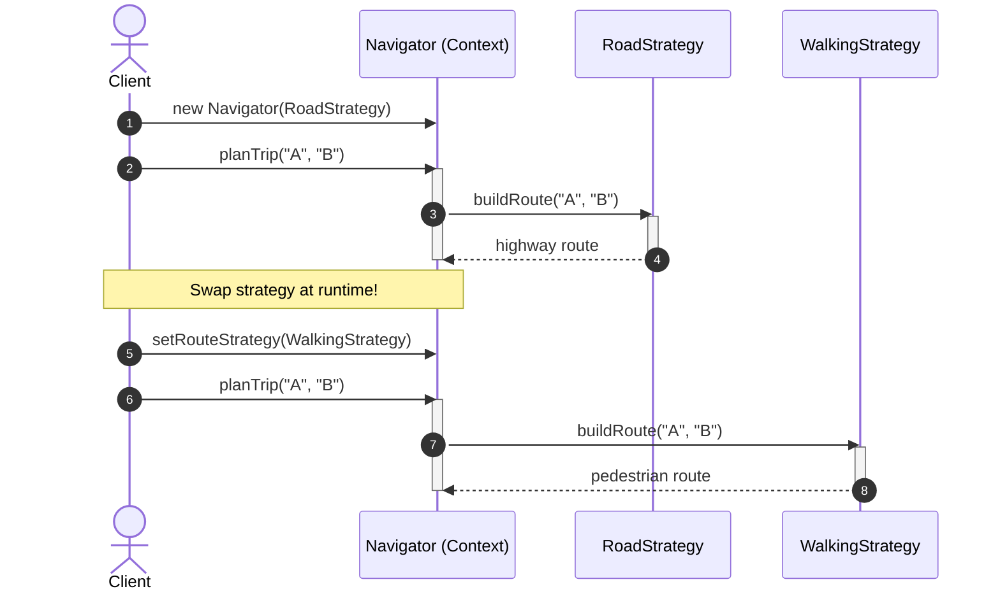

# Strategy

> **Classification:** Behavioral Pattern  
> **Complexity:** ★☆☆

---

## 1. Intent

**Strategy** is a behavioral design pattern that lets you define a family of algorithms, put each of them into a separate class, and make their objects interchangeable.

---

## 2. Problem

Imagine you are creating a navigation app for travelers:
* The first version of the app could only build routes for **automobiles (driving)**.
* Soon, you add support for **walking routes**.
* Next, you add **public transit routes**.
* Later, you plan to add **bicycle routes** and **scenic tourist routes**.



### The Code Bloat Anti-Pattern
Each time you add a new routing algorithm, the main `Navigator` class doubles in size:
* A team of developers working on different algorithms suffers constant **Git merge conflicts**.
* A tiny bug fix in the walking algorithm risks breaking car routing calculations.
* The monolithic class becomes hard to unit test and maintain.

---

## 3. Motivation

Consider an e-commerce checkout page:
* Customers can pay via: **Credit Card**, **PayPal**, **Apple Pay**, or **Cryptocurrency**.
* The checkout payment service needs to charge the order, but the exact protocol (API tokens, cryptographic signatures, OAuth redirects) differs completely across providers.

Instead of writing a massive `switch (paymentMethod)` block inside the checkout service, each payment provider becomes an interchangeable **Strategy**.

---

## 4. Solution

The Strategy pattern suggests that you extract all the differing algorithmic implementations into separate classes called **Strategies**:

1. The original class is called the **Context**. It maintains a reference to a Strategy interface.
2. The Context delegates the algorithmic work to the linked strategy object instead of implementing it directly.
3. The Context does not choose the strategy itself; the **Client** configures the context with the desired strategy at runtime.



---

## 5. Structure



---

## 6. Participants

1. **Context:** Maintains a reference to one of the concrete strategies and communicates with it solely through the Strategy interface.
2. **Strategy Interface:** Common to all strategy variants. It declares a method the context uses to execute an algorithm.
3. **Concrete Strategies:** Implement different variations of an algorithm the context uses.
4. **Client:** Creates a specific strategy object and passes it to the context. The client can swap strategies dynamically at runtime.

---

## 7. Code Implementation (Python 3)

```python
from abc import ABC, abstractmethod


# ==========================================
# 1. Strategy Interface
# ==========================================
class RouteStrategy(ABC):
    @abstractmethod
    def build_route(self, origin: str, destination: str) -> None:
        pass


# ==========================================
# 2. Concrete Strategies
# ==========================================
class RoadStrategy(RouteStrategy):
    def build_route(self, origin: str, destination: str) -> None:
        print(f"[Road Strategy] Routing highway paths between {origin} and {destination}. Calculating tolls and traffic congestion.")


class WalkingStrategy(RouteStrategy):
    def build_route(self, origin: str, destination: str) -> None:
        print(f"[Walking Strategy] Routing pedestrian sidewalks and pedestrian crossings between {origin} and {destination}.")


class PublicTransitStrategy(RouteStrategy):
    def build_route(self, origin: str, destination: str) -> None:
        print(f"[Public Transit] Scheduling subway lines and bus connections between {origin} and {destination}.")


# ==========================================
# 3. Context Class
# ==========================================
class Navigator:
    def __init__(self, strategy: RouteStrategy) -> None:
        self._strategy = strategy

    def set_strategy(self, strategy: RouteStrategy) -> None:
        self._strategy = strategy

    def navigate(self, origin: str, destination: str) -> None:
        self._strategy.build_route(origin, destination)


# ==========================================
# 4. Client Demo
# ==========================================
if __name__ == "__main__":
    navigator = Navigator(RoadStrategy())
    navigator.navigate("Central Park", "Brooklyn Bridge")

    print("--- User Switches to Walking Mode ---")
    navigator.set_strategy(WalkingStrategy())
    navigator.navigate("Central Park", "Times Square")
```

---

## 8. Execution Flow



---

## 9. When to Use (Applicability)

* **Interchangeable Algorithmic Variants:** When you have a class that defines multiple variations of an algorithm and you want to switch between them at runtime.
* **Isolating Complex Business Rules:** When you have lots of similar classes that only differ in the way they execute some behavior.
* **Eliminating Conditionals:** When an operation uses massive conditional branches (`switch` statements) to select different algorithmic variants.

---

## 10. When NOT to Use (Anti-Scenarios)

* **Only 1 or 2 Static Algorithms:** If an algorithm never changes and you have no realistic expectation of alternatives, standard private methods are far cleaner.
* **Client Must Know Strategies:** In Strategy, the client must be aware of how the strategies differ in order to select the right one. If clients should not know implementation differences, consider a [Factory](../creational/factory-method.md) or [Facade](../structural/facade.md).

---

## 11. Advantages

* **Runtime Algorithm Swapping:** You can swap algorithms used inside an object at runtime.
* **Open/Closed Principle (OCP):** You can introduce new strategies without having to change the context or existing strategies.
* **Isolates Algorithm Mechanics:** You can separate implementation details of an algorithm from code that uses it.

---

## 12. Disadvantages

* **Clients Must Be Aware of Differences:** Clients must understand how strategies differ to choose the right one.
* **Increased Class Count:** Increases the number of classes in a project. In Python, this can often be mitigated using lambdas and functional interfaces (`Function<T, R>`).

---

## 13. Common Mistakes & Misconceptions

### Mistake 1: Confusing Strategy with State
* **Strategy:** Algorithms are **completely independent** and oblivious to each other. The client chooses the strategy, and it rarely changes mid-operation.
* **State:** Concrete states **know about each other** and actively trigger transitions to replace one another dynamically based on context events.

---

## 14. Related Patterns

* **[Bridge](../structural/bridge.md):** Structurally looks identical (composition + delegation), but Bridge is an up-front structural architectural separation of abstraction from platform primitives; Strategy is a behavioral swapping of algorithms.
* **[Template Method](template-method.md):** Template Method is based on **inheritance** (subclasses override algorithmic steps); Strategy is based on **composition** (swapping an entire algorithm object).
* **[Command](command.md):** Strategy defines *how* to do something; Command defines *what* to do.

---

## 15. Real-World Applications

### Python Standard Library
* `sorted(iterable, key=lambda ...)`: Accepts arbitrary strategy functions.
* Authentication Backends in Django / FastAPI: Pluggable strategies resolved dynamically per request.

### Spring Framework
* `org.springframework.core.io.Resource`: Different resource retrieval strategies (`ClassPathResource`, `FileSystemResource`, `UrlResource`).

---

## 16. Interview Questions & Self-Assessment

### Q1: How does Strategy demonstrate the "Favor composition over inheritance" principle?
> **Answer:** Instead of inheriting from a base class and overriding an algorithm in subclasses, the context *has-a* reference to a strategy interface and delegates execution dynamically.

### Q2: How does Python's first-class function support simplify the Strategy pattern?
> **Answer:** If the Strategy interface is a `@FunctionalInterface` with a single method, developers no longer need to write boilerplate concrete strategy classes; they can pass lambda expressions or method references directly (`list.sort((a, b) -> a.compareTo(b))`).

### Q3: How does Strategy compare with Template Method?
> **Answer:** Template Method uses **inheritance** and allows subclasses to alter individual steps while keeping the algorithm's skeleton fixed. Strategy uses **composition** and allows replacing the **entire algorithm** at runtime.

### Q4: Does the Strategy pattern eliminate `switch` statements?
> **Answer:** Yes! It converts procedural conditional branching into object-oriented polymorphism, satisfying the Open/Closed Principle.

---

## 17. Key Takeaways

1. **Swappable Algorithms:** Encapsulates variations of an algorithm into separate classes.
2. **Runtime Composition:** Injects algorithms via constructors or setters.
3. **OCP Champion:** Add new algorithmic strategies without modifying the context class.
4. **Idiomatic Python Synergy:** Seamlessly integrates with Python first-class functions and lambdas.
