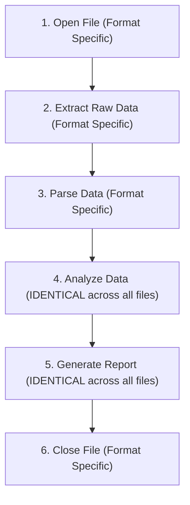
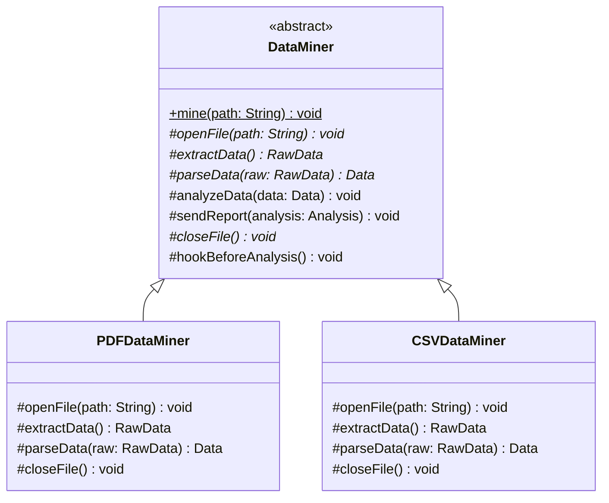
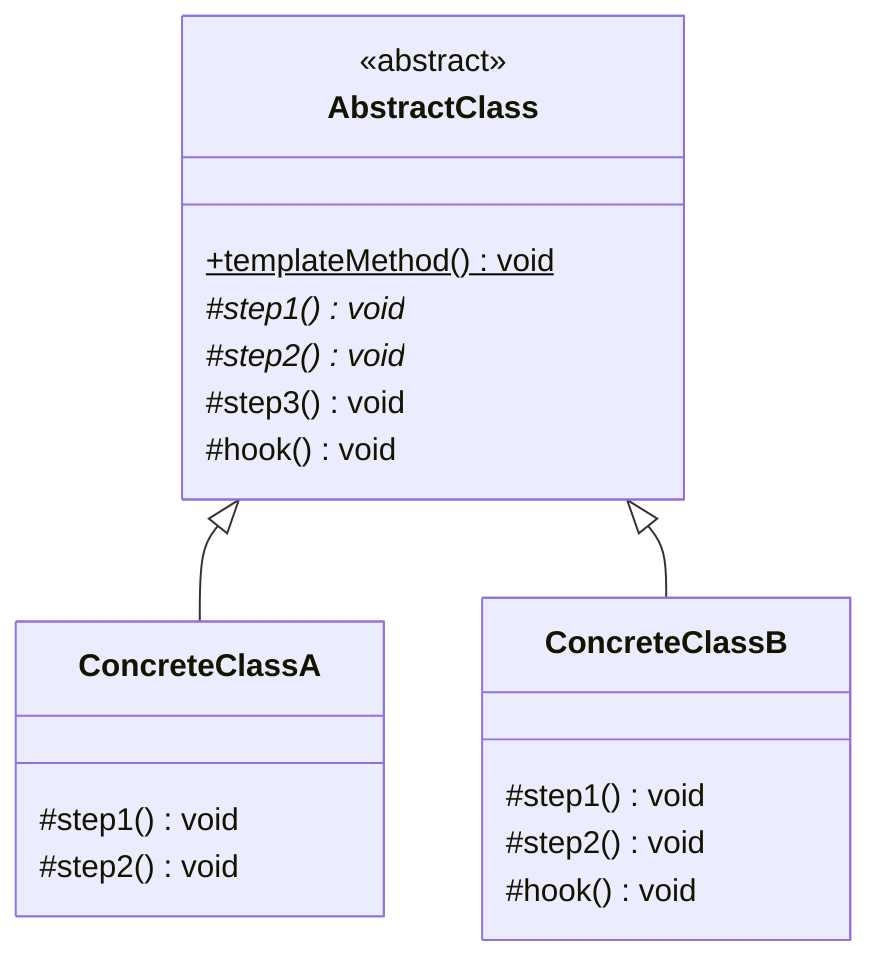
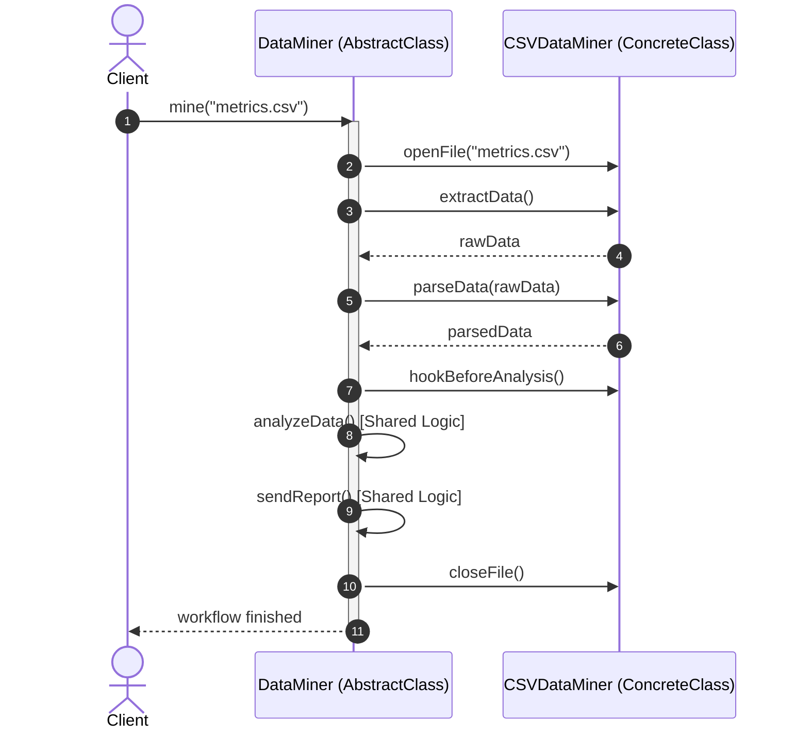

# Template Method

> **Also known as:** Template  
> **Classification:** Behavioral Pattern  
> **Complexity:** ★☆☆

---

## 1. Intent

**Template Method** is a behavioral design pattern that defines the skeleton of an algorithm in the superclass but lets subclasses override specific steps of the algorithm without changing its overall structure.

---

## 2. Problem

Imagine you are creating a data mining application that analyzes corporate documents. Users upload documents in various file formats: **PDF**, **DOC**, and **CSV**.

The core data mining workflow follows a strictly identical sequence across all document types:
1. Open the file.
2. Extract raw data.
3. Parse data into a standardized domain format.
4. Run statistical analysis.
5. Generate an executive report.
6. Close the file.



### The Duplication Trap
* Steps 4 and 5 (analysis and reporting) are **completely identical** regardless of file format.
* Steps 1, 2, 3, and 6 are **format-specific** (handling binary PDF streams vs XML DOC structures vs plain-text CSV lines).
* If you create independent classes (`PDFDataMiner`, `CSVDataMiner`), you duplicate the complex statistical analysis and reporting code in every single class!

---

## 3. Motivation

Consider building house construction simulation software:
* Building any standard house follows an invariant sequence:
  1. `buildFoundations()`
  2. `buildPillars()`
  3. `buildWalls()`
  4. `buildWindows()`
* A **Wooden House** builds wooden pillars and timber walls.
* A **Glass House** builds steel pillars and glass curtain walls.

The master building sequence must never be altered (you cannot install windows before pouring the foundation!), but individual construction materials differ.

---

## 4. Solution

The Template Method pattern suggests that you break down an algorithm into a series of steps, turn these steps into methods, and put a series of calls to these methods inside a single **Template Method**:

1. Declare the template method in an abstract base class.
2. In Python, document the template method as the fixed skeleton so subclasses cannot change the overarching execution sequence.
3. Steps can be:
   * **Abstract Steps:** Must be implemented by every subclass (e.g., `extractData()`).
   * **Optional Steps (Hooks):** Have default (often empty) implementations. Subclasses can override them if needed, but are not forced to.
   * **Concrete Invariant Steps:** Implemented directly in the base class and shared across all subclasses (e.g., `analyzeData()`).



---

## 5. Structure



---

## 6. Participants

1. **Abstract Class:** Declares methods that act as steps of an algorithm, as well as the actual `templateMethod()` that orchestrates these steps in a specific order.
2. **Concrete Classes:** Override the abstract steps to provide specialized behavior without altering the template method itself.
3. **Hooks:** Methods with empty or default bodies in the base class that subclasses can optionally override to inject logic before or after critical steps.

---

## 7. Code Implementation (Python 3)

```python
from abc import ABC, abstractmethod


# ==========================================
# 1. Abstract Base Class with Template Method
# ==========================================
class Network(ABC):
    def __init__(self, username: str, password: str) -> None:
        self.username = username
        self.password = password

    # THE TEMPLATE METHOD: Defines immutable algorithm skeleton
    def post(self, message: str) -> bool:
        if self.log_in(self.username, self.password):
            success = self.send_data(message)
            self.log_out()
            return success
        return False

    @abstractmethod
    def log_in(self, user: str, pwd: str) -> bool:
        pass

    @abstractmethod
    def send_data(self, message: str) -> bool:
        pass

    @abstractmethod
    def log_out(self) -> None:
        pass


# ==========================================
# 2. Concrete Classes
# ==========================================
class Twitter(Network):
    def log_in(self, user: str, pwd: str) -> bool:
        print(f"[Twitter] Authenticating OAuth token for @{user}...")
        return True

    def send_data(self, message: str) -> bool:
        print(f"[Twitter] Tweeting: '{message}'")
        return True

    def log_out(self) -> None:
        print(f"[Twitter] User @{self.username} signed out.")


class Facebook(Network):
    def log_in(self, user: str, pwd: str) -> bool:
        print(f"[Facebook] Logging in user '{user}' with password hash...")
        return True

    def send_data(self, message: str) -> bool:
        print(f"[Facebook] Posting to timeline: '{message}'")
        return True

    def log_out(self) -> None:
        print(f"[Facebook] Session closed for '{self.username}'.")


# ==========================================
# 3. Client Execution Demo
# ==========================================
if __name__ == "__main__":
    tweet_network = Twitter("dev_guru", "secret")
    tweet_network.post("Exploring Design Patterns in Python!")
```

---

## 8. Execution Flow



---

## 9. When to Use (Applicability)

* **Code Duplication in Parallel Algorithms:** When several classes contain almost identical algorithms with only minor differences in individual steps.
* **Framework Development (The Hollywood Principle):** *"Don't call us, we'll call you."* Frameworks define the invariant execution lifecycle and invoke user-supplied subclass hooks at controlled points.
* **Extending Invariant Workflows:** When you want to allow clients to extend only particular steps of an algorithm, but not the overarching flow.

---

## 10. When NOT to Use (Anti-Scenarios)

* **Frequently Altered Skeletons:** If the master algorithmic skeleton itself changes frequently, forcing changes down into subclasses violates the Open/Closed Principle.
* **When Composition is Better (Strategy):** If the steps and algorithm need to be swappable dynamically at runtime, use [Strategy](strategy.md) instead of static class inheritance.

---

## 11. Advantages

* **Eliminates Code Duplication:** Pulls invariant duplicate code up into a single base class.
* **Controls Extension Points:** Subclasses can only override designated abstract methods or hooks; they cannot break the overall algorithm structure.

---

## 12. Disadvantages

* **Inheritance Coupling:** Subclasses are tightly coupled to the superclass (the fragile base class problem).
* **Violates Liskov Substitution Principle if Abused:** If a subclass suppresses a base step by leaving it empty or throwing exceptions, it violates LSP.

---

## 13. Common Mistakes & Misconceptions

### Mistake 1: Forgetting to Mark the Template Method as `final`
If a subclass can override the template method itself, destroying the invariant order and re-introducing duplicate code.

### Mistake 2: Confusing Template Method with Strategy
* **Template Method:** Relies on **inheritance**. Individual steps are overridden by subclasses; the skeleton is static at compile time.
* **Strategy:** Relies on **composition**. The entire algorithm is swapped dynamically at runtime via an injected interface.

---

## 14. Related Patterns

* **[Factory Method](../creational/factory-method.md):** Factory Method is often called *inside* a Template Method to construct product objects required by the algorithm.
* **[Strategy](strategy.md):** Template Method works at the class level (compile-time inheritance); Strategy works at the object level (runtime composition).

---

## 15. Real-World Applications

### Python Standard Library
* `unittest.TestCase`: Template algorithm executing `setUp()` -> `test_*()` -> `tearDown()`.
* Django Generic Class-Based Views: Fixed request dispatching pipeline calling `get()` / `post()` hooks.

### Spring Framework
* `org.springframework.web.servlet.mvc.AbstractController`: Standard web request processing lifecycle with hooks for sub-controllers.

---

## 16. Interview Questions & Self-Assessment

### Q1: What is the "Hollywood Principle" and how does it relate to Template Method?
> **Answer:** The Hollywood Principle states *"Don't call us, we'll call you."* In Template Method, the superclass calls the methods of the subclass (inverting typical procedural control), ensuring the framework controls the execution lifecycle.

### Q2: How do you protect the template method from being overridden in Python?
> **Answer:** To prevent subclasses from overriding the overarching algorithm skeleton and violating the invariant execution sequence.

### Q3: What is a "Hook" method in Template Method?
> **Answer:** A method in the abstract base class that has a default (often empty) implementation. Subclasses can optionally override it to hook into the algorithm before or after crucial steps, but are not forced to implement it.

### Q4: How does Template Method differ from Strategy?
> **Answer:** Template Method is based on **class inheritance** (modifying steps at compile time); Strategy is based on **object composition** (swapping the entire algorithm at runtime).

---

## 17. Key Takeaways

1. **Algorithm Skeleton:** Keeps the master sequence invariant while allowing custom steps in subclasses.
2. **Eliminates Duplicate Pipelines:** Common logic is written once in the superclass.
3. **Always Declare as `final`:** Protect the template method from being overridden.
4. **Compile-Time Specialization:** Best when the workflow structure is permanent and subclasses vary only in step details.
