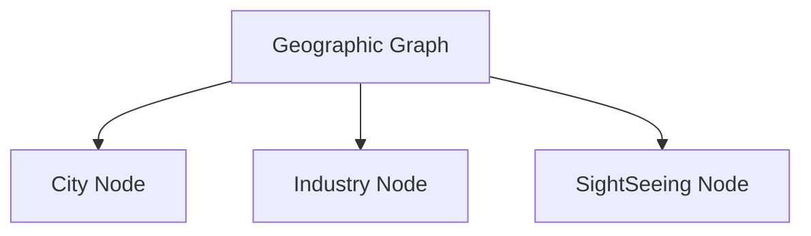
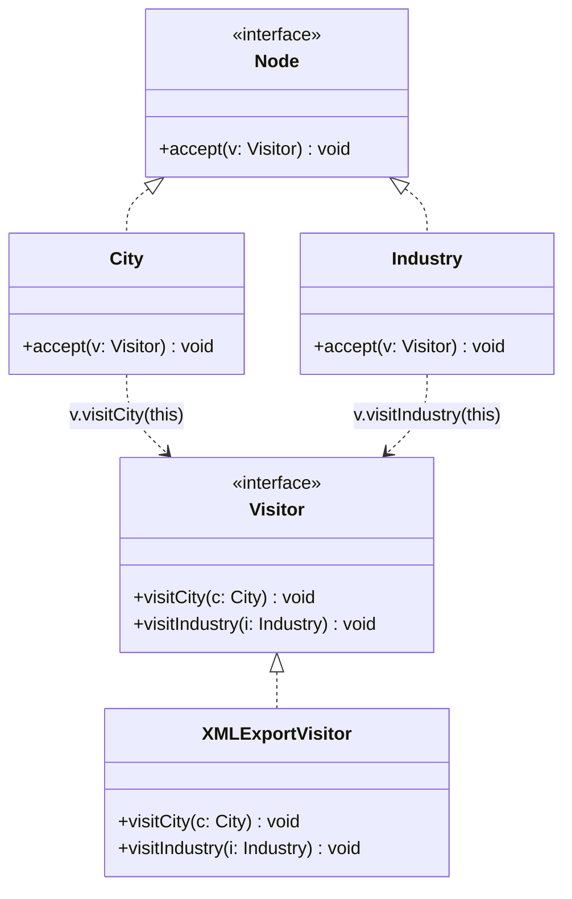
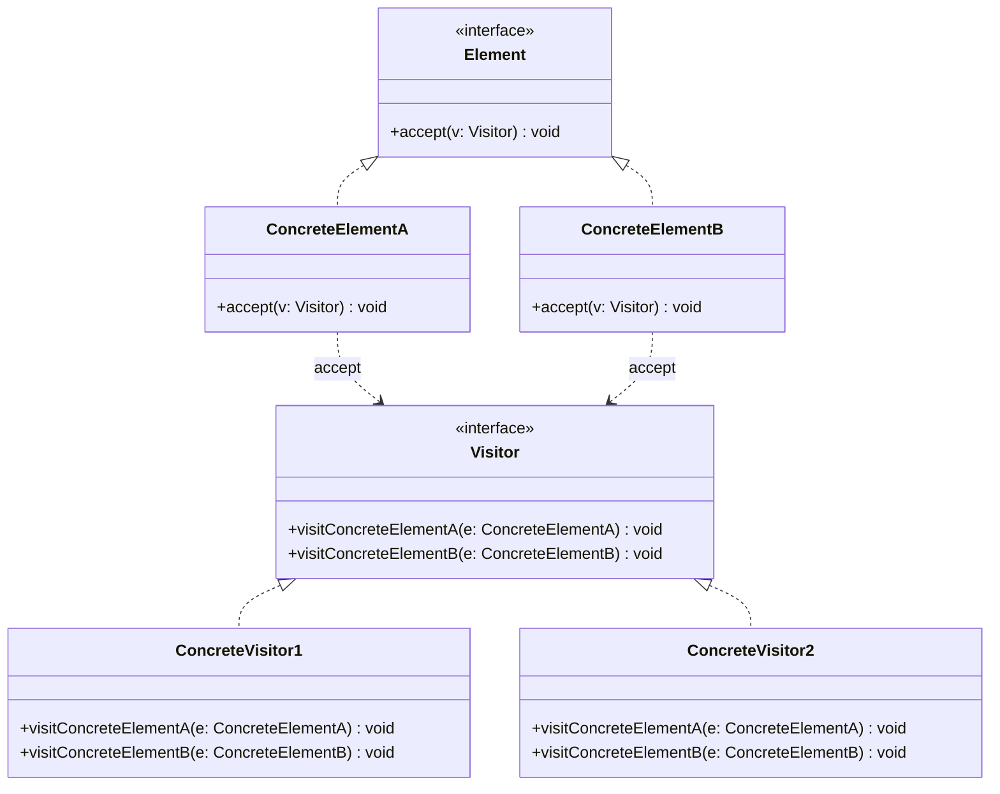
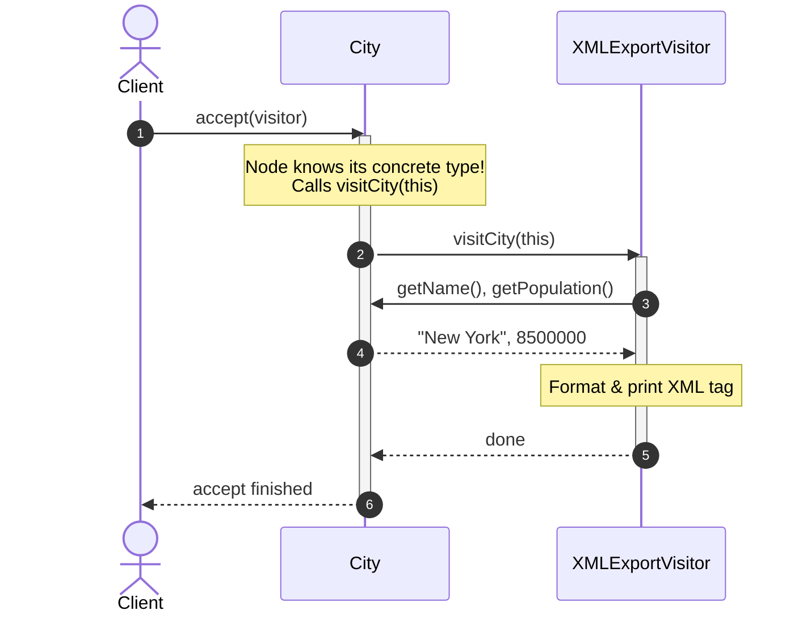

# Visitor

> **Classification:** Behavioral Pattern  
> **Complexity:** ★★★

---

## 1. Intent

**Visitor** is a behavioral design pattern that lets you separate algorithms from the objects on which they operate. It allows you to add new operations to existing class hierarchies without modifying the classes.

---

## 2. Problem

Imagine you are building a geographic information system (GIS) or map analytics platform. The map consists of a graph of various geometric nodes:
* `City` (containing population, landmarks, municipal coordinates).
* `Industry` (factories, warehouses, supply chain routes).
* `SightSeeing` (parks, historical monuments, museums).



### The Extension Dilemma
Now, marketing asks you to add an **XML Export** feature:
* You could add an `exportXML()` method directly to each node class (`City`, `Industry`, `SightSeeing`).
* However, modifying these tested, production-critical domain classes risks introducing regressions.
* Next week, another department asks for **GeoJSON Export**, then **Environmental Tax Calculations**, then **Tourist Route Analysis**!
* Your core domain classes become bloated with dozens of unrelated export and calculation methods, violating the **Single Responsibility Principle**.

---

## 3. Motivation

Consider an Abstract Syntax Tree (AST) in a compiler or programming language interpreter:
* An AST contains nodes: `AssignmentNode`, `BinaryExpressionNode`, `VariableDeclarationNode`.
* You need to perform completely different operations across the same syntax tree:
  1. Type Checking & Semantic Validation.
  2. Code Optimization & Dead-Code Elimination.
  3. Bytecode Generation (e.g., emitting JVM or LLVM bytecode).
  4. Code Formatting / Pretty Printing.

You do not want to pollute `BinaryExpressionNode` with bytecode generators and pretty-printers. The AST nodes should be stable; the operations should be decoupled visitors.

---

## 4. Solution

The Visitor pattern suggests that you extract the new operation into a separate class called a **Visitor**, instead of embedding it into the existing classes.

### The Double-Dispatch Mechanism
How does the visitor know which method to call when iterating over a collection of abstract `Node` objects? In single-dispatch languages like Python, method calls are resolved dynamically based only on the primary instance, not on parameter types.

The Visitor pattern solves this via **Double Dispatch**:
1. The `Node` interface defines a method: `void accept(Visitor v)`.
2. Each concrete node implements this method by passing `this` to the visitor:
   ```python
def accept(self, visitor: "Visitor") -> None:
    visitor.visit_city(self)  # Dispatches to specific visitor method for City
```
3. The runtime execution chooses the method based on **both** the receiver node type and the visitor type!



---

## 5. Structure



---

## 6. Participants

1. **Visitor Interface:** Declares a set of visiting methods that correspond to each concrete element class in the object structure.
2. **Concrete Visitors:** Implement several versions of the same operation, tailored for each concrete element class.
3. **Element Interface:** Declares an `accept()` method that takes a Visitor as an argument.
4. **Concrete Elements:** Implement the `accept()` method by calling the visitor's corresponding method for that element class.
5. **Client:** Typically iterates through a collection of elements and calls `element.accept(visitor)` on each.

---

## 7. Code Implementation (Python 3)

```python
from abc import ABC, abstractmethod


# ==========================================
# 1. Element Interface & Concrete Elements
# ==========================================
class Shape(ABC):
    @abstractmethod
    def accept(self, visitor: "Visitor") -> None:
        pass


class Dot(Shape):
    def __init__(self, x: int, y: int) -> None:
        self.x = x
        self.y = y

    def accept(self, visitor: "Visitor") -> None:
        visitor.visit_dot(self)


class Circle(Shape):
    def __init__(self, x: int, y: int, radius: int) -> None:
        self.x = x
        self.y = y
        self.radius = radius

    def accept(self, visitor: "Visitor") -> None:
        visitor.visit_circle(self)


# ==========================================
# 2. Visitor Interface & Concrete Visitor
# ==========================================
class Visitor(ABC):
    @abstractmethod
    def visit_dot(self, dot: Dot) -> None:
        pass

    @abstractmethod
    def visit_circle(self, circle: Circle) -> None:
        pass


class XMLExportVisitor(Visitor):
    def visit_dot(self, dot: Dot) -> None:
        print(f'  <dot x="{dot.x}" y="{dot.y}"/>')

    def visit_circle(self, circle: Circle) -> None:
        print(f'  <circle x="{circle.x}" y="{circle.y}" radius="{circle.radius}"/>')


# ==========================================
# 3. Client Demo
# ==========================================
if __name__ == "__main__":
    shapes: list[Shape] = [Dot(5, 10), Circle(20, 30, 15)]
    xml_visitor = XMLExportVisitor()

    print("<shapes>")
    for shape in shapes:
        shape.accept(xml_visitor)
    print("</shapes>")
```

---

## 8. Execution Flow



---

## 9. When to Use (Applicability)

* **Complex Object Graphs (ASTs, DOMs):** When you need to perform an operation on all elements of a complex object structure (such as an object tree or compiler abstract syntax tree).
* **Cleaning Up Business Logic:** When you want to clean up the business logic of auxiliary operations, moving disparate tasks out of primary domain classes.
* **Stable Class Hierarchies:** When the classes defining the nodes rarely change, but you frequently need to add new operations over them.

---

## 10. When NOT to Use (Anti-Scenarios)

* **Frequently Changing Element Classes:** If you add new element classes regularly (e.g., adding `River`, `Mountain`, `Airport`), every single visitor interface and concrete visitor class must be updated, violating OCP!
* **Private State Encapsulation:** If operations require deep access to private fields of the elements, the elements are forced to expose public getters, weakening encapsulation.

---

## 11. Advantages

* **Open/Closed Principle (OCP):** You can introduce a new behavior that can work with objects of different classes without changing these classes.
* **Single Responsibility Principle (SRP):** You can move multiple versions of the same behavior into the same visitor class.
* **Accumulates State:** A visitor can accumulate state as it traverses the element graph (e.g., summing total taxes).

---

## 12. Disadvantages

* **Fragile When Elements Change:** You need to update all visitors each time an element class is added or removed from the hierarchy.
* **Weakens Encapsulation:** Visitors might lack the necessary access to the private fields of elements that they are supposed to work with.

---

## 13. Common Mistakes & Misconceptions

### Mistake 1: Trying to Avoid `accept()` via `instanceof`
Developers often try to avoid the Visitor pattern by writing a method with a long chain of `if (element instanceof City) ... else if (element instanceof Industry) ...`. This is slow, error-prone, and destroys polymorphic dispatch. Double dispatch with `accept()` is compile-time verified and faster.

---

## 14. Related Patterns

* **[Composite](../structural/composite.md):** Visitors are frequently used to execute operations over complex [Composite](../structural/composite.md) trees.
* **[Iterator](iterator.md):** You can use an Iterator to traverse an object graph, while using a Visitor to execute actions on visited elements.

---

## 15. Real-World Applications

### Python Standard Library
* `ast.NodeVisitor` & `ast.NodeTransformer`: Standard library Python AST visitors traversing syntax nodes with `visit_<NodeType>()` methods.
* `os.walk()`: Navigates file system trees executing callbacks.

---

## 16. Interview Questions & Self-Assessment

### Q1: What is "Double Dispatch" and why is it used in the Visitor pattern?
> **Answer:** In single-dispatch languages like Python, method calls are routed dynamically based only on the primary receiver based on the declared variable type, not the runtime type. Double dispatch overcomes this: the client calls `element.accept(visitor)` (1st dispatch), and inside the concrete element calls `visitor.visit(this)` (2nd dispatch), ensuring the exact overloaded method executes based on runtime types.

### Q2: What is the main disadvantage of the Visitor pattern?
> **Answer:** Adding a new concrete element class (e.g., adding `Airport` to the nodes) breaks every visitor interface and requires updating every single concrete visitor implementation in the codebase.

### Q3: When is Visitor preferred over putting methods directly into classes?
> **Answer:** When the class hierarchy is stable, but new operations (exporting, auditing, optimizing, pretty-printing) are frequently introduced, preventing class pollution and adhering to SRP.

### Q4: How is `ast.NodeVisitor` an example of Visitor?
> **Answer:** It defines callbacks (`visitFile`, `preVisitDirectory`) that are called by `Files.walkFileTree(Path, FileVisitor)`, separating file system traversal from file processing logic (e.g., deleting, searching, or compressing files).

---

## 17. Key Takeaways

1. **Separates Algorithm from Data Structure:** The element hierarchy remains clean and stable.
2. **Double Dispatch Mechanism:** The elegant key that enables dynamic double dispatch routing.
3. **Ideal for ASTs and Document Graphs:** The standard architecture for compilers, DOM analyzers, and report generators.
4. **Element Hierarchy Must Be Stable:** Only use when the set of element classes is fixed.
