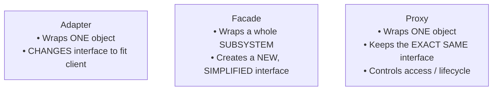

# Adapter vs. Facade vs. Proxy

> *"Adapter, Facade, and Proxy are all 'wrapper' patterns built using composition and delegation. The critical distinction lies in what they do to the interface and how many objects they wrap."*  
> — Alexander Shvets, *Dive Into Design Patterns*

---

## 1. Executive Summary



---

## 2. Side-by-Side Comparison Matrix

| Dimension | Adapter | Facade | Proxy |
| :--- | :--- | :--- | :--- |
| **Interface Impact** | **Changes** the interface | Creates a **new simplified** interface | Maintains the **exact same** interface |
| **Target Scope** | Typically wraps **one** incompatible class | Wraps an **entire subsystem** (dozens of classes) | Wraps **one** service object |
| **Primary Intent** | Enable **interoperability** between incompatible classes | Provide a **simple entry point** to a complex system | Control **access, lifecycle, security, or caching** |
| **Client Awareness** | Client knows the target interface it wants | Client wants a convenient high-level shortcut | Client is usually **completely unaware** a proxy exists |
| **When Applied** | Usually **retrofitted** after integration issues arise | Created to **simplify usage** of complex libraries | Used to optimize **lazy loading**, security, or remote calls |
| **Reference Pattern** | [Adapter Note](../structural/adapter.md) | [Facade Note](../structural/facade.md) | [Proxy Note](../structural/proxy.md) |

---

## 3. Code Interface Comparison (Python)

### Adapter: Changes the Interface
```python
# Target interface expected by client:
class RoundPeg:
    def get_radius(self) -> float: ...

# Adaptee with incompatible interface:
class SquarePeg:
    def get_width(self) -> float: ...

# Adapter maps get_width() -> get_radius():
class SquarePegAdapter(RoundPeg):
    def __init__(self, peg: SquarePeg) -> None:
        self.peg = peg

    def get_radius(self) -> float:
        return (self.peg.get_width() * (2 ** 0.5)) / 2
```

### Facade: Simplifies an Entire Subsystem
```python
# Subsystem has VideoFile, CodecFactory, BitrateReader, AudioMixer...
class VideoConverterFacade:
    # One clean method orchestrating 4 complex subsystems:
    def convert_video(self, filename: str, format_type: str) -> str:
        file = VideoFile(filename)
        codec = CodecFactory.extract(file)
        buffer = BitrateReader.read(file, codec)
        return AudioMixer().fix(buffer)
```

### Proxy: Implements the Identical Interface
```python
from abc import ABC, abstractmethod

class VideoService(ABC):
    @abstractmethod
    def get_video(self, video_id: str) -> bytes: ...

# Real service:
class RealVideoService(VideoService):
    def get_video(self, video_id: str) -> bytes:
        return b"Heavy_4K_Video_Bytes"

# Proxy: Same interface, controls caching and lazy initialization
class CachedVideoProxy(VideoService):
    def __init__(self) -> None:
        self.real_service: VideoService = None
        self.cache: dict[str, bytes] = {}

    def get_video(self, video_id: str) -> bytes:
        if video_id not in self.cache:
            if not self.real_service:
                self.real_service = RealVideoService()
            self.cache[video_id] = self.real_service.get_video(video_id)
        return self.cache[video_id]
```

---

## 4. Decision Guide: Which Wrapper Do You Need?

* **Use an Adapter when:**
  * Two classes do conceptually similar things, but have **different method names or parameter signatures** that prevent them from talking to each other.
* **Use a Facade when:**
  * You are tired of writing 15 lines of initialization code and managing 5 helper objects just to perform a common operation on a complex library.
* **Use a Proxy when:**
  * You need to inject **lazy loading, caching, logging, security authorization, or network RPC stubs** transparently without modifying the service class or client code.
