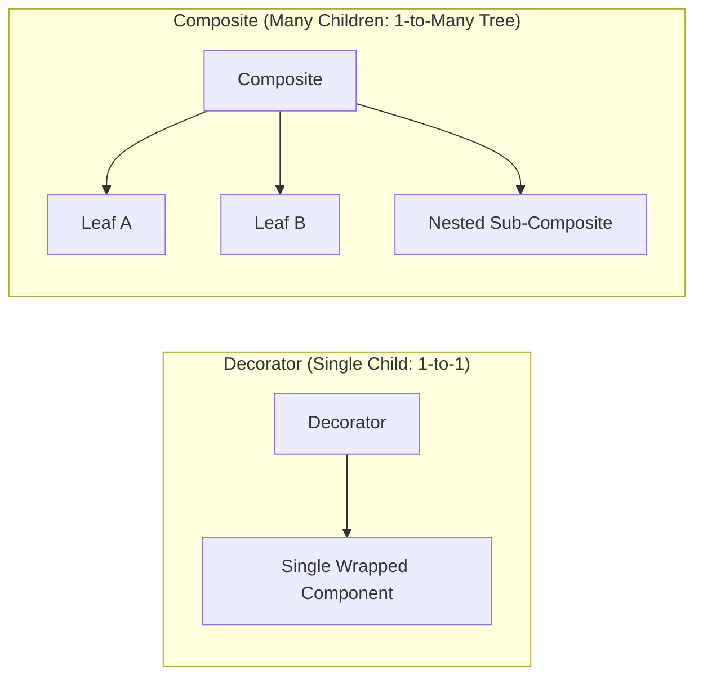

# Decorator vs. Composite

> *"Decorator and Composite share strikingly similar class diagrams because both rely on recursive composition. However, Decorator wraps a single child to add behavior, while Composite aggregates many children to represent a hierarchy."*  
> — Alexander Shvets, *Dive Into Design Patterns*

---

## 1. Executive Summary



---

## 2. Side-by-Side Comparison Matrix

| Dimension | Decorator | Composite |
| :--- | :--- | :--- |
| **Primary Intent** | Add **extra behaviors** to an object dynamically | Represent **part-whole tree hierarchies** |
| **Number of Children** | Exactly **one** wrapped component (`wrappee`) | **Many** child components (stored in a `List` or `Set`) |
| **Execution Pattern** | Modifies or augments the behavior of the single child | Recursively delegates to and **aggregates results** from all children |
| **Data Structure** | A linear **pipeline** (Russian nesting doll) | A branching **tree** (roots, branches, leaves) |
| **Child Management** | No `add()` or `remove()` methods | Declares `add(Component)` and `remove(Component)` |
| **Reference Pattern** | [Decorator Note](../structural/decorator.md) | [Composite Note](../structural/composite.md) |

---

## 3. Structural Comparison (Python)

### Decorator: Holds Exactly One Component
```python
class DataSourceDecorator(DataSource):
    def __init__(self, wrappee: DataSource) -> None:
        self.wrappee = wrappee  # Exactly ONE child!

    def write_data(self, data: str) -> None:
        self.wrappee.write_data(data)
```

### Composite: Holds a Collection of Components
```python
class Box(ItemComponent):
    def __init__(self) -> None:
        # A collection of MANY children!
        self.children: list[ItemComponent] = []

    def calculate_price(self) -> float:
        return sum(child.calculate_price() for child in self.children)
```

---

## 4. How They Collaborate

Decorator and Composite work together frequently:
* You can use a **Decorator** to wrap an entire **Composite** tree.
* For example, in a graphical editor, a `BorderDecorator` or `ScrollbarDecorator` can wrap a compound `Panel` containing dozens of child buttons and text fields!

---

## 5. Decision Rule

* **Choose Decorator if:** You have a single component and you want to layer on additional features (compression, encryption, borders, scrolling).
* **Choose Composite if:** You have a part-whole tree structure and you want to treat individual leaf items and composite containers uniformly (files & folders, master crates & small boxes).
