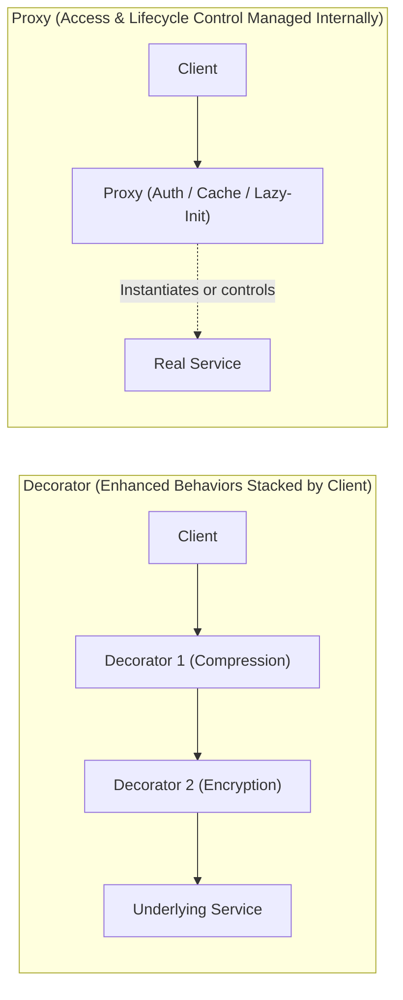

# Decorator vs. Proxy

> *"Decorator and Proxy both implement the exact same interface as the wrapped object. The difference lies in who manages the lifecycle of the object and why the wrapper exists in the first place."*  
> — Alexander Shvets, *Dive Into Design Patterns*

---

## 1. Executive Summary



---

## 2. Side-by-Side Comparison Matrix

| Dimension | Decorator | Proxy |
| :--- | :--- | :--- |
| **Primary Intent** | **Add new behaviors** and responsibilities dynamically | **Control access**, manage lifecycle, lazy load, or cache |
| **Who Manages Lifecycle?** | The **Client** creates both the target and the decorator stack | The **Proxy** often creates and manages the Real Subject |
| **Stacking / Nesting** | Designed to be **stacked in multiple layers** (Russian dolls) | Typically a **single layer** between client and service |
| **Client Awareness** | Client **explicitly constructs** the wrapper chain | Client is usually **unaware** that a proxy is being used |
| **Typical Flavors** | Encryption, Compression, Formatting, Metrics | Virtual (Lazy), Protection (Auth), Caching, Remote (RPC) |
| **Reference Pattern** | [Decorator Note](../structural/decorator.md) | [Proxy Note](../structural/proxy.md) |

---

## 3. Key Architectural Distinction

### Decorator: Client Composes the Stack
In [Decorator](../structural/decorator.md), the client is in the driver's seat. The client decides which features to layer on top of the base object:
```python
# Client builds the stack dynamically:
pipeline = CompressionDecorator(
    EncryptionDecorator(
        FileDataSource("app.log")
    )
)
```

### Proxy: Self-Managed Lifecycle
In [Proxy](../structural/proxy.md), the proxy manages the real object internally. The client only sees the interface and does not care that the proxy creates the real service lazily on first access:
```python
# Client just requests the service:
service: VideoService = CachedVideoProxy()  # Proxy creates RealVideoService lazily on demand!
```

---

## 4. Decision Rule

* **Choose Decorator if:** You want to give clients the freedom to customize and combine multiple optional behaviors at runtime (e.g., adding encryption, buffering, or compression to a stream).
* **Choose Proxy if:** You want to protect, optimize, or control access to a service object without clients needing to configure or know about the surrogate layer (e.g., Spring's `@Transactional` or Hibernate's lazy entity loading).
