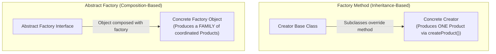

# Factory Method vs. Abstract Factory

> *"Both patterns deal with object creation and decoupling client code from concrete classes, leading many developers to confuse them. However, they operate through fundamentally different object-oriented mechanisms."*  
> — Alexander Shvets, *Dive Into Design Patterns*

---

## 1. Executive Summary: Core Difference



* **[Factory Method](../creational/factory-method.md)** relies on **Class Inheritance**. A class delegates creation to its subclasses by declaring an abstract method (`createTransport()`).
* **[Abstract Factory](../creational/abstract-factory.md)** relies on **Object Composition**. An object delegates the creation of a family of related products to an injected factory object (`FurnitureFactory`).

---

## 2. Side-by-Side Comparison Matrix

| Feature | Factory Method | Abstract Factory |
| :--- | :--- | :--- |
| **Primary Intent** | Create **one** product without coupling to its concrete class | Create **families of related products** guaranteed to match |
| **Core Mechanism** | **Inheritance** (Subclasses override a method) | **Composition** (An object delegates to a factory reference) |
| **Methods in Factory** | Typically **1** creation method (`createProduct()`) | **Multiple** creation methods (`createChair()`, `createSofa()`) |
| **Client Knowledge** | Client subclasses or invokes the Creator | Client is configured with an injected Concrete Factory |
| **Adding New Product Variants** | Easy: Create a new Product and Creator subclass | Easy: Create a new Concrete Factory subclass |
| **Adding New Product Types** | N/A (Only produces one product abstraction) | **Hard:** Breaks the `AbstractFactory` interface contract |
| **Complexity** | ★★☆ (Low to Medium) | ★★★ (High) |

---

## 3. Code Contrast (Python)

### Factory Method: Subclass-Driven
```python
from abc import ABC, abstractmethod

class Logistics(ABC):
    # 1. Factory method overridden by subclasses
    @abstractmethod
    def create_transport(self) -> Transport: ...

    def plan_delivery(self) -> None:
        transport = self.create_transport()
        transport.deliver()
```

### Abstract Factory: Family-Driven Delegation
```python
# Multiple product types coordinated in one factory interface:
class FurnitureFactory(ABC):
    @abstractmethod
    def create_chair(self) -> Chair: ...

    @abstractmethod
    def create_sofa(self) -> Sofa: ...

    @abstractmethod
    def create_coffee_table(self) -> CoffeeTable: ...
```

---

## 4. How They Evolve Together

In real-world architectures, systems often start with **Factory Method** (which is simpler and easier to customize via subclassing) and evolve toward **Abstract Factory**, **Prototype**, or **Builder** as the domain expands.

Frequently, an **Abstract Factory** is implemented internally as a collection of **Factory Methods**:
```python
class VictorianFurnitureFactory(FurnitureFactory):
    # Each method supplies a concrete product belonging to the Victorian family
    def create_chair(self) -> Chair:
        return VictorianChair()

    def create_sofa(self) -> Sofa:
        return VictorianSofa()
```

---

## 5. Decision Checklist: Which One Should You Choose?

* **Choose Factory Method if:**
  * You only need to create a single product type (e.g., just `Transport` or just `DialogButton`).
  * You want framework users to extend internal components by subclassing.
  * You don't know the exact class types beforehand.

* **Choose Abstract Factory if:**
  * Your system needs to produce **multiple categories of products** that must be stylistically or operationally compatible (e.g., UI Buttons + Checkboxes + Sliders).
  * You want to enforce that clients never mix incompatible cross-platform objects (e.g., never mix a Windows Button with a macOS Checkbox).
