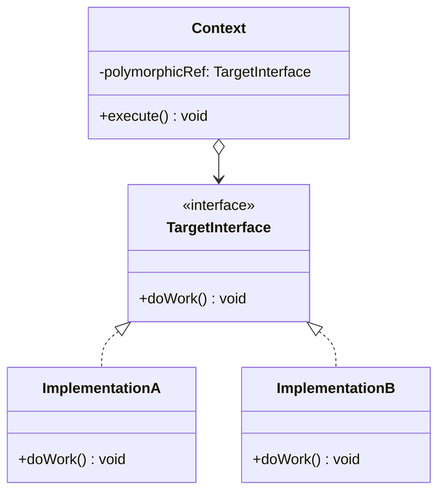

# Strategy vs. State

> *"If you look at the class diagrams for Strategy and State, they appear identical. Both rely on a Context class holding a reference to an interface and delegating execution. Yet, their architectural intents are polar opposites."*  
> — Alexander Shvets, *Dive Into Design Patterns*

---

## 1. Class Diagram Comparison: Structurally Identical



Despite having the **exact same structural topology**, the two patterns solve entirely different problems.

---

## 2. Side-by-Side Comparison Matrix

| Dimension | Strategy Pattern | State Pattern |
| :--- | :--- | :--- |
| **Primary Intent** | Swap interchangeable **algorithms** at runtime | Alter behavior when **internal state** changes (FSM) |
| **Sibling Awareness** | Strategies are **completely oblivious** to one another | States **know about each other** and trigger transitions |
| **Who Selects Implementation?** | The **Client** explicitly selects and injects the Strategy | The **Context or States** switch transitions automatically |
| **Frequency of Mutation** | Rare; typically set at initialization or by user choice | **Frequent**; changes dynamically on every state transition |
| **Metaphor** | "How to do something" (Driving vs Walking route) | "What state the object is in" (Draft vs Moderation vs Published) |
| **Complexity** | ★☆☆ (Low) | ★★☆ (Medium) |

---

## 3. Behavioral Differences Illustrated

### Strategy: Independent Algorithmic Tools
In [Strategy](../behavioral/strategy.md), the strategies are independent tools. `CreditCardPaymentStrategy` doesn't know `PayPalPaymentStrategy` exists, and neither strategy ever attempts to transform itself into the other:

```python
# Client chooses and injects strategy externally:
payment_service.set_strategy(PayPalPaymentStrategy())
payment_service.checkout(150.00)
```

### State: A Dynamic Finite State Machine
In [State](../behavioral/state.md), the states represent milestones in a lifecycle. The `DraftState` actively creates and transitions to `ModerationState` when `publish()` is called:

```python
class DraftState(State):
    def publish(self) -> None:
        print("Moving document from Draft to Moderation...")
        # State object transitions the context to the next state internally!
        self.document.change_state(ModerationState(self.document))
```

---

## 4. Decision Checklist: Strategy or State?

* **Choose Strategy if:**
  * You have multiple ways of performing a single computation (e.g., sorting, route planning, tax calculation, compression).
  * The client wants to control which algorithm is executed.
  * The implementations are independent and don't need to transition between one another.

* **Choose State if:**
  * You are modeling an object that transitions through distinct lifecycle phases (e.g., Order: `Pending` -> `Paid` -> `Shipped`).
  * You have massive `switch (currentState)` statements duplicated across multiple methods.
  * The behavior of multiple methods changes simultaneously when an event occurs.
