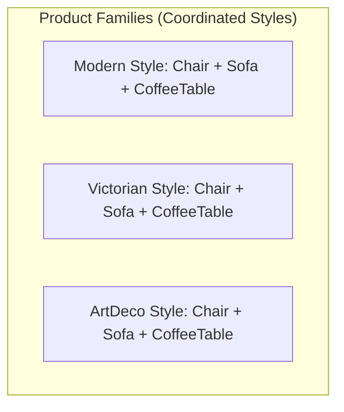
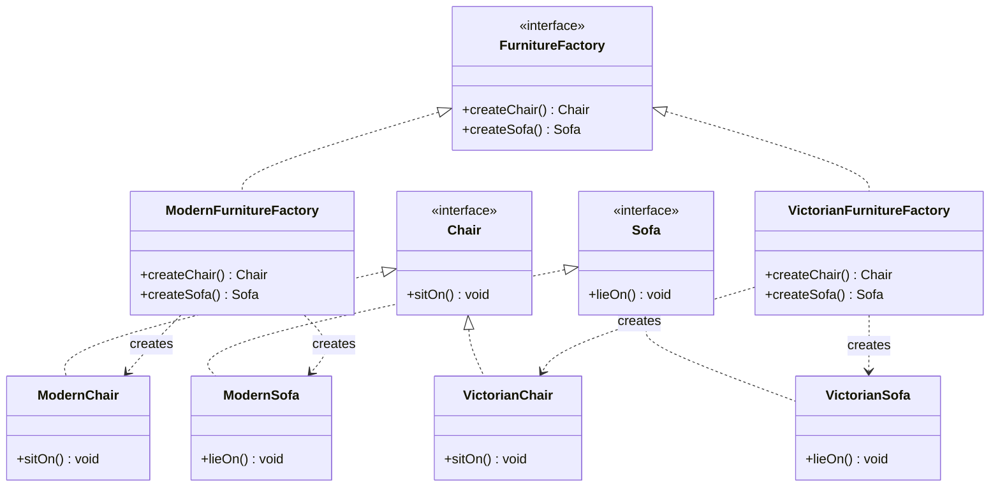
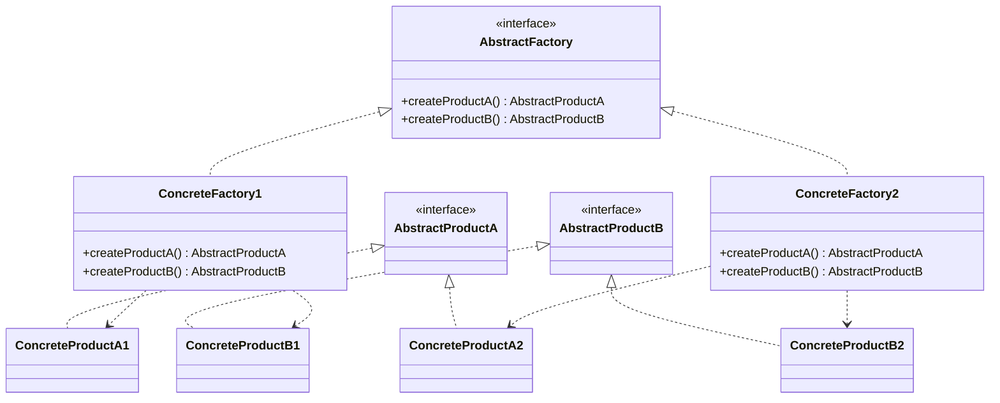
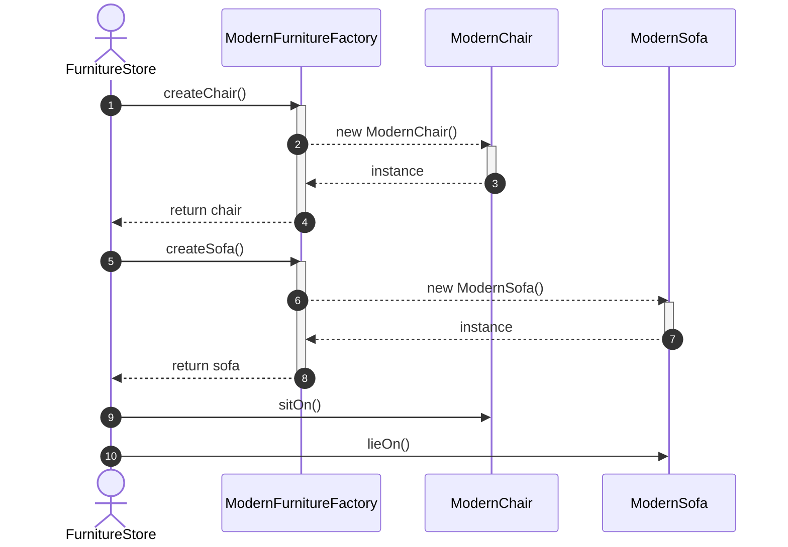

# Abstract Factory

> **Also known as:** Kit  
> **Classification:** Creational Pattern  
> **Complexity:** ★★★

---

## 1. Intent

**Abstract Factory** is a creational design pattern that lets you produce families of related or dependent objects without specifying their concrete classes.

---

## 2. Problem

Imagine you are building a furniture shop simulator. Your code needs to model:
1. A family of related products: `Chair`, `Sofa`, `CoffeeTable`.
2. Several distinct variants/styles: `Modern`, `Victorian`, `ArtDeco`.



You need a mechanism to instantiate individual furniture items such that:
* Objects within a style variant always match each other (you don't want a customer getting a Victorian chair with a Modern sofa).
* You don't want to modify existing client code whenever a new furniture family or product line is introduced.

---

## 3. Motivation

Consider a cross-platform desktop UI toolkit (like PyQt, PySide, or Tkinter). A client application needs to render standard controls:
* `Button`, `Checkbox`, `Scrollbar`.
* On Windows, all controls must follow Windows Fluent design rules.
* On macOS, all controls must adhere to Apple Cocoa styling.

If client code mixes `WindowsButton` with `MacCheckbox`, the UI looks broken. The application needs a single, coordinated factory to produce a coherent family of UI components matching the active operating system.

---

## 4. Solution

The Abstract Factory pattern recommends:
1. Declaring abstract interfaces for each distinct product category (`Chair`, `Sofa`, `CoffeeTable`).
2. Declaring an **Abstract Factory** interface (`FurnitureFactory`) containing creation methods for every product in the family:
   * `createChair(): Chair`
   * `createSofa(): Sofa`
   * `createCoffeeTable(): CoffeeTable`
3. Implementing concrete factory classes for each style variant (`ModernFurnitureFactory`, `VictorianFurnitureFactory`).

Client code interacts exclusively with the abstract factory and product interfaces.



---

## 5. Structure



---

## 6. Participants

1. **Abstract Products (`Chair`, `Sofa`):** Declare interfaces for a set of distinct but related products that make up a product family.
2. **Concrete Products (`ModernChair`, `VictorianChair`):** Group implementations of abstract products by style or variant.
3. **Abstract Factory (`FurnitureFactory`):** Declares a set of creation methods for each abstract product.
4. **Concrete Factories (`ModernFurnitureFactory`, `VictorianFurnitureFactory`):** Implement the creation methods, returning concrete products that belong to the same family variant.
5. **Client:** Relies exclusively on abstract interfaces declared by the Abstract Factory and Abstract Products.

---

## 7. Code Implementation (Python 3)

```python
from abc import ABC, abstractmethod


# ==========================================
# 1. Abstract Products
# ==========================================
class Chair(ABC):
    @abstractmethod
    def sit_on(self) -> None:
        pass

    @abstractmethod
    def has_legs(self) -> bool:
        pass


class Sofa(ABC):
    @abstractmethod
    def lie_on(self) -> None:
        pass

    @abstractmethod
    def get_capacity(self) -> int:
        pass


# ==========================================
# 2. Concrete Products: Modern Family
# ==========================================
class ModernChair(Chair):
    def sit_on(self) -> None:
        print("Sitting on an ergonomic, minimalist modern chair.")

    def has_legs(self) -> bool:
        return False  # Cantilever base


class ModernSofa(Sofa):
    def lie_on(self) -> None:
        print("Relaxing on a sleek, low-profile modern sofa.")

    def get_capacity(self) -> int:
        return 3


# ==========================================
# 3. Concrete Products: Victorian Family
# ==========================================
class VictorianChair(Chair):
    def sit_on(self) -> None:
        print("Sitting on an ornate carved-wood Victorian armchair.")

    def has_legs(self) -> bool:
        return True


class VictorianSofa(Sofa):
    def lie_on(self) -> None:
        print("Reclining on a tufted velvet Victorian chesterfield.")

    def get_capacity(self) -> int:
        return 4


# ==========================================
# 4. Abstract Factory Interface
# ==========================================
class FurnitureFactory(ABC):
    @abstractmethod
    def create_chair(self) -> Chair:
        pass

    @abstractmethod
    def create_sofa(self) -> Sofa:
        pass


# ==========================================
# 5. Concrete Factories
# ==========================================
class ModernFurnitureFactory(FurnitureFactory):
    def create_chair(self) -> Chair:
        return ModernChair()

    def create_sofa(self) -> Sofa:
        return ModernSofa()


class VictorianFurnitureFactory(FurnitureFactory):
    def create_chair(self) -> Chair:
        return VictorianChair()

    def create_sofa(self) -> Sofa:
        return VictorianSofa()


# ==========================================
# 6. Client Application
# ==========================================
class FurnitureStore:
    def __init__(self, factory: FurnitureFactory) -> None:
        # Client is decoupled from concrete furniture classes!
        self._chair = factory.create_chair()
        self._sofa = factory.create_sofa()

    def demonstrate_suite(self) -> None:
        self._chair.sit_on()
        self._sofa.lie_on()


if __name__ == "__main__":
    chosen_style = "modern"
    factory: FurnitureFactory = (
        ModernFurnitureFactory() if chosen_style.lower() == "modern" else VictorianFurnitureFactory()
    )
    store = FurnitureStore(factory)
    store.demonstrate_suite()
```

---

## 8. Execution Flow



---

## 9. When to Use (Applicability)

* **Coordinated Product Families:** When your code needs to work with various families of related products, but you do not want it to depend on concrete classes.
* **Guaranteeing Compatibility:** When you want to enforce architectural consistency across related components (e.g., UI controls, database drivers, operating system integrations).
* **Cross-Platform Abstractions:** When isolating client code from platform-specific APIs.

---

## 10. When NOT to Use (Anti-Scenarios)

* **Single Product Types:** If you do not have families of related products, use [Factory Method](factory-method.md) instead.
* **Frequently Changing Product Categories:** If you frequently add new product types (e.g., adding `Desk`, `Bed`, `Lamp`), every new product forces modifications to the `FurnitureFactory` interface and breaks all existing concrete factories.
* **Simple Systems:** Avoid introducing Abstract Factory if your system only supports a single theme with no realistic requirement for alternative skins.

---

## 11. Advantages

* **Guaranteed Product Compatibility:** Products obtained from a factory are guaranteed to work together harmoniously.
* **Eliminates Concrete Coupling:** Client code deals strictly with abstract interfaces.
* **Single Responsibility Principle (SRP):** Product creation code is isolated in dedicated concrete factory classes.
* **Open/Closed Principle (OCP):** Introducing a new style family (e.g., `ArtDecoFurnitureFactory`) requires zero modifications to existing client code.

---

## 12. Disadvantages

* **High Initial Complexity:** Demands a significant number of interfaces, abstract classes, and concrete implementations before business value is written.
* **Rigid Product Catalog:** Adding a new product category requires editing the `AbstractFactory` interface and updating every existing concrete factory subclass.

---

## 13. Common Mistakes & Misconceptions

### Mistake 1: Confusing Factory Method with Abstract Factory
* **Factory Method:** Relies on **class inheritance**. A class delegates creation to its subclasses via a single method.
* **Abstract Factory:** Relies on **object composition**. An object delegates creation to an injected factory object capable of producing multiple related products.

### Mistake 2: Mixing Families
Allowing a client to instantiate products from multiple factories simultaneously (e.g., passing both `ModernFurnitureFactory` and `VictorianFurnitureFactory` to the same UI screen) defeats the purpose of coordinated family integrity.

---

## 14. Related Patterns

* **[Factory Method](factory-method.md):** Abstract Factory classes are often implemented as a suite of Factory Methods.
* **[Builder](builder.md):** Abstract Factory focuses on producing families of related objects immediately; Builder focuses on constructing a single complex object step by step.
* **[Singleton](singleton.md):** Concrete factories are almost always implemented as Singletons because only one instance of a specific factory is needed per application lifecycle.

---

## 15. Real-World Applications

### Python Standard Library
* `javax.xml.parsers.DocumentBuilderFactory.newInstance()`: Returns a factory that produces XML document builders conforming to specific parser implementations.
* `javax.xml.transform.TransformerFactory.newInstance()`: Creates XML transformers.

### Spring Framework
* `org.springframework.beans.factory.BeanFactory`: Top-level factory producing beans configured across an application context.

---

## 16. Interview Questions & Self-Assessment

### Q1: What is the primary problem solved by Abstract Factory?
> **Answer:** It ensures that client code receives objects from the same product family that are guaranteed to be compatible with each other, without tying client code to concrete classes.

### Q2: How does Abstract Factory uphold the Open/Closed Principle?
> **Answer:** You can add a new product family (e.g., `FuturisticFurnitureFactory`) without altering the client code that consumes the `FurnitureFactory` interface.

### Q3: What is the main drawback when adding a new product *type* to an Abstract Factory?
> **Answer:** It violates OCP regarding product categories: adding a new product method (e.g., `createDesk()`) requires modifying the `FurnitureFactory` interface and all existing concrete factory implementations.

### Q4: How is Abstract Factory usually wired into an application?
> **Answer:** At application startup, an initialization phase reads a configuration file or environment flag and instantiates one concrete factory instance (often as a Singleton), which is then injected into services via Dependency Injection.

### Q5: Can Abstract Factory return existing cached instances?
> **Answer:** Yes. While factories are typically creational, implementations can return pooled or cached instances as long as they satisfy the product interface contract.

---

## 17. Key Takeaways

1. **Family Coordinator:** Abstract Factory produces families of related, compatible objects.
2. **Composition Over Inheritance:** Works by composing factory objects into client classes, rather than relying on subclassing.
3. **Double Abstraction:** Abstract Factory operates at two levels of abstraction: abstract factories producing abstract products.
4. **Product Line Stability:** Ideal when the product categories are fixed, but the stylistic variants are expected to grow.
