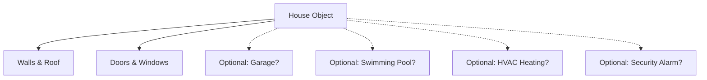
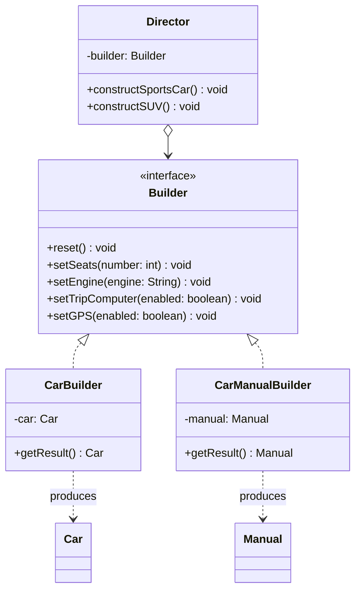
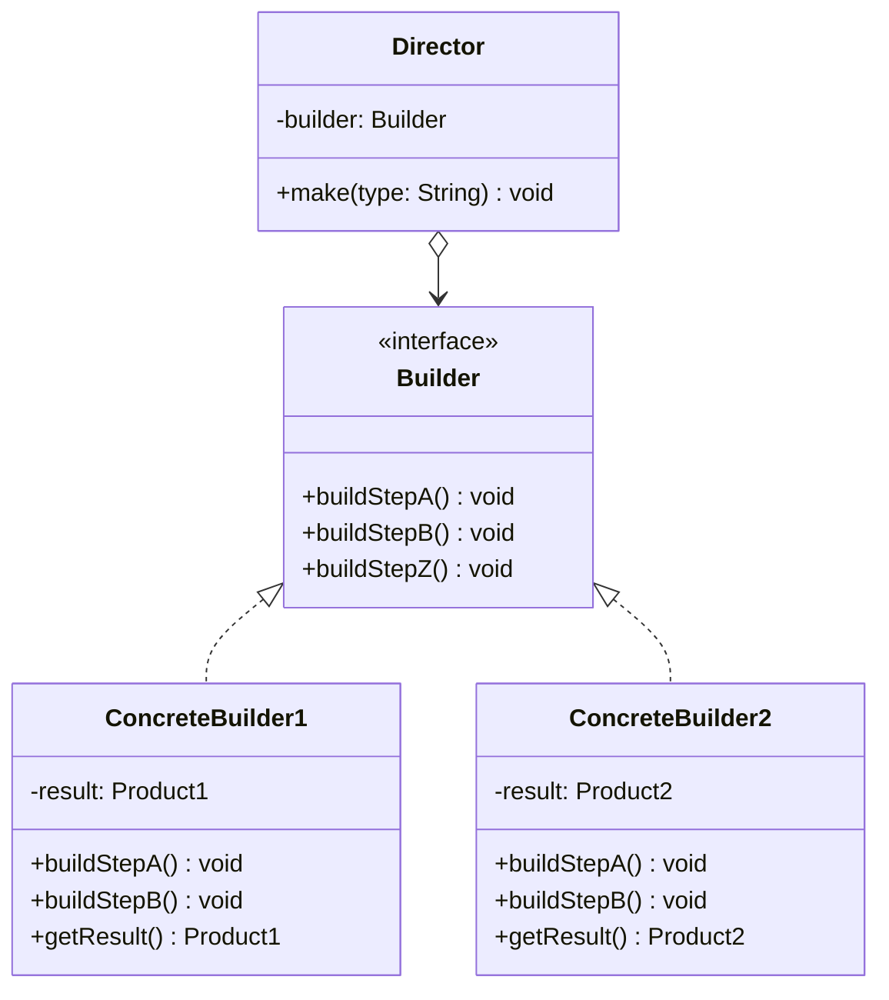
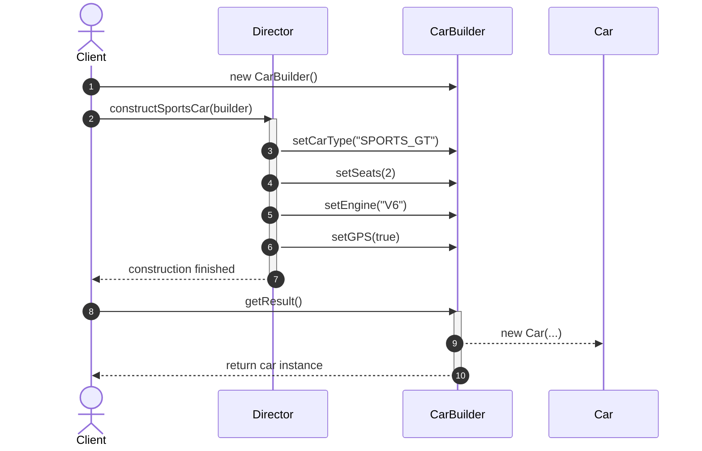

# Builder

> **Classification:** Creational Pattern  
> **Complexity:** ★★☆

---

## 1. Intent

**Builder** is a creational design pattern that lets you construct complex objects step by step. The pattern allows you to produce different types and representations of an object using the same construction code.

---

## 2. Problem

Imagine a complex object that requires laborious, step-by-step initialization of many fields and nested objects. 

Consider building a `House`. A basic house requires four walls, a roof, windows, and doors. But what if you need a luxury house with a garage, swimming pool, heating system, high-end electrical wiring, architectural landscaping, and statues?



### The Inadequate Approaches:
1. **The Subclass Explosion Trap:** Creating subclasses for every parameter combination (`HouseWithGarage`, `HouseWithPoolAndGarden`) leads to an unmaintainable class hierarchy.
2. **The Telescoping Constructor Anti-Pattern:** Creating a giant constructor with 25 parameters:
   ```python
class House:
    def __init__(self, windows: int, doors: int, rooms: int, has_garage: bool, 
                 has_pool: bool, has_roof: bool, has_hvac: bool, **kwargs) -> None:
        ...
```
   Calling this constructor is error-prone, unreadable, and forces callers to pass `null` or `false` for unused parameters:
   ```python
# What do these boolean values mean? Inverting positional args leads to critical bugs!
house = House(4, 2, 3, False, True, True, False, None, 0)
```

---

## 3. Motivation

Consider building cars in an automotive manufacturing software system:
* A `Car` requires an engine, transmission, GPS, trip computer, and seating capacity.
* The company also produces a user manual (`CarManual`) for each model describing every installed feature.

You want the **same construction sequence** (install engine -> mount seats -> setup GPS) to produce both a real drivable `Car` object and a technical documentation `CarManual` object without duplicating assembly algorithms.

---

## 4. Solution

The Builder pattern extracts object construction out of its own class and moves it to separate objects called **Builders**.

1. The pattern breaks object construction into discrete steps (`buildEngine()`, `setSeats()`, `setGPS()`).
2. You define a common `Builder` interface declaring these construction steps.
3. Multiple concrete builders implement the interface:
   * `CarBuilder`: Assembles real physical components into a `Car`.
   * `CarManualBuilder`: Documents installed components into a printed `CarManual`.
4. An optional **Director** class defines the order of construction steps, allowing you to reuse specific configurations (e.g., "Build Sports Car", "Build SUV").



---

## 5. Structure



---

## 6. Participants

1. **Builder Interface:** Declares product construction steps that are common to all builders.
2. **Concrete Builders:** Provide different implementations of the construction steps. They construct and track the product being built, providing a `getResult()` method to retrieve the finished object.
3. **Products (`Car`, `Manual`):** The resulting objects. Products produced by different builders don't have to share the same interface.
4. **Director:** Defines the sequence in which building steps are called, so you can create and reuse specific configurations of products.
5. **Client:** Associates a concrete builder with the director, triggers construction, and retrieves the final product from the builder.

---

## 7. Code Implementation (Python 3)

```python
from abc import ABC, abstractmethod
from typing import Optional


# ==========================================
# 1. Resulting Product Classes
# ==========================================
class Car:
    def __init__(self, car_type: str, seats: int, engine: str, has_gps: bool) -> None:
        self.car_type = car_type
        self.seats = seats
        self.engine = engine
        self.has_gps = has_gps

    def print_specs(self) -> None:
        print(f"Car -> Type: {self.car_type}, Seats: {self.seats}, Engine: {self.engine}, GPS: {self.has_gps}")


class Manual:
    def __init__(self, car_type: str, seats: int, engine: str, has_gps: bool) -> None:
        self.car_type = car_type
        self.seats = seats
        self.engine = engine
        self.has_gps = has_gps

    def print_manual(self) -> str:
        gps_txt = "Available in Dashboard Settings" if self.has_gps else "None"
        return f"User Manual for {self.car_type}: {self.seats} passenger capacity with {self.engine} engine. GPS: {gps_txt}"


# ==========================================
# 2. Builder Interface
# ==========================================
class Builder(ABC):
    @abstractmethod
    def reset(self) -> None:
        pass

    @abstractmethod
    def set_car_type(self, car_type: str) -> None:
        pass

    @abstractmethod
    def set_seats(self, seats: int) -> None:
        pass

    @abstractmethod
    def set_engine(self, engine: str) -> None:
        pass

    @abstractmethod
    def set_gps(self, has_gps: bool) -> None:
        pass


# ==========================================
# 3. Concrete Builders
# ==========================================
class CarBuilder(Builder):
    def __init__(self) -> None:
        self.reset()

    def reset(self) -> None:
        self._car_type = ""
        self._seats = 0
        self._engine = ""
        self._has_gps = False

    def set_car_type(self, car_type: str) -> None:
        self._car_type = car_type

    def set_seats(self, seats: int) -> None:
        self._seats = seats

    def set_engine(self, engine: str) -> None:
        self._engine = engine

    def set_gps(self, has_gps: bool) -> None:
        self._has_gps = has_gps

    def get_result(self) -> Car:
        product = Car(self._car_type, self._seats, self._engine, self._has_gps)
        self.reset()
        return product


class CarManualBuilder(Builder):
    def __init__(self) -> None:
        self.reset()

    def reset(self) -> None:
        self._car_type = ""
        self._seats = 0
        self._engine = ""
        self._has_gps = False

    def set_car_type(self, car_type: str) -> None:
        self._car_type = car_type

    def set_seats(self, seats: int) -> None:
        self._seats = seats

    def set_engine(self, engine: str) -> None:
        self._engine = engine

    def set_gps(self, has_gps: bool) -> None:
        self._has_gps = has_gps

    def get_result(self) -> Manual:
        product = Manual(self._car_type, self._seats, self._engine, self._has_gps)
        self.reset()
        return product


# ==========================================
# 4. Director (Defines Construction Sequences)
# ==========================================
class Director:
    def make_sports_car(self, builder: Builder) -> None:
        builder.reset()
        builder.set_car_type("SPORTS_CAR")
        builder.set_seats(2)
        builder.set_engine("3.0L Twin-Turbo V6")
        builder.set_gps(True)

    def make_suv(self, builder: Builder) -> None:
        builder.reset()
        builder.set_car_type("SUV")
        builder.set_seats(7)
        builder.set_engine("2.5L Hybrid Inline-4")
        builder.set_gps(True)


# ==========================================
# 5. Client Execution Demo
# ==========================================
if __name__ == "__main__":
    director = Director()

    # 1. Build a sports car
    car_builder = CarBuilder()
    director.make_sports_car(car_builder)
    sports_car = car_builder.get_result()
    sports_car.print_specs()

    # 2. Build the corresponding user manual using the exact same steps!
    manual_builder = CarManualBuilder()
    director.make_sports_car(manual_builder)
    manual = manual_builder.get_result()
    print(manual.print_manual())
```

---

## 8. Execution Flow



---

## 9. When to Use (Applicability)

* **Eliminating Telescoping Constructors:** When a constructor has more than 4 or 5 parameters, especially when many parameters are optional or boolean flags.
* **Varying Representations:** When your code must create different representations of some product (e.g., JSON, XML, binary, or DTO vs Domain Entity) using the same multi-step algorithm.
* **Constructing Recursive/Composite Trees:** When building [Composite](../structural/composite.md) trees or complex hierarchical data structures step by step.

---

## 10. When NOT to Use (Anti-Scenarios)

* **Simple Domain Objects:** If an object only has 2 or 3 immutable fields, a standard Python `@dataclass` or named tuple is much cleaner.
* **Entities with Completely Different Lifecycles:** If the parts of an object are created hours or days apart based on external events, an event-driven state machine or repository persistence model is more suitable than a synchronous builder.

---

## 11. Advantages

* **Construct Objects Step-by-Step:** You can defer execution steps or run steps recursively.
* **Reuses Construction Code:** The same assembly algorithm can build completely different products (e.g., `Car` vs `CarManual`).
* **Single Responsibility Principle (SRP):** Complex construction code is decoupled from the business logic of the resulting product.
* **Immutability:** Allows you to construct completely immutable objects without exposing public setters.

---

## 12. Disadvantages

* **Increased Code Complexity:** Requires multiple new builder and director classes.
* **Duplicated Fields:** Builders often duplicate the fields of the target product.

---

## 13. Common Mistakes & Misconceptions

### Mistake 1: Confusing "Fluent Method Chaining" with the GoF Builder Pattern
Many developers assume `new UserBuilder().setName("Alice").setAge(30).build()` is the complete Builder pattern.
* **Fluent Interface:** A programming style where methods return `this` to allow method chaining.
* **GoF Builder Pattern:** An architectural pattern designed to allow **different concrete builders** to construct **different representations** under the direction of an orchestrator (**Director**).

### Mistake 2: Missing the `reset()` Step in Reusable Builders
If a concrete builder is reused to construct multiple products, failing to reset internal state leads to state contamination from previous builds.

---

## 14. Related Patterns

* **[Abstract Factory](abstract-factory.md):** Abstract Factory creates families of related objects immediately in one shot; Builder constructs a single complex object step by step.
* **[Composite](../structural/composite.md):** Builders are commonly used to assemble complex nested Composite trees.
* **[Singleton](singleton.md):** Directors are often implemented as Singletons.

---

## 15. Real-World Applications

### Python Standard Library
* `email.message.EmailMessage`: Builds multipart MIME email payloads with headers and attachments.
* `urllib.parse.urlunparse()`: Incrementally composes complex URLs from tuples.
* `subprocess.Popen`: Incrementally configures arguments, environment, and pipes before process launch.

### Spring Framework
* `org.springframework.web.util.UriComponentsBuilder`: Constructs complex URL paths, query parameters, and fragments.
* Lombok `@Builder`: Automatically generates inner builder classes for clean record-like instantiation.

---

## 16. Interview Questions & Self-Assessment

### Q1: Why is Builder preferred over a constructor with many parameters?
> **Answer:** It eliminates the telescoping constructor anti-pattern, prevents parameter ordering bugs (especially with identical types like multiple `int`s or `boolean`s), and produces self-documenting code.

### Q2: Is the `Director` class mandatory in the Builder pattern?
> **Answer:** No. In modern software engineering, clients frequently act as their own directors by directly chaining builder steps. The Director is only necessary when a standardized construction sequence must be reused across different parts of the application.

### Q3: Why doesn't the `Builder` interface declare a `getResult()` method?
> **Answer:** Because different concrete builders may produce products that have completely different interfaces and no common superclass (e.g., a `Car` and a `CarManual` share zero methods). Declaring `getResult()` in the builder interface would require an awkward `Object` return type.

### Q4: How does Builder facilitate object immutability?
> **Answer:** A builder accumulates state in its mutable fields during the building phase, validates invariants at the end, and instantiates an immutable object whose fields are `final` with no public setters.

### Q5: How does Builder contrast with Factory Method?
> **Answer:** Factory Method produces an object in a single method call via subclassing; Builder produces an object through a controlled sequence of method calls via composition.

---

## 17. Key Takeaways

1. **Step-by-Step Construction:** Decomposes monster constructors into clear, isolated building phases.
2. **Same Process, Varied Products:** Allows one assembly director to construct physical items, audit manuals, or test mocks.
3. **Immutability Friend:** The best way to construct rich, validated, immutable domain entities.
4. **Director is Optional:** Use a Director for fixed recipe sequences, or direct fluent chaining for ad-hoc construction.
