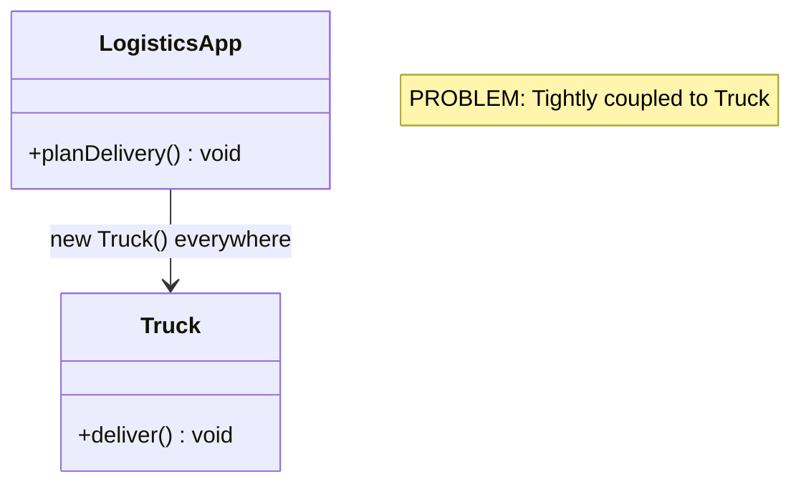
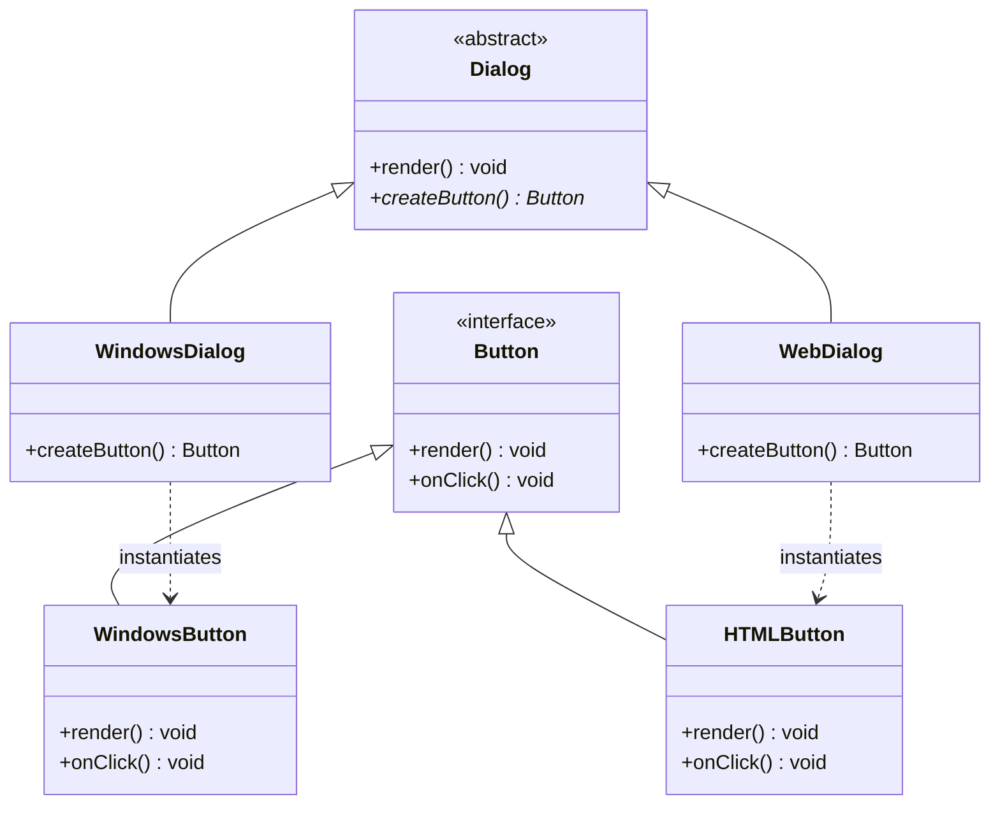
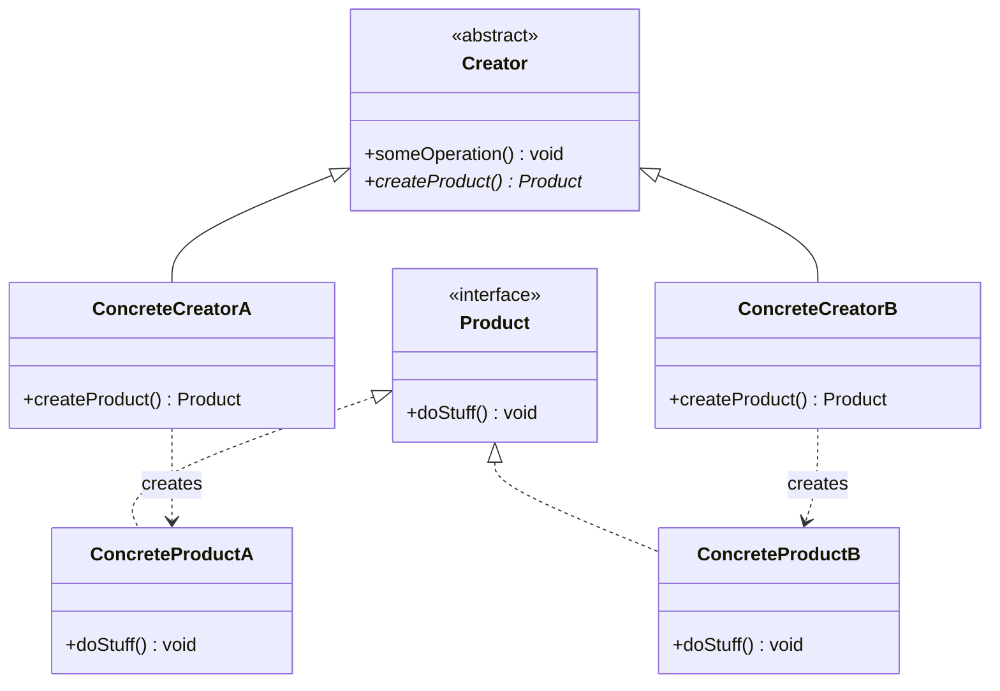
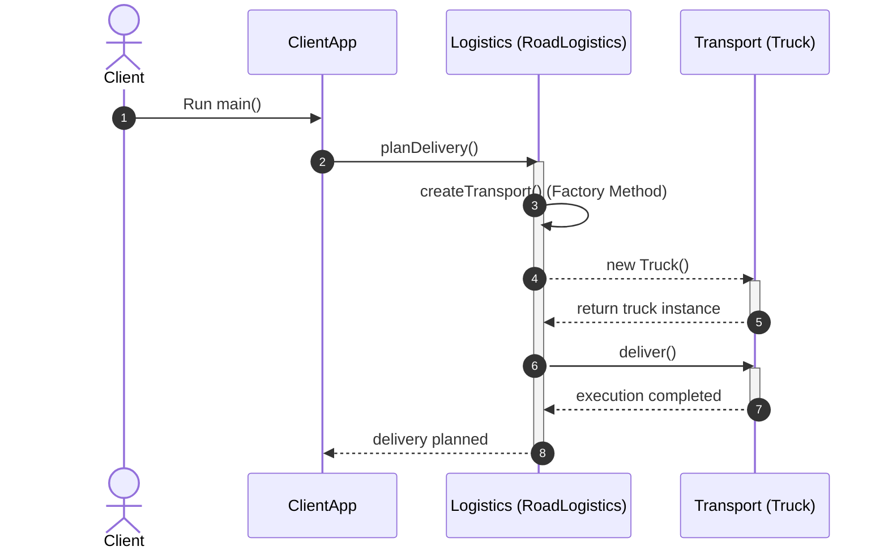

# Factory Method

> **Also known as:** Virtual Constructor  
> **Classification:** Creational Pattern  
> **Complexity:** ★★☆

---

## 1. Intent

**Factory Method** is a creational design pattern that provides an interface for creating objects in a superclass, but allows subclasses to alter the type of objects that will be created.

---

## 2. Problem

Imagine you are developing a logistics management application. The first version of your application handles only road transportation, so the bulk of your business logic lives inside a `Truck` class.

After your app becomes popular, sea freight companies request integration for maritime shipping. Adding a `Ship` class creates a significant architectural dilemma:

* Most of your existing codebase is tightly coupled to the concrete `Truck` class.
* Introducing `Ship` requires altering conditional logic (`if-else` or `switch` statements) throughout your routing, scheduling, and billing code.
* Each time you add a new transportation mode (e.g., Air Freight, Rail Transport), you must modify core business code, risking regressions across existing modes.



---

## 3. Motivation

Consider a cross-platform user interface framework. You want to render dialog boxes with buttons across both desktop (Windows) and web (HTML):

* A `Dialog` class must render a window, add title bars, and display an **OK/Cancel** button.
* On Windows, buttons look and behave like native Windows OS controls (`WindowsButton`).
* On the Web, buttons must render as valid HTML/CSS markup (`HTMLButton`).

If the base `Dialog` class hardcodes `new WindowsButton()`, the framework cannot be reused for web environments without rewriting the dialog logic. The base dialog needs a button, but should not care which concrete button is rendered.

---

## 4. Solution

The Factory Method pattern suggests replacing direct object construction calls (using the `new` operator) with calls to a special **factory method**. The objects are still created via `new`, but the instantiation occurs inside an overridable method.

Subclasses can override this factory method to return different concrete types of products, as long as all products implement a common interface.



---

## 5. Structure



---

## 6. Participants

1. **Product (`Button` / `Transport`):** Declares the common interface for all objects produced by the creator and its subclasses.
2. **Concrete Products (`WindowsButton`, `HTMLButton`):** Specific implementations of the product interface.
3. **Creator (`Dialog` / `Logistics`):** Declares the abstract factory method that returns a new product object. The return type matches the Product interface. The creator often contains core business logic that relies on the product returned by the factory method.
4. **Concrete Creators (`WindowsDialog`, `WebDialog`):** Overrides the factory method to return an instance of a concrete product.

---

## 7. Code Implementation (Python 3)

```python
from abc import ABC, abstractmethod


# ==========================================
# 1. Product Interface
# ==========================================
class Transport(ABC):
    """Product declares the interface common to all objects created by creators."""

    @abstractmethod
    def deliver(self) -> None:
        pass


# ==========================================
# 2. Concrete Products
# ==========================================
class Truck(Transport):
    def deliver(self) -> None:
        print("Delivering cargo overland in a refrigerated truck container.")


class Ship(Transport):
    def deliver(self) -> None:
        print("Delivering cargo across oceans via container cargo ship.")


# ==========================================
# 3. Creator (Base Class)
# ==========================================
class Logistics(ABC):
    """Creator declares the factory method that returns new product instances.
    Contains core business logic relying on the abstract product.
    """

    def plan_delivery(self) -> None:
        # Call the factory method to obtain a product
        transport = self.create_transport()
        print("Logistics: Planning delivery route and manifesting cargo...")
        transport.deliver()

    @abstractmethod
    def create_transport(self) -> Transport:
        """The Factory Method: subclasses override this to supply concrete products."""
        pass


# ==========================================
# 4. Concrete Creators
# ==========================================
class RoadLogistics(Logistics):
    def create_transport(self) -> Transport:
        return Truck()


class SeaLogistics(Logistics):
    def create_transport(self) -> Transport:
        return Ship()


# ==========================================
# 5. Client Execution Demo
# ==========================================
if __name__ == "__main__":
    environment = "sea"  # e.g., read from configuration or environment variable

    if environment.lower() == "road":
        logistics: Logistics = RoadLogistics()
    elif environment.lower() == "sea":
        logistics = SeaLogistics()
    else:
        raise ValueError(f"Unknown logistics mode: {environment}")

    # Client operates uniformly via the abstract Logistics interface
    logistics.plan_delivery()
```

---

## 8. Execution Flow



---

## 9. When to Use (Applicability)

* **Unknown Types Ahead of Time:** When you don't know beforehand the exact types and dependencies of the objects your code will work with.
* **Framework Extensibility:** When you want to provide users of your library or framework with a clean mechanism to extend its internal components by subclassing the creator.
* **Resource Pooling / Reusability:** When you want to save system resources by reusing existing objects from an internal pool or cache instead of rebuilding them repeatedly (constructors must always create new instances; a factory method can return an existing cached instance).

---

## 10. When NOT to Use (Anti-Scenarios)

* **Single Stable Product:** If you have only one implementation of a class and no realistic expectation of alternative variants, introducing a Creator and ConcreteCreator is unjustified boilerplate.
* **Simple Data Structures:** Value objects, records, and simple DTOs do not warrant a Factory Method; standard constructors or records are preferable.
* **Trivial Instantiation:** When standard `new ConcreteObject()` does not cause coupling issues or testability friction.

---

## 11. Advantages

* **Eliminates Tight Coupling:** Decouples the core business logic from concrete product classes.
* **Single Responsibility Principle (SRP):** Product creation code is isolated in one specific place in your codebase.
* **Open/Closed Principle (OCP):** You can introduce new product variants into the application without breaking existing client code.

---

## 12. Disadvantages

* **Subclass Proliferation:** You may need to create a new creator subclass just to instantiate a single new product class.
* **Increased Architectural Layers:** If the application has a simple hierarchy, the added abstraction can make the code harder to follow for junior developers.

---

## 13. Common Mistakes & Misconceptions

### Mistake 1: Confusing "Simple Factory" with "Factory Method"
* **Simple Factory (Idiom):** A single class with a static method containing a large `switch` or `if-else` statement that instantiates classes based on arguments.
* **Factory Method (Pattern):** An object-oriented pattern relying on **inheritance and polymorphism**, where subclasses override a virtual method to supply the concrete product.

```python
# ANTI-PATTERN: Simple Factory idiom with hardcoded branching, NOT Factory Method
class SimpleTransportFactory:
    @staticmethod
    def create(transport_type: str) -> Transport:
        if transport_type.lower() == "truck":
            return Truck()
        elif transport_type.lower() == "ship":
            return Ship()
        raise ValueError(f"Unknown transport type: {transport_type}")
```

### Mistake 2: Hardcoding Switch Statements in the Base Creator
Developers sometimes implement the base factory method with a switch statement over string flags. This violates the Open/Closed Principle and defeats the purpose of the pattern.

### Mistake 3: Downcasting Products in Client Code
If client code calls `logistics.createTransport()` and immediately casts the result:
```python
# ANTI-PATTERN: Breaks polymorphism via concrete type inspection
transport = logistics.create_transport()
if isinstance(transport, Truck):
    transport.haul_refrigerated_goods()  # Defeats polymorphism!
```
The client is tightly coupled to `Truck`, defeating the pattern's decoupling benefits.

---

## 14. Related Patterns

* **[Abstract Factory](abstract-factory.md):** Abstract Factory is often implemented using a set of Factory Methods.
* **[Template Method](../behavioral/template-method.md):** Factory Methods are frequently called inside the template methods of the Creator class.
* **[Prototype](prototype.md):** Prototype does not require subclassing the Creator, but requires an initialize operation on the cloned product.

---

## 15. Real-World Applications

### Python Standard Library
* `logging.getLogger(name)`: Factory method returning logger instances configured per hierarchy level.
* `urllib.request.build_opener(*handlers)`: Factory that constructs customized `OpenerDirector` instances.
* `tempfile.NamedTemporaryFile()`: Produces OS-appropriate file-like temporary objects.

### Spring Framework
* `org.springframework.beans.factory.FactoryBean<T>`: The fundamental factory interface in Spring used to construct complex beans in the IoC container.
* `org.springframework.web.servlet.ViewResolver`: Subclasses resolve and create concrete `View` instances based on view names.

---

## 16. Interview Questions & Self-Assessment

### Q1: What is the key difference between Simple Factory and Factory Method?
> **Answer:** Simple Factory is a single class with a conditional method that centralizes object creation. Factory Method delegates object creation to subclasses via inheritance, eliminating switch statements and complying with the Open/Closed Principle.

### Q2: Can a Factory Method be parameterized?
> **Answer:** Yes. A factory method can accept arguments (e.g., `createTransport(String type)`) to produce variations within a subclass's product family.

### Q3: Must the Creator class always be abstract?
> **Answer:** No. The creator can provide a sensible default implementation of the factory method returning a standard product, allowing subclasses to override it only when customization is required.

### Q4: How does Factory Method promote testability?
> **Answer:** In automated tests, you can create a `TestLogistics` subclass that overrides `createTransport()` to return a `MockTransport`, allowing you to test delivery planning without touching real hardware or databases.

### Q5: Does Factory Method violate the Single Responsibility Principle?
> **Answer:** No; it reinforces SRP by separating product construction logic from business processing logic.

---

## 17. Key Takeaways

1. **Virtual Constructor:** Factory Method is the object-oriented alternative to direct constructor invocations.
2. **Polymorphic Creation:** The Creator superclass relies on the Product interface; subclasses determine the concrete class instantiated.
3. **OCP Champion:** Adding a new product requires creating a new Product class and a new Creator subclass—existing code remains untouched.
4. **Beware Subclass Explosion:** If your hierarchy becomes too deep, consider refactoring toward [Abstract Factory](abstract-factory.md) or [Prototype](prototype.md).
