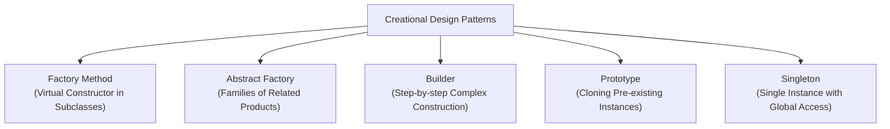

# Creational Design Patterns 🏭

> *"Creational design patterns provide various object creation mechanisms, which increase flexibility and reuse of existing code."*  
> — Alexander Shvets, *Dive Into Design Patterns*

Creational patterns handle the complexities of object creation. Rather than instantiating objects directly with the `new` operator across your business logic—which scatters concrete dependencies throughout your codebase—creational patterns encapsulate instantiation rules behind clean, polymorphic abstractions.

---

## 🧭 Creational Decision Rubric

| Pattern | Complexity | When to Choose |
| :--- | :--- | :--- |
| **[Factory Method](factory-method.md)** | ★★☆ | When you don't know the exact types of objects your code will work with beforehand, or you want to allow framework users to extend internal components. |
| **[Abstract Factory](abstract-factory.md)** | ★★★ | When your system must work with multiple families of related or dependent products without committing to their concrete classes. |
| **[Builder](builder.md)** | ★★☆ | When creating complex objects with many optional parameters (avoiding "telescoping constructors") or constructing step-by-step representations. |
| **[Prototype](prototype.md)** | ★☆☆ | When creating an object is more expensive than cloning an existing one, or you need to decouple from concrete classes while copying. |
| **[Singleton](singleton.md)** | ★☆☆ | When a class must have strictly one instance accessible to all clients (e.g., connection pools, configuration registries). |

---

## 📦 The 5 Creational Patterns

1. 🏭 **[Factory Method](factory-method.md)** — Defines an interface for creating an object, but lets subclasses decide which class to instantiate.
2. 🏢 **[Abstract Factory](abstract-factory.md)** — Provides an interface for creating families of related or dependent objects without specifying their concrete classes.
3. 🔨 **[Builder](builder.md)** — Separates the construction of a complex object from its representation, allowing the same process to create different representations.
4. 🧬 **[Prototype](prototype.md)** — Creates new objects by copying an existing instance (prototype) rather than constructing from scratch.
5. 💍 **[Singleton](singleton.md)** — Ensures that a class has only one instance and provides a global access point to it.
