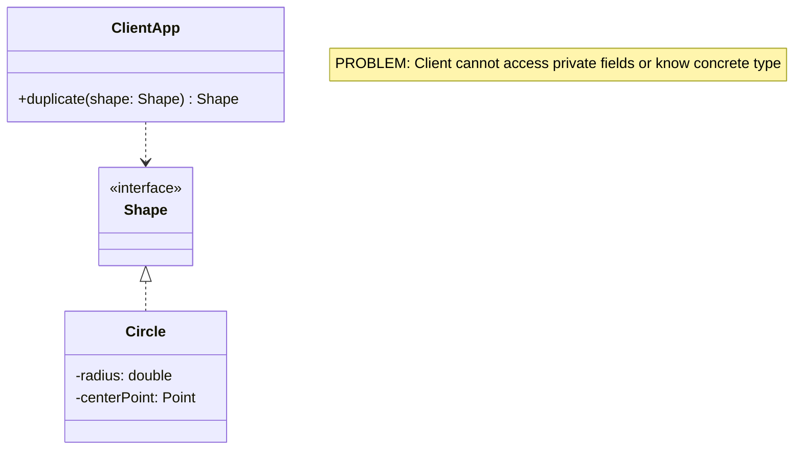
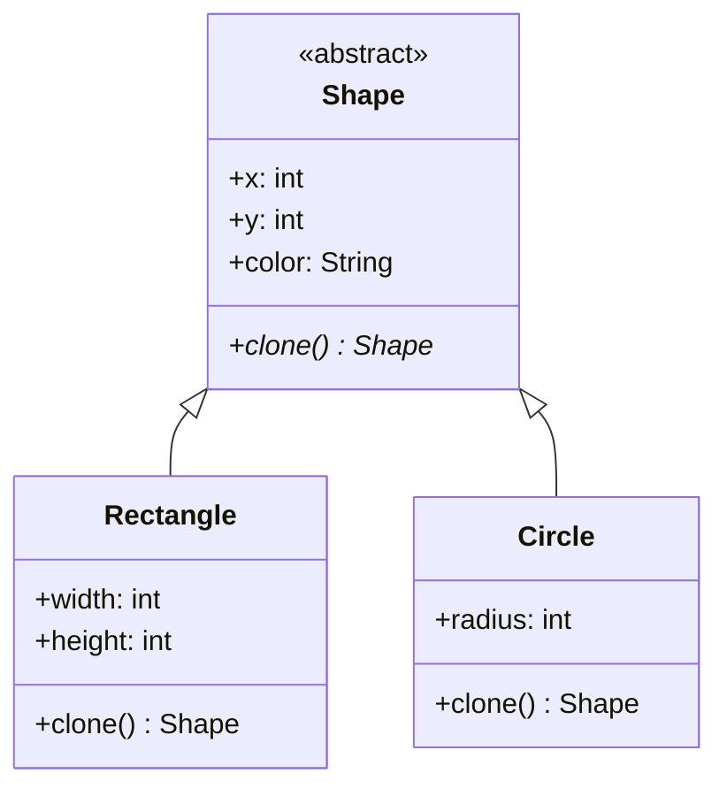
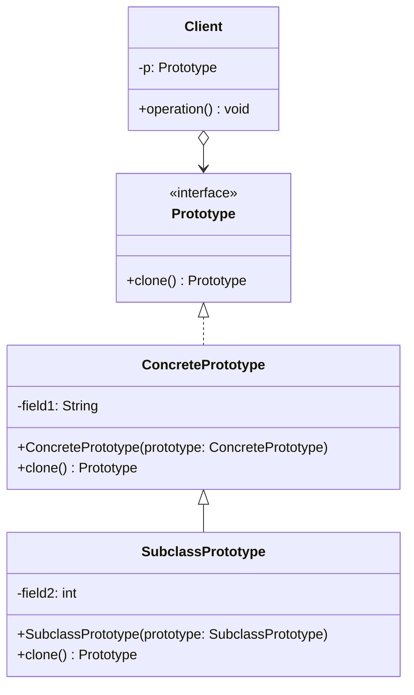
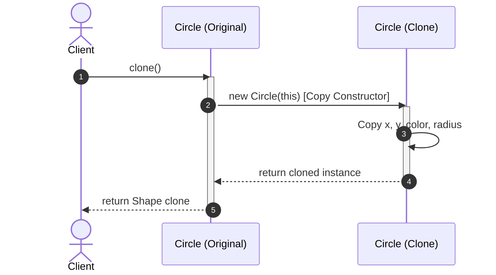

# Prototype

> **Also known as:** Clone  
> **Classification:** Creational Pattern  
> **Complexity:** ★☆☆

---

## 1. Intent

**Prototype** is a creational design pattern that lets you copy existing objects without making your code dependent on their concrete classes.

---

## 2. Problem

Say you have an object and you want to create an exact copy of it. How would you do that from client code?

1. **Private State Encapsulation:** You must create a new object of the same class, then walk through all fields of the original object and copy their values. However, some fields are `private` or internal and cannot be accessed from outside the class!
2. **Coupling to Concrete Classes:** Your client code might only know the object through an abstract interface (e.g., `Shape`). You cannot instantiate a concrete object (like `new Circle()`) if you only have a reference to the `Shape` interface.



---

## 3. Motivation

Consider a graphical vector design canvas (like Figma or Photoshop):
* Users can select complex UI components composed of shapes, drop shadows, gradients, and text fields.
* When a user hits **Duplicate (Ctrl+D)**, the application must instantly create an identical clone.
* The canvas manager only holds a collection of abstract `GraphicElement` references. It cannot know whether an element is a `VectorPath`, `BitmapImage`, or `TextFrame`.

The application delegates the copying responsibility to the element itself via a polymorphic `clone()` method.

---

## 4. Solution

The Prototype pattern delegates the cloning process to the actual objects being copied.

1. The pattern declares a common `Prototype` interface that contains a single `clone()` method.
2. Concrete classes implement this method. Inside the class, all fields—including `private` ones—are directly accessible and can be safely copied into a newly instantiated clone.
3. An object that supports cloning is called a **Prototype**.



---

## 5. Structure



---

## 6. Participants

1. **Prototype Interface:** Declares the cloning methods (typically a single `clone()` method).
2. **Concrete Prototype:** Implements the cloning method. In addition to copying primitive fields, it manages whether to perform a **shallow copy** or a **deep copy** of internal object references.
3. **Prototype Registry (Optional):** A catalog or cache holding pre-configured prototype instances ready to be cloned by key (e.g., "blue-button", "red-circle").
4. **Client:** Clones an object through the Prototype interface without knowing its concrete class.

---

## 7. Code Implementation (Python 3)

> [!WARNING]
> In Python, object copying is handled via the built-in `copy` module (`copy.copy()` and `copy.deepcopy()`).
> **Best Practice:** Use an explicit `Prototype<T>` interface or a copy constructor.

```python
from abc import ABC, abstractmethod
import copy
from typing import Any


# ==========================================
# 1. Prototype Base Interface / Class
# ==========================================
class Shape(ABC):
    def __init__(self, x: int, y: int, color: str) -> None:
        self.x = x
        self.y = y
        self.color = color

    @abstractmethod
    def clone(self) -> "Shape":
        """Polymorphic clone method producing an independent duplicate."""
        pass

    def __eq__(self, other: Any) -> bool:
        if not isinstance(other, Shape):
            return False
        return self.x == other.x and self.y == other.y and self.color == other.color


# ==========================================
# 2. Concrete Prototypes
# ==========================================
class Circle(Shape):
    def __init__(self, x: int, y: int, color: str, radius: int) -> None:
        super().__init__(x, y, color)
        self.radius = radius

    def clone(self) -> "Circle":
        # Returns a deep copy of the instance
        return copy.deepcopy(self)

    def __eq__(self, other: Any) -> bool:
        if not isinstance(other, Circle) or not super().__eq__(other):
            return False
        return self.radius == other.radius


class Rectangle(Shape):
    def __init__(self, x: int, y: int, color: str, width: int, height: int) -> None:
        super().__init__(x, y, color)
        self.width = width
        self.height = height

    def clone(self) -> "Rectangle":
        return copy.deepcopy(self)


# ==========================================
# 3. Client Execution Demo
# ==========================================
if __name__ == "__main__":
    original_circle = Circle(10, 20, "CrimsonRed", 15)

    # Client clones without knowing internal constructor signatures
    cloned_circle = original_circle.clone()

    print(f"Are objects the same memory reference? {original_circle is cloned_circle}")  # False
    print(f"Are object values identical?          {original_circle == cloned_circle}")  # True
```

---

## 8. Execution Flow



---

## 9. When to Use (Applicability)

* **Decoupling from Concrete Classes:** When your code should not depend on the concrete classes of objects that you need to duplicate.
* **Reducing Subclass Proliferation:** When you want to avoid creating subclasses whose only difference is how their fields are initialized. You can register pre-configured prototypes and clone them on demand.
* **Expensive Construction:** When creating an object from scratch involves heavy database queries, network calls, or intensive computations, cloning an existing instance is substantially faster.

---

## 10. When NOT to Use (Anti-Scenarios)

* **Circular References:** Cloning complex object graphs that contain circular references (Object A -> Object B -> Object A) can lead to infinite recursion unless complex identity-map tracking is implemented.
* **Objects Containing External System Handles:** Objects holding open file descriptors, database connections, active network sockets, or OS process handles cannot be duplicated via simple memory cloning.

---

## 11. Advantages

* **Clones Without Concrete Coupling:** You can clone objects without coupling to their concrete classes.
* **Preserves Encapsulation:** Private fields are cloned from within the class itself.
* **Convenient Alternative to Subclassing:** Pre-set prototypes can replace factory inheritance trees.

---

## 12. Disadvantages

* **Deep Copy Complexity:** Cloning complex objects that hold references to nested mutable objects can be tricky and bug-prone.

---

## 13. Common Mistakes & Misconceptions

### Mistake 1: Shallow Copy vs Deep Copy Bugs
* **Shallow Copy:** Copies primitive values directly, but only copies references for nested objects. Both original and clone point to the same nested object in memory. Mutating the clone mutates the original!
* **Deep Copy:** Recursively clones all nested objects so the clone is 100% independent.

```python
# SHALLOW COPY TRAP
class Person:
    def __init__(self, name: str, address: Address) -> None:
        self.name = name
        self.address = address  # If shallow copied, both Person instances share the same address object!
```

### Mistake 2: Shallow Copy vs Deep Copy Confusion
Using shallow copy when objects contain nested mutable references causes unexpected shared state mutations. Use `copy.deepcopy()` or custom `clone()` methods.

---

## 14. Related Patterns

* **[Factory Method](factory-method.md):** Many designs start using Factory Method and evolve toward Prototype, Abstract Factory, or Builder for greater runtime flexibility.
* **[Abstract Factory](abstract-factory.md):** An Abstract Factory can store a set of Prototypes and produce products simply by cloning them.
* **[Memento](../behavioral/memento.md):** Prototype is sometimes used to create snapshots of state for Memento.

---

## 15. Real-World Applications

### Python Standard Library
* `copy.deepcopy()`: Native standard library recursive prototype cloning.
* `dict.copy()`, `list.copy()`: Native prototype duplication hooks.

### Spring Framework
* `@Scope("prototype")`: In Spring, beans marked with `prototype` scope return a brand new instance every time they are requested from the `ApplicationContext`.

---

## 16. Interview Questions & Self-Assessment

### Q1: What is the fundamental difference between a shallow copy and a deep copy?
> **Answer:** A shallow copy duplicates primitive fields but copies only the memory references of nested objects (leaving them shared). A deep copy recursively duplicates all nested objects, creating a completely independent object tree.

### Q2: What is the difference between shallow copy and deep copy in Python?
> **Answer:** `Cloneable` has no methods (it's a marker interface), relies on a protected method in `Object`, bypasses normal constructor execution, cannot properly assign `final` fields during deep copies, and throws checked exceptions.

### Q3: What is the Prototype Registry?
> **Answer:** A hash map or catalog where pre-configured objects are stored by string keys (e.g., `"standard-delivery"`, `"express-delivery"`). Clients look up a key and clone the prototype rather than configuring an object from scratch.

### Q4: How does Prototype compare to Abstract Factory?
> **Answer:** Abstract Factory produces objects via class inheritance and factory methods; Prototype produces objects by cloning pre-existing prototype instances stored in memory.

### Q5: Can Prototype clone private fields?
> **Answer:** Yes, because the cloning logic is executed *inside* the class itself (via a copy constructor or `clone()` method), where private fields are fully accessible.

---

## 17. Key Takeaways

1. **Self-Duplicating Objects:** Objects clone themselves from the inside, protecting private state encapsulation.
2. **Always Decide Copy Depth:** Always specify whether a prototype provides a shallow copy or a recursive deep copy.
3. **Explicit Clone Protocol:** In Python, a dedicated `clone()` method using `copy.deepcopy(self)` ensures clean object duplication.
4. **Alternative to Inheritance:** Use prototypes to spawn pre-configured variants instead of maintaining a rigid subclass hierarchy.
