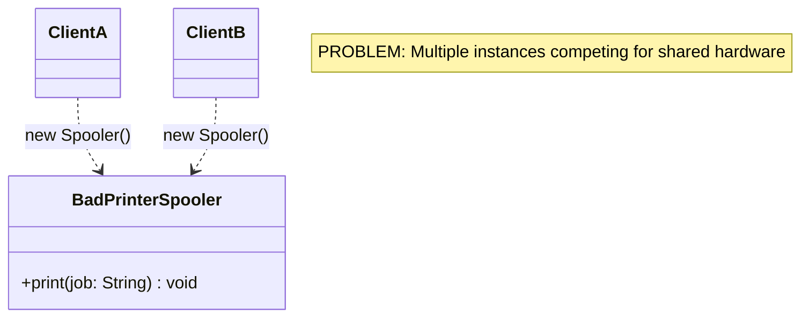
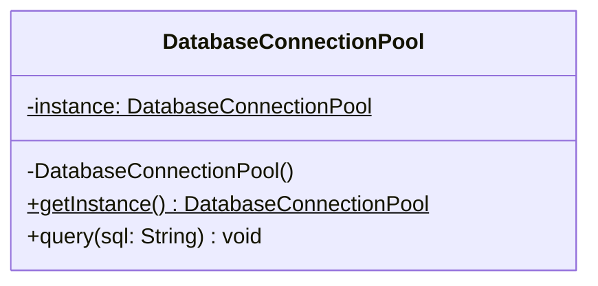
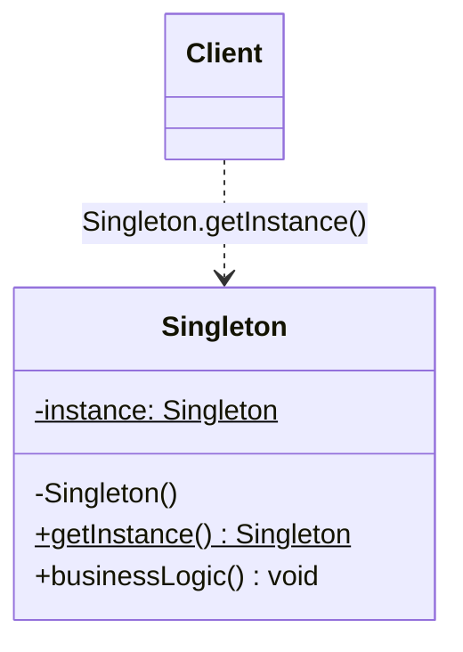
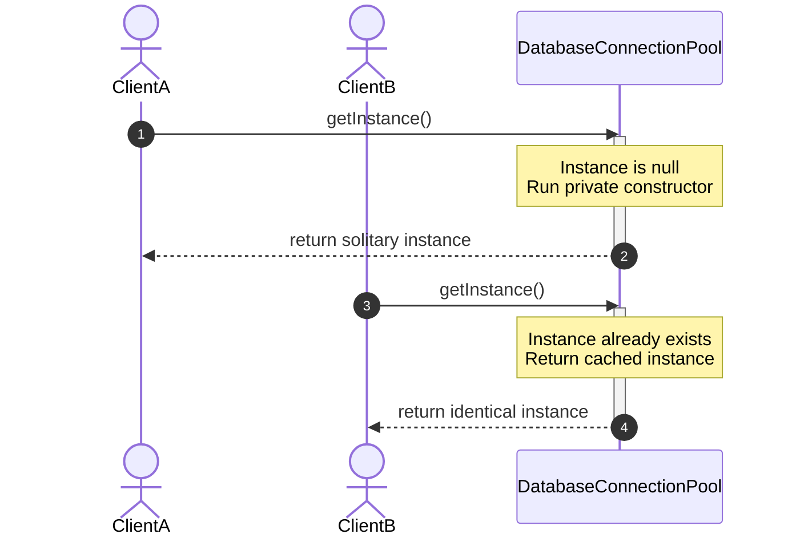

# Singleton

> **Classification:** Creational Pattern  
> **Complexity:** ★☆☆

---

## 1. Intent

**Singleton** is a creational design pattern that lets you ensure that a class has only one instance, while providing a global access point to this instance.

---

## 2. Problem

The Singleton pattern solves two problems simultaneously (violating the Single Responsibility Principle, but providing practical utility):

1. **Ensure that a class has just a single instance:** Why would anyone want to control how many instances a class has? The most common reason is to control access to a shared resource—for example, a database connection pool, a hardware device driver, or a shared filesystem cache.
2. **Provide a global access point to that instance:** Just like a global variable, the Singleton pattern lets you access some object from anywhere in the program. However, unlike raw global variables, it protects that instance from being overwritten by other code.



---

## 3. Motivation

Consider an enterprise application managing a shared database connection pool or hardware log aggregator:
* If different modules independently instantiate their own database managers, they create multiple uncoordinated connection pools, quickly exhausting database server sockets.
* If you store the connection manager in a mutable public global variable, any module can accidentally set it to `null` or reassign it, crashing the entire application.

You need a class that strictly forbids multiple instantiations and provides a single, controlled access gateway.

---

## 4. Solution

All implementations of the Singleton pattern share two common steps:

1. **Make the default constructor `private`**, preventing other objects from using the `new` operator with the Singleton class.
2. **Create a `public static` creation method** (commonly named `getInstance()`). Under the hood, this method calls the private constructor to create an object and saves it in a private static field. All subsequent calls to this method return the cached instance.



---

## 5. Structure



---

## 6. Participants

1. **Singleton Class:** Declares the `private static` instance variable, a `private` constructor, and the `public static` method `getInstance()` that controls access to the solitary instance.
2. **Client:** Accesses the Singleton instance exclusively via `Singleton.getInstance()`.

---

## 7. Code Implementation (Python 3)

In Python, concurrency, module caching, and object identity determine how Singletons are structured. Below are the **three industry-standard implementations**.

### Option A: The Bill Pugh Singleton (Recommended for Lazy Loading)
Uses a static nested helper class. The JVM guarantees that the inner class is only loaded into memory when `getInstance()` is called, providing clean, lock-free, thread-safe lazy loading:

```python
import threading


class DatabaseConnectionPool:
    _instance = None
    _lock = threading.Lock()

    def __new__(cls, *args, **kwargs):
        if not cls._instance:
            with cls._lock:
                if not cls._instance:
                    cls._instance = super().__new__(cls)
                    print("Initializing Database Connection Pool...")
        return cls._instance

    def execute_query(self, sql: str) -> None:
        print(f"Executing SQL on shared connection: {sql}")
```

### Option B: Thread-Safe Double-Checked Locking (DCL)
Uses `volatile` to prevent CPU instruction reordering during instantiation:

```python
import threading
from typing import Optional


class DoubleCheckedSingleton:
    _instance: Optional["DoubleCheckedSingleton"] = None
    _lock: threading.Lock = threading.Lock()

    @classmethod
    def get_instance(cls) -> "DoubleCheckedSingleton":
        if cls._instance is None:  # First check (no lock overhead)
            with cls._lock:
                if cls._instance is None:  # Second check (safe thread-lock)
                    cls._instance = cls()
        return cls._instance
```

### Option C: The Enum Singleton (Joshua Bloch's Gold Standard)
In Python, module-level singletons are 100% immune to multi-instance creation because Python naturally caches modules upon initial import in `sys.modules`:

```python
# Idiomatic Python Module Singleton:
# Saved in a module (e.g. app/singleton_service.py)
# Because Python caches modules upon first import in sys.modules,
# this guarantees thread-safe, lazy-initialized singleton behavior!


class _ServiceSingleton:

  def __init__(self) -> None:
    self.connection_count = 0

  def do_work(self) -> None:
    self.connection_count += 1
    print(f"Active operations count: {self.connection_count}")


# Public exported singleton instance
service = _ServiceSingleton()
```

---

## 8. Execution Flow



---

## 9. When to Use (Applicability)

* **Strictly Single Resource:** When a class in your program should have just a single instance available to all clients (e.g., a hardware driver, logging manager, database connection pool, or thread pool).
* **Controlled Global Access:** When you need stricter control over global variables, preventing accidental reassignment.

---

## 10. When NOT to Use (Anti-Scenarios)

> [!CAUTION]
> The Singleton pattern is frequently considered an **anti-pattern** when overused because it introduces global mutable state and tight coupling.

* **Avoid for Domain Models:** Never make business entities (e.g., `User`, `Order`, `Cart`) Singletons.
* **Avoid If Dependency Injection is Available:** In modern frameworks (Spring, Guice, Quarkus), singletons should be managed by the **IoC Container**, not by hardcoded private static methods.
* **Avoid When Unit Testing is Critical:** Hardcoded singletons make mocking impossible and cause test cases to leak state into one another.

---

## 11. Advantages

* **Guaranteed Solitary Instance:** You can be certain that a class has only one instance across the JVM.
* **Global Access Point:** You gain a centralized access point from any layer.
* **Lazy Initialization:** The instance is initialized only when requested for the first time.

---

## 12. Disadvantages

* **Violates Single Responsibility Principle:** It solves two problems at once (instance lifecycle management and business logic).
* **Masks Bad Architecture:** Components can secretly fetch the singleton instead of declaring explicit dependencies in their constructors.
* **Unit Testing Nightmare:** Hardcoded `getInstance()` calls cannot be mocked or stubbed with Mockito. Tests run in unpredictable orders and mutate shared state.
* **Concurrency Bugs:** In multi-threaded environments, careless implementations produce multiple instances.

---

## 13. Common Mistakes & Misconceptions

### Mistake 1: Missing the `volatile` Keyword in Double-Checked Locking
Without thread locking, race conditions can occur if multiple threads check the instance cache simultaneously, leading to redundant instantiations!

### Mistake 2: Vulnerability to Reflection and Serialization
* **Reflection Attack:** Code using `constructor.setAccessible(true)` can instantiate a private constructor.
* **Serialization Attack:** Deserializing a Singleton creates a new instance unless `readResolve()` is implemented.

---

## 14. Related Patterns

* **[Facade](../structural/facade.md):** A Facade class can often be transformed into a Singleton since a single facade object is usually sufficient.
* **[Abstract Factory](abstract-factory.md):** Abstract Factories, Builders, and Prototypes can all be implemented as Singletons.
* **[Flyweight](../structural/flyweight.md):** If you manage to reduce all shared states of an object to one flyweight, that flyweight resembles a Singleton.

---

## 15. Real-World Applications

### Python Standard Library
* `sys.modules`: Global dictionary caching all imported modules; guarantees singletons at module import time.
* `logging.getLogger()`: Returns identical `Logger` instances for identical names across threads.
* `None`: Python's `None` is a true language-level singleton (`NoneType()`).

### Spring Framework
* **Singleton Scope (Default):** In Spring, beans are singletons by default, but the singleton lifecycle is managed by the Spring IoC container (`ApplicationContext`), eliminating hardcoded static access.

---

## 16. Interview Questions & Self-Assessment

### Q1: Why is Singleton considered by many engineers to be an anti-pattern?
> **Answer:** Because it introduces global state into an application, hides dependencies instead of exposing them through constructors, makes unit testing difficult due to shared state pollution, and violates the Single Responsibility Principle.

### Q2: What is the purpose of the `volatile` keyword in Double-Checked Locking?
> **Answer:** `volatile` guarantees visibility of changes across threads and prevents instruction reordering by the compiler/CPU, ensuring no thread accesses a partially constructed object.

### Q3: How does the Bill Pugh Singleton achieve lazy loading without synchronization locks?
> **Answer:** It relies on the JVM class-loading mechanism. The static inner holder class is not loaded into memory when the outer class is loaded; it is only loaded when `getInstance()` is called, triggering a thread-safe, one-time class initialization.

### Q4: How does Joshua Bloch recommend preventing reflection and serialization vulnerabilities in Singletons?
> **Answer:** By using a single-element `enum`. The JVM guarantees that enum constants cannot be instantiated via reflection and handles serialization automatically without creating duplicates.

### Q5: How do modern frameworks (like Spring) use singletons without the drawbacks of the GoF Singleton pattern?
> **Answer:** They use **Dependency Injection (DI)**. The container creates a single instance of a service and injects it into dependent components via their constructors. The components remain loosely coupled to an interface and can be easily mocked in tests.

---

## 17. Key Takeaways

1. **One Class, One Instance:** Guaranteed single instance for coordinating shared hardware or connections.
2. **Prefer Bill Pugh or Enum:** Avoid naive synchronization; use inner static holder classes or enums for thread safety.
3. **Beware Global State:** Use with restraint. Prefer Dependency Injection singletons over hardcoded static `getInstance()` singletons whenever possible.
