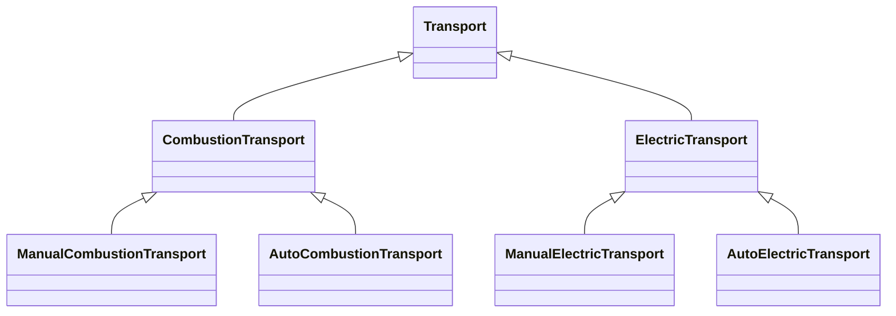
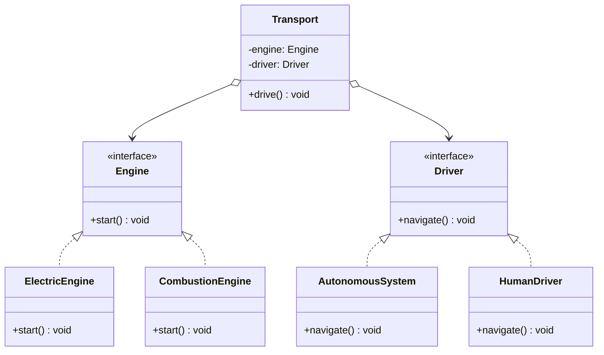

# Favor Composition Over Inheritance

> *"Inheritance is probably the most obvious and easiest way of reusing code between classes. But it comes with a major catch: it creates the tightest possible coupling between classes in your code."*  
> — Alexander Shvets, *Dive Into Design Patterns*

One of the most celebrated design principles in the Gang of Four catalog is:
> **"Favor object composition over class inheritance."**

While inheritance represents an **"is-a"** relationship, composition represents a **"has-a"** relationship. Understanding why composition is preferred is the key to understanding patterns like Strategy, Decorator, Bridge, and State.

---

## 1. The Traps of Inheritance

### Trap 1: Subclass Explosion (Combinatorial Explosion)
Imagine you are building a simulation of vehicles. You start with a `Transport` base class. Then you introduce engines (Combustion, Electric) and autonomy (Manual, Autonomous).

If you rely on inheritance, you get a geometric explosion of classes:


Adding a third dimension (e.g., Cargo vs Passenger) multiplies the hierarchy into dozens of specialized classes!

### Trap 2: The Fragile Base Class Problem
Inheritance breaks encapsulation. A subclass depends heavily on the internal implementation details of its parent class.
* If a method in the parent class is renamed or modifies how it calls protected methods, all subclasses risk silent failure.
* Subclasses cannot limit the interface of the parent class: if the parent introduces a method that doesn't make sense for the child, the child still inherits it.

### Trap 3: Compile-Time vs Runtime Rigidity
Inheritance is static: once an object is instantiated, its type cannot be changed at runtime. A `ManualElectricCar` cannot dynamically swap its engine to combustion or toggle autonomy without re-instantiating an entirely new object.

---

## 2. The Solution: Composition

Instead of inheriting behavior, compose your object by delegating responsibilities to helper objects.



Now, instead of creating separate classes for every combination, you have **one** `Transport` class that can be configured with any combination of `Engine` and `Driver` at runtime!

---

## 3. Python Code Comparison

### The Fragile Inheritance Approach (Anti-pattern)
```python
# The Fragile Base Class Trap: Modifying superclass breaks subclass!
class SuperList:
    def __init__(self) -> None:
        self.add_count = 0
        self.items: list[str] = []

    def add(self, item: str) -> None:
        self.items.append(item)
        self.add_count += 1

    def add_all(self, items: list[str]) -> None:
        for item in items:
            self.add(item)  # Internally calls add()!


class BadSubclass(SuperList):
    def add(self, item: str) -> None:
        super().add(item)

    def add_all(self, items: list[str]) -> None:
        self.add_count += len(items)  # Double counts if super().add_all() calls add()!
        super().add_all(items)
```

### The Clean Composition Approach (Forwarding / Decorator)
```python
# The Composition Solution: Delegating calls through a wrapped dependency
class ForwardingCountingList:
    def __init__(self) -> None:
        self._list: list[str] = []  # Composed dependency
        self.add_count = 0

    def add(self, item: str) -> None:
        self._list.append(item)
        self.add_count += 1

    def add_all(self, items: list[str]) -> None:
        self._list.extend(items)
        self.add_count += len(items)  # Exactly accurate; immune to internal superclass changes!

    def __len__(self) -> int:
        return len(self._list)
```

---

## 4. When IS Inheritance Appropriate?

Inheritance is not evil; it is simply overused. Use inheritance when:
1. An authentic, undeniable **"is-a"** relationship exists (a `Dog` is definitely an `Animal`).
2. The subclass fulfills the **Liskov Substitution Principle** completely without throwing exceptions on parent methods.
3. You are building a framework template algorithm ([Template Method](../behavioral/template-method.md)).
4. You control both the base class and subclasses within the same package.

---

## ⚖️ Trade-Off Summary

| Attribute | Inheritance | Composition |
| :--- | :--- | :--- |
| **Relationship** | "Is-a" | "Has-a" |
| **Coupling** | High (Tight) | Low (Loose) |
| **Flexibility** | Static (Compile-time) | Dynamic (Runtime swappable) |
| **Encapsulation** | Weakened (Exposes parent internals) | Strong (Black-box interface delegation) |
| **Complexity** | Simple initially, rigid over time | Requires more small classes and interfaces |
