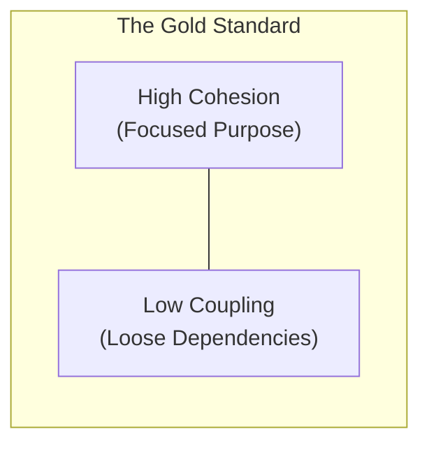
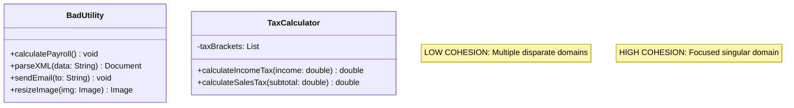
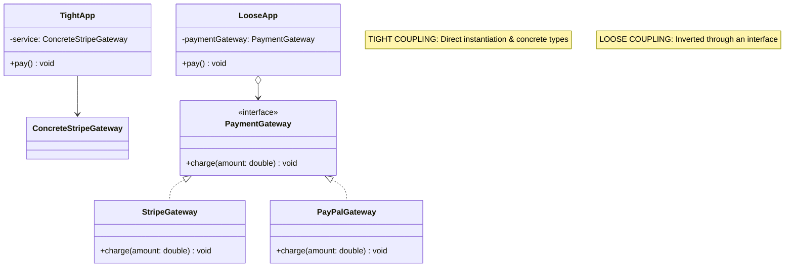

# Coupling and Cohesion

> *"High cohesion and low coupling are the twin north stars of software design. Almost every design pattern is an architectural technique to increase cohesion or decrease coupling."*  
> — Alexander Shvets, *Dive Into Design Patterns*

Two foundational metrics determine the maintainability, testability, and clarity of any object-oriented codebase: **Cohesion** and **Coupling**.



---

## 1. Cohesion: Focus Within a Component

> **Cohesion measures how closely related and focused the responsibilities of a single class or module are.**

* **Low Cohesion (Bad):** A single class contains unrelated responsibilities (e.g., parsing XML, calculating taxes, connecting to a socket, and rendering HTML).
* **High Cohesion (Good):** A class performs a single, well-defined task. All methods and fields cooperate toward that purpose.



### Why High Cohesion Matters
1. **Easy to Understand:** Developers immediately know where a specific business logic resides.
2. **Reusability:** Small, cohesive classes can be reused across different parts of the application without dragging along unrelated dependencies.
3. **Fewer Side Effects:** Changing tax rules won't break email formatting or image resizing.

---

## 2. Coupling: Interdependence Between Components

> **Coupling measures the degree of direct knowledge and dependence one class has on other classes.**

* **Tight Coupling (Bad):** Class A directly instantiates concrete classes B, C, and D, and accesses their public fields. A change in B ripples into A.
* **Loose Coupling (Good):** Class A interacts with Class B exclusively through an interface or abstraction. Class A does not care about the concrete implementation of B.



---

## 3. Refactoring Python Example: From Tight to Loose Coupling

### The Tightly Coupled Code (Hard to Test, Rigid)
```python
# ANTI-PATTERN: Tightly coupled to concrete implementations
class OrderService:
    def __init__(self) -> None:
        self.database = MySQLDatabase()
        self.smtp_client = SMTPEmailService()

    def process_order(self, order_id: str, amount: float) -> None:
        self.database.save(order_id, amount)
        self.smtp_client.send_email(f"Order {order_id} processed for ${amount}")
```

### The Highly Cohesive, Loosely Coupled Refactoring
```python
from abc import ABC, abstractmethod


# High Cohesion & Loose Coupling via Abstraction
class OrderRepository(ABC):
    @abstractmethod
    def save(self, order_id: str, amount: float) -> None:
        pass


class NotificationGateway(ABC):
    @abstractmethod
    def notify_customer(self, message: str) -> None:
        pass


class DecoupledOrderService:
    def __init__(self, repo: OrderRepository, notifier: NotificationGateway) -> None:
        self.repo = repo
        self.notifier = notifier

    def process_order(self, order_id: str, amount: float) -> None:
        self.repo.save(order_id, amount)
        self.notifier.notify_customer(f"Order {order_id} processed.")
```

---

## 🧭 How Design Patterns Optimize Cohesion & Coupling

| Design Pattern | Impact on Cohesion | Impact on Coupling |
| :--- | :--- | :--- |
| **[Facade](../structural/facade.md)** | Groups complex subsystem coordination | Drastically reduces client coupling to subsystem internals |
| **[Strategy](../behavioral/strategy.md)** | Each algorithmic variant is isolated in its own cohesive class | Client is decoupled from algorithm implementations |
| **[Observer](../behavioral/observer.md)** | Subject manages state; Observers handle their own reactions | Subject is loosely coupled to any number of subscribers |
| **[Mediator](../behavioral/mediator.md)** | Consolidates complex multi-object communication | Decouples chaotic many-to-many object networks into 1-to-1 |
