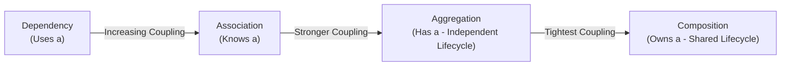
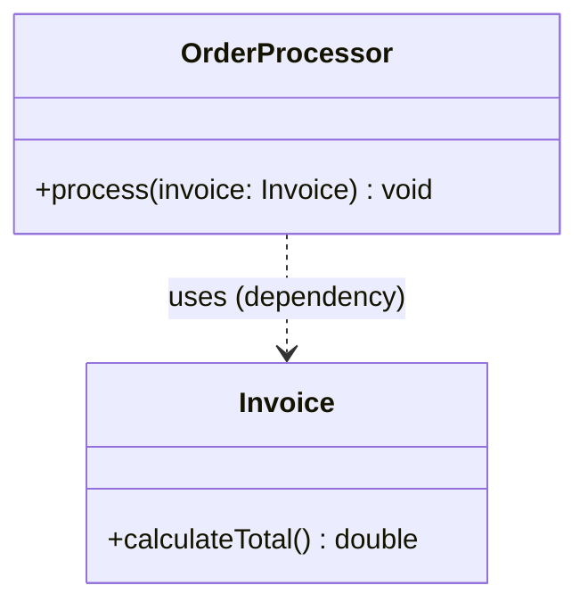
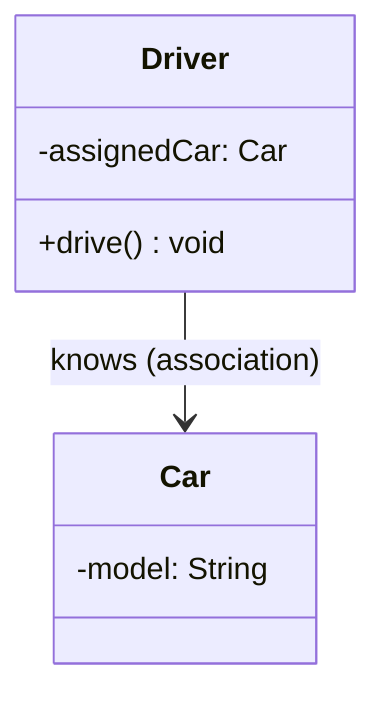
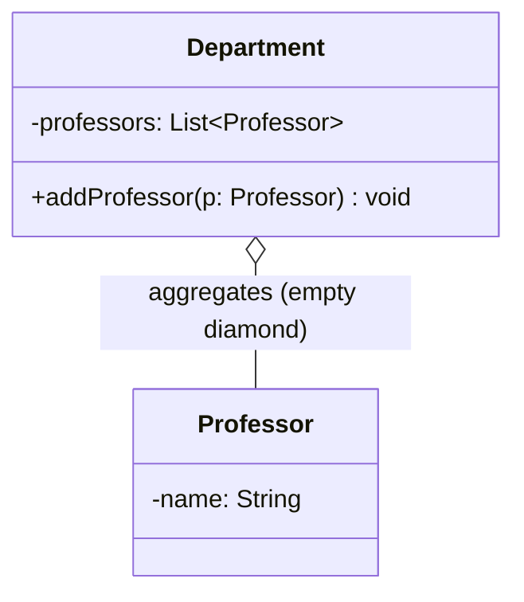
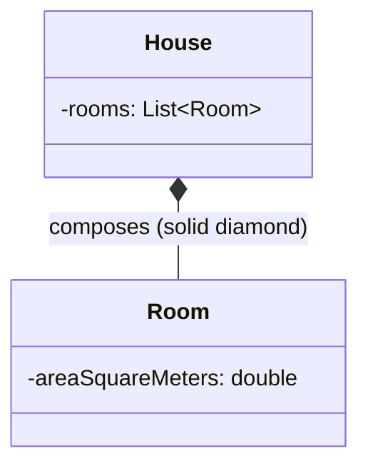

# Object Relationships

> *"In software systems, objects do not live in isolation. Understanding the exact nature of how objects relate to one another—from transient method calls to tight lifetime ownership—is critical to choosing the correct design pattern."*  
> — Alexander Shvets, *Dive Into Design Patterns*

Object relationships represent degrees of coupling and ownership between classes. They range from the weakest, temporary relationship (**Dependency**) to the strongest, exclusive ownership relationship (**Composition**).



---

## 1. Dependency ("Uses-a")

> **Weakest relationship**: Class A briefly interacts with Class B (e.g., as a method parameter, local variable, or return type), but does NOT hold a persistent reference to it.

If Class B changes its public interface, Class A may break. However, Class A does not store Class B as a member field.



### Python Example
```python
class Invoice:
    def calculate_total(self) -> float:
        return 250.00


class OrderProcessor:
    # Dependency: Invoice is used as a local variable/parameter only; OrderProcessor doesn't store it!
    def generate_receipt(self, invoice: Invoice) -> str:
        return f"Receipt Total: ${invoice.calculate_total():.2f}"
```

---

## 2. Association ("Knows-a")

> **Structural connection**: Class A maintains a persistent reference to Class B as an instance field. Both objects can exist independently.

Association can be **unidirectional** (A knows B, but B does not know A) or **bidirectional** (both know each other).



### Python Example
```python
class Car:
    def __init__(self, model: str) -> None:
        self.model = model

    def start(self) -> None:
        print(f"{self.model} engine running.")


class Driver:
    # Association: Driver holds a reference to a Car
    def __init__(self, name: str, car: Car) -> None:
        self.name = name
        self.car = car

    def drive(self) -> None:
        print(f"{self.name} is driving:")
        self.car.start()
```

---

## 3. Aggregation ("Has-a" with Independent Lifecycles)

> **Whole/Part relationship**: Class A is a container for Class B. However, Class B has an **independent lifecycle** and can exist without Class A.

* If the container (Whole) is destroyed, the component (Part) survives.
* Components are typically injected into the container from the outside.



### Python Example
```python
class Professor:
    def __init__(self, name: str) -> None:
        self.name = name


class Department:
    # Aggregation (Has-A, weak lifecycle): Professors exist independently of Department!
    def __init__(self, dept_name: str) -> None:
        self.dept_name = dept_name
        self.professors: list[Professor] = []

    def assign_professor(self, professor: Professor) -> None:
        self.professors.append(professor)
```

---

## 4. Composition ("Owns-a" with Shared Lifecycle)

> **Strict Whole/Part ownership**: Class A creates, owns, and controls the lifecycle of Class B. Class B cannot exist independently of Class A.

* If the container (Whole) is deleted, all contained components (Parts) are deleted along with it.
* The contained components are usually instantiated inside the container's constructor.



### Python Example
```python
class Room:
    def __init__(self, area: float) -> None:
        self.area = area


class House:
    # Composition (Contains-A, strong lifecycle): Rooms are created by House and die with House!
    def __init__(self) -> None:
        self.rooms = [Room(25.0), Room(18.5), Room(12.0)]
```

---

## 📊 Summary Comparison Matrix

| Relationship | UML Notation | Coupling Level | Lifecycle Ownership | Example |
| :--- | :--- | :--- | :--- | :--- |
| **Dependency** | Dashed arrow `..>` | Very Low | None (transient call) | Method parameter, local variable |
| **Association** | Solid arrow `-->` | Low to Medium | Independent | Customer has a CreditCard |
| **Aggregation** | Hollow diamond `o--` | Medium | Independent | Team has Players |
| **Composition** | Solid diamond `*--` | High | Bound together | Car owns an Engine |

---

## 🔗 Connection to Design Patterns

* **Composition & Aggregation** form the foundation of:
  * [Composite](../structural/composite.md): Tree structures of nested components.
  * [Decorator](../structural/decorator.md): Wrapping one object inside another to extend behavior.
  * [Strategy](../behavioral/strategy.md): Injecting interchangeable algorithmic strategies via aggregation.
* **Dependency & Association** are decoupled using:
  * [Dependency Inversion Principle](solid-principles.md#5-dependency-inversion-principle-dip)
  * [Factory Method](../creational/factory-method.md): Encapsulating instantiation dependencies.
