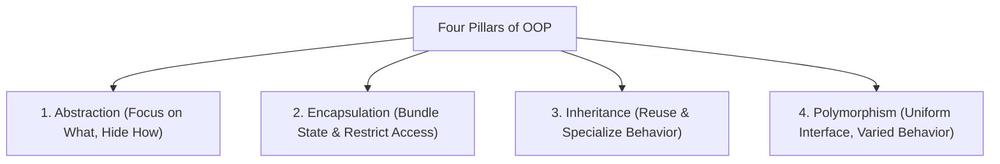
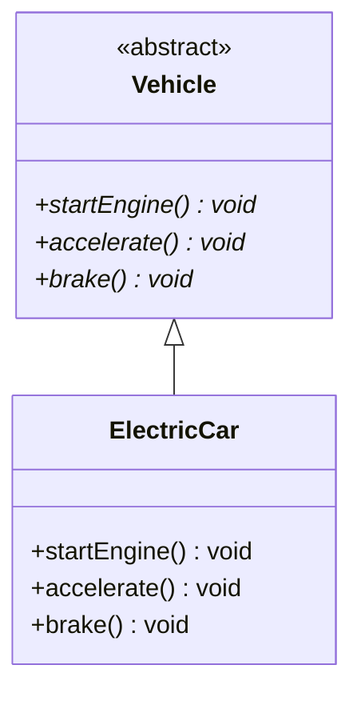
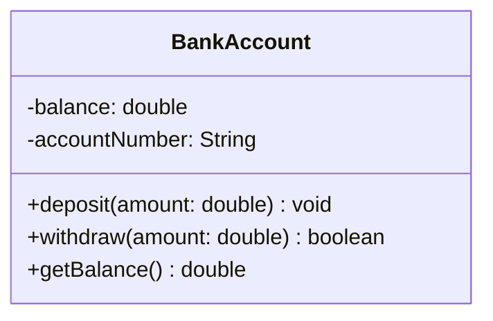
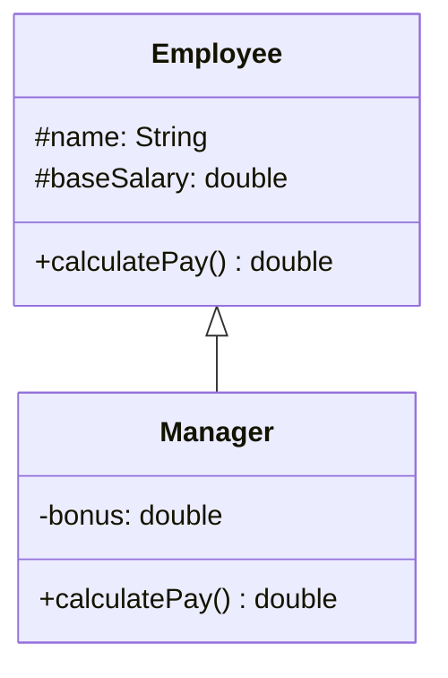
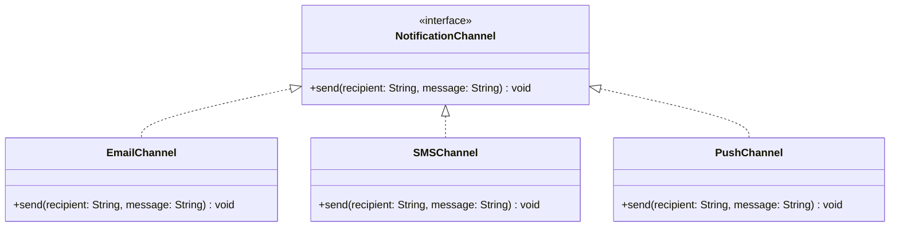

# The Four Pillars of Object-Oriented Programming

> *"Object-oriented programming is an approach to software design based on the concept of objects that interact with each other. Objects encapsulate both state and behavior, serving as building blocks for complex systems."*  
> — Alexander Shvets, *Dive Into Design Patterns*

Every Gang of Four design pattern is built upon the interaction of four core object-oriented principles: **Abstraction**, **Encapsulation**, **Inheritance**, and **Polymorphism**.



---

## 1. Abstraction

> **"Modeling real-world entities by focusing on traits essential to the current problem context while omitting irrelevant details."**

Abstraction provides a simplified view of complex systems. When you drive a car, you interact with an accelerator pedal, steering wheel, and brakes. You do not need to manage fuel injection timing, spark plug firing sequences, or differential gear ratios.



### Python Example
```python
from abc import ABC, abstractmethod


class Vehicle(ABC):
    def __init__(self, brand: str) -> None:
        self.brand = brand

    @abstractmethod
    def start_engine(self) -> None:
        pass


class ElectricCar(Vehicle):
    def start_engine(self) -> None:
        print(f"[{self.brand}] High-voltage inverter engaged. In-wheel electric motors active.")
```

---

## 2. Encapsulation

> **"Hiding internal state and requiring all interaction to occur through a well-defined public interface."**

Encapsulation prevents external code from mutating an object's internal fields into invalid states. It creates an explicit boundary between an object's implementation and its public contract.

### Why Encapsulation Matters
* **Protection of Invariants:** Ensures business rules cannot be bypassed.
* **Loose Coupling:** Internal data representations (e.g., changing from a `List` to a `Map`) can change without breaking client code.



### Python Example
```python
class BankAccount:
    def __init__(self, account_number: str, initial_balance: float) -> None:
        self._account_number = account_number
        self.__balance = initial_balance  # Private balance protected from direct external tampering

    def deposit(self, amount: float) -> None:
        if amount <= 0:
            raise ValueError("Deposit amount must be positive.")
        self.__balance += amount

    def get_balance(self) -> float:
        return self.__balance
```

---

## 3. Inheritance

> **"Building new classes on top of existing ones, reusing common state and methods while specializing behavior."**

Inheritance establishes an **"is-a"** relationship between a superclass (parent) and subclass (child).



### Python Example
```python
class Employee:
    def __init__(self, name: str, base_salary: float) -> None:
        self.name = name
        self.base_salary = base_salary

    def calculate_pay(self) -> float:
        return self.base_salary


class Manager(Employee):
    def __init__(self, name: str, base_salary: float, performance_bonus: float) -> None:
        super().__init__(name, base_salary)
        self.performance_bonus = performance_bonus

    def calculate_pay(self) -> float:
        return self.base_salary + self.performance_bonus
```

> [!WARNING]
> While powerful, inheritance introduces strong coupling. Favoring composition over inheritance is a core theme in structural and behavioral patterns.

---

## 4. Polymorphism

> **"The ability of different objects to respond to the same message or method call in their own unique manner."**

Polymorphism allows client code to treat a collection of diverse objects through a single common interface, with the JVM executing the appropriate subclass implementation at runtime (dynamic dispatch).



### Python Example
```python
from abc import ABC, abstractmethod


class NotificationChannel(ABC):
    @abstractmethod
    def send(self, recipient: str, message: str) -> None:
        pass


class EmailChannel(NotificationChannel):
    def send(self, recipient: str, message: str) -> None:
        print(f"Sending SMTP Email to {recipient}: {message}")


class SMSChannel(NotificationChannel):
    def send(self, recipient: str, message: str) -> None:
        print(f"Sending Twilio SMS to {recipient}: {message}")


def notify_user(channel: NotificationChannel, user: str, msg: str) -> None:
    # Polymorphic call: Client works with any channel without knowing its concrete class
    channel.send(user, msg)
```

---

## 🧭 How the Pillars Connect to Design Patterns

| Pillar | How Patterns Leverage It | Exemplary Patterns |
| :--- | :--- | :--- |
| **Abstraction** | Defines clean contracts decoupled from execution mechanics | [Facade](../structural/facade.md), [Adapter](../structural/adapter.md), [Bridge](../structural/bridge.md) |
| **Encapsulation** | Hides instantiation details, internal algorithms, and state transitions | [Singleton](../creational/singleton.md), [Memento](../behavioral/memento.md), [State](../behavioral/state.md) |
| **Inheritance** | Creates templates and default behavioral skeletons | [Template Method](../behavioral/template-method.md), [Factory Method](../creational/factory-method.md) |
| **Polymorphism** | Swaps implementations, strategies, and handlers at runtime | [Strategy](../behavioral/strategy.md), [Command](../behavioral/command.md), [Observer](../behavioral/observer.md) |
