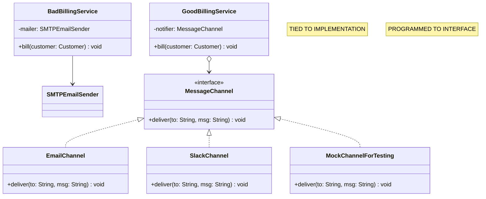

# Program to an Interface, Not an Implementation

> *"Program to an interface, not an implementation. Depend on abstractions, not on concrete classes."*  
> — Gang of Four, *Design Patterns: Elements of Reusable Object-Oriented Software*

This fundamental heuristic ensures that client code remains blissfully ignorant of the concrete classes it collaborates with, as long as those classes fulfill the agreed-upon contract.

---

## 1. Concrete Coupling vs Interface Polymorphism

### Programming to an Implementation (Rigid)
```python
# Rigid: Client is tightly coupled to concrete SQLite database
from sqlite3 import Connection
database: Connection = Connection("app.db")
```
If you later need to switch to a `LinkedList` for concurrent queue operations, or a `PostgresDatabase` for geo-spatial querying, you must rewrite the variable declarations, method signatures, and client callers throughout the codebase.

### Programming to an Interface (Flexible)
```python
# Flexible: Client depends on abstract Database contract / Protocol
from typing import Protocol

class DatabaseProtocol(Protocol):
    def execute(self, query: str) -> list[dict]: ...
```
Now, swapping implementations requires changing only the instantiation site (or better yet, letting a Factory or Dependency Injection container supply it).

---

## 2. Real-World Architectural Dilemma

Imagine a company building an automated billing system. The system sends invoices via email.



### Benefits Realized:
1. **Effortless Unit Testing:** In tests, pass `MockChannelForTesting` to verify business logic without sending real emails.
2. **Future Proofing:** Adding SMS, Slack, or Webhook notification requires zero alterations to `GoodBillingService`.

---

## 3. Interface vs Abstract Class: When to Use Which?

| Feature | `interface` | `abstract class` |
| :--- | :--- | :--- |
| **Primary Purpose** | Defines a behavioral contract ("What it can do") | Defines a common identity and default template ("What it is") |
| **Multiple Inheritance** | A class can implement **multiple** interfaces | A class can extend only **one** abstract class |
| **State** | Stateless (can only define constants: `public static final`) | Stateful (can define instance variables and constructors) |
| **Method Implementation** | Can provide `default` methods (Python 3), but best kept minimal | Can provide rich template methods and partial implementations |
| **GoF Pattern Usage** | [Strategy](../behavioral/strategy.md), [Observer](../behavioral/observer.md), [Adapter](../structural/adapter.md) | [Template Method](../behavioral/template-method.md), [Factory Method](../creational/factory-method.md) |

---

## 4. Python Implementation

```python
from abc import ABC, abstractmethod


# The Abstract Contract
class MessageChannel(ABC):
    @abstractmethod
    def deliver(self, recipient: str, message: str) -> None:
        pass


# Concrete Implementations
class SlackChannel(MessageChannel):
    def deliver(self, recipient: str, message: str) -> None:
        print(f"Posting to Slack #{recipient}: {message}")


class EmailChannel(MessageChannel):
    def deliver(self, recipient: str, message: str) -> None:
        print(f"Dispatching Email to {recipient}: {message}")


# Client depends strictly on the abstraction
class AlertDispatcher:
    def __init__(self, channel: MessageChannel) -> None:
        self.channel = channel

    def dispatch(self, user: str, text: str) -> None:
        self.channel.deliver(user, text)
```
