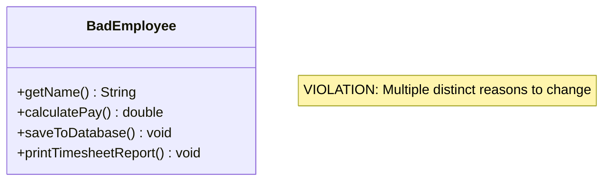
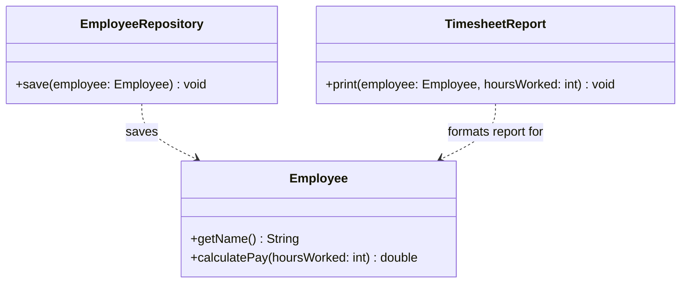
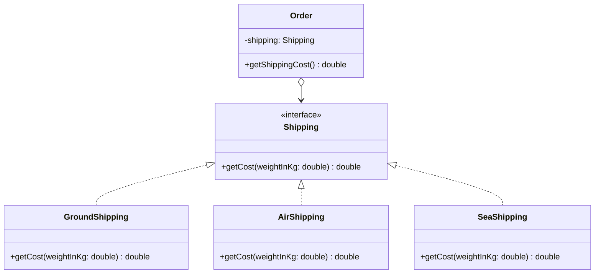
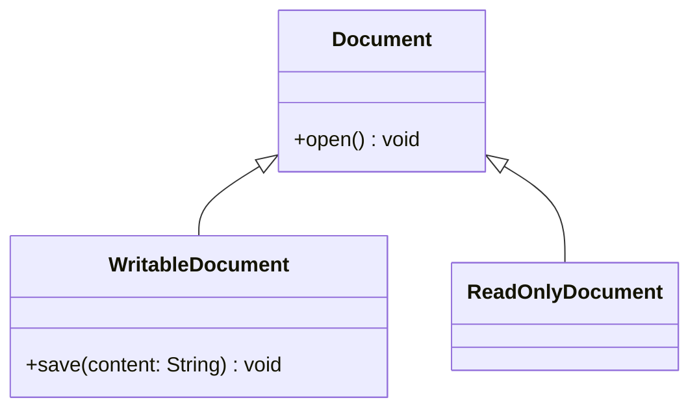
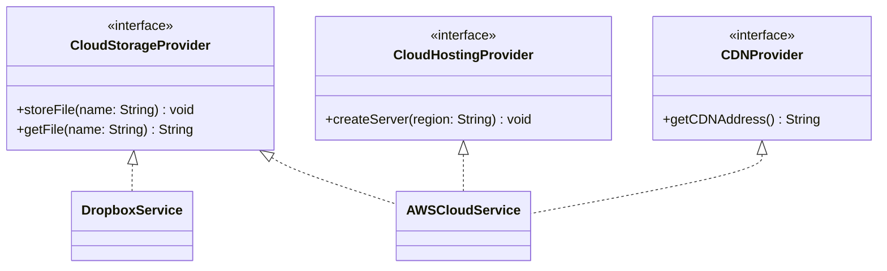
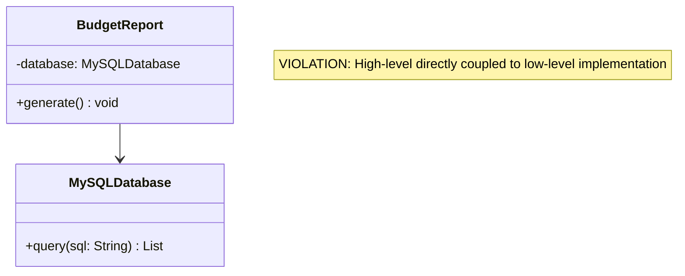
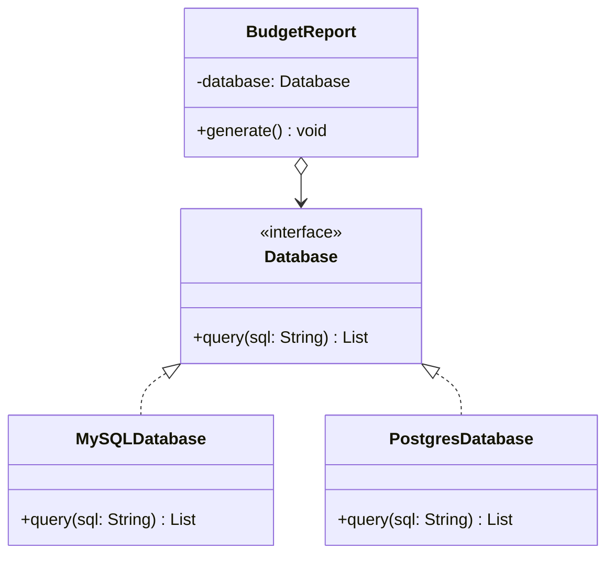

# SOLID Principles

> *"SOLID is a mnemonic for five design principles intended to make software designs more understandable, flexible, and maintainable. Striving for these principles is good, but always be pragmatic and don't take everything as dogma."*  
> — Alexander Shvets, *Dive Into Design Patterns*

Before studying the 22 Gang of Four design patterns, mastering the **SOLID** principles (popularized by Robert C. Martin, "Uncle Bob") is essential. Patterns are concrete, battle-tested realizations of these five architectural pillars.

---

## 1. Single Responsibility Principle (SRP)

> **"A class should have just one reason to change."**

### Problem
When a class handles data management, financial math, report formatting, and persistence simultaneously, it becomes a "God Class". Changing how reports are generated risks breaking salary calculations or database operations.



### Solution
Segregate distinct responsibilities into dedicated classes so each component has exactly one trigger for modification.



### Python Implementation
```python
# SRP Violator: One class with multiple reasons to change
class BadEmployee:
    def __init__(self, name: str, hourly_rate: float) -> None:
        self.name = name
        self.hourly_rate = hourly_rate

    def calculate_pay(self, hours: float) -> float: ...      # Business Logic (CFO)
    def save_to_database(self) -> None: ...                 # Persistence Logic (CTO)
    def generate_tax_report(self) -> str: ...              # Reporting Logic (COO)


# Refactored for SRP: Each class has a single responsibility
class Employee:
    def __init__(self, name: str, hourly_rate: float) -> None:
        self.name = name
        self.hourly_rate = hourly_rate


class PayrollCalculator:
    def calculate_pay(self, employee: Employee, hours: float) -> float:
        return employee.hourly_rate * hours


class EmployeeRepository:
    def save(self, employee: Employee) -> None:
        print(f"Saving {employee.name} to database.")
```

---

## 2. Open/Closed Principle (OCP)

> **"Classes should be open for extension, but closed for modification."**

### Problem
A monolithic `Order` class calculates shipping costs with a hardcoded `switch` statement over shipping types. Adding a new shipping method (e.g., Sea Freight) forces developers to edit and re-test the core `Order` class, risking regressions.

### Solution
Extract shipping algorithms behind a polymorphic interface. New shipping methods implement the interface without altering existing order logic.



### Python Implementation
```python
from abc import ABC, abstractmethod


# OCP: Open for extension, closed for modification
class Shipping(ABC):
    @abstractmethod
    def get_cost(self, weight_kg: float) -> float:
        pass


class GroundShipping(Shipping):
    def get_cost(self, weight_kg: float) -> float:
        return weight_kg * 1.50


class AirShipping(Shipping):
    def get_cost(self, weight_kg: float) -> float:
        return weight_kg * 4.00


# Adding SeaShipping requires ZERO changes to existing classes!
class SeaShipping(Shipping):
    def get_cost(self, weight_kg: float) -> float:
        return weight_kg * 0.75
```

---

## 3. Liskov Substitution Principle (LSP)

> **"Subclasses should be substitutable for their base classes without altering the correctness of the program."**

* Preconditions cannot be strengthened in a subtype.
* Postconditions cannot be weakened in a subtype.
* Invariants of a supertype must be preserved in a subtype.
* Subclasses should not throw unexpected runtime exceptions on base methods.

### Problem
A `ReadOnlyDocument` subclass inherits from `Document` and throws an `UnsupportedOperationException` when `save()` is invoked:

```python
# LSP VIOLATION: Subtype cannot substitute for supertype
class Document:
    def save(self) -> None:
        print("Document saved to disk.")


class ReadOnlyDocument(Document):
    def save(self) -> None:
        raise PermissionError("Cannot save a read-only document!")  # Breaks client expectations!
```

### Solution
Segregate the hierarchy so that modifying operations are only present on writable types.



### Python Implementation
```python
# LSP Adherent: Segregating writable contracts
class Document:
    def __init__(self, title: str) -> None:
        self.title = title

    def open(self) -> None:
        print(f"Opened {self.title}")


class WritableDocument(Document):
    def save(self) -> None:
        print(f"Saved {self.title} to storage.")
```

---

## 4. Interface Segregation Principle (ISP)

> **"Clients should not be forced to depend on methods they do not use."**

### Problem
A bloated interface like `CloudProvider` forces a basic file-hosting service like Dropbox to implement server creation and CDN configuration methods with dummy stubs or errors.

### Solution
Decompose fat interfaces into role-specific, granular interfaces.



### Python Implementation
```python
from abc import ABC, abstractmethod


# ISP: Clients should not be forced to depend on methods they do not use
class CloudStorageProvider(ABC):
    @abstractmethod
    def store_file(self, file_name: str) -> None:
        pass

    @abstractmethod
    def get_file(self, file_name: str) -> bytes:
        pass


class CloudHostingProvider(ABC):
    @abstractmethod
    def create_server(self, region: str) -> str:
        pass


class DropboxService(CloudStorageProvider):
    def store_file(self, file_name: str) -> None:
        print(f"Storing {file_name} in Dropbox.")

    def get_file(self, file_name: str) -> bytes:
        return b"file_contents"
```

---

## 5. Dependency Inversion Principle (DIP)

> **"High-level modules should not depend on low-level modules. Both should depend on abstractions. Abstractions should not depend on details. Details should depend on abstractions."**

### Problem
A high-level business reporting class directly instantiates and executes queries against a concrete `MySQLDatabase`. Migrating to PostgreSQL or MongoDB requires modifying core reporting code.



### Solution
Invert the dependency. Have `BudgetReport` depend on a `Database` interface that low-level adapters implement.



### Python Implementation
```python
from abc import ABC, abstractmethod


# DIP: High-level modules should not depend on low-level modules. Both should depend on abstractions.
class Database(ABC):
    @abstractmethod
    def query(self, sql: str) -> list[str]:
        pass


class PostgreSQLDatabase(Database):
    def query(self, sql: str) -> list[str]:
        return [f"Row from PostgreSQL for query: {sql}"]


class PasswordManager:
    # High-level module depends on abstract Database interface, not concrete PostgreSQLDatabase!
    def __init__(self, db: Database) -> None:
        self.db = db

    def find_user_hash(self, username: str) -> str:
        results = self.db.query(f"SELECT password_hash FROM users WHERE username = '{username}'")
        return results[0] if results else ""
```

---

## 🔗 How SOLID Powers Design Patterns

| Principle | Primary Design Patterns Embodying It |
| :--- | :--- |
| **SRP** | [Command](../behavioral/command.md), [Facade](../structural/facade.md), [Observer](../behavioral/observer.md) |
| **OCP** | [Strategy](../behavioral/strategy.md), [Decorator](../structural/decorator.md), [Factory Method](../creational/factory-method.md) |
| **LSP** | [Composite](../structural/composite.md), [Adapter](../structural/adapter.md), [Proxy](../structural/proxy.md) |
| **ISP** | [Adapter](../structural/adapter.md), [Bridge](../structural/bridge.md) |
| **DIP** | [Abstract Factory](../creational/abstract-factory.md), [Template Method](../behavioral/template-method.md), [Bridge](../structural/bridge.md) |
