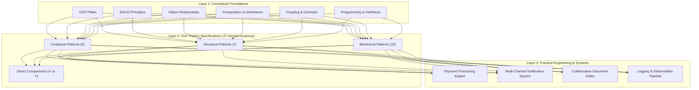

# Design Patterns Knowledge System 🏛️

> *"Design patterns are not copy-paste code snippets; they are architectural toolkits. They provide a shared vocabulary and battle-tested solutions for managing complexity, coupling, and change in software systems."*  
> — Alexander Shvets, *Dive Into Design Patterns*

Welcome to the **Design Patterns Knowledge System**. This repository is engineered as a three-layer architectural reference designed to guide you from foundational principles to production system design.

---

## 🧭 The Pattern Selection Guide

Use this decision matrix to identify candidate patterns based on your system's symptoms:

| If your primary challenge is... | Recommended Pattern | Category |
| :--- | :--- | :--- |
| **Object Instantiation & Creation** | | |
| Subclasses must decide which concrete class to instantiate at runtime | [Factory Method](creational/factory-method.md) | Creational |
| Creating families of related products without depending on concrete classes | [Abstract Factory](creational/abstract-factory.md) | Creational |
| Constructing complex, multi-step objects with distinct representations | [Builder](creational/builder.md) | Creational |
| Cloning existing objects without depending on their private implementation | [Prototype](creational/prototype.md) | Creational |
| Guaranteeing exactly one instance of a class with global access | [Singleton](creational/singleton.md) | Creational |
| **Class & Object Structural Composition** | | |
| Making two incompatible interfaces collaborate seamlessly | [Adapter](structural/adapter.md) | Structural |
| Decoupling an abstraction from its implementation so both can evolve independently | [Bridge](structural/bridge.md) | Structural |
| Composing objects into tree structures to treat leaves and branches uniformly | [Composite](structural/composite.md) | Structural |
| Adding dynamic responsibilities to objects without subclass explosion | [Decorator](structural/decorator.md) | Structural |
| Providing a simplified facade over a complex, messy subsystem | [Facade](structural/facade.md) | Structural |
| Supporting millions of fine-grained objects efficiently by sharing common state | [Flyweight](structural/flyweight.md) | Structural |
| Providing a surrogate placeholder to control access, lazy-load, or cache | [Proxy](structural/proxy.md) | Structural |
| **Algorithmic Flow & Object Responsibilities** | | |
| Passing requests sequentially along a pipeline of candidate handlers | [Chain of Responsibility](behavioral/chain-of-responsibility.md) | Behavioral |
| Encapsulating requests as objects for queuing, scheduling, and undo/redo | [Command](behavioral/command.md) | Behavioral |
| Traversing complex collection elements without exposing internal representations | [Iterator](behavioral/iterator.md) | Behavioral |
| Restricting direct communication between many objects via a central hub | [Mediator](behavioral/mediator.md) | Behavioral |
| Capturing and restoring an object's internal state without breaking encapsulation | [Memento](behavioral/memento.md) | Behavioral |
| Broadcasting state changes automatically to any number of subscriber objects | [Observer](behavioral/observer.md) | Behavioral |
| Changing an object's execution behavior dynamically when internal state changes | [State](behavioral/state.md) | Behavioral |
| Swapping algorithms or business logic interchangeably at runtime | [Strategy](behavioral/strategy.md) | Behavioral |
| Defining an algorithm's invariant skeleton while letting subclasses override steps | [Template Method](behavioral/template-method.md) | Behavioral |
| Adding new operations to complex object structures without modifying their classes | [Visitor](behavioral/visitor.md) | Behavioral |

---

## 🏛️ Layer 1: Conceptual Foundations

* 🧱 **[The Four Pillars of OOP](foundations/oop-pillars.md)**: Abstraction, Encapsulation, Inheritance, and Polymorphism.
* 📐 **[SOLID Principles](foundations/solid-principles.md)**: SRP, OCP, LSP, ISP, and DIP explained with practical Python code.
* 🔗 **[Object Relationships](foundations/object-relationships.md)**: Dependency vs Association vs Aggregation vs Composition.
* 🔄 **[Composition vs Inheritance](foundations/composition-vs-inheritance.md)**: Overcoming the fragile base class problem.
* ⚖️ **[Coupling and Cohesion](foundations/coupling-and-cohesion.md)**: The core metrics of maintainable software.
* 🔌 **[Programming to Interfaces](foundations/programming-to-interfaces.md)**: Designing resilient polymorphic contracts.

---

## 📦 Layer 2: Gang of Four Pattern Catalog

Every pattern note in this section follows a standardized **17-Section Anatomy** featuring Mermaid Class & Sequence diagrams, compilable Python code, anti-scenarios ("When NOT to use"), and common developer traps.

### 1. [Creational Patterns](creational/index.md) (5 Patterns)
Mechanisms that handle object creation gracefully while decoupling client code from concrete implementations.
* 🏭 **[Factory Method](creational/factory-method.md)** — Virtual Constructor for subclass-driven instantiation.
* 🏢 **[Abstract Factory](creational/abstract-factory.md)** — Factories producing families of coordinated components.
* 🔨 **[Builder](creational/builder.md)** — Step-by-step assembly of complex domain representations.
* 🧬 **[Prototype](creational/prototype.md)** — Self-cloning objects without external coupling.
* 💍 **[Singleton](creational/singleton.md)** — Thread-safe, single-instance coordination.

### 2. [Structural Patterns](structural/index.md) (7 Patterns)
Blueprints for composing classes and objects into flexible, larger structures.
* 🔌 **[Adapter](structural/adapter.md)** — Interface translation and legacy wrapper.
* 🌉 **[Bridge](structural/bridge.md)** — Orthogonal abstraction and implementation hierarchies.
* 🌳 **[Composite](structural/composite.md)** — Part-whole recursive tree structures.
* 🎁 **[Decorator](structural/decorator.md)** — Dynamic behavior wrapping without subclassing.
* 🏛️ **[Facade](structural/facade.md)** — Simplified entry-point to complex subsystems.
* 🪶 **[Flyweight](structural/flyweight.md)** — Intrinsic vs extrinsic state sharing for extreme scalability.
* 🛡️ **[Proxy](structural/proxy.md)** — Virtual, protection, and caching surrogates.

### 3. [Behavioral Patterns](behavioral/index.md) (10 Patterns)
Algorithms and delegation of responsibilities between collaborating objects.
* ⛓️ **[Chain of Responsibility](behavioral/chain-of-responsibility.md)** — Dynamic sequential request processing.
* 📜 **[Command](behavioral/command.md)** — Action encapsulation, transaction logging, and undo/redo.
* 🔄 **[Iterator](behavioral/iterator.md)** — Standardized collection traversal.
* 🚦 **[Mediator](behavioral/mediator.md)** — Decoupled many-to-many communication hub.
* 💾 **[Memento](behavioral/memento.md)** — Safe state snapshots and rollback.
* 📡 **[Observer](behavioral/observer.md)** — Publisher-subscriber event broadcasting.
* 🚦 **[State](behavioral/state.md)** — State-driven behavioral state machines.
* 🎯 **[Strategy](behavioral/strategy.md)** — Interchangeable algorithmic families.
* 📋 **[Template Method](behavioral/template-method.md)** — Algorithmic skeleton with subclass hook points.
* 🚶 **[Visitor](behavioral/visitor.md)** — Double-dispatch operation execution across object graphs.

---

## ⚖️ Pattern Comparisons (Disambiguation)

Side-by-side technical breakdowns to prevent choosing the wrong pattern:
* ⚖️ **[Factory Method vs Abstract Factory](comparisons/factory-method-vs-abstract-factory.md)**
* ⚖️ **[Strategy vs State](comparisons/strategy-vs-state.md)**
* ⚖️ **[Adapter vs Facade vs Proxy](comparisons/adapter-vs-facade-vs-proxy.md)**
* ⚖️ **[Decorator vs Proxy](comparisons/decorator-vs-proxy.md)**
* ⚖️ **[Decorator vs Composite](comparisons/decorator-vs-composite.md)**
* ⚖️ **[Inheritance vs Composition](comparisons/inheritance-vs-composition.md)**

---

## 🏗️ Layer 3: Practical Systems Architecture

Case studies demonstrating multi-pattern compositions in production software:
* 💳 **[Payment Processing System](practical-examples/payment-system.md)**: Strategy + Factory Method + Decorator + Observer.
* 🔔 **[Multi-Channel Notification System](practical-examples/notification-system.md)**: Factory Method + Strategy + Chain of Responsibility + Observer.
* 📝 **[Collaborative Document Editor](practical-examples/document-editor.md)**: Command + Memento + Composite + Observer.
* 🪵 **[Logging & Observability Pipeline](practical-examples/logging-system.md)**: Chain of Responsibility + Decorator + Singleton + Factory Method.

---

## 📚 Learning Resources & Interview Prep

* 🗺️ **[Pattern Selection Decision Guide](resources/pattern-selection-guide.md)**
* 📑 **[Pattern Cheat Sheet](resources/pattern-cheat-sheet.md)**
* 🎯 **[Design Patterns Interview Guide](resources/interview-questions.md)**
