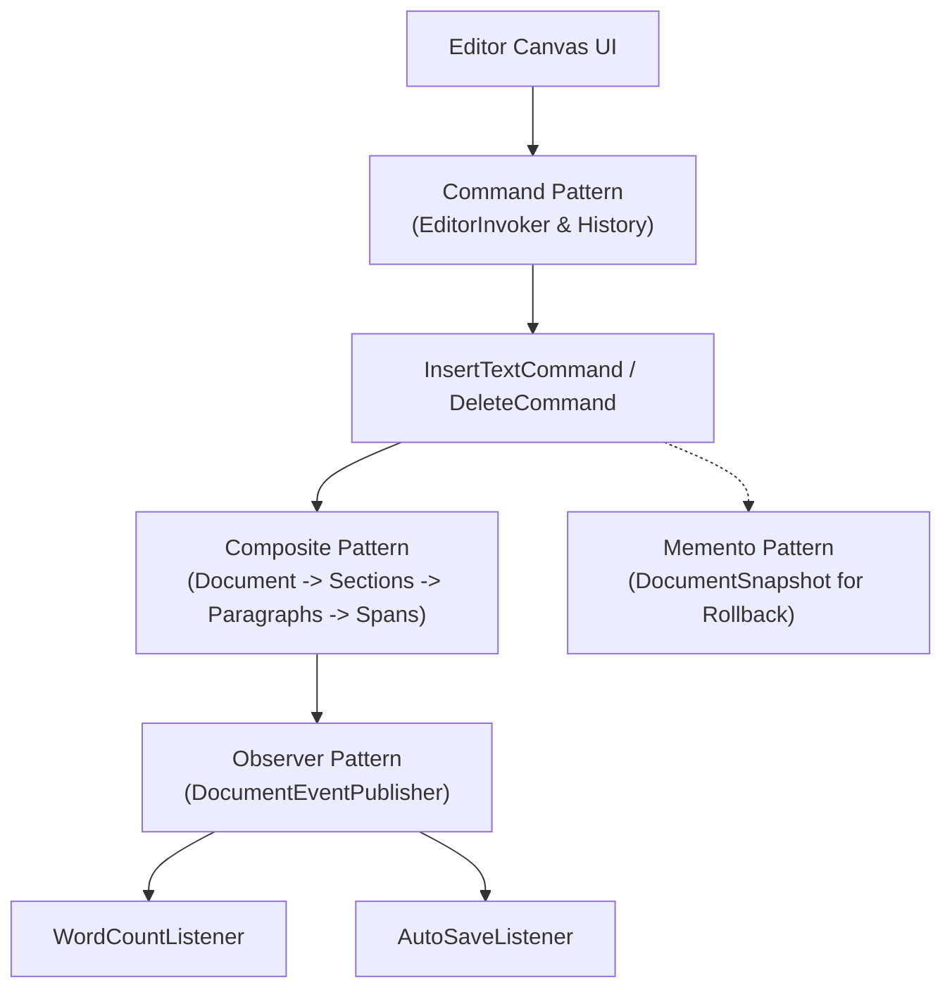

# Case Study: Collaborative Document Editor 📝

> *"A rich document editor must represent complex hierarchical elements (paragraphs, tables, images), support seamless multi-level undo/redo, and reactively update word counts and UI canvases. Here is how four design patterns orchestrate this system."*

---

## 1. System Requirements

1. **Hierarchical Document Model:** Documents consist of nested sections, paragraphs, inline text spans, and embedded media elements.
2. **Reversible Operations (Undo/Redo):** Any user action (typing, deleting, styling, inserting images) can be undone and redone.
3. **State Checkpointing:** Users can bookmark or revert to historical document snapshots.
4. **Reactive UI Sync:** Mutating document content automatically triggers word count counters, auto-save timers, and canvas re-renders.

---

## 2. Multi-Pattern Architecture Blueprint



### Patterns Involved:
| Pattern | Role in Architecture |
| :--- | :--- |
| **[Composite](../structural/composite.md)** | Models the document structure as a recursive tree of sections, paragraphs, and text leaves. |
| **[Command](../behavioral/command.md)** | Encapsulates user actions into command objects with `execute()` and `undo()` operations. |
| **[Memento](../behavioral/memento.md)** | Captures internal state snapshots for multi-level history and revision rollback. |
| **[Observer](../behavioral/observer.md)** | Reactively informs UI components (word counters, spell-checkers) when document state changes. |

---

## 3. Production Python Implementation

```python
from abc import ABC, abstractmethod
import copy
from typing import Optional


# ==========================================
# 1. COMPOSITE PATTERN: Document Structure
# ==========================================
class DocumentComponent(ABC):
    @abstractmethod
    def render(self) -> str:
        pass


class TextLeaf(DocumentComponent):
    def __init__(self, text: str) -> None:
        self.text = text

    def render(self) -> str:
        return self.text


class ParagraphComposite(DocumentComponent):
    def __init__(self) -> None:
        self.children: list[DocumentComponent] = []

    def add(self, comp: DocumentComponent) -> None:
        self.children.append(comp)

    def render(self) -> str:
        return "".join(child.render() for child in self.children) + "\n"


# ==========================================
# 2. MEMENTO PATTERN: Snapshots
# ==========================================
class DocumentSnapshot:
    def __init__(self, content: list[ParagraphComposite]) -> None:
        self.state = copy.deepcopy(content)


class DocumentModel:
    def __init__(self) -> None:
        self.paragraphs: list[ParagraphComposite] = []

    def add_paragraph(self, p: ParagraphComposite) -> None:
        self.paragraphs.append(p)

    def create_snapshot(self) -> DocumentSnapshot:
        return DocumentSnapshot(self.paragraphs)

    def restore(self, snapshot: DocumentSnapshot) -> None:
        self.paragraphs = copy.deepcopy(snapshot.state)

    def get_full_text(self) -> str:
        return "".join(p.render() for p in self.paragraphs)


# ==========================================
# 3. COMMAND PATTERN: Undo/Redo Engine
# ==========================================
class Command(ABC):
    def __init__(self, model: DocumentModel) -> None:
        self.model = model
        self.snapshot: Optional[DocumentSnapshot] = None

    def backup(self) -> None:
        self.snapshot = self.model.create_snapshot()

    def undo(self) -> None:
        if self.snapshot:
            self.model.restore(self.snapshot)

    @abstractmethod
    def execute(self) -> None:
        pass


class AppendParagraphCommand(Command):
    def __init__(self, model: DocumentModel, text: str) -> None:
        super().__init__(model)
        self.text = text

    def execute(self) -> None:
        self.backup()
        para = ParagraphComposite()
        para.add(TextLeaf(self.text))
        self.model.add_paragraph(para)


# ==========================================
# 4. Client Demo
# ==========================================
if __name__ == "__main__":
    doc = DocumentModel()
    history: list[Command] = []

    # Command 1
    cmd1 = AppendParagraphCommand(doc, "Chapter 1: The Foundations of Design Patterns.")
    cmd1.execute()
    history.append(cmd1)

    # Command 2
    cmd2 = AppendParagraphCommand(doc, "Chapter 2: Structural Elegance in Python.")
    cmd2.execute()
    history.append(cmd2)

    print("--- Document After 2 Inserts ---")
    print(doc.get_full_text())

    print("--- Undoing Last Insert ---")
    last_cmd = history.pop()
    last_cmd.undo()
    print(doc.get_full_text())
```

---

## 4. Key Architectural Takeaways

* **Composite** structures elements hierarchically so formatting and word count calculations cascade cleanly.
* **Command & Memento** provide a bulletproof Undo/Redo mechanism without exposing the document’s internal state.
* **Observer** keeps UI widgets, spellcheckers, and cloud auto-save handlers synchronized without coupling them to the document model.
