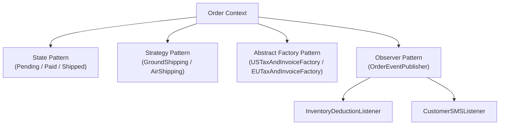

# Case Study: Global E-Commerce Order Platform 🛒

> *"An enterprise e-commerce platform must manage orders progressing through strict lifecycle stages, calculate regional taxes, dynamically compute shipping options, and broadcast inventory events."*

---

## 1. System Requirements

1. **Order Lifecycle State Machine:** Orders transition through `PENDING` -> `PAID` -> `SHIPPED` -> `DELIVERED`. Actions like cancellation are permitted only in specific states.
2. **Dynamic Shipping Calculation:** Shipping fees vary dynamically depending on whether a customer selects Ground, Express Air, or Freight delivery.
3. **Regional Tax & Invoice Families:** In the US, calculate sales tax and generate US receipts; in the EU, calculate VAT and generate EU tax invoices.
4. **Asynchronous Order Events:** State transitions notify inventory reservation, tracking SMS handlers, and analytics pipelines.

---

## 2. Multi-Pattern Architecture Blueprint



### Patterns Involved:
| Pattern | Role in Architecture |
| :--- | :--- |
| **[State](../behavioral/state.md)** | Controls the lifecycle of an order (`PendingState`, `PaidState`, `ShippedState`), enforcing business rules. |
| **[Strategy](../behavioral/strategy.md)** | Calculates shipping costs dynamically based on delivery speed (Ground, Air, Overnight). |
| **[Abstract Factory](../creational/abstract-factory.md)** | Produces regional families of compliant Tax Calculators and Invoices (US vs EU). |
| **[Observer](../behavioral/observer.md)** | Emits events when an order is paid or shipped, notifying external inventory and warehouse systems. |

---

## 3. Production Python Implementation

```python
from abc import ABC, abstractmethod


# ==========================================
# 1. ABSTRACT FACTORY: Regional Policies
# ==========================================
class TaxCalculator(ABC):
    @abstractmethod
    def compute_tax(self, subtotal: float) -> float:
        pass


class USTaxCalculator(TaxCalculator):
    def compute_tax(self, subtotal: float) -> float:
        return subtotal * 0.08  # 8% State Sales Tax


class EUTaxCalculator(TaxCalculator):
    def compute_tax(self, subtotal: float) -> float:
        return subtotal * 0.20  # 20% European VAT


class RegionalStoreFactory(ABC):
    @abstractmethod
    def get_tax_calculator(self) -> TaxCalculator:
        pass

    @abstractmethod
    def format_currency(self, amount: float) -> str:
        pass


class USStoreFactory(RegionalStoreFactory):
    def get_tax_calculator(self) -> TaxCalculator:
        return USTaxCalculator()

    def format_currency(self, amount: float) -> str:
        return f"${amount:,.2f}"


# ==========================================
# 2. STATE PATTERN: Order Lifecycle
# ==========================================
class OrderState(ABC):
    @abstractmethod
    def proceed_next(self, context: "Order") -> None:
        pass

    @abstractmethod
    def cancel(self, context: "Order") -> None:
        pass


class PlacedState(OrderState):
    def proceed_next(self, context: "Order") -> None:
        print("[OrderState] Payment received. Transitioning from PLACED -> PROCESSING.")
        context.set_state(ProcessingState())

    def cancel(self, context: "Order") -> None:
        print("[OrderState] Order cancelled before processing.")
        context.set_state(CancelledState())


class ProcessingState(OrderState):
    def proceed_next(self, context: "Order") -> None:
        print("[OrderState] Warehouse dispatch complete. Transitioning from PROCESSING -> SHIPPED.")
        context.set_state(ShippedState())

    def cancel(self, context: "Order") -> None:
        print("[OrderState] Order is already packing! Restocking fee applies.")
        context.set_state(CancelledState())


class ShippedState(OrderState):
    def proceed_next(self, context: "Order") -> None:
        print("[OrderState] Order delivered to customer destination.")

    def cancel(self, context: "Order") -> None:
        print("[OrderState ERROR] Cannot cancel an order that has already shipped!")


class CancelledState(OrderState):
    def proceed_next(self, context: "Order") -> None:
        print("[OrderState ERROR] Cannot advance a cancelled order.")

    def cancel(self, context: "Order") -> None:
        print("[OrderState] Order is already cancelled.")


# ==========================================
# 3. BUILDER PATTERN: Order Assembly
# ==========================================
class Order:
    def __init__(self, factory: RegionalStoreFactory) -> None:
        self.factory = factory
        self.items: list[tuple[str, float]] = []
        self._state: OrderState = PlacedState()

    def set_state(self, state: OrderState) -> None:
        self._state = state

    def proceed(self) -> None:
        self._state.proceed_next(self)

    def cancel(self) -> None:
        self._state.cancel(self)

    def total(self) -> float:
        subtotal = sum(price for _, price in self.items)
        tax = self.factory.get_tax_calculator().compute_tax(subtotal)
        return subtotal + tax


# ==========================================
# 4. Client Demo
# ==========================================
if __name__ == "__main__":
    us_store = USStoreFactory()
    order = Order(us_store)

    order.items.append(("Mechanical Keyboard", 120.00))
    order.items.append(("Wireless Mouse", 80.00))

    subtotal = sum(p for _, p in order.items)
    print(f"Subtotal:    {us_store.format_currency(subtotal)}")
    print(f"Grand Total: {us_store.format_currency(order.total())}")

    print("\n--- Advancing Order Lifecycle ---")
    order.proceed()  # Placed -> Processing
    order.proceed()  # Processing -> Shipped
    order.cancel()   # Attempt cancel after shipping -> Blocked
```

---

## 4. Key Architectural Takeaways

1. **State pattern guarantees valid lifecycle flows:** Eliminates impossible bugs (like shipping unpaid orders).
2. **Strategy pattern simplifies logistics:** Shipping algorithms are isolated and swappable on the checkout screen.
3. **Abstract Factory handles global compliance:** Tax rates and invoice formats are kept in regional families without conditional checks polluting business logic.
