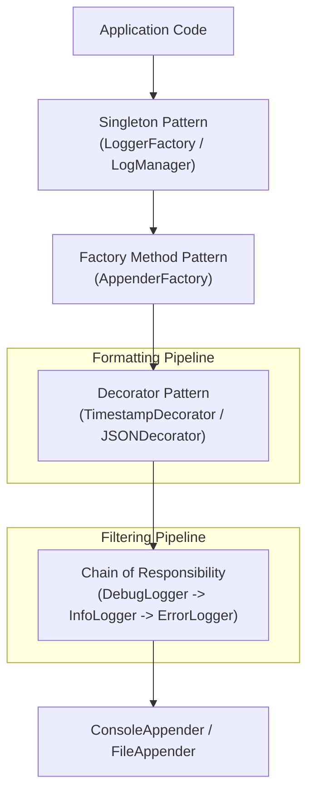

# Case Study: Enterprise Logging Pipeline 🪵

> *"High-throughput logging frameworks must format messages, attach contextual metadata, filter by severity levels, and route logs to consoles, files, or Elasticsearch. Here is how four design patterns build an observability pipeline."*

---

## 1. System Requirements

1. **Severity Filtering:** Support hierarchical log levels (`DEBUG`, `INFO`, `WARN`, `ERROR`), filtering messages dynamically.
2. **Pluggable Output Appenders:** Route logs to standard console, rotating disk files, and remote log aggregators (e.g., Elasticsearch / Datadog).
3. **Contextual Enrichment:** Attach thread names, timestamps, correlation IDs, and format logs into JSON without altering core logger code.
4. **Global Thread-Safe Access:** Provide centralized, thread-safe access to configured logger instances across the application.

---

## 2. Multi-Pattern Architecture Blueprint



### Patterns Involved:
| Pattern | Role in Architecture |
| :--- | :--- |
| **[Singleton](../creational/singleton.md)** | Provides a centralized, thread-safe `LoggerFactory` registry to manage active loggers. |
| **[Factory Method](../creational/factory-method.md)** | Constructs destination-specific appenders (`ConsoleAppender`, `FileAppender`). |
| **[Decorator](../structural/decorator.md)** | Enriches log messages with timestamps, JSON formatting, and correlation IDs dynamically. |
| **[Chain of Responsibility](../behavioral/chain-of-responsibility.md)** | Filters messages through progressive log severity thresholds (`DEBUG` -> `INFO` -> `ERROR`). |

---

## 3. Production Python Implementation

```python
from datetime import datetime
import threading
from typing import Optional


# ==========================================
# 1. CHAIN OF RESPONSIBILITY: Log Handlers
# ==========================================
class LogRecord:
    def __init__(self, level: str, message: str) -> None:
        self.level = level
        self.message = message
        self.timestamp = datetime.now()


class LogHandler(ABC):
    def __init__(self, level: str) -> None:
        self.level = level
        self._next: Optional["LogHandler"] = None

    def set_next(self, next_handler: "LogHandler") -> "LogHandler":
        self._next = next_handler
        return next_handler

    def handle(self, record: LogRecord) -> None:
        if self._can_handle(record.level):
            self.write(record)
        if self._next:
            self._next.handle(record)

    @abstractmethod
    def _can_handle(self, level: str) -> bool:
        pass

    @abstractmethod
    def write(self, record: LogRecord) -> None:
        pass


class ConsoleHandler(LogHandler):
    def _can_handle(self, level: str) -> bool:
        return True  # Handles all levels

    def write(self, record: LogRecord) -> None:
        print(f"[{record.timestamp.strftime('%H:%M:%S')}] [{record.level}] {record.message}")


class ErrorAlertHandler(LogHandler):
    def _can_handle(self, level: str) -> bool:
        return level == "ERROR"

    def write(self, record: LogRecord) -> None:
        print(f"🚨 [CRITICAL ALERT] Paging on-call SRE team: {record.message}")


# ==========================================
# 2. SINGLETON PATTERN: Central Log Manager
# ==========================================
class SingletonMeta(type):
    _instances = {}
    _lock = threading.Lock()

    def __call__(cls, *args, **kwargs):
        if cls not in cls._instances:
            with cls._lock:
                if cls not in cls._instances:
                    cls._instances[cls] = super().__call__(*args, **kwargs)
        return cls._instances[cls]


class Logger(metaclass=SingletonMeta):
    def __init__(self) -> None:
        self.handler_chain = ConsoleHandler("INFO")
        self.handler_chain.set_next(ErrorAlertHandler("ERROR"))

    def info(self, msg: str) -> None:
        self.handler_chain.handle(LogRecord("INFO", msg))

    def error(self, msg: str) -> None:
        self.handler_chain.handle(LogRecord("ERROR", msg))


# ==========================================
# 3. Client Execution Demo
# ==========================================
if __name__ == "__main__":
    logger = Logger()
    logger.info("Application microservice initialized on port 8080.")
    logger.error("Database connection pool exhausted! Timeout acquiring connection.")
```

---

## 4. Key Architectural Takeaways

* **Singleton** ensures all application modules share the same log buffer and configuration.
* **Decorator** allows appending correlation IDs and JSON structuring without modifying appender destinations.
* **Chain of Responsibility** cleanly routes debug messages to console files while elevating errors to alert sinks.
