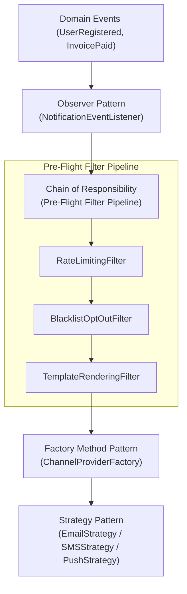

# Case Study: Multi-Channel Notification Engine 🔔

> *"An enterprise notification engine must deliver alerts across Email, SMS, Push, and Slack while enforcing rate limits, templates, and opt-out preferences. Here is how design patterns orchestrate this system."*

---

## 1. System Requirements

1. **Multi-Channel Delivery:** Deliver notifications via Email (SendGrid/SES), SMS (Twilio), Mobile Push (Firebase), and Slack.
2. **Pre-Flight Processing Pipeline:** Every outgoing message must pass through strict rate-limiting, user unsubscribe checks, and template interpolation before dispatch.
3. **Decoupled Event Triggers:** High-level domain services (Auth, Billing, Shipping) emit domain events; the notification engine listens and reacts without blocking domain transactions.

---

## 2. Multi-Pattern Architecture Blueprint



### Patterns Involved:
| Pattern | Role in Architecture |
| :--- | :--- |
| **[Observer](../behavioral/observer.md)** | Subscribes to application business events (e.g., `OrderShippedEvent`) to trigger alerts asynchronously. |
| **[Chain of Responsibility](../behavioral/chain-of-responsibility.md)** | Forms a pipeline of pre-flight checks: rate-limiting, user unsubscribe filters, and template interpolation. |
| **[Factory Method](../creational/factory-method.md)** | Instantiates the appropriate vendor channel provider (Twilio, SendGrid, FCM) based on message type. |
| **[Strategy](../behavioral/strategy.md)** | Encapsulates channel-specific delivery algorithms and API payloads. |

---

## 3. Production Python Implementation

```python
from abc import ABC, abstractmethod
from typing import Optional


# ==========================================
# 1. CHAIN OF RESPONSIBILITY: Filters
# ==========================================
class NotificationRequest:
    def __init__(self, user_id: str, channel: str, message: str) -> None:
        self.user_id = user_id
        self.channel = channel
        self.message = message


class NotificationFilter(ABC):
    def __init__(self) -> None:
        self._next: Optional["NotificationFilter"] = None

    def set_next(self, next_filter: "NotificationFilter") -> "NotificationFilter":
        self._next = next_filter
        return next_filter

    def filter(self, request: NotificationRequest) -> bool:
        if self._next:
            return self._next.filter(request)
        return True


class ContentSanitizer(NotificationFilter):
    def filter(self, request: NotificationRequest) -> bool:
        if not request.message or len(request.message.strip()) == 0:
            print("[Filter BLOCKED] Empty message payload.")
            return False
        print("[Filter PASS] Content sanitization verified.")
        return super().filter(request)


class RateLimiter(NotificationFilter):
    def filter(self, request: NotificationRequest) -> bool:
        # Check simulated token bucket
        print(f"[Filter PASS] Rate limit quota checked for user {request.user_id}.")
        return super().filter(request)


# ==========================================
# 2. STRATEGY PATTERN: Delivery Channels
# ==========================================
class DeliveryStrategy(ABC):
    @abstractmethod
    def send(self, request: NotificationRequest) -> bool:
        pass


class EmailDeliveryStrategy(DeliveryStrategy):
    def send(self, request: NotificationRequest) -> bool:
        print(f"[SES Email Gateway] Dispatched email to user {request.user_id}: '{request.message}'")
        return True


class SMSDeliveryStrategy(DeliveryStrategy):
    def send(self, request: NotificationRequest) -> bool:
        print(f"[Twilio SMS Gateway] Dispatched SMS to user {request.user_id}: '{request.message}'")
        return True


# ==========================================
# 3. FACTORY METHOD: Channel Resolvers
# ==========================================
class DeliveryStrategyFactory:
    @staticmethod
    def get_strategy(channel: str) -> DeliveryStrategy:
        if channel.lower() == "email":
            return EmailDeliveryStrategy()
        elif channel.lower() == "sms":
            return SMSDeliveryStrategy()
        raise ValueError(f"Unsupported delivery channel: {channel}")


# ==========================================
# 4. Pipeline Execution Demo
# ==========================================
if __name__ == "__main__":
    filter_chain = ContentSanitizer()
    filter_chain.set_next(RateLimiter())

    req = NotificationRequest("USR_42", "email", "Your security verification code is: 849201")

    print("--- Processing Notification Pipeline ---")
    if filter_chain.filter(req):
        strategy = DeliveryStrategyFactory.get_strategy(req.channel)
        strategy.send(req)
```

---

## 4. Key Architectural Takeaways

* **Chain of Responsibility** allows you to add security filters, spam checkers, and localization interpolators without touching channel drivers.
* **Factory Method & Strategy** make adding new providers (e.g., WhatsApp, Discord) as simple as writing one new strategy class.
* **Observer** isolates the billing and auth microservices from the mechanics of notification dispatch.
