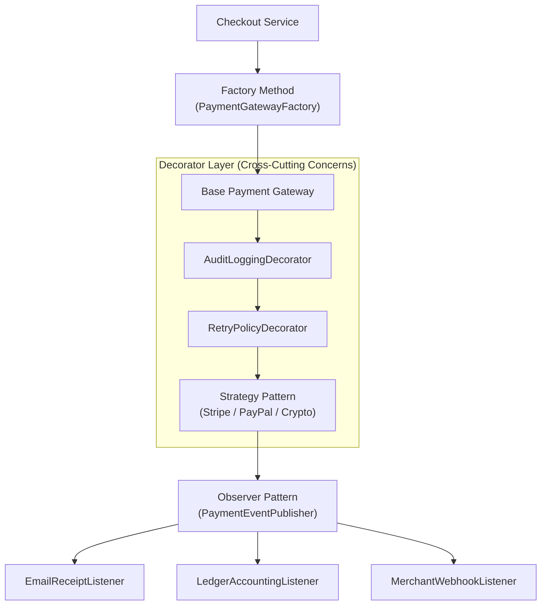

# Case Study: Enterprise Payment Processing System 💳

> *"In real-world software engineering, design patterns are never used in a vacuum. Production architectures combine multiple Gang of Four patterns to create clean, maintainable systems."*

---

## 1. System Requirements

You are tasked with architecting a payment processing platform for a global e-commerce company:
1. **Multi-Provider Support:** Support payment via Stripe, PayPal, and Cryptocurrency (Bitcoin/Ethereum).
2. **Regional Routing:** Automatically select the best payment gateway based on the user's currency and geographic region.
3. **Resilience & Auditing:** Automatically retry failed network attempts, log every transaction securely, and mask sensitive credit card data.
4. **Event-Driven Notifications:** Asynchronously notify downstream order services, send confirmation emails, and update financial ledger balances upon payment completion.

---

## 2. Multi-Pattern Architecture Blueprint



### Patterns Involved:
| Pattern | Role in Architecture |
| :--- | :--- |
| **[Factory Method](../creational/factory-method.md)** | Creates region-compliant payment gateways based on customer location and currency. |
| **[Strategy](../behavioral/strategy.md)** | Encapsulates provider-specific charging algorithms (Stripe API, PayPal OAuth, Crypto RPC). |
| **[Decorator](../structural/decorator.md)** | Transparently wraps payment calls with automatic retries and secure audit logging. |
| **[Observer](../behavioral/observer.md)** | Broadcasts payment outcomes (Success/Failure) to receipts, ledgers, and webhooks. |

---

## 3. Production Python Implementation

```python
from abc import ABC, abstractmethod
from typing import Optional


# ==========================================
# 1. STRATEGY PATTERN: Payment Strategies
# ==========================================
class PaymentStrategy(ABC):
    @abstractmethod
    def process_payment(self, amount: float, currency: str) -> bool:
        pass


class StripePaymentStrategy(PaymentStrategy):
    def process_payment(self, amount: float, currency: str) -> bool:
        print(f"[Stripe API] Charging card for {amount:.2f} {currency}. Tokenizing credentials...")
        return True


class PayPalPaymentStrategy(PaymentStrategy):
    def process_payment(self, amount: float, currency: str) -> bool:
        print(f"[PayPal Gateway] Redirecting OAuth authorization for {amount:.2f} {currency}...")
        return True


# ==========================================
# 2. DECORATOR PATTERN: Additional Behaviors
# ==========================================
class PaymentDecorator(PaymentStrategy):
    def __init__(self, wrappee: PaymentStrategy) -> None:
        self._wrappee = wrappee

    def process_payment(self, amount: float, currency: str) -> bool:
        return self._wrappee.process_payment(amount, currency)


class FraudCheckDecorator(PaymentDecorator):
    def process_payment(self, amount: float, currency: str) -> bool:
        print(f"[FraudGuard] Evaluating transaction risk score for {amount:.2f} {currency}...")
        if amount > 10000.0:
            print("[FraudGuard WARNING] High-value transaction requires manual AML review!")
        return super().process_payment(amount, currency)


class AuditLoggingDecorator(PaymentDecorator):
    def process_payment(self, amount: float, currency: str) -> bool:
        print(f"[Audit Log] Initiating transaction record: amount={amount:.2f} {currency}")
        success = super().process_payment(amount, currency)
        print(f"[Audit Log] Completed transaction record: status={'SUCCESS' if success else 'FAILED'}")
        return success


# ==========================================
# 3. OBSERVER PATTERN: Status Notifications
# ==========================================
class PaymentObserver(ABC):
    @abstractmethod
    def on_payment_completed(self, order_id: str, amount: float) -> None:
        pass


class EmailNotificationObserver(PaymentObserver):
    def on_payment_completed(self, order_id: str, amount: float) -> None:
        print(f"[Email Service] Receipt dispatched to customer for Order #{order_id} (${amount:.2f})")


class AccountingLedgerObserver(PaymentObserver):
    def on_payment_completed(self, order_id: str, amount: float) -> None:
        print(f"[ERP Ledger] General Ledger credited with ${amount:.2f} for Order #{order_id}")


# ==========================================
# 4. ORCHESTRATOR / SERVICE
# ==========================================
class PaymentService:
    def __init__(self, strategy: PaymentStrategy) -> None:
        self._strategy = strategy
        self._observers: list[PaymentObserver] = []

    def attach_observer(self, observer: PaymentObserver) -> None:
        self._observers.append(observer)

    def execute_transaction(self, order_id: str, amount: float, currency: str = "USD") -> None:
        success = self._strategy.process_payment(amount, currency)
        if success:
            for obs in self._observers:
                obs.on_payment_completed(order_id, amount)


# ==========================================
# 5. Client Demo
# ==========================================
if __name__ == "__main__":
    # Assemble payment pipeline: Stripe wrapped in FraudCheck and AuditLogging
    base_strategy = StripePaymentStrategy()
    secure_pipeline = AuditLoggingDecorator(FraudCheckDecorator(base_strategy))

    service = PaymentService(secure_pipeline)
    service.attach_observer(EmailNotificationObserver())
    service.attach_observer(AccountingLedgerObserver())

    print("--- Executing Payment Transaction ---")
    service.execute_transaction("ORD-9876", 12500.00, "USD")
```

---

## 4. Architectural Lessons

1. **Strategy handles algorithm variation:** Adding Apple Pay requires zero changes to logging or notifications.
2. **Decorator handles cross-cutting concerns:** Retries and logging wrap around any payment strategy seamlessly.
3. **Observer decouples side effects:** Email receipts and ledger updates happen without polluting the core charging logic.
4. **Factory Method encapsulates wiring:** Client code requests a processor and receives a fully assembled, decorated pipeline.
