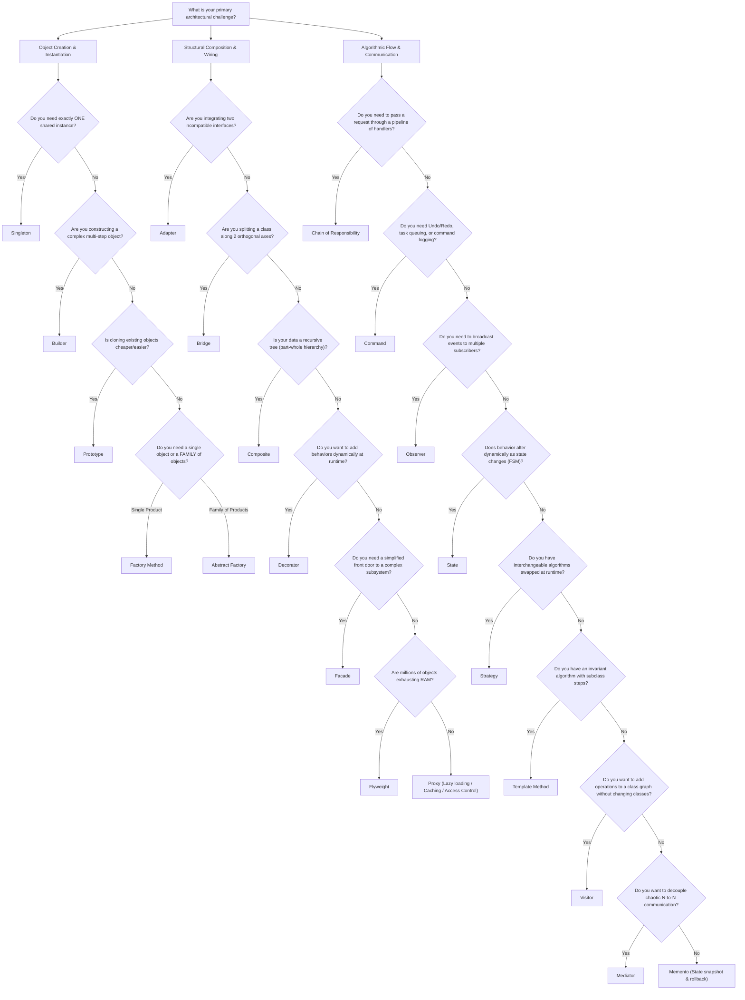

# Design Pattern Selection Guide 🧭

> *"Don't start with a pattern and try to force a problem into it. Start with the problem and let the symptoms guide you to the pattern."*

---

## 1. Master Decision Flowchart

---

## 2. Problem-to-Pattern Diagnostic Table

| If you see this code smell or symptom... | The root problem is... | Apply this pattern |
| :--- | :--- | :--- |
| Giant `switch` statement over string types during `new` calls | Tight coupling to concrete classes | [Factory Method](../creational/factory-method.md) |
| A constructor taking 10+ arguments with many `null` or boolean defaults | Telescoping constructor anti-pattern | [Builder](../creational/builder.md) |
| Multiple instances conflicting over a shared physical resource or socket | Uncoordinated state mutation | [Singleton](../creational/singleton.md) |
| Two classes do identical jobs but have incompatible method signatures | Third-party interface mismatch | [Adapter](../structural/adapter.md) |
| A class hierarchy multiplying into $N \times M$ subclasses | Orthogonal dimensions coupled together | [Bridge](../structural/bridge.md) |
| Complex recursive `instanceof` checks to unwrap nested objects and boxes | Missing common abstraction over part-whole trees | [Composite](../structural/composite.md) |
| Subclasses multiplying just to combine optional features (e.g. `LoggingAuthEncryptionService`) | Combinatorial inheritance explosion | [Decorator](../structural/decorator.md) |
| Client code importing 15 classes just to perform one basic business operation | Leaky subsystem abstractions | [Facade](../structural/facade.md) |
| Massive `OutOfMemoryError` caused by millions of similar small objects | Redundant duplicate intrinsic state in heap | [Flyweight](../structural/flyweight.md) |
| Heavyweight service slowing down application boot times | Missing lazy loading or security check | [Proxy](../structural/proxy.md) |
| Sequential validation checks hardcoded into one 500-line service method | Monolithic execution pipeline | [Chain of Responsibility](../behavioral/chain-of-responsibility.md) |
| Actions cannot be queued, scheduled, or undone | Actions are bound directly to UI triggers | [Command](../behavioral/command.md) |
| One object changes and multiple unrelated modules need to be updated | Polling or tight coupling | [Observer](../behavioral/observer.md) |
| Massive `switch (currentState)` statements duplicated across every method | Unencapsulated finite state machine | [State](../behavioral/state.md) |
| Multiple variations of an algorithm tangled inside conditional branches | Inability to swap algorithms dynamically | [Strategy](../behavioral/strategy.md) |
| Duplicate multi-step workflow across sibling classes | Code duplication in parallel algorithms | [Template Method](../behavioral/template-method.md) |
| Core domain classes bloated with dozens of unrelated export and audit methods | Operations coupled to data nodes | [Visitor](../behavioral/visitor.md) |

---

## 3. Four Questions to Ask Before Choosing a Pattern

1. **Am I over-engineering?** If standard OOP with clean methods and a constructor solves the problem, **do not introduce a pattern**. Patterns add architectural indirection.
2. **Can I use composition instead of inheritance?** Always lean toward patterns that compose behavior at runtime ([Strategy](../behavioral/strategy.md), [Decorator](../structural/decorator.md)) rather than static subclassing.
3. **Is the interface stable?** Patterns like [Visitor](../behavioral/visitor.md) and [Abstract Factory](../creational/abstract-factory.md) become painful if the underlying interfaces change frequently.
4. **Is there a modern language feature that replaces the pattern?** (e.g., Python first-class functions replace single-method Strategies; `@dataclass` replaces Builders for simple DTOs).
