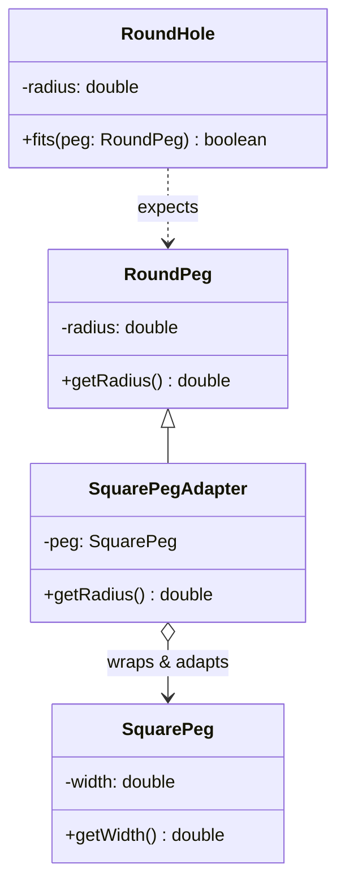
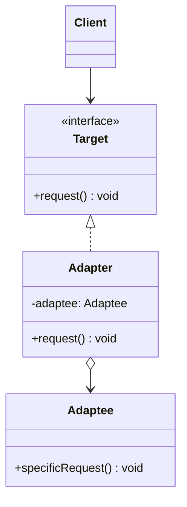
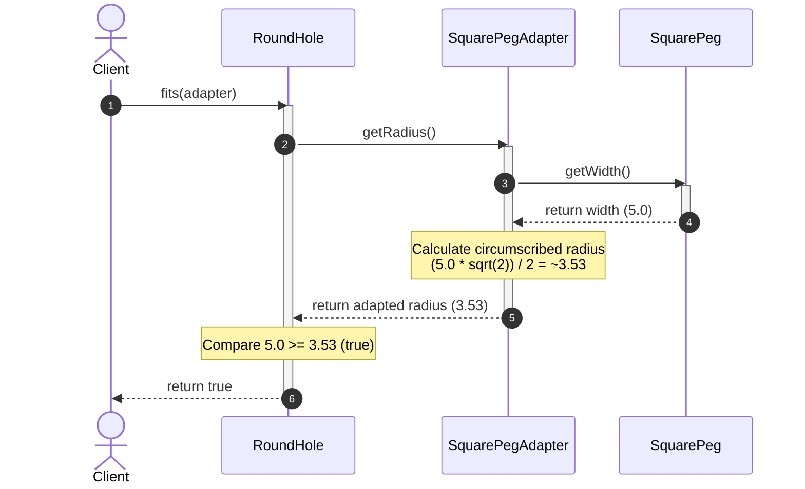

# Adapter

> **Also known as:** Wrapper  
> **Classification:** Structural Pattern  
> **Complexity:** ★☆☆

---

## 1. Intent

**Adapter** is a structural design pattern that allows objects with incompatible interfaces to collaborate.

---

## 2. Problem

Imagine you are developing a stock market analytics application. The app downloads stock data from financial exchanges in **XML format** and renders clean user dashboards and trend lines.

You want to improve the app by integrating a top-tier third-party machine learning analytics library. However, there is a catch: **the analytics library only accepts data formatted in JSON**.


You face a dilemma:
* You cannot modify the third-party library because it is proprietary vendor software or an external dependency.
* Rewriting your entire application to use JSON would break dozens of existing features, tests, and data feeds.

---

## 3. Motivation

Consider geometric components in a CAD software package:
* You have a class `RoundHole` designed to fit round objects of a certain radius (`RoundPeg`).
* You are provided with a legacy or third-party class `SquarePeg` that represents square pegs defined by width.
* A square peg cannot be passed directly into a round hole method because its interface lacks a `getRadius()` method.

An adapter can wrap the square peg and calculate the equivalent minimum radius of a circle that can circumscribe the square peg:
$$\text{radius} = \frac{\text{width} \times \sqrt{2}}{2}$$

---

## 4. Solution

Create an **Adapter**. An adapter is a special object that acts as an intermediary, converting the interface of one object so that another object can understand it:

1. The adapter implements the interface that the client expects (**Target Interface**).
2. The adapter holds an internal reference to the incompatible object (**Adaptee**).
3. When the client calls a method on the adapter, the adapter converts the parameters, invokes the corresponding method on the adaptee, and translates the response back into the format the client expects.



---

## 5. Structure (Object Adapter)



---

## 6. Participants

1. **Target Interface:** Defines the domain-specific interface that the Client code uses and expects.
2. **Client:** Collaborates with classes conforming to the Target interface.
3. **Adaptee:** The existing, legacy, or third-party class with an incompatible interface that needs adapting.
4. **Adapter:** Implements the Target interface and wraps an instance of the Adaptee, translating calls between the two.

---

## 7. Code Implementation (Python 3)

```python
import math


# ==========================================
# 1. Target Interface / Class (Client Expectation)
# ==========================================
class RoundPeg:
    """RoundPegs fit into RoundHoles."""
    def __init__(self, radius: float = 0.0) -> None:
        self._radius = radius

    def get_radius(self) -> float:
        return self._radius


class RoundHole:
    """RoundHoles accept RoundPegs with radius <= hole radius."""
    def __init__(self, radius: float) -> None:
        self._radius = radius

    def get_radius(self) -> float:
        return self._radius

    def fits(self, peg: RoundPeg) -> bool:
        return peg.get_radius() <= self._radius


# ==========================================
# 2. Adaptee (Incompatible Service)
# ==========================================
class SquarePeg:
    """SquarePegs have widths, not radii. They are incompatible with RoundHole."""
    def __init__(self, width: float) -> None:
        self._width = width

    def get_width(self) -> float:
        return self._width


# ==========================================
# 3. Object Adapter
# ==========================================
class SquarePegAdapter(RoundPeg):
    """Adapter inherits from Target (RoundPeg) and wraps Adaptee (SquarePeg)."""
    def __init__(self, peg: SquarePeg) -> None:
        self._peg = peg

    def get_radius(self) -> float:
        # Calculate minimum bounding circle radius: (width * sqrt(2)) / 2
        return (self._peg.get_width() * math.sqrt(2)) / 2


# ==========================================
# 4. Client Demo
# ==========================================
if __name__ == "__main__":
    hole = RoundHole(radius=5.0)
    round_peg = RoundPeg(radius=5.0)
    print(f"Round peg fits hole: {hole.fits(round_peg)}")  # True

    small_sq_peg = SquarePeg(width=5.0)
    large_sq_peg = SquarePeg(width=10.0)

    # hole.fits(small_sq_peg)  # Incompatible type / missing get_radius()!

    # Wrap inside adapter
    small_adapter = SquarePegAdapter(small_sq_peg)
    large_adapter = SquarePegAdapter(large_sq_peg)

    print(f"Small square peg (w=5) adapter radius: {small_adapter.get_radius():.2f}")
    print(f"Small square peg fits hole (r=5):      {hole.fits(small_adapter)}")  # True (3.54 <= 5.0)
    print(f"Large square peg (w=10) adapter radius: {large_adapter.get_radius():.2f}")
    print(f"Large square peg fits hole (r=5):      {hole.fits(large_adapter)}")  # False (7.07 > 5.0)
```

---

## 8. Execution Flow



---

## 9. When to Use (Applicability)

* **Legacy or Third-Party Integration:** When you want to use an existing class, but its interface does not match the rest of your application code.
* **Creating Reusable Subclasses:** When you want to create a reusable class that cooperates with unrelated or unforeseen classes that do not necessarily have compatible interfaces.
* **Data Format Translation:** When integrating subsystems communicating via differing data formats (e.g., XML to JSON, SOAP to REST, Celsius to Fahrenheit).

---

## 10. When NOT to Use (Anti-Scenarios)

* **When You Control Both Classes:** If you have direct control over both interfaces, refactor them directly to share a common interface instead of adding unnecessary adapter layers.
* **When Semantic Behavior Differs Completely:** If the adaptee does not perform anything conceptually similar to the target interface, forcing an adapter creates confusing, misleading code.

---

## 11. Advantages

* **Single Responsibility Principle (SRP):** You separate the interface or data conversion logic from the primary business logic of the program.
* **Open/Closed Principle (OCP):** You can introduce new types of adapters into the program without breaking existing client code.

---

## 12. Disadvantages

* **Increased Architectural Indirection:** Overall code complexity increases because you must introduce new interfaces and wrapper classes.

---

## 13. Common Mistakes & Misconceptions

### Mistake 1: Confusing Adapter with Facade
* **Adapter:** Makes two **existing, incompatible interfaces** work together by translating method names and data structures.
* **Facade:** Defines a **brand-new, simplified interface** over an entire complex subsystem to make it easier to use.

### Mistake 2: Confusing Adapter with Decorator
* **Adapter:** Changes the interface of an object to make it compatible with a client.
* **Decorator:** Enhances an object’s behavior **without changing its interface**.

---

## 14. Related Patterns

* **[Bridge](bridge.md):** Bridge is designed up-front to let abstractions and implementations vary independently; Adapter is typically retrofitted to make unrelated classes work together.
* **[Decorator](decorator.md):** Decorator changes an object's responsibilities without changing its interface; Adapter changes an object's interface.
* **[Proxy](proxy.md):** Proxy provides the identical interface to its subject; Adapter provides a different interface.

---

## 15. Real-World Applications

### Python Standard Library
* `io.StringIO` & `io.BytesIO`: Adapt in-memory strings or bytes into file stream interfaces (`read()`, `write()`).
* `dataclasses.asdict()`: Adapts structured OOP dataclass instances into dictionary mappings.

---

## 16. Interview Questions & Self-Assessment

### Q1: What is the difference between an Object Adapter and a Class Adapter?
> **Answer:** An Object Adapter uses **composition** (it holds an instance of the Adaptee), which works with the adaptee and all of its subclasses. A Class Adapter uses **multiple inheritance** (inheriting from both Target and Adaptee), binding tightly to a single concrete class.

### Q2: Why is the Object Adapter preferred over the Class Adapter in modern OOP?
> **Answer:** It respects the "Favor composition over inheritance" principle. An object adapter can adapt not only the adaptee class, but any of its subclasses dynamically at runtime.

### Q3: Can an Adapter be two-way (bidirectional)?
> **Answer:** Yes. A two-way adapter implements both interfaces, allowing it to be used interchangeably by either client.

### Q4: How does the Adapter pattern support the Open/Closed Principle?
> **Answer:** New adapters can be added to wrap new legacy or third-party systems without altering existing clients or existing target interfaces.

### Q5: How is `io.StringIO` in Python an example of an Adapter?
> **Answer:** It implements the `Reader` interface (which works with characters) while wrapping an underlying `InputStream` (which works with raw bytes), transparently converting byte streams into character streams using a specified character set.

---

## 17. Key Takeaways

1. **Interface Translator:** Adapter bridges the gap between incompatible interfaces.
2. **Object Wrapper:** Relies on composition to delegate calls to the wrapped adaptee.
3. **Preserves Existing Code:** Allows integration of third-party or legacy classes without touching their source code.
4. **Interface Conversion, Not Enhancement:** Unlike Decorator, Adapter's sole responsibility is interface compatibility, not behavioral enhancement.
