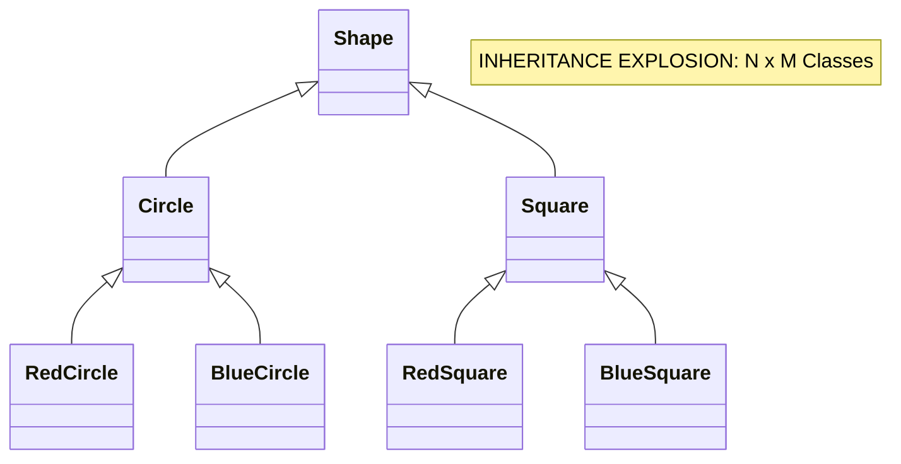
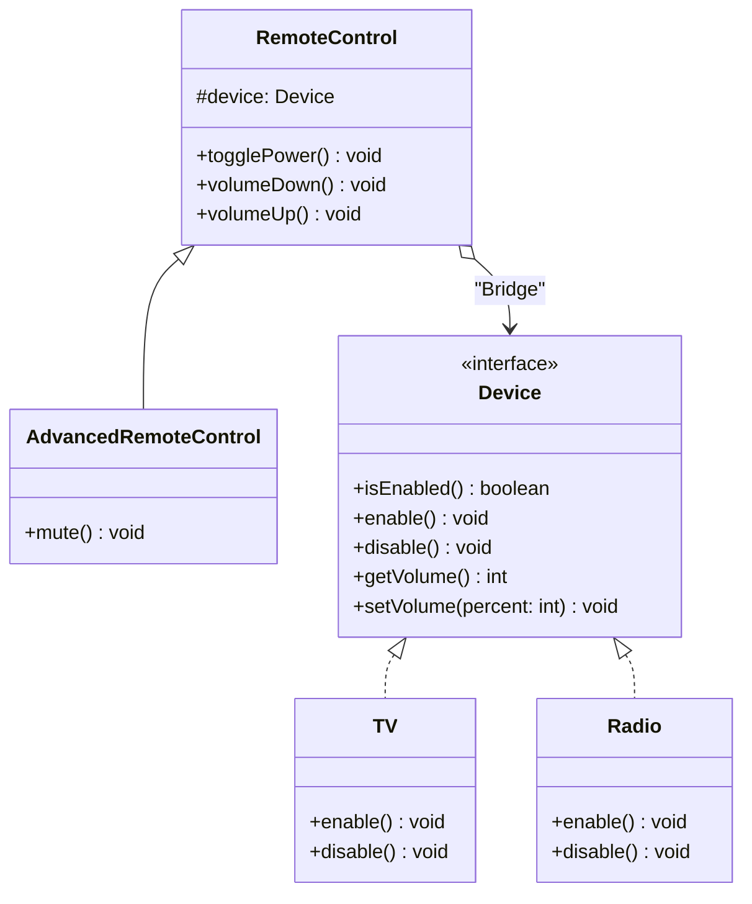
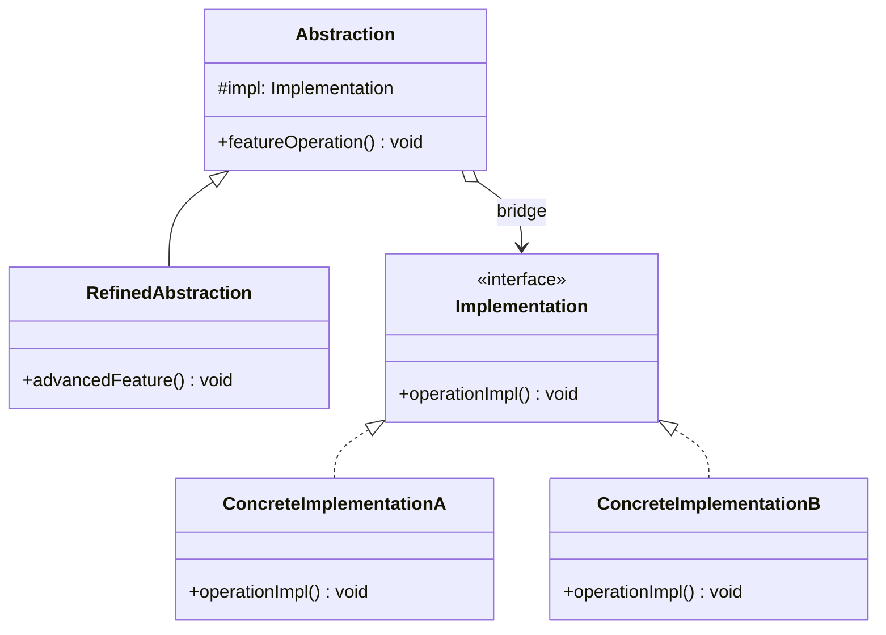
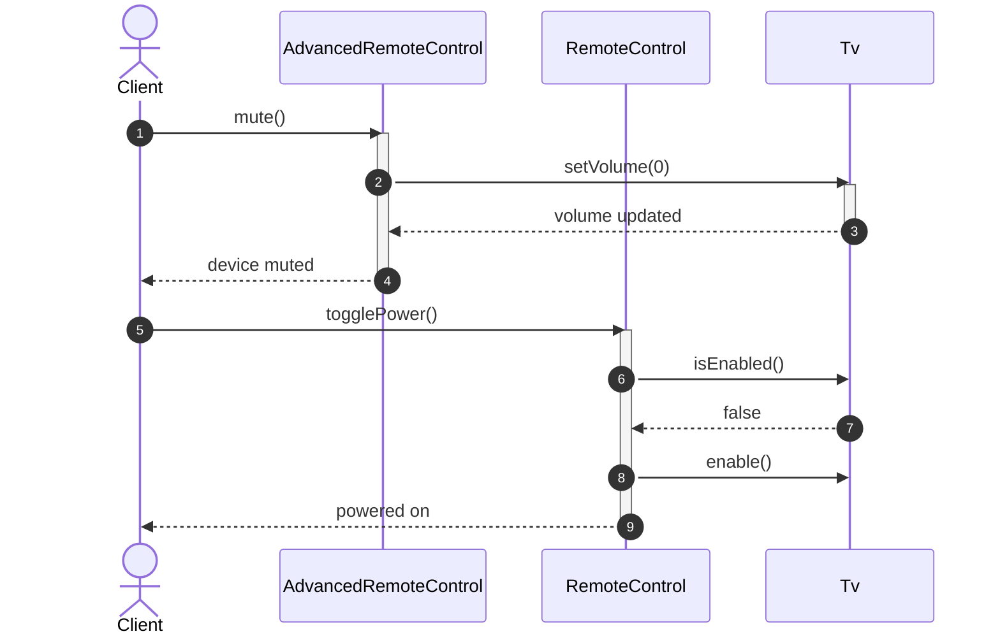

# Bridge

> **Classification:** Structural Pattern  
> **Complexity:** ★★★

---

## 1. Intent

**Bridge** is a structural design pattern that lets you split a large class or a set of closely related classes into two separate hierarchies—**Abstraction** and **Implementation**—which can be developed independently of each other.

---

## 2. Problem

Imagine you have a geometric `Shape` class with a pair of subclasses: `Circle` and `Square`. You want to extend this class hierarchy to incorporate colors: `Red` and `Blue`.

If you rely on inheritance, you face a **combinatorial explosion**:
* You must create four classes: `RedCircle`, `BlueCircle`, `RedSquare`, `BlueSquare`.
* Adding a `Triangle` requires two new classes. Adding a `Yellow` color requires three new classes.
* For $N$ shapes and $M$ colors, you need $N \times M$ classes!



This occurs because we are attempting to extend the class in two independent, orthogonal dimensions simultaneously: **form** (abstraction) and **color** (implementation).

---

## 3. Motivation

Consider universal remote controls and multimedia devices:
* You have various remote controls: `BasicRemote`, `AdvancedRemote` (with mute and channel recall).
* You have various devices: `TV`, `Radio`, `SmartProjector`.

If you model remotes and devices via inheritance (`TVBasicRemote`, `RadioAdvancedRemote`), adding a new remote feature or supporting a new device multiplies subclasses.

Instead, a **Remote Control (Abstraction)** should hold a reference (Bridge) to a **Device (Implementation)**. The remote delegates commands (power, volume, channel) to the device interface.

---

## 4. Solution

The Bridge pattern solves this problem by replacing inheritance with **object composition**:
1. Separate the two orthogonal dimensions into distinct hierarchies:
   * **Abstraction (Control Layer):** High-level logic that delegates work to the implementation layer.
   * **Implementation (Platform Layer):** Low-level primitives that do the real work.
2. The Abstraction maintains a reference to an Implementation object—this reference is the **Bridge**.



Now, adding a new `SmartProjector` requires only one new class. Adding a `VoiceControlledRemote` requires only one new class. Total classes: $N + M$ instead of $N \times M$!

---

## 5. Structure



---

## 6. Participants

1. **Abstraction:** Defines high-level control logic and maintains a reference to an Implementation object.
2. **Refined Abstraction:** Extends the Abstraction to provide variant or specialized control features.
3. **Implementation Interface:** Declares common primitives needed by the abstraction. The methods do not need to mirror the abstraction's interface; the abstraction operates by orchestrating these primitives.
4. **Concrete Implementations:** Provide platform-specific code.

---

## 7. Code Implementation (Python 3)

```python
from abc import ABC, abstractmethod


# ==========================================
# 1. Implementation Interface & Concrete Classes
# ==========================================
class Device(ABC):
    """Implementation defines the low-level primitive interface."""
    @abstractmethod
    def is_enabled(self) -> bool:
        pass

    @abstractmethod
    def enable(self) -> None:
        pass

    @abstractmethod
    def disable(self) -> None:
        pass

    @abstractmethod
    def get_volume(self) -> int:
        pass

    @abstractmethod
    def set_volume(self, percent: int) -> None:
        pass

    @abstractmethod
    def get_channel(self) -> int:
        pass

    @abstractmethod
    def set_channel(self, channel: int) -> None:
        pass


class TV(Device):
    def __init__(self) -> None:
        self._on = False
        self._volume = 30
        self._channel = 1

    def is_enabled(self) -> bool:
        return self._on

    def enable(self) -> None:
        self._on = True
        print("[TV] Powered ON")

    def disable(self) -> None:
        self._on = False
        print("[TV] Powered OFF")

    def get_volume(self) -> int:
        return self._volume

    def set_volume(self, percent: int) -> None:
        self._volume = max(0, min(100, percent))
        print(f"[TV] Volume set to: {self._volume}%")

    def get_channel(self) -> int:
        return self._channel

    def set_channel(self, channel: int) -> None:
        self._channel = channel
        print(f"[TV] Channel tuned to: {self._channel}")


class Radio(Device):
    def __init__(self) -> None:
        self._on = False
        self._volume = 20
        self._channel = 88

    def is_enabled(self) -> bool:
        return self._on

    def enable(self) -> None:
        self._on = True
        print("[Radio] Powered ON (FM/AM Receiver Active)")

    def disable(self) -> None:
        self._on = False
        print("[Radio] Powered OFF")

    def get_volume(self) -> int:
        return self._volume

    def set_volume(self, percent: int) -> None:
        self._volume = max(0, min(100, percent))
        print(f"[Radio] Volume set to: {self._volume}%")

    def get_channel(self) -> int:
        return self._channel

    def set_channel(self, channel: int) -> None:
        self._channel = channel
        print(f"[Radio] Frequency tuned to: {self._channel} MHz")


# ==========================================
# 2. Abstraction Hierarchy
# ==========================================
class RemoteControl:
    """Abstraction maintains a reference to an Implementation object (The Bridge)."""
    def __init__(self, device: Device) -> None:
        self._device = device

    def toggle_power(self) -> None:
        if self._device.is_enabled():
            self._device.disable()
        else:
            self._device.enable()

    def volume_down(self) -> None:
        self._device.set_volume(self._device.get_volume() - 10)

    def volume_up(self) -> None:
        self._device.set_volume(self._device.get_volume() + 10)

    def channel_down(self) -> None:
        self._device.set_channel(self._device.get_channel() - 1)

    def channel_up(self) -> None:
        self._device.set_channel(self._device.get_channel() + 1)


class AdvancedRemoteControl(RemoteControl):
    """Refined Abstraction extending control features independently of device types."""
    def mute(self) -> None:
        print("[Advanced Remote] Executing Mute")
        self._device.set_volume(0)


# ==========================================
# 3. Client Execution Demo
# ==========================================
if __name__ == "__main__":
    tv = TV()
    basic_remote = RemoteControl(tv)
    basic_remote.toggle_power()
    basic_remote.volume_up()

    print("--- Switching Implementation to Radio with Advanced Remote ---")
    radio = Radio()
    advanced_remote = AdvancedRemoteControl(radio)
    advanced_remote.toggle_power()
    advanced_remote.channel_up()
    advanced_remote.mute()
```

---

## 8. Execution Flow



---

## 9. When to Use (Applicability)

* **Preventing Cartesian Product of Classes:** When you have two independent dimensions of variation (e.g., UI abstractions across OS platforms, shapes across rendering engines, documents across export formats).
* **Cross-Platform Architectures:** When your application must support multiple database drivers, rendering engines, or operating systems without polluting domain business logic.
* **Runtime Swapping:** When you need to switch implementation platforms dynamically at runtime.

---

## 10. When NOT to Use (Anti-Scenarios)

* **Single Dimension of Variation:** If your class does not vary in multiple orthogonal ways, introducing a Bridge adds needless indirection.
* **Simple Inheritance Trees:** When subclassing is shallow and class explosion is not a realistic threat.

---

## 11. Advantages

* **Decouples High-Level Logic from Low-Level Platforms:** You can alter the implementation without touching the abstraction, and vice versa.
* **Open/Closed Principle (OCP):** You can introduce new abstractions and implementations independently.
* **Single Responsibility Principle (SRP):** Abstraction focuses on high-level user features; implementation focuses on platform primitives.

---

## 12. Disadvantages

* **Increased Architectural Indirection:** Code structure can become confusing for developers who expect simple inheritance.

---

## 13. Common Mistakes & Misconceptions

### Mistake: Confusing Bridge with Adapter
* **Adapter:** Added to **existing code** after the fact to resolve incompatibilities between legacy or third-party classes.
* **Bridge:** Designed **up-front** during initial architecture to let abstractions and platforms evolve independently.

---

## 14. Related Patterns

* **[Abstract Factory](../creational/abstract-factory.md):** Abstract Factory is often combined with Bridge to construct specific bridge pairings (e.g., pairing a `WindowsRemote` with a `WindowsDevice`).
* **[Adapter](adapter.md):** Adapter makes unrelated classes work together after the fact; Bridge is designed up-front.
* **[Strategy](../behavioral/strategy.md):** Structurally, Bridge and Strategy look identical (both rely on composition and delegation). However, Strategy is **behavioral** (swapping interchangeable algorithms), while Bridge is **structural** (separating abstract control from low-level execution platforms).

---

## 15. Real-World Applications

### Python Standard Library
* **Python DB-API 2.0 (`sqlite3`, `psycopg2`):** Abstract connection/cursor protocols bridging to database-specific C-bindings and protocols.
* **SQLAlchemy:** Decouples high-level SQL queries from dialect-specific compiler and execution engines.

---

## 16. Interview Questions & Self-Assessment

### Q1: What problem does the Bridge pattern solve that inheritance cannot?
> **Answer:** It prevents the combinatorial explosion of subclasses ($N \times M$) when a domain has multiple independent dimensions of variation, reducing complexity to $N + M$ classes.

### Q2: What is the difference between Abstraction and Implementation in the Bridge pattern?
> **Answer:** The Abstraction provides the high-level client-facing interface (the "what"), while the Implementation defines the low-level platform-specific primitive operations (the "how").

### Q3: How does Bridge differ from Strategy?
> **Answer:** Structurally they look identical (delegation to an interface). Conceptually, Bridge is a structural pattern designed up-front to decouple an entire hierarchy from its platform, whereas Strategy is a behavioral pattern used to swap interchangeable algorithms within an existing object.

### Q4: Can the Implementation object be swapped at runtime in a Bridge?
> **Answer:** Yes! Because the bridge is maintained via an object reference (composition), client code can dynamically assign a new implementation (e.g., switching from a `Tv` to a `Radio` on the same remote).

---

## 17. Key Takeaways

1. **Orthogonal Separation:** Splits classes that vary along multiple axes into two independent hierarchies.
2. **$N \times M \rightarrow N + M$:** Drastically reduces subclass explosion.
3. **Designed Up-Front:** Unlike Adapter, Bridge is an intentional foundational architectural decision.
4. **Core to Enterprise Frameworks:** The backbone of JDBC, graphic engines, and cross-platform UI toolkits.
