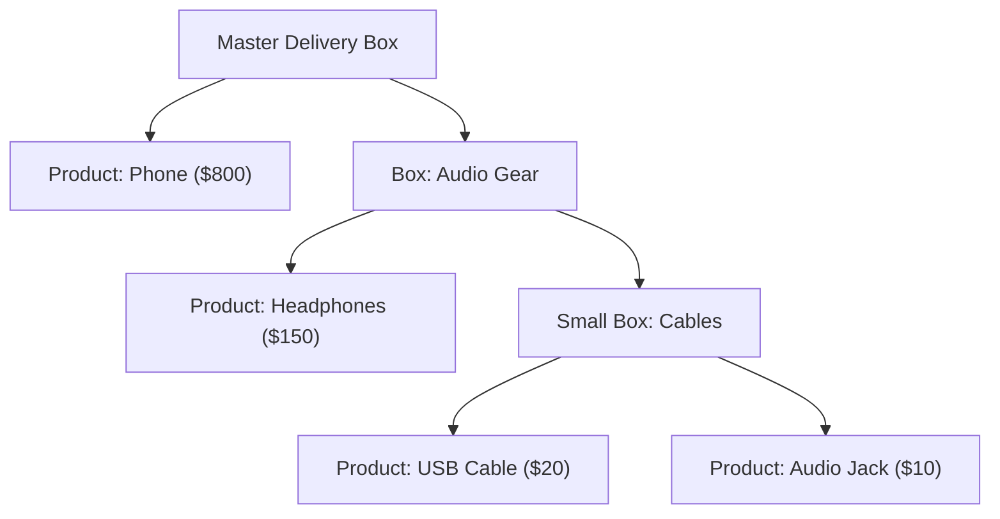
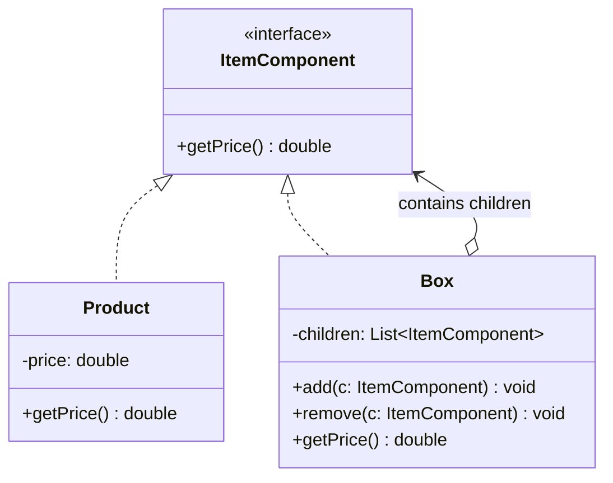
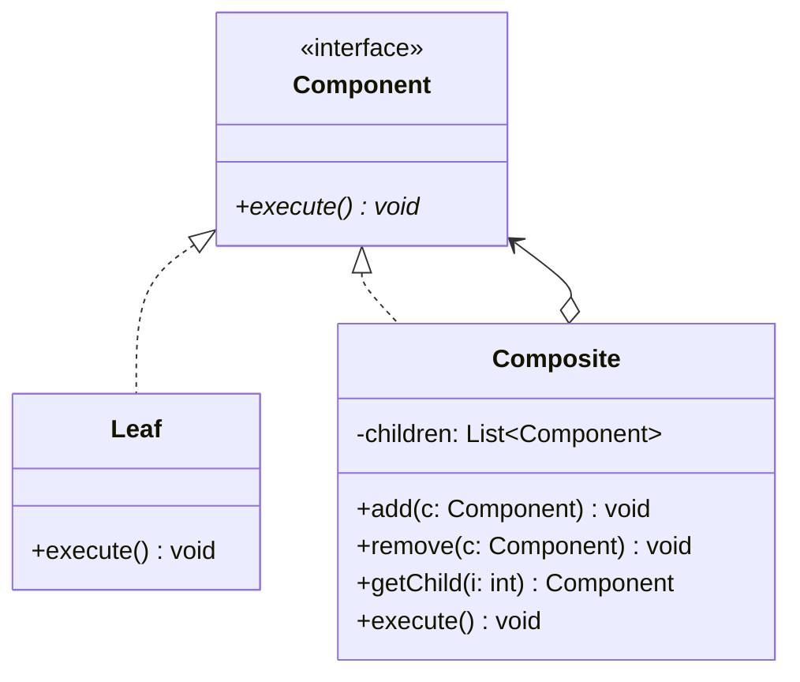
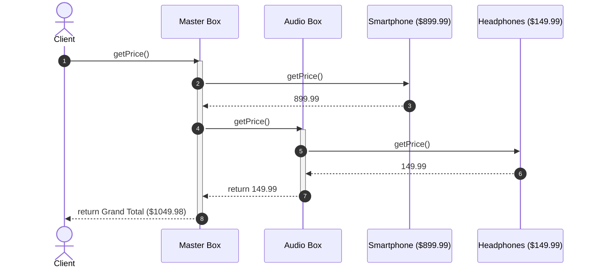

# Composite

> **Classification:** Structural Pattern  
> **Complexity:** ★★☆

---

## 1. Intent

**Composite** is a structural design pattern that lets you compose objects into tree structures and then work with these structures as if they were individual objects.

---

## 2. Problem

Imagine you are building an e-commerce shipping and logistics system. Your product catalog contains two types of elements:
1. **Products:** Individual items (e.g., a phone, a pair of headphones, a charger).
2. **Boxes:** Containers that hold products as well as other smaller boxes, forming an arbitrary, nested tree hierarchy.



### The Naive Dilemma
How do you calculate the total price of an order?
* A naive approach requires unwrapping every box, writing complex nested `for` loops, and checking types with `instanceof` to distinguish between a `Product` and a `Box`.
* This tightly couples client code to the concrete classes of the tree and breaks whenever packaging structures change.

---

## 3. Motivation

Consider graphical drawing tools (like Adobe Illustrator or SVG editors):
* You have primitive shapes: `Circle`, `Rectangle`, `Line`.
* Users can select multiple shapes and click **"Group" (Ctrl+G)**, creating a compound graphic.
* A group can contain both primitive shapes and other nested groups.
* When a user calls `move(dx, dy)` or `render()`, the action must apply uniformly whether the target is a single circle or a complex grouped illustration with hundreds of nested shapes.

---

## 4. Solution

The Composite pattern suggests that you work with `Products` and `Boxes` through a common **Component** interface that declares operations applicable to both:

* For a **Leaf** (individual product), `calculatePrice()` simply returns its unit price.
* For a **Composite** (box), `calculatePrice()` iterates through each child item, recursively calls their `calculatePrice()` methods, and sums the total.

Client code doesn't know or care whether an item is a single product or a nested box—it treats the entire tree uniformly.



---

## 5. Structure



---

## 6. Participants

1. **Component Interface:** Describes operations that are common to both simple and complex elements of the tree.
2. **Leaf:** Represents end objects of the composition that have no children. A leaf implements the core work directly.
3. **Composite:** Represents a container that has child components (either leaves or other composites). It does not know the concrete classes of its children; it communicates with them only via the Component interface.
4. **Client:** Operates on elements of the tree structure through the Component interface.

---

## 7. Code Implementation (Python 3)

```python
from abc import ABC, abstractmethod


# ==========================================
# 1. Common Component Interface
# ==========================================
class OrderComponent(ABC):
    @abstractmethod
    def calculate_price(self) -> float:
        pass

    @abstractmethod
    def print_structure(self, indent: str = "") -> None:
        pass


# ==========================================
# 2. Leaf (Primitive Item)
# ==========================================
class Product(OrderComponent):
    def __init__(self, name: str, price: float) -> None:
        self._name = name
        self._price = price

    def calculate_price(self) -> float:
        return self._price

    def print_structure(self, indent: str = "") -> None:
        print(f"{indent}- Product: {self._name} (${self._price:.2f})")


# ==========================================
# 3. Composite (Container / Box)
# ==========================================
class Box(OrderComponent):
    def __init__(self, name: str, packaging_fee: float = 0.0) -> None:
        self._name = name
        self._packaging_fee = packaging_fee
        self._children: list[OrderComponent] = []

    def add(self, component: OrderComponent) -> "Box":
        self._children.append(component)
        return self  # Fluent builder helper

    def remove(self, component: OrderComponent) -> None:
        self._children.remove(component)

    def calculate_price(self) -> float:
        # Recursively aggregates prices across all sub-components
        subtotal = sum(child.calculate_price() for child in self._children)
        return subtotal + self._packaging_fee

    def print_structure(self, indent: str = "") -> None:
        print(f"{indent}+ Box: {self._name} [Packaging Fee: ${self._packaging_fee:.2f}]")
        for child in self._children:
            child.print_structure(indent + "  ")


# ==========================================
# 4. Client Demo
# ==========================================
if __name__ == "__main__":
    # Small inner box 1
    phone_box = Box("Smartphone Package", packaging_fee=2.50)
    phone_box.add(Product("iPhone 15 Pro", 999.00))
    phone_box.add(Product("USB-C Cable", 19.00))

    # Small inner box 2
    audio_box = Box("Audio Accessories", packaging_fee=1.50)
    audio_box.add(Product("AirPods Pro", 249.00))

    # Master shipping crate containing smaller boxes & loose items
    master_box = Box("Master Shipping Container", packaging_fee=10.00)
    master_box.add(phone_box)
    master_box.add(audio_box)
    master_box.add(Product("Warranty Document", 0.00))

    # Client interacts uniformly with Leaf or Composite!
    print("=== Order Packaging Hierarchy ===")
    master_box.print_structure()

    print(f"Total Order Cost (recursive): ${master_box.calculate_price():.2f}")
```

---

## 8. Execution Flow



---

## 9. When to Use (Applicability)

* **Part-Whole Hierarchies:** When you need to implement a tree-like object structure (e.g., file systems, UI component trees, corporate management structures, nested orders).
* **Uniform Client Code:** When you want client code to treat both simple leaf objects and complex composite branch nodes identically.

---

## 10. When NOT to Use (Anti-Scenarios)

* **Flat Data Models:** If your domain model does not naturally form a recursive tree, forcing a Composite structure leads to unnecessary complexity.
* **Overly Diverse Leaf Interfaces:** If different leaves require drastically different interfaces and cannot be abstracted under a common component interface, the pattern loses its benefits.

---

## 11. Advantages

* **Uniformity:** Simplifies client code by eliminating `instanceof` checks and recursive tree-traversal logic.
* **Open/Closed Principle (OCP):** You can introduce new leaf or container types into the tree without modifying existing code or algorithms.

---

## 12. Disadvantages

* **Overly General Interface:** It can be difficult to provide a common interface for classes whose functionality differs too widely. In some languages, you may need to declare `add()` and `remove()` in the base interface, which makes no sense for leaf nodes.

---

## 13. Common Mistakes & Misconceptions

### Mistake 1: Transparency vs Type Safety
* **Uniformity (Transparency):** Declaring child management methods (`add()`, `remove()`) on the `Component` base interface. Leaves inherit methods that do nothing or throw `UnsupportedOperationException`.
* **Type Safety:** Declaring `add()` and `remove()` **only** on the `Composite` class. Leaves remain safe, but clients lose the ability to treat leaves and containers completely identically.

---

## 14. Related Patterns

* **[Builder](../creational/builder.md):** Often used to construct complex Composite trees step by step.
* **[Chain of Responsibility](../behavioral/chain-of-responsibility.md):** A request can be passed up through the parent hierarchy of a Composite tree (e.g., UI event bubbling).
* **[Decorator](decorator.md):** Composite and Decorator have similar structure diagrams because both rely on recursive composition. However, Decorator adds responsibilities to a **single** child; Composite aggregates **many** children.
* **[Visitor](../behavioral/visitor.md):** Can be used to execute operations over an entire Composite tree.

---

## 15. Real-World Applications

### Python Standard Library
* `xml.etree.ElementTree`: XML nodes contain sub-elements (composites) or text (leaves) while presenting uniform traversal.
* `PyQt / PySide (QWidget / QLayout)`: GUI containers hold child widgets or nested layouts uniformly.
* DOM Nodes (`org.w3c.dom.Node`): XML/HTML DOM trees where `Element` contains child nodes and text leaves.

---

## 16. Interview Questions & Self-Assessment

### Q1: What is the primary intent of the Composite pattern?
> **Answer:** To compose objects into tree structures to represent part-whole hierarchies, allowing clients to treat individual objects (leaves) and compositions of objects (containers) uniformly.

### Q2: How does Composite leverage recursion?
> **Answer:** Composite methods iterate over their internal collection of child components and call the same method on each child. If a child is another Composite, the call propagates down the tree recursively until it hits leaf nodes.

### Q3: What is the trade-off between Transparency and Safety in Composite?
> **Answer:** Transparency puts child management methods (`add()`, `remove()`) in the base Component interface, treating leaves and containers identically, but leaves must throw exceptions. Safety defines child management only on the Composite class, preventing illegal operations on leaves, but forcing clients to cast when adding children.

### Q4: How is the Web DOM or a GUI widget tree a Composite?
> **Answer:** A `Window` contains `Panels`, which contain `Buttons` and `InputFields`. Calling `render()` on the window cascades down the entire hierarchy, painting every leaf without the window needing to know the specific types of its children.

---

## 17. Key Takeaways

1. **Tree Structures:** The definitive pattern for recursive part-whole hierarchies.
2. **Treat Leaves and Trees as Equals:** Clients interact only with the `Component` interface.
3. **Recursive Delegation:** Composite nodes aggregate calculations by delegating to their children.
