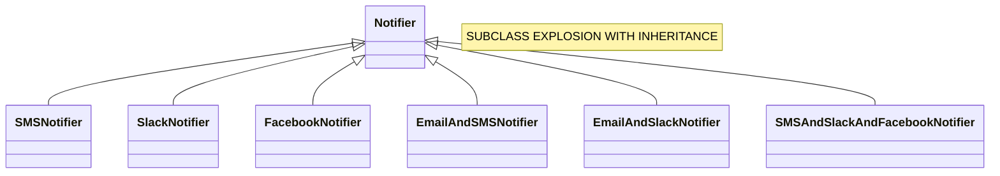
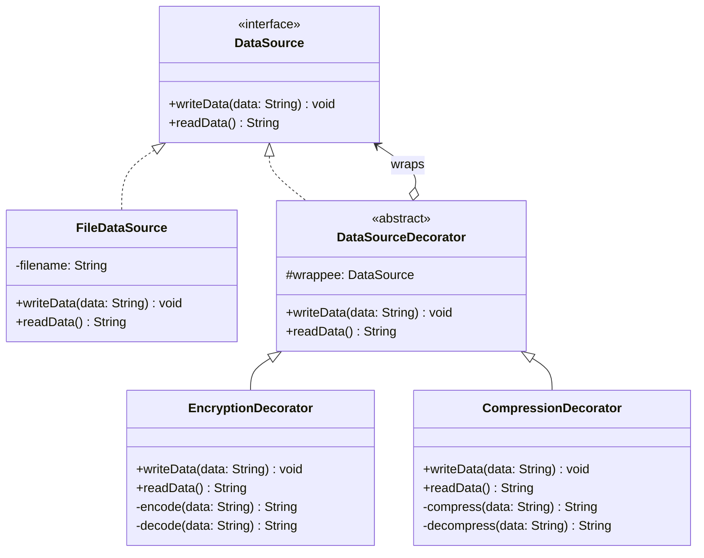
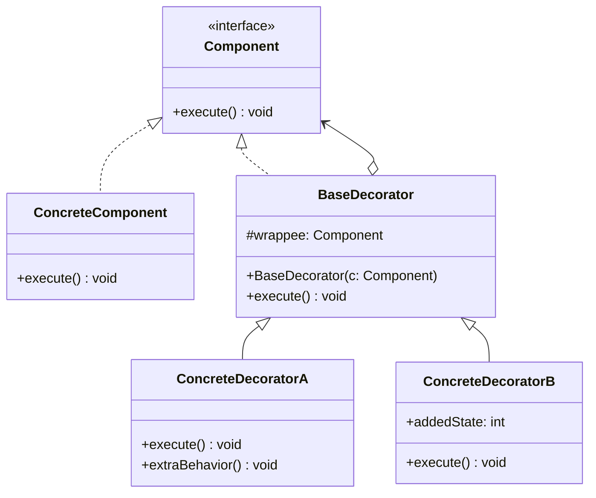
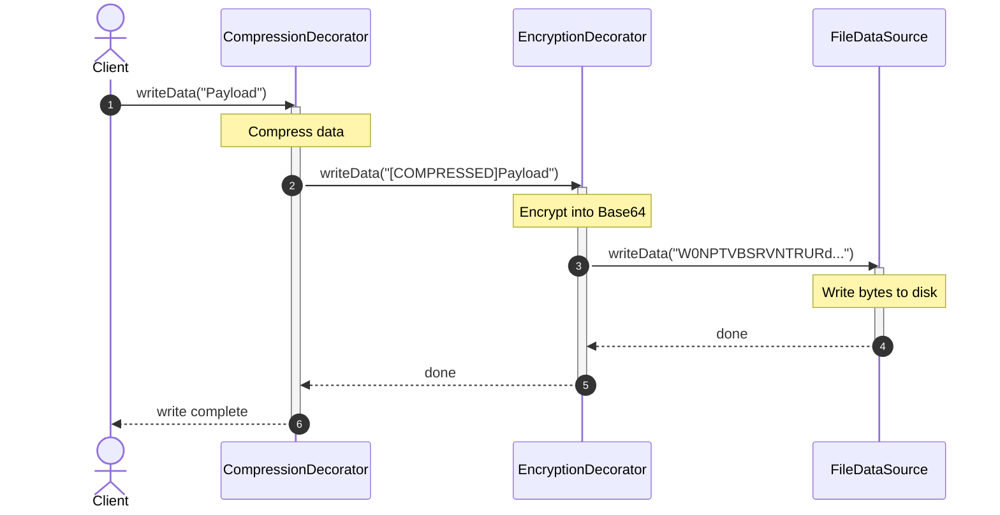

# Decorator

> **Also known as:** Wrapper  
> **Classification:** Structural Pattern  
> **Complexity:** ★★☆

---

## 1. Intent

**Decorator** is a structural design pattern that lets you attach new behaviors to objects by placing these objects inside special wrapper objects that contain the behaviors.

---

## 2. Problem

Imagine you are creating a notification library which lets other programs notify their users about important events. The initial version of the library was based on a `Notifier` class that had a few fields and a single `send()` method that emailed the notification to a user.

Soon, users ask for more channels:
* Some users want **SMS notifications**.
* Other users want **Slack alerts**.
* Enterprise users want **Facebook / WhatsApp notifications**.



### The Inadequacy of Subclassing
What if a user wants both Slack and SMS notifications? Or all three at once?
* Extending classes leads to a **combinatorial explosion of subclasses**.
* Inheritance is static: you cannot alter or compose an object's notification channels dynamically at runtime.

---

## 3. Motivation

Consider file streams in an operating system or I/O library:
* You have a base data source (`FileDataSource`) that reads and writes raw bytes to disk.
* You want to optionally **compress** data to save disk space.
* You want to optionally **encrypt** sensitive customer records.
* Different applications require different stacks:
  * Raw File: `FileDataSource`
  * Encrypted File: `Encryption(FileDataSource)`
  * Compressed & Encrypted File: `Compression(Encryption(FileDataSource))`

Wrapping one object inside another creates a dynamic, layered processing pipeline.

---

## 4. Solution

The Decorator pattern recommends using **Aggregation and Composition** instead of inheritance:

1. Both the target object and the wrapper share a common interface (`DataSource` / `Notifier`).
2. The wrapper holds a reference to a `Component` object.
3. The wrapper delegates all operations to the wrapped object, while injecting its own behavior before or after the delegation call.
4. Because the wrapper implements the same interface as the wrapped object, you can wrap an object inside an arbitrary number of decorators!



---

## 5. Structure



---

## 6. Participants

1. **Component Interface:** Declares the common interface for both wrappers and wrapped objects.
2. **Concrete Component:** The basic object being decorated, providing default behavior.
3. **Base Decorator:** Holds a reference field pointing to a wrapped `Component`. It delegates all work to the wrapped object.
4. **Concrete Decorators:** Extend the Base Decorator and add dynamic responsibilities before or after delegating to the wrapped component.
5. **Client:** Wraps components in multiple layers of decorators and communicates with the outermost decorator via the Component interface.

---

## 7. Code Implementation (Python 3)

```python
from abc import ABC, abstractmethod
import base64
import zlib


# ==========================================
# 1. Common Component Interface
# ==========================================
class DataSource(ABC):
    @abstractmethod
    def write_data(self, data: str) -> None:
        pass

    @abstractmethod
    def read_data(self) -> str:
        pass


# ==========================================
# 2. Concrete Component
# ==========================================
class MemoryDataSource(DataSource):
    """In-memory storage simulating disk persistence."""
    def __init__(self) -> None:
        self._content: str = ""

    def write_data(self, data: str) -> None:
        self._content = data
        print(f"[Storage] Wrote {len(data)} raw characters to memory.")

    def read_data(self) -> str:
        return self._content


# ==========================================
# 3. Base Decorator
# ==========================================
class DataSourceDecorator(DataSource):
    """Maintains reference to wrapped DataSource and delegates calls."""
    def __init__(self, wrappee: DataSource) -> None:
        self._wrappee = wrappee

    def write_data(self, data: str) -> None:
        self._wrappee.write_data(data)

    def read_data(self) -> str:
        return self._wrappee.read_data()


# ==========================================
# 4. Concrete Decorators
# ==========================================
class EncryptionDecorator(DataSourceDecorator):
    def write_data(self, data: str) -> None:
        encoded = base64.b64encode(data.encode("utf-8")).decode("utf-8")
        print(f"[Encrypt] Data obfuscated: {encoded}")
        super().write_data(encoded)

    def read_data(self) -> str:
        raw = super().read_data()
        decoded = base64.b64decode(raw.encode("utf-8")).decode("utf-8")
        return decoded


class CompressionDecorator(DataSourceDecorator):
    def write_data(self, data: str) -> None:
        compressed_bytes = zlib.compress(data.encode("utf-8"))
        encoded = base64.b64encode(compressed_bytes).decode("utf-8")
        print(f"[Compress] Compressed payload from {len(data)} to {len(encoded)} base64 chars.")
        super().write_data(encoded)

    def read_data(self) -> str:
        raw_b64 = super().read_data()
        compressed_bytes = base64.b64decode(raw_b64.encode("utf-8"))
        decompressed = zlib.decompress(compressed_bytes).decode("utf-8")
        return decompressed


# ==========================================
# 5. Client Execution Demo
# ==========================================
if __name__ == "__main__":
    salary_record = "Name: John Doe, Salary: $150,000, SSN: 000-12-3456"
    print(f"Original record: {salary_record}")

    # Stack decorators dynamically at runtime:
    # MemoryDataSource <- EncryptionDecorator <- CompressionDecorator
    pipeline = CompressionDecorator(
        EncryptionDecorator(
            MemoryDataSource()
        )
    )

    print("\n--- Writing Data Through Decorator Pipeline ---")
    pipeline.write_data(salary_record)

    print("\n--- Reading Data Unwinding Decorator Pipeline ---")
    recovered_data = pipeline.read_data()
    print(f"Recovered record: {recovered_data}")
```

---

## 8. Execution Flow



---

## 9. When to Use (Applicability)

* **Dynamic Behavior Assignment:** When you need to assign extra behaviors to objects at runtime without breaking the code that uses these objects.
* **Avoiding Subclass Explosion:** When extension by subclassing is impractical or awkward due to combinatorial combinations.
* **Non-Inheritable Classes:** When a class is declared `final` and cannot be subclassed, wrapping it in a decorator allows you to extend its functionality safely.

---

## 10. When NOT to Use (Anti-Scenarios)

* **Order-Dependent Fragility:** If the decorators in a stack must be executed in a strict, fragile order (e.g., encryption must always precede hashing, but compression must always follow encryption) and mistakes cause runtime crashes, a [Builder](../creational/builder.md) or [Pipeline](../behavioral/chain-of-responsibility.md) is safer.
* **Identity Dependence:** Code that relies on object identity (`obj1 == obj2`) will fail because a decorator creates a new wrapper reference.

---

## 11. Advantages

* **Runtime Flexibility:** You can add or remove responsibilities from an object at runtime.
* **Single Responsibility Principle (SRP):** You can divide a monolithic class that implements many possible variants of behavior into several smaller classes.
* **Composability:** You can combine several behaviors by wrapping an object into multiple decorators.

---

## 12. Disadvantages

* **Hard to Remove a Specific Wrapper:** Removing a specific decorator from the middle of a deeply nested wrapper stack is difficult.
* **Many Small Classes:** Results in an explosion of tiny wrapper classes that can make a library difficult to navigate for newcomers.

---

## 13. Common Mistakes & Misconceptions

### Mistake 1: Confusing Decorator with Adapter
* **Adapter:** Changes the **interface** of an existing object to make it compatible with a client.
* **Decorator:** Enhances an object's **behavior** while maintaining the **exact same interface**.

### Mistake 2: Confusing Decorator with Proxy
* **Decorator:** Adds new functionality (compression, encryption, formatting) driven by client configuration.
* **Proxy:** Manages the lifecycle, access control, or caching of the service object, usually without client awareness.

---

## 14. Related Patterns

* **[Adapter](adapter.md):** Adapter changes the interface of an object; Decorator enhances it without changing the interface.
* **[Composite](composite.md):** Both patterns rely on recursive composition. A Decorator has only **one** child component; a Composite can have **many** children.
* **[Strategy](../behavioral/strategy.md):** Decorator changes the skin of an object (adds outer behaviors); Strategy changes the guts (swaps internal algorithms).

---

## 15. Real-World Applications

### Python Standard Library
* Python Language Decorators (`@functools.wraps`): Wraps execution of functions and methods dynamically.
* WSGI / ASGI Middleware: Concentric decorator layers in FastAPI and Flask handling CORS, GZip, and JWT authentication.
  * `Collections.unmodifiableList(list)`: Decorates a list to prevent mutations.
  * `Collections.synchronizedList(list)`: Decorates a list with synchronized locks.

---

## 16. Interview Questions & Self-Assessment

### Q1: How does Decorator prevent the class explosion problem?
> **Answer:** Instead of subclassing every combination of features ($2^N$ classes), Decorator implements each feature as an independent wrapper ($N$ classes) that can be dynamically nested at runtime.

### Q2: Why must the Base Decorator implement the same interface as the Concrete Component?
> **Answer:** So that the wrapped object can be substituted anywhere the original component was expected, allowing multi-layered stacking without breaking client code.

### Q3: How does Python's `@functools.lru_cache` demonstrate the Decorator pattern?
> **Answer:** It implements the `Reader` interface and accepts another `Reader` in its constructor, adding an internal buffer and `readLine()` capability to raw character streams.

### Q4: What is the main drawback of the Decorator pattern?
> **Answer:** It makes object identity unreliable (`wrapped != unwrapped`), and debugging deeply nested stacks of decorators can be difficult because stack traces span across many intermediate wrapper layers.

---

## 17. Key Takeaways

1. **Dynamic Extension:** Enhances objects dynamically at runtime without subclassing.
2. **Same Interface:** A Decorator conforms to the exact interface of the component it wraps.
3. **Russian Doll Architecture:** Multiple decorators can be chained in layers.
4. **Native Python Synergy:** Directly aligns with Python's `@decorator` syntax and middleware pipelines.
