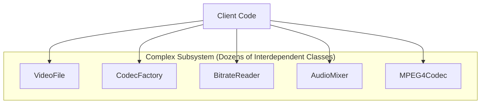
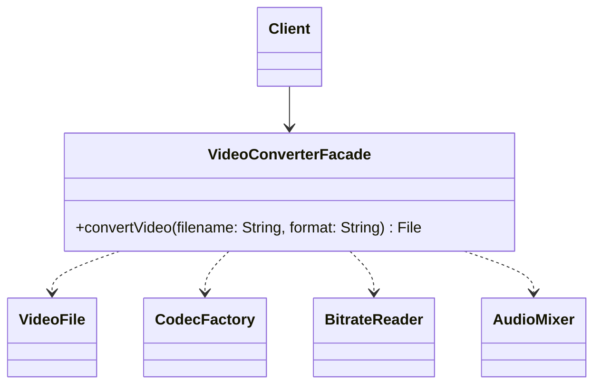
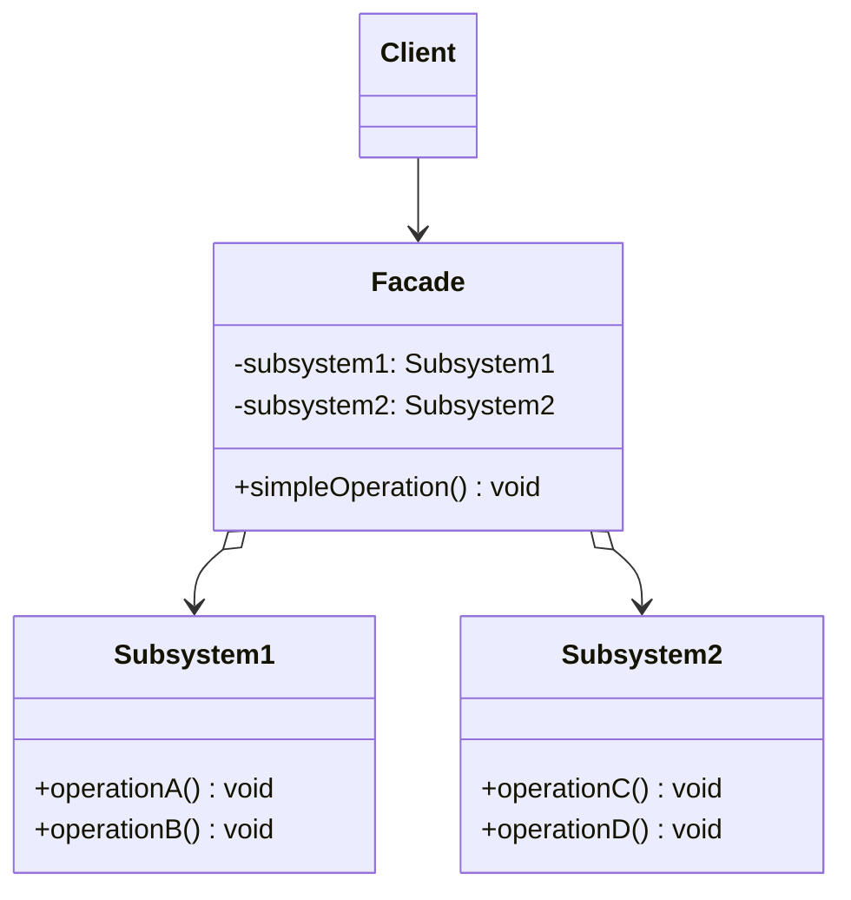
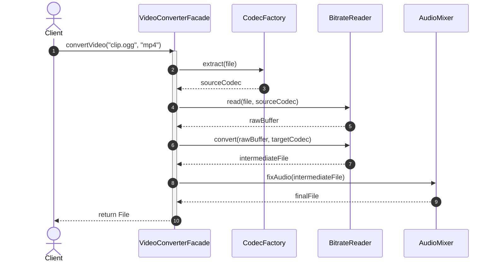

# Facade

> **Classification:** Structural Pattern  
> **Complexity:** ★☆☆

---

## 1. Intent

**Facade** is a structural design pattern that provides a simplified, unified interface to a library, a framework, or any other complex set of classes.

---

## 2. Problem

Imagine your code needs to work with a broad set of objects that belong to a sophisticated library or framework. To perform a common, everyday operation—such as converting a video file—your client code must interact with dozens of classes:

* Initialize a `VideoFile` wrapper.
* Query a `CodecFactory` for codecs (`MPEG4CompressionCodec`, `OggCompressionCodec`).
* Manage frame buffers with `BitrateReader`.
* Re-encode audio streams using `AudioMixer`.
* Fix color profiles and write output headers.



### The Dilemma
* Your business logic becomes tightly coupled to the implementation details of third-party classes.
* The code is tedious to comprehend, hard to test, and vulnerable to breaking whenever the third-party library updates.

---

## 3. Motivation

Consider an e-commerce order placement system:
* Placing an order requires reserving stock in `InventoryService`, authorizing payment in `PaymentGateway`, calculating taxes in `TaxEngine`, dispatching an alert via `NotificationService`, and booking transport with `ShippingCarrier`.
* The Web UI controller or mobile API handler shouldn't need to orchestrate these five independent backend services manually.

An `OrderFulfillmentFacade` provides a single entry-point: `placeOrder(customerId, cartId)`, coordinating the underlying services automatically.

---

## 4. Solution

A **Facade** is a class that provides a straightforward interface to a complex subsystem containing many moving parts:

1. The Facade provides a high-level method (e.g., `convertVideo(filename, format)`) that handles all initialization, dependency wiring, and execution order behind the scenes.
2. The subsystem classes remain directly accessible for power users who need fine-grained control, but 95% of client code can use the clean, simple Facade.



---

## 5. Structure



---

## 6. Participants

1. **Facade:** Provides convenient access to a particular part of the subsystem's functionality. It knows where to direct the client's request and how to coordinate all moving parts.
2. **Additional Facade (Optional):** Can be created to prevent a single facade from becoming bloated with unrelated features.
3. **Complex Subsystem Classes:** The individual classes with detailed, low-level mechanics. They are unaware of the facade and operate independently.
4. **Client:** Uses the Facade instead of calling the subsystem classes directly.

---

## 7. Code Implementation (Python 3)

```python
class VideoFile:
    def __init__(self, filename: str) -> None:
        self.name = filename
        self.codec_type = filename.split(".")[-1]


class OggCompressionCodec:
    type = "ogg"


class MPEG4CompressionCodec:
    type = "mp4"


class CodecFactory:
    @staticmethod
    def extract(file: VideoFile):
        if file.codec_type == "mp4":
            print("[CodecFactory] Extracting MPEG4 codec...")
            return MPEG4CompressionCodec()
        print("[CodecFactory] Extracting Ogg codec...")
        return OggCompressionCodec()


class BitrateReader:
    @staticmethod
    def read(file: VideoFile, codec) -> str:
        print(f"[BitrateReader] Reading source buffer for {file.name} using {codec.type}...")
        return "raw_video_buffer_data"

    @staticmethod
    def convert(buffer: str, destination_codec) -> str:
        print(f"[BitrateReader] Transcoding buffer to {destination_codec.type}...")
        return f"transcoded_{destination_codec.type}_buffer"


class AudioMixer:
    def fix(self, result_buffer: str) -> str:
        print("[AudioMixer] Normalizing and synchronizing audio channels...")
        return f"{result_buffer}_with_mastered_audio"


# ==========================================
# 2. The Facade
# ==========================================
class VideoConverterFacade:
    """Facade provides a single clean entrypoint masking the complex transcoding subsystem."""
    def convert_video(self, filename: str, format_type: str) -> str:
        print(f"=== VideoConverterFacade: Starting conversion of {filename} to {format_type} ===")
        file = VideoFile(filename)
        source_codec = CodecFactory.extract(file)
        
        destination_codec = (
            MPEG4CompressionCodec() if format_type.lower() == "mp4" else OggCompressionCodec()
        )

        raw_buffer = BitrateReader.read(file, source_codec)
        converted_buffer = BitrateReader.convert(raw_buffer, destination_codec)
        final_video = AudioMixer().fix(converted_buffer)

        out_name = f"{filename.split('.')[0]}.{format_type}"
        print(f"=== VideoConverterFacade: Successfully generated {out_name} ===\n")
        return out_name


# ==========================================
# 3. Client Demo
# ==========================================
if __name__ == "__main__":
    # Client doesn't need to import or orchestrate CodecFactory, BitrateReader, AudioMixer!
    converter = VideoConverterFacade()
    mp4_video = converter.convert_video("funny_cats.ogg", "mp4")
```

---

## 8. Execution Flow



---

## 9. When to Use (Applicability)

* **Simplifying Complex Subsystems:** When you need to provide a straightforward or limited interface to a complex subsystem.
* **Layered Architecture:** When you want to structure a subsystem into layers, use facades to define entry points to each level of a subsystem.
* **Decoupling from Third-Party Libraries:** Wrap external libraries in a facade so that if you switch vendors later, only the facade class needs updating.

---

## 10. When NOT to Use (Anti-Scenarios)

* **When Clients Need Deep Customization:** If clients require custom low-level configuration of every subsystem component, bypassing the facade is necessary.
* **The "God Object" Trap:** Avoid letting a facade absorb all business logic of an application. A facade should merely **delegate**, not perform business calculations.

---

## 11. Advantages

* **Isolates Client Code:** Shields clients from subsystem complexity and changes.
* **Promotes Weak Coupling:** Subsystems can evolve internally without breaking client callers.

---

## 12. Disadvantages

* **Risk of a God Object:** A facade can become an oversized class coupled to all classes of an app if not split when responsibilities grow.

---

## 13. Common Mistakes & Misconceptions

### Mistake 1: Confusing Facade with Adapter
* **Adapter:** Adapts an **existing interface** so two incompatible classes can talk to each other.
* **Facade:** Defines a **brand new simplified interface** over an entire subsystem.

### Mistake 2: Making Subsystems Inaccessible
A facade provides convenience, but should **not** lock down subsystem classes if advanced developers genuinely need fine-grained control.

---

## 14. Related Patterns

* **[Adapter](adapter.md):** Adapter wraps one object to change its interface; Facade wraps a whole subsystem to simplify it.
* **[Mediator](../behavioral/mediator.md):** Facade provides a one-directional simplified interface to a subsystem; Mediator centralizes bidirectional communication between peer objects.
* **[Singleton](../creational/singleton.md):** A Facade is often implemented as a Singleton because a single facade object is usually sufficient.

---

## 15. Real-World Applications

### Python Standard Library & Spring Framework
* `org.springframework.jdbc.core.JdbcTemplate`: The ultimate Facade over low-level JDBC (`Connection`, `PreparedStatement`, `ResultSet`, `SQLException` handling).
* `requests.get()`: A clean facade over low-level socket connections, urllib3, SSL context, and redirect handlers.

---

## 16. Interview Questions & Self-Assessment

### Q1: What is the main purpose of the Facade pattern?
> **Answer:** To provide a simplified, unified high-level interface to a complex library or subsystem, decoupling clients from internal subsystem mechanics.

### Q2: Can a client still access the subsystem classes directly if a Facade exists?
> **Answer:** Yes. A Facade does not hide or seal subsystem classes; it simply provides a convenient default path for common use cases.

### Q3: How does Facade differ from Mediator?
> **Answer:** Facade abstracts a subsystem from the outside (unidirectional client-to-subsystem calls). Mediator coordinates communication from the inside among peer objects (bidirectional many-to-many communication).

### Q4: How is Spring's `RestTemplate` or `JdbcTemplate` a Facade?
> **Answer:** It hides socket connections, HTTP headers, serialization, and error mapping behind clean methods like `getForObject()` or `queryForList()`.

---

## 17. Key Takeaways

1. **Complexity Shield:** A front-door interface to a complex multi-class engine.
2. **Pure Delegation:** A facade coordinates and delegates; it doesn't reinvent subsystem logic.
3. **Decouples Third-Party Dependencies:** Changing underlying libraries only requires editing the Facade.
