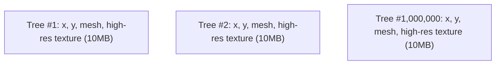
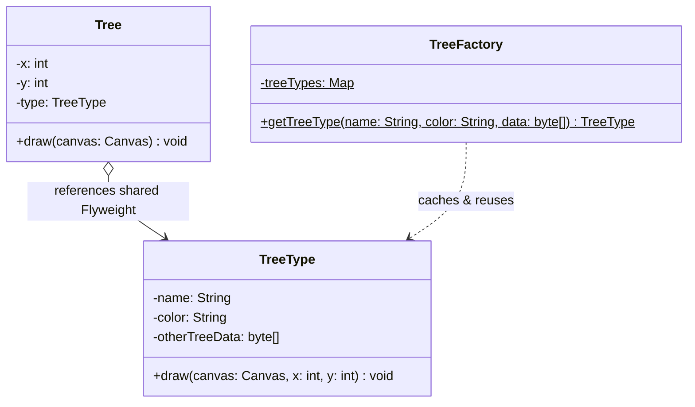
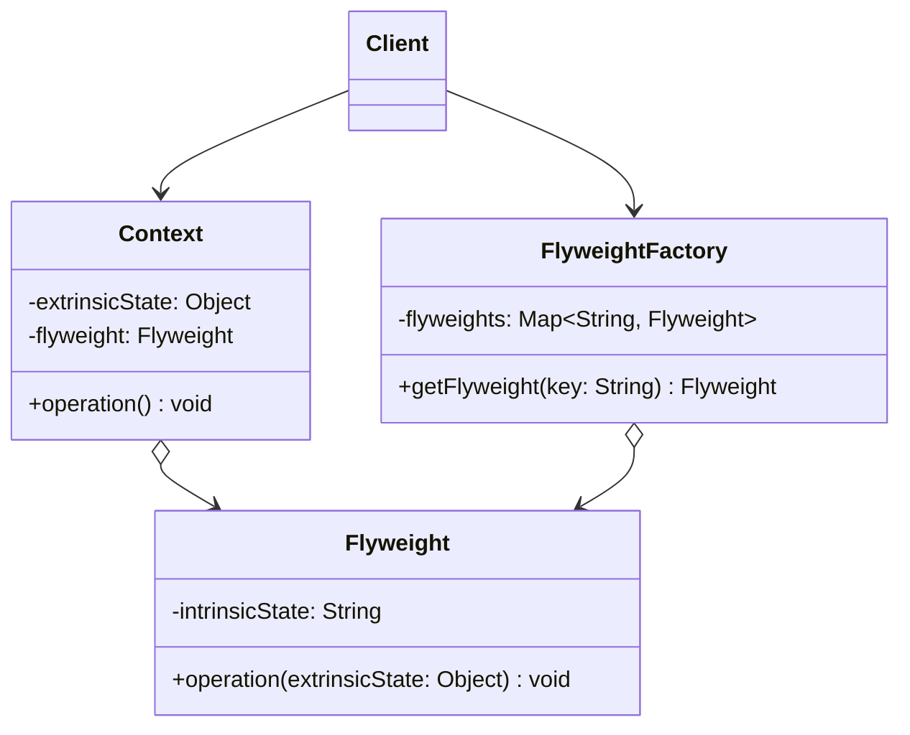
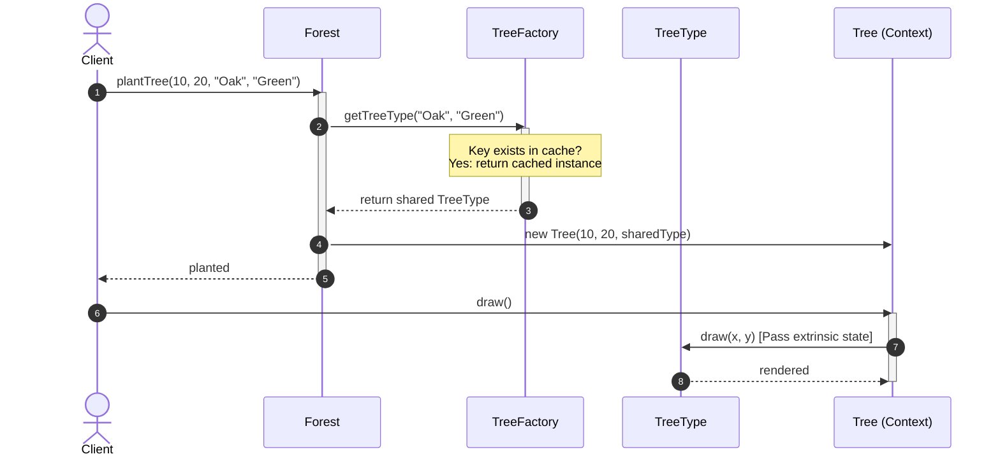

# Flyweight

> **Also known as:** Cache  
> **Classification:** Structural Pattern  
> **Complexity:** ★★★

---

## 1. Intent

**Flyweight** is a structural design pattern that lets you fit more objects into the available amount of RAM by sharing common parts of state between multiple objects instead of keeping all of the data in each object.

---

## 2. Problem

Imagine you are developing a realistic forest rendering engine or a massive multiplayer video game. In your virtual world, you want to render **1,000,000 trees**:

* Each tree is an instance of a `Tree` class containing:
  * Coordinates: `x`, `y` (8 bytes each).
  * Height, age (8 bytes).
  * 3D Mesh and Texture Sprites: `sprite` (several megabytes of texture bitmaps).



Allocating 1,000,000 separate tree objects will consume **gigabytes of RAM**, promptly exhausting available memory with a `MemoryError`.

Yet, in reality, there are only 3 distinct types of trees in the forest: *Oak*, *Pine*, and *Birch*! Millions of trees share the exact same 3D mesh and texture data.

---

## 3. Motivation

Consider a rich text document editor (like Microsoft Word):
* A document contains 500,000 characters.
* If every character on the screen is an independent object storing font family, font size, bold/italic flags, and kerning metrics, memory footprint explodes.
* In reality, the character glyph for the letter **'e'** in 12pt Times New Roman is identical across all 50,000 occurrences.
* Only the **(x, y) cursor coordinate** and position on the line change.

---

## 4. Solution

The Flyweight pattern suggests dividing an object's state into two distinct categories:

1. **Intrinsic State:** Constant, immutable data that never changes across instances (e.g., Tree name, color, texture bitmap, 3D mesh). This data can be **safely shared** across millions of objects.
2. **Extrinsic State:** Unique, contextual data that changes for every instance (e.g., `x`, `y` coordinates). This data is stored externally by the client or context object and passed into the flyweight as method arguments.

An object that stores only intrinsic state is called a **Flyweight**.



Instead of 1,000,000 heavy texture objects, the JVM allocates **only 3 `TreeType` flyweights** in memory, drastically reducing RAM consumption from gigabytes to megabytes!

---

## 5. Structure



---

## 6. Participants

1. **Flyweight:** Contains the intrinsic (shared) state. It should be immutable. Any state passed into its methods must be extrinsic.
2. **Context:** Contains the extrinsic (unique) state across all original objects. When paired with a shared flyweight, it represents the full state of a domain entity.
3. **Flyweight Factory:** Manages a pool of existing flyweights. Clients request a flyweight from the factory, which either returns an existing cached instance or creates a new one.
4. **Client:** Computes or stores the extrinsic state and triggers operations on flyweights.

---

## 7. Code Implementation (Python 3)

```python
from dataclasses import dataclass
from typing import Optional


# ==========================================
# 1. Flyweight (Intrinsic State: Shared & Immutable)
# ==========================================
@dataclass(frozen=True)
class TreeType:
    name: str
    color: str
    texture_data: str  # Heavy byte array / texture asset

    def draw(self, x: int, y: int) -> None:
        print(f"Drawing '{self.name}' tree [{self.color}] at coordinates ({x}, {y})")


# ==========================================
# 2. Flyweight Factory (Cache)
# ==========================================
class TreeFactory:
    _tree_types: dict[tuple[str, str, str], TreeType] = {}

    @classmethod
    def get_tree_type(cls, name: str, color: str, texture_data: str) -> TreeType:
        key = (name, color, texture_data)
        if key not in cls._tree_types:
            cls._tree_types[key] = TreeType(name, color, texture_data)
            print(f"[TreeFactory] Loaded new heavy texture flyweight for '{name}' [{color}].")
        return cls._tree_types[key]

    @classmethod
    def total_flyweights_created(cls) -> int:
        return len(cls._tree_types)


# ==========================================
# 3. Context (Extrinsic State: Unique to Each Instance)
# ==========================================
class Tree:
    def __init__(self, x: int, y: int, tree_type: TreeType) -> None:
        self.x = x
        self.y = y
        self.tree_type = tree_type  # Reference to shared Flyweight

    def draw(self) -> None:
        self.tree_type.draw(self.x, self.y)


# ==========================================
# 4. Forest (Client Container)
# ==========================================
class Forest:
    def __init__(self) -> None:
        self._trees: list[Tree] = []

    def plant_tree(self, x: int, y: int, name: str, color: str, texture: str) -> None:
        type_flyweight = TreeFactory.get_tree_type(name, color, texture)
        tree = Tree(x, y, type_flyweight)
        self._trees.append(tree)

    def draw(self) -> None:
        for tree in self._trees[:5]:  # Print first 5 for brevity
            tree.draw()
        print(f"... and {len(self._trees) - 5} more trees.")


# ==========================================
# 5. Client Demo
# ==========================================
if __name__ == "__main__":
    forest = Forest()

    # Planting 1,000,000 trees across only 2 shared Flyweight types
    for i in range(500_000):
        forest.plant_tree(i, i * 2, "Autumn Oak", "Orange", "OakTexture_HD_4MB")
        forest.plant_tree(i * 3, i + 5, "Silver Birch", "White", "BirchTexture_HD_4MB")

    print(f"\nTotal Tree Objects Rendered:   1,000,000")
    print(f"Total Unique Flyweights Stored: {TreeFactory.total_flyweights_created()}")
    # Memory saved: Instead of 1,000,000 * 4MB = 4TB texture data, only 2 * 4MB = 8MB loaded!
    forest.draw()
```

---

## 8. Execution Flow



---

## 9. When to Use (Applicability)

* **Extreme Object Counts:** When your application needs to spawn a vast number of objects (tens of thousands to millions) and memory consumption threatens to crash the JVM.
* **Redundant Shared State:** When objects contain duplicate, immutable attributes that can be extracted and centralized.

---

## 10. When NOT to Use (Anti-Scenarios)

* **Abundant Memory:** If your application only creates a few dozen or hundreds of objects, Flyweight is unnecessary over-engineering.
* **No Shared State:** If every object’s state is completely unique, Flyweight provides zero memory savings and adds CPU overhead.
* **CPU vs RAM Trade-Off:** De-contextualizing state saves memory but costs minor CPU cycles each time context must be calculated and passed into methods.

---

## 11. Advantages

* **Drastic RAM Savings:** Saves enormous amounts of heap memory by sharing intrinsic state.
* **Massive Scalability:** Allows systems to scale to millions of elements.

---

## 12. Disadvantages

* **Code Complexity:** You trade memory space for code complexity: classes must be split into Context and Flyweight layers.
* **Thread Safety Sensitivity:** Because flyweights are shared globally, they **must be strictly immutable**. Any mutation affects all referencing contexts.

---

## 13. Common Mistakes & Misconceptions

### Mistake 1: Mutable Flyweights
If a developer adds a public setter method to `TreeType`:
```python
# DISASTER: Mutating intrinsic state affects every instance referencing it!
# tree_type.color = "Blue"  # Prevented by dataclass(frozen=True)!
```
Flyweights **must be completely immutable** (`final` fields, no setters).

---

## 14. Related Patterns

* **[Composite](composite.md):** The leaf nodes of a Composite tree can often be implemented as Flyweights to save memory.
* **[Singleton](../creational/singleton.md):** If you manage to reduce all shared states of an object to one flyweight, that flyweight resembles a Singleton.

---

## 15. Real-World Applications

### Python Standard Library
* **Python Integer & String Interning:** Python caches small integers (-5 to 256) and identifier-like strings automatically.
* **`__slots__` Optimization:** Eliminates `__dict__` overhead in high-volume classes to share structure.

---

## 16. Interview Questions & Self-Assessment

### Q1: What is the difference between Intrinsic and Extrinsic state?
> **Answer:** Intrinsic state is constant, immutable, and shared across many objects (stored inside the Flyweight). Extrinsic state is contextual, unique to a specific instance (e.g., coordinates, timestamps), and passed into flyweight methods from the outside.

### Q2: Why must Flyweight objects be immutable?
> **Answer:** Because a single Flyweight is shared simultaneously by thousands of different contexts. If one context mutates the flyweight, the change would inadvertently corrupt all other contexts.

### Q3: How does Python small integer caching demonstrate the Flyweight pattern?
> **Answer:** The JVM maintains an internal static cache of `Integer` objects for values between -128 and 127. Instead of constructing a new `Integer` heap object on every call, `valueOf` returns a shared pre-allocated flyweight.

### Q4: What is the main trade-off of the Flyweight pattern?
> **Answer:** You trade CPU cycles and architectural complexity for memory. You save gigabytes of RAM, but code becomes more complex and passing extrinsic parameters incurs minor runtime method invocation overhead.

---

## 17. Key Takeaways

1. **Memory Optimization Titan:** Shrinks memory footprints for systems with millions of fine-grained objects.
2. **Intrinsic vs Extrinsic:** Separate what is shared (intrinsic) from what is unique (extrinsic).
3. **Mandatory Immutability:** Flyweights must never be mutable.
4. **Governed by a Factory:** Flyweight pools must be managed by a factory cache.
