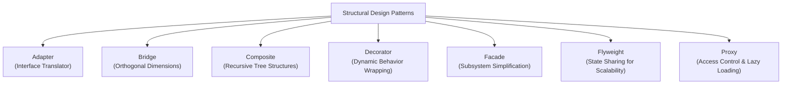

# Structural Design Patterns 🏛️

> *"Structural design patterns explain how to assemble objects and classes into larger structures, while keeping these structures flexible and efficient."*  
> — Alexander Shvets, *Dive Into Design Patterns*

Structural patterns focus on how classes and objects are composed to form larger subsystems. By leveraging interfaces, object references, and delegation instead of rigid inheritance, structural patterns ensure that changes to one part of a system do not break the rest.

---

## 🧭 Structural Decision Rubric

| Pattern | Complexity | When to Choose |
| :--- | :--- | :--- |
| **[Adapter](adapter.md)** | ★☆☆ | When you want to use an existing class, but its interface does not match the one expected by your client code. |
| **[Bridge](bridge.md)** | ★★★ | When you need to split a monolithic class that has multiple orthogonal dimensions of variation (e.g., Abstraction vs Implementation). |
| **[Composite](composite.md)** | ★★☆ | When your domain model can be structured as a recursive tree hierarchy, and you want clients to treat leaves and branches uniformly. |
| **[Decorator](decorator.md)** | ★★☆ | When you need to assign extra behaviors to objects dynamically at runtime without breaking existing code or creating a subclass explosion. |
| **[Facade](facade.md)** | ★☆☆ | When you need a simple, high-level interface over a complex, sprawling subsystem or library. |
| **[Flyweight](flyweight.md)** | ★★★ | When your program must spawn a massive number of objects (thousands or millions) that would otherwise exhaust available RAM. |
| **[Proxy](proxy.md)** | ★★☆ | When you need a surrogate or placeholder to manage lazy loading, access control, logging, or caching for a heavy service object. |

---

## 📦 The 7 Structural Patterns

1. 🔌 **[Adapter](adapter.md)** — Converts the interface of a class into another interface that clients expect.
2. 🌉 **[Bridge](bridge.md)** — Decouples an abstraction from its implementation so that both can vary independently.
3. 🌳 **[Composite](composite.md)** — Composes objects into tree structures to represent part-whole hierarchies.
4. 🎁 **[Decorator](decorator.md)** — Attaches additional responsibilities to an object dynamically without subclassing.
5. 🏛️ **[Facade](facade.md)** — Provides a unified, simplified interface to a complex set of interfaces in a subsystem.
6. 🪶 **[Flyweight](flyweight.md)** — Shares common parts of state between multiple objects to fit more objects in RAM.
7. 🛡️ **[Proxy](proxy.md)** — Provides a surrogate or placeholder for another object to control access to it.
