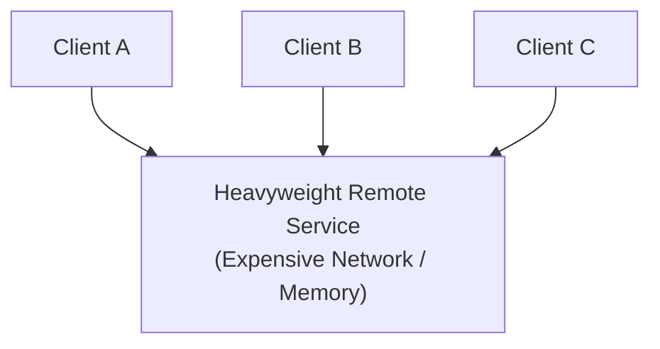
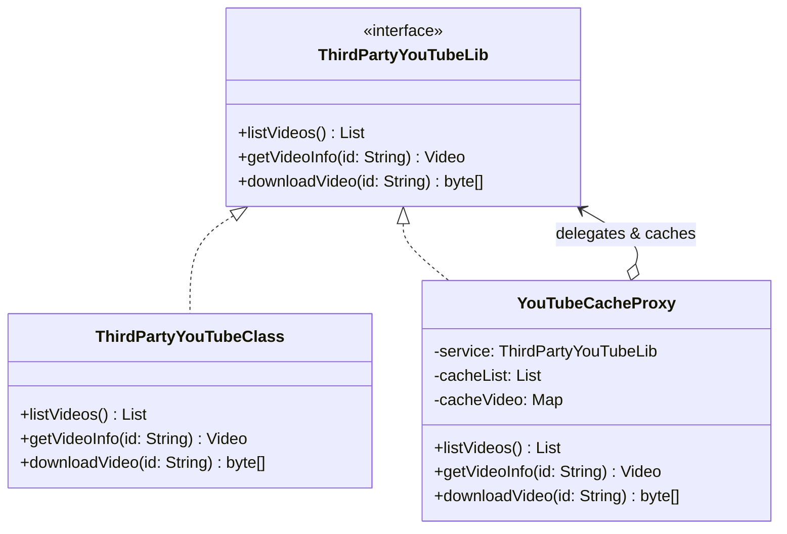
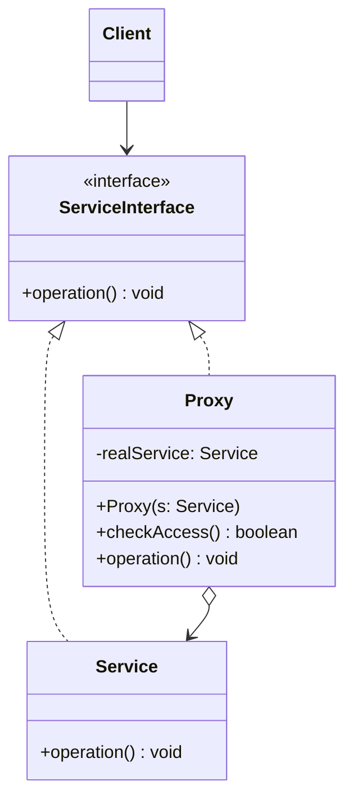
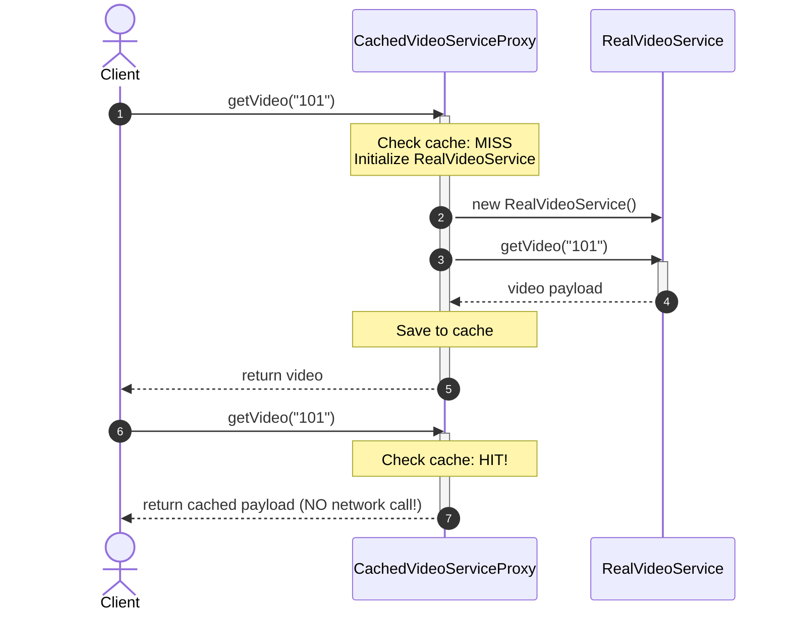

# Proxy

> **Classification:** Structural Pattern  
> **Complexity:** ★★☆

---

## 1. Intent

**Proxy** is a structural design pattern that lets you provide a substitute or placeholder for another object. A proxy controls access to the original object, allowing you to perform actions either before or after the request gets through to the original object.

---

## 2. Problem

Imagine you have a heavyweight service object that consumes significant system resources:
* Connecting to a remote database.
* Downloading video streams from a third-party API (e.g., `ThirdPartyYouTubeClass`).
* Loading massive 3D models or PDF documents.



### The Inadequacy of Direct Access
* If you instantiate the service eagerly at startup, application boot times slow down dramatically, even if a user never requests that feature.
* If multiple clients repeatedly request the same identical video or database query, the service redundantly redownloads the data over the network, wasting bandwidth and degrading performance.
* You cannot easily add authentication checks or access control without modifying the original service class.

---

## 3. Motivation

Consider an enterprise document management system:
* Only authorized department managers should be permitted to call `deleteDocument()` or read confidential payroll files.
* If the underlying `DocumentService` does not have built-in RBAC (Role-Based Access Control), you don't want to pollute domain business logic with security authorization checks.

A **Protection Proxy** wraps the document service, inspects the active user's security token, and delegates only if the user has valid permissions.

---

## 4. Solution

The Proxy pattern suggests that you create a new **Proxy** class with the **exact same interface** as the original service object:

1. Both the Proxy and the Real Service implement the same `ServiceInterface`.
2. The Proxy maintains a reference to the Real Service.
3. When client code invokes a method on the Proxy, the Proxy can:
   * Perform **lazy initialization** (create the real object only on the first call).
   * Perform **access control** (check permissions).
   * Check an **in-memory cache** and return cached results immediately without contacting the real service.
   * Forward the call to the Real Service only when necessary.



---

## 5. Structure



---

## 6. Participants & Proxy Flavors

| Proxy Flavor | Responsibility |
| :--- | :--- |
| **Virtual Proxy (Lazy Loading)** | Defers the creation of an expensive object until it is genuinely needed by a client call. |
| **Caching Proxy** | Stores the results of expensive operations and serves cached responses for identical requests. |
| **Protection Proxy (Access Control)** | Verifies whether the calling client possesses necessary security credentials or roles. |
| **Remote Proxy** | Represents an object that exists in a different address space (e.g., gRPC, RMI, REST client). |
| **Logging Proxy** | Intercepts requests to log execution history, metrics, and execution timing. |

---

## 7. Code Implementation (Python 3)

```python
from abc import ABC, abstractmethod
import time
from typing import Optional


# ==========================================
# 1. Service Interface
# ==========================================
class ThirdPartyYouTubeLib(ABC):
    @abstractmethod
    def get_video_info(self, video_id: str) -> str:
        pass

    @abstractmethod
    def download_video(self, video_id: str) -> bytes:
        pass


# ==========================================
# 2. Real Subject (Heavy Service)
# ==========================================
class ThirdPartyYouTubeClass(ThirdPartyYouTubeLib):
    def get_video_info(self, video_id: str) -> str:
        # Simulate network latency
        time.sleep(1.0)
        return f"Metadata for video '{video_id}' (1080p 60fps)"

    def download_video(self, video_id: str) -> bytes:
        print(f"[Remote API] Connecting to YouTube CDN and downloading {video_id}...")
        time.sleep(2.0)
        return f"Raw_H264_Bytes_{video_id}".encode("utf-8")


# ==========================================
# 3. Caching & Lazy-Loading Proxy
# ==========================================
class CachedYouTubeProxy(ThirdPartyYouTubeLib):
    def __init__(self, service: Optional[ThirdPartyYouTubeLib] = None) -> None:
        self._service = service
        self._cache_info: dict[str, str] = {}
        self._cache_video: dict[str, bytes] = {}

    def _ensure_service(self) -> ThirdPartyYouTubeLib:
        if self._service is None:
            print("[Proxy] Lazy-initializing expensive remote service client...")
            self._service = ThirdPartyYouTubeClass()
        return self._service

    def get_video_info(self, video_id: str) -> str:
        if video_id not in self._cache_info:
            print(f"[Proxy Cache MISS] Fetching video info for '{video_id}' from remote API...")
            self._cache_info[video_id] = self._ensure_service().get_video_info(video_id)
        else:
            print(f"[Proxy Cache HIT] Returning cached video info for '{video_id}' instantly.")
        return self._cache_info[video_id]

    def download_video(self, video_id: str) -> bytes:
        if video_id not in self._cache_video:
            print(f"[Proxy Cache MISS] Downloading '{video_id}'...")
            self._cache_video[video_id] = self._ensure_service().download_video(video_id)
        else:
            print(f"[Proxy Cache HIT] Returning cached video bytes for '{video_id}' instantly.")
        return self._cache_video[video_id]


# ==========================================
# 4. Client Demo
# ==========================================
if __name__ == "__main__":
    # Client communicates through the common ThirdPartyYouTubeLib interface
    youtube_proxy: ThirdPartyYouTubeLib = CachedYouTubeProxy()

    print("--- Request 1 (Cache Miss) ---")
    start = time.time()
    info1 = youtube_proxy.get_video_info("design_patterns_ep1")
    vid1 = youtube_proxy.download_video("design_patterns_ep1")
    print(f"Elapsed: {time.time() - start:.2f}s\n")

    print("--- Request 2 (Cache Hit - Instantaneous) ---")
    start = time.time()
    info2 = youtube_proxy.get_video_info("design_patterns_ep1")
    vid2 = youtube_proxy.download_video("design_patterns_ep1")
    print(f"Elapsed: {time.time() - start:.2f}s\n")
```

---

## 8. Execution Flow



---

## 9. When to Use (Applicability)

* **Lazy Initialization (Virtual Proxy):** When you have a heavyweight service object that wastes system resources by always staying up, even when rarely needed.
* **Access Control (Protection Proxy):** When you want only specific clients to be able to use the service object (e.g., administrative operations).
* **Caching Request Results (Caching Proxy):** When you need to cache results of client requests and manage the lifecycle of this cache, especially if results are huge.
* **Logging and Auditing:** When you need to log requests to a service object without polluting domain logic.

---

## 10. When NOT to Use (Anti-Scenarios)

* **Simple Lightweight Objects:** Creating proxies for simple in-memory objects adds unnecessary indirection and boilerplate.
* **High-Frequency Critical Paths:** A proxy introduces an additional layer of method calls, which can cause negligible microsecond overhead in ultra-low-latency financial trading loops.

---

## 11. Advantages

* **Controls Service Lifecycle:** You can control the service object without clients knowing about it.
* **Open/Closed Principle (OCP):** You can introduce new proxies without changing the service or clients.
* **Transparent Performance Optimization:** Caching and lazy loading occur completely behind the scenes.

---

## 12. Disadvantages

* **Architectural Indirection:** Response times might be slightly delayed by proxy processing.
* **Increased Codebase Size:** Requires creating new classes and keeping proxy methods synchronized with service interfaces.

---

## 13. Common Mistakes & Misconceptions

### Mistake 1: Confusing Proxy with Decorator
* **Decorator:** Enhances an object’s functionality **dynamically at the request of the client** (e.g., adding encryption or compression).
* **Proxy:** Manages the **lifecycle, security, or network boundaries** of the service object, typically transparently without client awareness.

### Mistake 2: Confusing Proxy with Adapter
* **Adapter:** Provides a **different interface** to bridge two incompatible classes.
* **Proxy:** Provides the **exact same interface** to act as a surrogate.

---

## 14. Related Patterns

* **[Adapter](adapter.md):** An adapter provides a different interface to the wrapped object, whereas a proxy provides the same interface.
* **[Decorator](decorator.md):** Both patterns are built on composition. A decorator adds responsibilities; a proxy controls access.
* **[Facade](facade.md):** Facade provides a simplified interface to a complex subsystem; Proxy provides the identical interface to a single service.

---

## 15. Real-World Applications

### Python Standard Library
* `unittest.mock.Mock`: Intercepts method calls dynamically in test suites.
* SQLAlchemy lazy-loading: Attributes act as proxies fetching related database records only upon first property access.

### Spring Framework
* **Spring AOP:** The backbone of Spring! `@Transactional`, `@PreAuthorize`, `@Cacheable`, and `@Async` are all implemented via dynamic JDK / CGLIB proxies wrapping Spring beans.
* **Hibernate Lazy Loading:** Hibernate wraps entity relationships (`@OneToMany`) in proxies, loading database records only when the getter is invoked.

---

## 16. Interview Questions & Self-Assessment

### Q1: What is the primary purpose of a Virtual Proxy?
> **Answer:** To optimize resource usage by deferring the heavy initialization of an expensive object until a method on that object is actually invoked.

### Q2: How does Spring Framework use the Proxy pattern to implement `@Transactional`?
> **Answer:** Spring wraps target bean classes in a dynamic proxy. When a transactional method is called, the proxy intercepts the call, opens a database transaction, invokes the real method, and commits or rolls back the transaction before returning.

### Q3: How do Proxy and Decorator differ in their intent?
> **Answer:** Decorator focuses on adding new behaviors and features dynamically (driven by client configuration). Proxy focuses on controlling access, lazy-loading, caching, or managing the lifecycle of the service object (often transparent to the client).

### Q4: How do dynamic proxies work in Python?
> **Answer:** In Python, a dynamic proxy overrides `__getattr__` or `__getattribute__` to dynamically intercept method calls across any interface without writing concrete proxy classes ahead of time.

---

## 17. Key Takeaways

1. **Surrogate Stand-In:** Shares the exact same interface as the real service.
2. **Access & Lifecycle Controller:** Governs lazy loading, caching, security, and logging.
3. **The Core of Enterprise Frameworks:** Powers Spring AOP, Hibernate lazy loading, and RPC stubs.
4. **Transparent to Clients:** Clients are completely unaware they are talking to a proxy.
