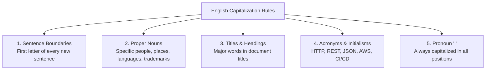
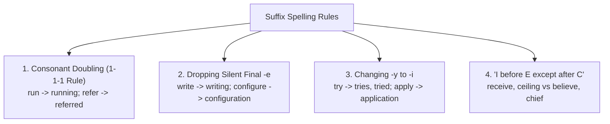
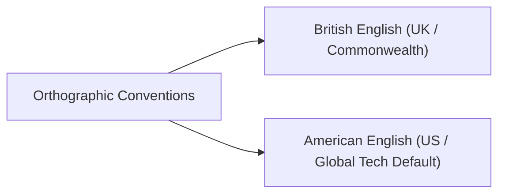

# Capitalization and Spelling Rules ✍️

> **Level:** CEFR A1–A2 (Orthographic Mechanics)  
> **Primary References:** Michael Swan (*Practical English Usage*, §28, 30, 319, 336–351); Raymond Murphy (*English Grammar in Use*, Appendices 6 & 7)  
> **Core Principle:** Correct spelling and capitalization are the formatting linters of human communication. In professional engineering, spelling errors in documentation, commit messages, and API naming damage credibility and introduce code defects.

---

## 1. Capitalization Protocols

Capital letters (majuscules) are used strictly according to grammatical conventions—never randomly for aesthetic emphasis.

### The Seven Cardinal Capitalization Laws

| Law | Rule Description | Valid Production Example | Common Error Bug |
| :--- | :--- | :--- | :--- |
| **1. Sentence Initial** | The first letter of every complete sentence. | *The proxy forwarder is running.* | ❌ *the proxy forwarder...* |
| **2. Proper Nouns** | Names of specific entities, tools, and brands. | *Linux, Python, Docker, PostgreSQL, Google.* | ❌ *We installed linux and python.* |
| **3. Languages & Nationalities** | Always capitalized, even when used as adjectives. | *English grammar, French locale, Japanese docs.* | ❌ *written in english.* |
| **4. Calendar Entities** | Days, months, and holidays (never seasons!). | *Monday, September, Thanksgiving, spring, summer.* | ❌ *in the Spring semester.* |
| **5. The Standalone Pronoun 'I'** | Always capitalized, regardless of position. | *When I reviewed the PR, I found bugs.* | ❌ *When i reviewed...* |
| **6. Acronyms & Initialisms** | All-caps for abbreviated technical protocols. | *API, JSON, REST, SQL, UUID, JWT, DNS.* | ❌ *Rest api, Json payload.* |
| **7. Code Identifiers & Variables** | Preserve code case exactly in prose. | *The `getUserById` method returns a `User`.* | ❌ *The getuserbyid method...* |

> [!NOTE]
> **Common Noun Trap:** Do **not** capitalize common technical nouns unless they start a sentence:
> - ❌ *We migrated our Database to the Cloud using Microservices.*
> - ✅ *We migrated our database to the cloud using microservices.*

---

## 2. English Spelling Mechanics (Morphological Rules)

English spelling appears irregular, but 85% of words follow predictable morphological transformation rules when suffixes are appended.

### Rule 1: Consonant Doubling (The 1-1-1 Rule)
When adding a vowel suffix (`-ing, -ed, -er, -est`) to a word:
1. **One-syllable words:** If the word has **1 syllable**, ends in **1 single vowel** + **1 consonant**, double the final consonant:
   - *run* $\to$ *ru**nn**ing*
   - *stop* $\to$ *sto**pp**ed*
   - *log* $\to$ *lo**gg**ing*
   - Contrast: *treat* $\to$ *treating* (2 vowels $\to$ do not double); *park* $\to$ *parking* (2 consonants $\to$ do not double).
2. **Multi-syllable words (Stress Invariant):** Double the final consonant **only if the stress falls on the final syllable**:
   - *re-**FER*** $\to$ *refe**rr**ed, refe**rr**ing* (Stress on last syllable $\to$ double)
   - *be-**GIN*** $\to$ *begi**nn**ing*
   - ***VIS**-it* $\to$ *visited, visiting* (Stress on first syllable $\to$ do not double)
   - ***TAR**-get* $\to$ *targeted, targeting* (Stress on first syllable $\to$ do not double)

### Rule 2: Dropping the Silent Final `-e`
When a word ends in a silent `-e`, drop the `-e` before a **vowel suffix** (`-ing, -able, -ation`), but retain it before a **consonant suffix** (`-ment, -ful, -ly`):
- *configure* + *-ing* $\to$ *configur**ing***
- *write* + *-ing* $\to$ *writ**ing***
- *allocate* + *-ion* $\to$ *allocat**ion***
- *require* + *-ment* $\to$ *require**ment*** (Consonant suffix $\to$ retain `-e`)
- *state* + *-ment* $\to$ *state**ment***

> [!WARNING]
> **Soft Consonant Exception:** Retain `-e` before `-able` or `-ous` if needed to preserve a soft `/s/` or `/dʒ/` sound:
> - *notice* + *-able* $\to$ *noticeable* (Dropping `-e` would make *c* sound like /k/: *noticable* $\to$ false).
> - *change* + *-able* $\to$ *changeable*.

### Rule 3: Changing `-y` to `-i`
- If a word ends in **consonant + `-y`**, change `-y` to `-i` before any suffix (except `-ing`):
  - *retry* $\to$ *retr**ies**, retr**ied*** (but *retry**ing*** to avoid double *ii*)
  - *modify* $\to$ *modif**ies**, modif**ied**, modif**ication***
  - *easy* $\to$ *eas**ily***
- If preceded by a **vowel + `-y`**, keep the `-y`:
  - *deploy* $\to$ *deplo**ys**, deplo**yed**, deplo**ying***
  - *play* $\to$ *pla**yed***

### Rule 4: "I before E except after C" (When sounded as /iː/)
When the vowel sounds like long *ee* (/iː/):
- **Standard:** *I before E* (*achieve, believe, retrieve, yield, chief*).
- **After C:** *E before I* (*receive, ceiling, receipt, deceive*).
- **Phonetic Exceptions (sounded as /eɪ/ or /aɪ/):** *neighbor, weigh, reign, height, weird, seize*.

---

## 3. British vs. American Spelling Conventions

Technical documentation teams must select one regional orthographic convention and maintain consistency across all repositories:

| Dimension | British English (UK) | American English (US - Default) | Technical Software Note |
| :--- | :--- | :--- | :--- |
| **`-our` vs `-or`** | *colour, behaviour, honour* | *color, behavior, honor* | CSS property is strictly `color`! |
| **`-re` vs `-er`** | *centre, metre, fibre* | *center, meter, fiber* | Fiber-optic, data center. |
| **`-ise` vs `-ize`** | *optimise, standardise, initialize* | *optimize, standardize, initialize* | Python libraries prefer `initialize`. |
| **`-yse` vs `-yze`** | *analyse, paralyse* | *analyze, paralyze* | Static code analysis tools. |
| **`-ence` vs `-ense`**| *licence (noun), defense* | *license (noun & verb), defense* | Software license (`LICENSE` file). |
| **Doubled `l`** | *travelled, cancelled, initialled*| *traveled, canceled, initialed* | Log messages: *Request canceled*. |
| **Program vs Programme**| *computer program, television programme*| *computer program, TV program* | *Program* always used in computing. |

---

## 4. Dual-Domain Practical Examples

### Everyday Conversational English
1. *I am traveling to London this September.* (Proper nouns capitalized)
2. *She noticed that the weather was changeable.* (Retaining silent `-e`)
3. *He apologized for arriving late.* (American spelling: `-ize`)
4. *We received the parcel yesterday.* (*E before I after C*)
5. *They are beginning a new French language course on Wednesday.* (Consonant doubling + capitalized day/language)
6. *The children played happily in the garden.* (*y* kept after vowel in *played*; *y* changed to *i* in *happily*)
7. *Summer is my favorite season.* (Seasons are lowercase; US spelling *favorite*)

### Professional Software Engineering Context
8. *The distributed cluster is **targeting** a 99.999% SLA.*  
   $\to$ *target* + *-ing* $\to$ single *t* (*targeting*) because stress is on the first syllable (*TAR-get*).
9. *The background worker is **retrying** the failed database transaction.*  
   $\to$ *retry* + *-ing* retains *y* (*retrying*) to avoid *retriing*.
10. *The team **analyzed** the root cause of the Redis outage.*  
    $\to$ US spelling standard (*analyzed* with `-z-`).
11. *The service handles data serialization and deserialization.*  
    $\to$ Common nouns (*data serialization*) remain lowercase.
12. *We **configured** the Amazon Web Services infrastructure via Terraform.*  
    $\to$ Drop silent `-e` (*configure* $\to$ *configured*); proper nouns capitalized (*Amazon Web Services, Terraform*).
13. *The client received a valid JSON Web Token.*  
    $\to$ Acronyms in all-caps (*JSON*); *received* follows *e before i after c*.
14. *The open-source library was released under the MIT **License**.*  
    $\to$ US spelling *License* (standard for software legal headers).
15. *The asynchronous event handler is **canceling** expired user sessions.*  
    $\to$ Single `l` in US standard (*canceling*).

---

## 5. Common Mistakes & Diagnostic Anti-Patterns

| Bug (Spelling / Case Error) | Patch (Correct Orthography) | Diagnostic Root Cause |
| :--- | :--- | :--- |
| ❌ *The thread was **stoped**.* | ✅ *The thread was **stopped**.* | **Violation of 1-1-1 rule:** Single-syllable word ending in 1 vowel + 1 consonant must double final consonant (*stopped*). |
| ❌ *We are **targetting** lower memory usage.* | ✅ *We are **targeting** lower memory usage.* | **Over-doubling unstressed syllable:** Stress is on first syllable (*TAR-get*), so do not double *t*. |
| ❌ *The API returns a **noticable** delay.* | ✅ *The API returns a **noticeable** delay.* | **Erroneously dropping `-e`:** Must retain `-e` before `-able` to maintain soft /s/ sound in *noticeable*. |
| ❌ *Our company deploys on **AWS cloud**.* | ✅ *Our company deploys on **AWS Cloud** (or **the AWS cloud**).* | Inconsistent proper branding or missing determiner. |
| ❌ *We received **seperate** webhook alerts.* | ✅ *We received **separate** webhook alerts.* | **Common misspelling:** *Separate* has *a* in the middle (*sep-a-rate*), not *e*. |

---

## 6. Self-Assessment Practice Exercises

### Section A: Suffix Application & Spelling Transformations
Apply the indicated suffix to each base word, following morphological rules:

1. `commit` + `-ed` = ?
2. `debug` + `-ing` = ?
3. `occur` + `-ence` = ?
4. `manage` + `-able` = ?
5. `write` + `-ing` = ?
6. `rely` + `-able` = ?
7. `visit` + `-ed` = ?
8. `benefit` + `-ed` = ?

### Section B: Capitalization & Regional Spelling Correction
Correct all capitalization and spelling errors in the following software engineering excerpts:

9. *we deployed the postgresql cluster on a linux server last friday.*
10. *The engineer recieve the token and verifys it's payload.*
11. *Our backend service is runing in a docker container.*
12. *The system architecture is highly scalible and maintainance is automated.*

---

## 7. Comprehensive Answer Key & Explanations

1. **committed** — Multi-syllable word with stress on final syllable (*com-MIT*); double the consonant.
2. **debugging** — Ends in single vowel + consonant with stress; double the *g*.
3. **occurrence** — Stress on final syllable (*oc-CUR*); double the *r*.
4. **manageable** — Retain silent `-e` to keep soft /dʒ/ sound before vowel suffix `-able`.
5. **writing** — Drop silent final `-e` before vowel suffix `-ing`.
6. **reliable** — Change consonant + `-y` to `-i` before suffix `-able`.
7. **visited** — Stress is on first syllable (*VIS-it*); do NOT double the *t*.
8. **benefited** (US) / **benefitted** (UK variant) — Stress is on first syllable (*BEN-e-fit*); US tech standard prefers single *t*.
9. **Patched:** *We deployed the PostgreSQL cluster on a Linux server last Friday.*  
   *Rules:* Sentence-initial capitalization (*We*), brand capitalization (*PostgreSQL, Linux*), and day of week (*Friday*).
10. **Patched:** *The engineer **receives** the token and **verifies its** payload.*  
    *Rules:* *Receive* (*e before i after c*); *verify* $\to$ *verifies* (change *-y* to *-ies*); possessive *its* (no apostrophe).
11. **Patched:** *Our backend service is **running** in a **Docker** container.*  
    *Rules:* 1-1-1 rule doubles *n* in *running*; *Docker* is a proper noun trademark.
12. **Patched:** *The system architecture is highly **scalable** and **maintenance** is automated.*  
    *Rules:* *scale* + *-able* drops final `-e` (*scalable*); correct spelling is *maintenance* (not *maintainance*).

---

## 8. Revision Flashcards & Key Takeaways

- **The 1-1-1 Doubling Rule:** 1 syllable + 1 vowel + 1 consonant $\to$ double before vowel suffix (*stop $\to$ stopped*).
- **Stress-Governed Doubling:** Multi-syllable words double only if the stress is on the final syllable (*reFER $\to$ referred*; but *VISit $\to$ visited*).
- **Dropping Silent `-e`:** Drop `-e` before vowel suffixes (*write $\to$ writing*), except to preserve soft sounds (*noticeable, changeable*).
- **Changing `-y` to `-i`:** Consonant + `y` $\to$ `i` (*rely $\to$ reliable*); Vowel + `y` $\to$ stays `y` (*deploy $\to$ deployed*).
- **Proper vs. Common Nouns:** Capitalize specific entities and languages (*Python, English, AWS*), but never common nouns (*database, cloud, microservice*).
- **Regional Consistency:** Pick American English (*optimize, color, license*) or British English (*optimise, colour, licence*) and maintain it uniformly across documentation.
