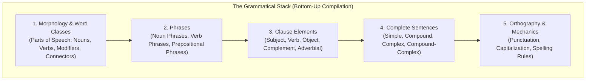

# Foundations of English Grammar 🧱

> *"Before you build distributed systems, you must understand bytes, sockets, and memory pointers. Before you craft compelling prose or crisp technical documentation, you must master parts of speech, clause mechanics, and punctuation."*  
> — Reference: Raymond Murphy (*Essential Grammar in Use*); Michael Swan (*Practical English Usage*, Language Terminology & §19, 26, 30)

Welcome to the **Foundations** module of the English Grammar Knowledge System. This module provides the indispensable structural mechanics needed to understand every subsequent topic—from verb conjugations to complex inverted clauses.

---

## 🧭 Topic Catalog & Navigation

| Document | Core Focus | CEFR Level | Key Practical Takeaway |
| :--- | :--- | :---: | :--- |
| **[1. Parts of Speech](parts-of-speech.md)** | The 8 primary word classes + determiners | A1 | Identify words by their functional syntax rather than isolated spelling. |
| **[2. Sentence Elements & Word Order](sentence-elements-and-word-order.md)** | S-V-O-C-A architecture and canonical English syntax | A1–A2 | Master strict canonical English word order (SVO) and prevent fragmentation. |
| **[3. Phrases and Clauses](phrases-and-clauses.md)** | Distinguishing phrases from finite/non-finite clauses | A2 | Understand what constitutes an independent thought vs a dependent modifier. |
| **[4. Sentence Types & Purposes](sentence-types-and-purposes.md)** | Structural (Simple, Compound, Complex) & Functional (Declarative, Imperative) | A2 | Balance sentence lengths and craft direct, active instructions in technical writing. |
| **[5. Punctuation Mastery](punctuation-mastery.md)** | Commas, semicolons, colons, dashes, hyphens, and apostrophes | A1–B2 | Eliminate comma splices and run-on sentences in production documents. |
| **[6. Capitalization & Spelling Rules](capitalization-and-spelling-rules.md)** | Capitalization protocols, doubling consonants, suffix transformations | A1–A2 | Eliminate typo bugs and master British vs American orthographic differences. |

---

## ⚡ Foundational Principles

### 1. English is an SVO (Subject-Verb-Object) Analytic Language
Unlike inflected languages (such as Latin, Sanskrit, or Russian) where word order can change freely because grammatical cases are marked on noun endings, modern English relies almost entirely on **rigid position**:
- *The compiler optimized the code.* (Valid: Subject = compiler, Object = code)
- *The code optimized the compiler.* (Completely different meaning)
- *Optimized the compiler the code.* (Syntactically invalid in modern English)

### 2. Form vs. Function
A single word form can function as multiple parts of speech depending on its syntactic position:
- *We run a distributed **test**.* (Noun — direct object)
- *We **test** the distributed database.* (Verb — finite predicate)
- *We review the **test** results.* (Adjective / Noun Adjunct — modifier)

### 3. The Golden Sentence Invariant
Every grammatically complete English sentence **must** contain at least one **independent clause**, which consists of an explicit (or implied imperative) **Subject** and a **Finite Verb** expressing a complete proposition:
$$\text{Complete Sentence} \iff \text{Independent Clause} \ge 1$$
