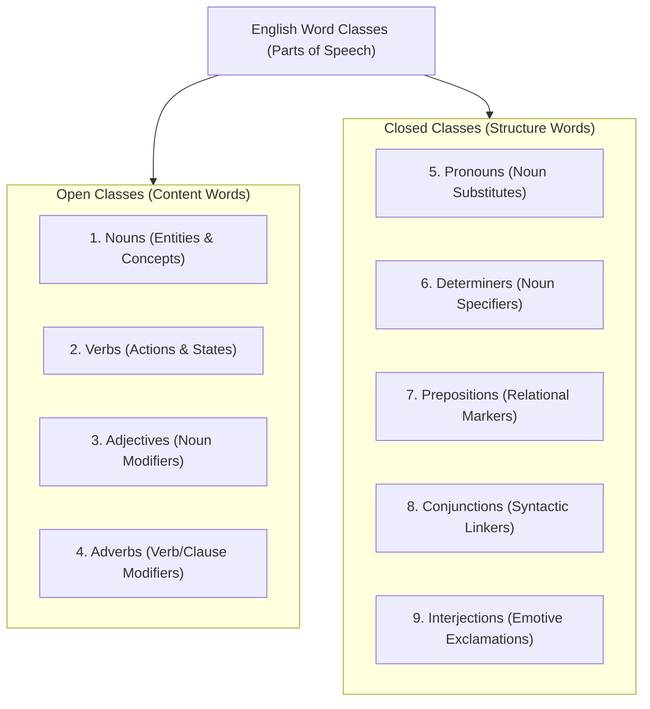
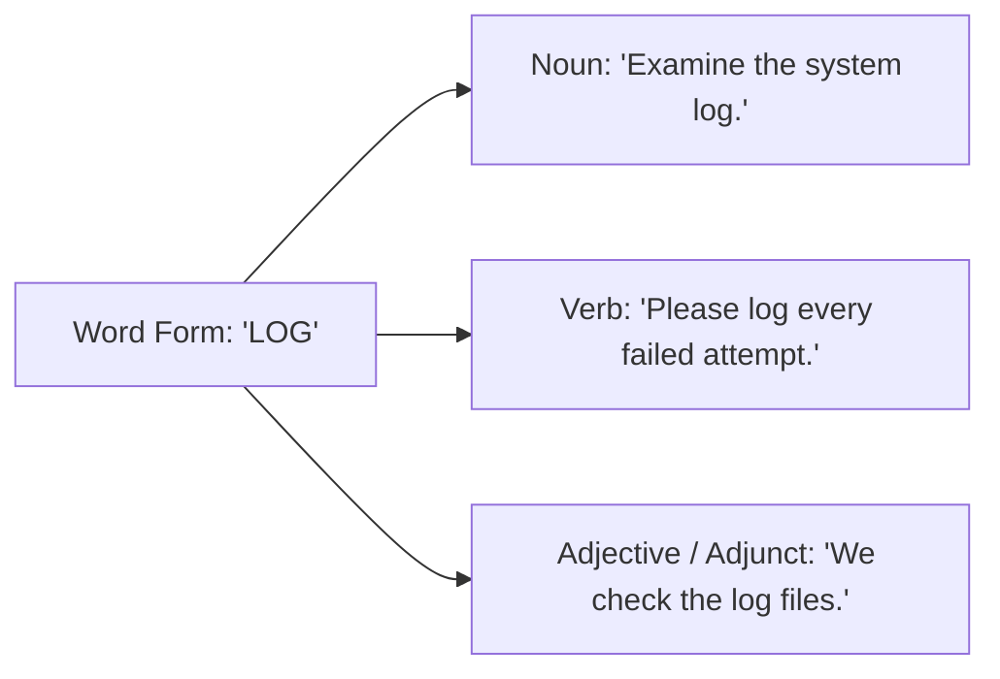

# Parts of Speech (Word Classes) 🧩

> **Level:** CEFR A1 (Fundamental)  
> **Primary References:** Michael Swan (*Practical English Usage*, Language Terminology & §1); Raymond Murphy (*Essential Grammar in Use*, Units 54–88)  
> **Key Concept:** Words do not inherently "belong" to a grammatical category in isolation; their category is determined by the syntactic role they perform in a given sentence.

---

## 1. Intent & Core Definition

In English linguistics, a **part of speech** (or **word class**) is a category of words that exhibit similar syntactic behavior, morphological forms, and grammatical functions. 

Words are broadly divided into two structural divisions:
1. **Open (Lexical / Content) Classes:** Carry primary semantic meaning (nouns, verbs, adjectives, adverbs). New words are continuously created and added to these classes (e.g., *to containerize*, *microservices*, *algorithmic*).
2. **Closed (Functional / Grammatical) Classes:** Provide structural scaffolding and syntactic glue (pronouns, prepositions, conjunctions, determiners, interjections). These classes are fixed and rarely admit new words.

---

## 2. The Nine Word Classes at a Glance

| Part of Speech | Primary Function | Common Suffixes / Clues | Canonical Example |
| :--- | :--- | :--- | :--- |
| **1. Noun** | Names a person, place, thing, or abstract idea | `-tion, -ment, -ness, -ity, -er, -ance` | *The **cluster** deployed the **configuration**.* |
| **2. Verb** | Expresses action, occurrence, or state of being | `-ate, -en, -ify, -ize, -ed, -ing` | *The pipeline **validates** and **executes** tests.* |
| **3. Adjective** | Modifies or describes a noun or pronoun | `-able, -ive, -al, -ous, -ful, -less` | *We need an **idempotent** and **resilient** service.* |
| **4. Adverb** | Modifies a verb, adjective, or another adverb | `-ly, -ward, -wise` | *The query responded **extremely** **quickly**.* |
| **5. Pronoun** | Replaces a noun to eliminate repetitive reference | Closed set (*he, it, they, which, someone*) | *The engineer fixed the bug because **she** found **it**.* |
| **6. Determiner** | Specifies, quantifies, or limits a noun phrase | Closed set (*the, a, every, those, three, each*) | ***Every** request requires **an** API token.* |
| **7. Preposition** | Links nouns/pronouns to indicate time, space, logic | Closed set (*at, in, on, through, without, under*) | *The message is routed **through** the broker.* |
| **8. Conjunction** | Joins words, phrases, or clauses | Closed set (*and, but, although, because, if*) | *Deploy now **if** tests pass, **but** notify the team.* |
| **9. Interjection** | Expresses sudden emotion or conversational tone | Isolated (*alas, eureka, wow, ouch, hey*) | ***Eureka!** The memory leak has finally been isolated.* |

---

## 3. Deep Dive into Each Word Class

### 1. Nouns (Substantives)
Nouns denote concrete entities (*server, monitor, disk*) or abstract entities (*latency, redundancy, scalability*).
- **Common vs. Proper:** *framework* (common) vs. *Pytest* (proper, capitalized).
- **Countable vs. Uncountable:** *three servers* (countable) vs. *RAM / information* (uncountable).
- **Syntactic positions:** Subject, Direct Object, Indirect Object, Object of Preposition, Subject Complement.

### 2. Verbs (Predicators)
The engine of the sentence. Without a finite verb, no independent clause can exist.
- **Dynamic (Action):** Express activities (*compile, build, transmit, benchmark*).
- **Stative (State):** Express conditions, cognitive states, possession (*belong, contain, know, resemble*).
- **Finite vs. Non-finite:**
  - *The daemon **runs**.* (Finite: marked for present tense and 3rd-person singular)
  - *To **run** the daemon is expensive.* (Non-finite: infinitive)

### 3. Adjectives (Modifiers of Nouns)
Provide attributes, restrictions, or qualitative judgments to nouns.
- **Attributive position:** Before the noun (*a **scalable** architecture*).
- **Predicative position:** After a linking verb (*The architecture is **scalable***).

### 4. Adverbs (Modifiers of Verbs, Adjectives & Clauses)
Answer questions such as *How? When? Where? How often? To what degree?*
- *The script executed **flawlessly**.* (Adverb of manner modifying verb *executed*)
- *This is a **highly** effective algorithm.* (Adverb of degree modifying adjective *effective*)
- *The container restarted **yesterday**.* (Adverb of time modifying verb *restarted*)
- ***Fortunately**, the transaction rolled back.* (Sentence adverb modifying entire clause)

### 5. Pronouns (Substitutes)
Prevent fatigue by standing in place of previously mentioned noun phrases (antecedents).
- **Personal:** *I, you, he, she, it, we, they, me, him, them*.
- **Demonstrative:** *this, that, these, those*.
- **Relative:** *who, whom, which, that, whose*.
- **Indefinite:** *everyone, someone, nobody, nothing, each*.

### 6. Determiners (Specifiers)
Always precede nouns (and their attributive adjectives). They anchor the noun to reality.
- **Articles:** *a, an, the*.
- **Demonstratives:** *this, that, these, those*.
- **Possessives:** *my, your, his, her, their, its*.
- **Quantifiers:** *all, some, any, few, many, every*.

### 7. Prepositions (Relational Connectors)
Positioned before a noun phrase (forming a prepositional phrase) to show relationship in space, time, cause, or agency:
- *The client authenticated **with** a cryptographic key.*
- *Traffic spiked **during** the Black Friday sale.*

### 8. Conjunctions (Syntactic Links)
- **Coordinating (FANBOYS):** *For, And, Nor, But, Or, Yet, So* (joins elements of equal grammatical rank).
- **Subordinating:** *Because, although, since, unless, while, if, whereas* (attaches a dependent clause to a main clause).
- **Correlative:** *Either...or, neither...nor, not only...but also*.

### 9. Interjections
Grammatically independent vocal expressions used in dialogue:
- *"**Oops**, we forgot to run the database migration."*

---

## 4. Syntactic Shifting (Functional Flexibility)

In modern English, many words change their word class depending entirely on their syntactic context. Memorizing a dictionary definition is insufficient; you must diagnose the word's function:

| Word Form | Noun Role | Verb Role | Adjective Role |
| :--- | :--- | :--- | :--- |
| **Fast** | *The monk maintained a strict **fast**.* | *Athletes **fast** before surgery.* | *We need a **fast** network interface.* |
| **Benchmark**| *This metric sets the **benchmark**.* | *We must **benchmark** both APIs.* | *These are our **benchmark** tests.* |
| **Default** | *The setting reverted to its **default**.*| *Borrowers who **default** face fines.*| *Use the **default** constructor.* |
| **Back** | *The server rack has an open **back**.* | *We will **back** up the database.* | *The **back** door was left unsecured.* |

---

## 5. Dual-Domain Practical Examples

### Everyday Conversational English
1. *She walked **quickly** to the station.* (Adverb)
2. *They drank **fresh** coffee in the morning.* (Adjective)
3. *We will wait **until** noon.* (Preposition)
4. *We will wait **until** the train arrives.* (Subordinating Conjunction)
5. ***Nobody** answered the phone.* (Indefinite Pronoun)
6. *That book belongs to **her**.* (Personal Pronoun - object form)
7. *That is **her** book.* (Determiner - possessive adjective)
8. *I like tea, **but** my friend prefers coffee.* (Coordinating Conjunction)

### Professional Software Engineering Context
9. *The **load balancer** distributes incoming HTTP requests across three nodes.*  
   $\to$ **Noun phrase** acting as Subject.
10. *The database **persists** user session tokens in Redis.*  
    $\to$ **Finite verb** in Present Simple.
11. *This is an **asynchronous**, non-blocking architectural framework.*  
    $\to$ **Attributive adjectives** modifying *framework*.
12. *The cache invalidation worker executes **periodically**.*  
    $\to$ **Adverb of frequency/manner** modifying *executes*.
13. *If the primary cluster crashes, the replica **automatically** assumes master status.*  
    $\to$ *If* (**subordinating conjunction**), *replica* (**noun**), *automatically* (**adverb**).
14. *Every microservice must register **with** the service discovery agent.*  
    $\to$ *Every* (**determiner**), *with* (**preposition**).
15. *The architecture team approved **our** migration plan.*  
    $\to$ *our* (**determiner** specifying *migration plan*).

---

## 6. Common Mistakes & Diagnostic Anti-Patterns

| Bug (Incorrect) | Patch (Correct) | Diagnostic Root Cause |
| :--- | :--- | :--- |
| ❌ *The microservice operates very **good**.* | ✅ *The microservice operates very **well**.* | *Good* is an adjective; modifying the verb *operates* requires the adverb *well*. |
| ❌ *The team made **a research** on NoSQL.* | ✅ *The team conducted **research** on NoSQL.* | *Research* is an uncountable noun in English; it cannot take indefinite article *a*. |
| ❌ *He gave the credentials to **myself**.* | ✅ *He gave the credentials to **me**.* | Reflexive pronoun (*myself*) cannot substitute for an objective personal pronoun (*me*). |
| ❌ *We need to **fastly** deploy the fix.* | ✅ *We need to **quickly** (or **fast**) deploy the fix.* | *Fastly* does not exist in English. *Fast* is both an adjective and an adverb; alternatively use *quickly*. |
| ❌ *The software has **much** features.* | ✅ *The software has **many** features.* | *Features* is a countable plural noun; it requires quantifier *many*, not *much*. |

---

## 7. Self-Assessment Practice Exercises

### Section A: Identify the Word Class
Identify the part of speech of the bracketed bold word in each sentence:

1. The build completed [**successfully**] after the refactoring.
2. We must install an [**isolated**] staging environment.
3. [**Although**] the CPU reached 95% utilization, the system did not drop packets.
4. The router forwards packets [**through**] the internal gateway.
5. The deployment process failed because [**it**] exceeded the 15-minute timeout.
6. [**Each**] developer must sign their git commits.
7. We must [**index**] the customer table to speed up lookup times.
8. The database query [**cost**] is unacceptably high.

### Section B: Syntax Classification & Error Correction
Correct the grammatical class errors in the following sentences:

9. The background job processes records *efficient* and *reliable*.
10. The engineer was *extreme* pleased with the benchmark results.
11. You can contact Bob or *myself* if the API goes down.
12. We have received *many* feedback from the frontend developers.

---

## 8. Comprehensive Answer Key & Explanations

1. **Adverb** — Modifies the finite verb *completed*, answering *how* it completed.
2. **Adjective** (Past Participle used adjectivally) — Pre-modifies the noun phrase *staging environment*.
3. **Subordinating Conjunction** — Introduces the subordinate concession clause (*Although the CPU reached...*).
4. **Preposition** — Expresses directional relationship; governs the noun phrase *the internal gateway*.
5. **Personal Pronoun** — Third-person singular neuter pronoun replacing the antecedent *the deployment process*.
6. **Determiner (Distributive Quantifier)** — Directly precedes and modifies the singular countable noun *developer*.
7. **Verb (Base form / Infinitive)** — Follows the modal auxiliary *must*; expresses the action to be performed.
8. **Noun** — Functions as a noun adjunct / modifier within the compound subject *database query cost*.
9. **Correction:** *The background job processes records **efficiently** and **reliably**.*  
   *Explanation:* The words modify the verb *processes*, so adverbs ending in `-ly` are syntactically required.
10. **Correction:** *The engineer was **extremely** pleased with the benchmark results.*  
    *Explanation:* *Pleased* is an adjective; modifying an adjective requires an adverb of degree (*extremely*).
11. **Correction:** *You can contact Bob or **me** if the API goes down.*  
    *Explanation:* *Contact* is a transitive verb; its compound direct object must be in the objective case (*me*, not reflexive *myself*).
12. **Correction:** *We have received **much** feedback (or **a lot of** feedback) from the frontend developers.*  
    *Explanation:* *Feedback* is an uncountable noun in English; it cannot be modified by *many*.

---

## 9. Revision Flashcards & Key Takeaways

- **Word class depends on function, not spelling:** Always ask *"What syntactic job is this word performing in this specific sentence?"*
- **Open Classes vs Closed Classes:** Nouns, verbs, adjectives, and adverbs carry content and expand endlessly. Pronouns, prepositions, determiners, and conjunctions form the closed grammatical backbone.
- **The Adverb `-ly` Rule:** Adverbs modify verbs, adjectives, and other adverbs (*rapidly, deeply*). Do not use an adjective where an adverb is syntactically demanded (*operates smooth* $\to$ *operates smoothly*).
- **The Reflexive Trap:** Never use *myself* unless *I* is the subject of the same clause (*I wrote it myself*), or for direct reflexive action (*I hurt myself*).
