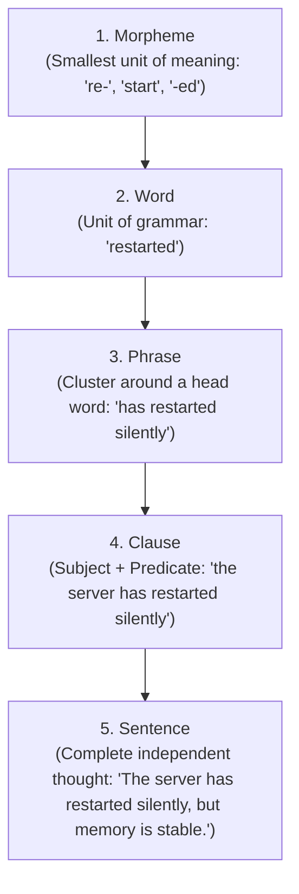
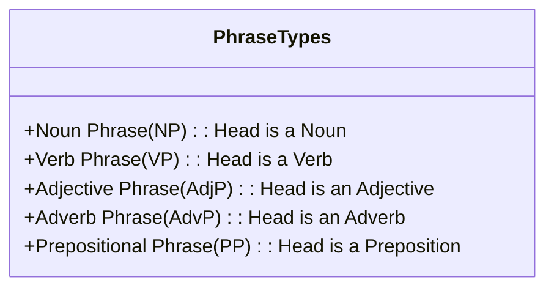
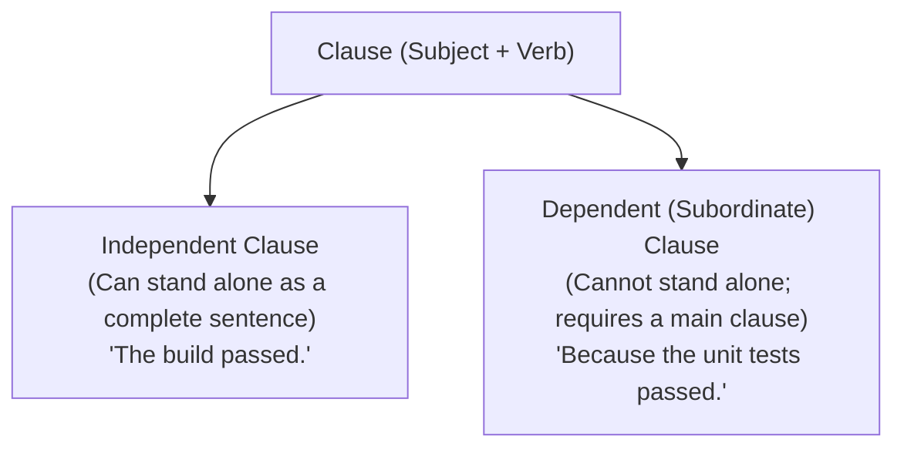
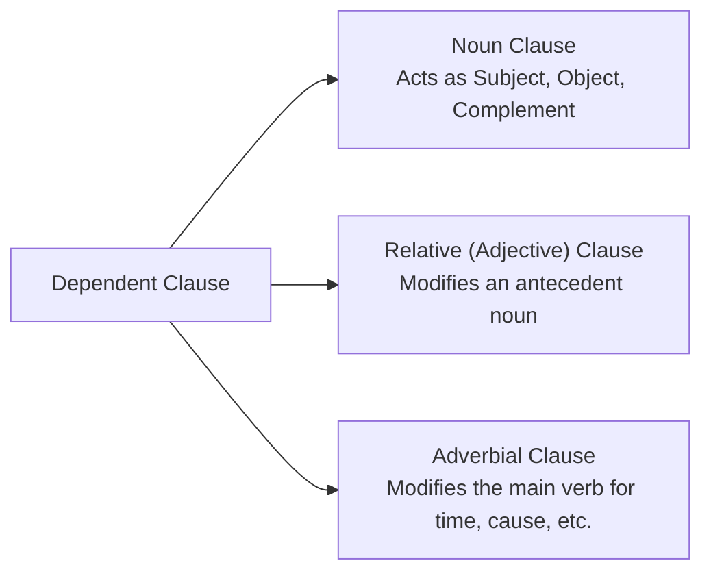
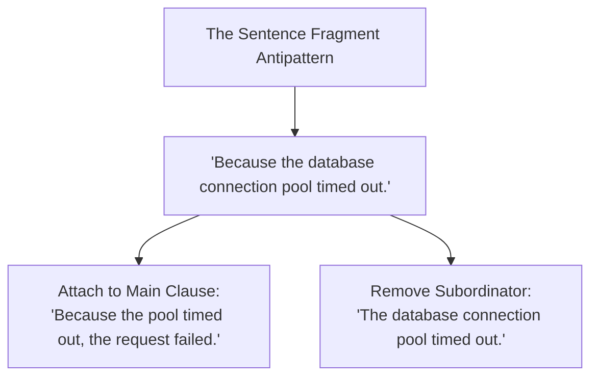

# Phrases and Clauses 🧱

> **Level:** CEFR A2 (Syntactic Hierarchy)  
> **Primary References:** Michael Swan (*Practical English Usage*, §19, 20, 229); Raymond Murphy (*English Grammar in Use*, Units 92–97, 113–116)  
> **Core Principle:** A **phrase** is a group of words lacking a subject-predicate pair; a **clause** contains a subject and a finite predicate. Treating a dependent clause as a standalone sentence produces the dreaded **Sentence Fragment** bug.

---

## 1. The Grammatical Hierarchy

To write coherent technical documentation, you must understand the nested levels of English grammar:

---

## 2. What is a Phrase?

A **phrase** is a syntactic unit consisting of one or more words organized around a central **Head Word**. Crucially, a phrase **never** contains both a Subject and a Finite Verb simultaneously.

### The Five Primary Phrase Types

| Phrase Type | Head Word | Syntactic Architecture | Production Example |
| :--- | :--- | :--- | :--- |
| **Noun Phrase (NP)** | Noun / Pronoun | Determiner + Modifiers + **Noun** + Post-modifiers | *[The **high-throughput** message broker] queued packets.* |
| **Verb Phrase (VP)** | Finite/Main Verb | Auxiliaries + **Main Verb** | *The worker thread [**has been executing**].* |
| **Adjective Phrase (AdjP)** | Adjective | Degree Modifier + **Adjective** + Complement | *The API is [**extremely resilient** to network partitions].* |
| **Adverb Phrase (AdvP)** | Adverb | Degree Modifier + **Adverb** | *The algorithm sorted records [**much more efficiently**].* |
| **Prepositional Phrase (PP)**| Preposition | **Preposition** + Object of Preposition (NP) | *Logs are streamed [**across the distributed cluster**].* |

---

## 3. What is a Clause?

A **clause** is a higher-level syntactic construction containing an explicit (or implied) **Subject** and a **Predicate** (a finite verb phrase).

$$\text{Clause} = \mathbf{Subject} + \mathbf{Predicate}$$

Clauses are bifurcated into two foundational categories:

### 1. Independent (Main) Clause
- Expresses a complete, self-contained thought.
- Possesses full grammatical independence.
- Can stand alone punctuated by a full stop:
  - *The load balancer distributes traffic evenly.* (Complete sentence)

### 2. Dependent (Subordinate) Clause
- Contains a subject and a verb, but begins with a **Subordinating Conjunction** (*because, although, if, since, while, when*) or a **Relative Pronoun** (*who, which, that*).
- Does not express a complete thought. Punctuating it as an independent sentence is a grammatical defect:
  - ❌ *Although the load balancer distributes traffic evenly.* (Syntax error: Fragment)
  - ✅ *Although the load balancer distributes traffic evenly, latency remains high.* (Valid complex sentence)

---

## 4. Taxonomy of Dependent Clauses

Subordinate clauses function within the larger sentence as if they were single parts of speech:

### 1. Noun Clauses
Perform the job of a noun phrase (Subject, Object, or Complement):
- *[**What the benchmark revealed**] surprised the systems team.* (Noun clause as Subject)
- *The monitoring dashboard shows [**that database latency is surging**].* (Noun clause as Direct Object)
- *The root issue is [**how the cache handles expiration**].* (Noun clause as Subject Complement)

### 2. Relative (Adjective) Clauses
Directly modify an antecedent noun, introduced by *who, whom, which, that, whose, where, when*:
- *The microservice [**which processes credit cards**] must be PCI-DSS compliant.*
- *The database administrator [**whose credentials were compromised**] revoked all keys.*

### 3. Adverbial Clauses
Modify the main clause by answering *Why? When? Under what conditions? To what degree?*
- **Time:** *Deploy the release [**after the database migrations finish**].*
- **Condition:** *The system will scale out [**if CPU utilization exceeds 80%**].*
- **Concession / Contrast:** *The queries ran quickly [**although indexing was disabled**].*
- **Reason:** *The pod crashed [**because it exceeded its allocated memory**].*

---

## 5. Finite vs. Non-Finite Clauses

Understanding this distinction is crucial for reading advanced literature (Swan §8–10):

| Property | Finite Clause | Non-Finite Clause |
| :--- | :--- | :--- |
| **Verb Form** | Contains a tense-bearing verb (Present/Past). | Contains an infinitive, gerund, or participle. |
| **Subject Marker** | Requires a nominative subject. | Subject is frequently omitted/implied. |
| **Independence** | Can be independent or dependent. | Always dependent; cannot stand alone. |
| **Example** | *When the worker **processed** the queue...* | *Having **processed** the queue, the worker idled.* |

---

## 6. Dual-Domain Practical Examples

### Everyday Conversational English
1. *[In the morning], I drink green tea.* (Prepositional Phrase)
2. *She bought [a very expensive leather jacket].* (Noun Phrase)
3. *[When the rain stops], we will go for a walk.* (Adverbial Clause of time)
4. *I know [where she hid the birthday gift].* (Noun Clause as Object)
5. *The musician [who played the guitar] was brilliant.* (Relative Clause)
6. *[Feeling tired], he went to bed early.* (Non-finite participial phrase)
7. *They stayed home [because it was snowing].* (Adverbial Clause of reason)

### Professional Software Engineering Context
8. *[Under extreme concurrent load], the Redis cache evicted old keys.*  
   $\to$ **Prepositional phrase** acting as an adverbial modifier.
9. *[The newly deployed authorization gateway] refused unverified JWTs.*  
   $\to$ **Noun phrase** acting as the complete Subject.
10. *[Because the replica lag exceeded five seconds], the read router redirected queries.*  
    $\to$ **Dependent adverbial clause** modifying the main clause.
11. *The engineer [who authored the deployment script] added rollback mechanisms.*  
    $\to$ **Defining relative clause** modifying the noun *engineer*.
12. *The operations team announced [that the API gateway would undergo maintenance].*  
    $\to$ **Noun clause** acting as the direct object of *announced*.
13. *[To optimize database throughput], we introduced read replicas.*  
    $\to$ **Non-finite infinitive clause of purpose**.
14. *The background worker crashed, [corrupting the write-ahead log].*  
    $\to$ **Non-finite present participial clause** describing result.
15. *The infrastructure failed [while the disaster recovery drill was executing].*  
    $\to$ **Finite adverbial clause of time**.

---

## 7. Common Mistakes & Diagnostic Anti-Patterns

| Bug (Sentence Fragment) | Patch (Syntactically Complete) | Diagnostic Root Cause |
| :--- | :--- | :--- |
| ❌ *Because the API rate limit was reached.* | ✅ *Because the API rate limit was reached, the client received HTTP 429.* | **Dependent clause punctuated as sentence:** Lacks an independent main clause. |
| ❌ *Running tests across multiple containers.* | ✅ *The CI runner is running tests across multiple containers.* | **Participial phrase lacking finite verb:** A standalone sentence requires a finite verb. |
| ❌ *Which caused the production outage.* | ✅ *A deadlocked thread caused the production outage.* | **Dangling relative clause:** Relative pronoun *which* cannot initiate a standalone sentence without an antecedent. |
| ❌ *In order to scale the backend.* | ✅ *In order to scale the backend, the team migrated to Kubernetes.* | **Infinitive phrase fragment:** Infinitive of purpose must attach to a finite main clause. |

---

## 8. Self-Assessment Practice Exercises

### Section A: Phrase vs. Clause Classification
Classify each highlighted excerpt as either a **Phrase** or a **Clause**:

1. [Under the high-availability configuration]
2. [Because the memory allocator leaked memory]
3. [Having completed the compilation cycle]
4. [That the software system requires encryption]
5. [Extremely reliable across network outages]
6. [When the monitoring alert triggered]

### Section B: Sentence Fragment Debugging
Identify whether the statement is a **Complete Sentence** or a **Fragment**. Fix any fragments:

7. *Although the code passed all local unit tests.*
8. *The distributed lock prevented concurrent database writes.*
9. *Since the architecture team recommended event sourcing.*
10. *To ensure maximum test coverage for legacy endpoints.*
11. *The developer refactored the monolith because modularity had deteriorated.*
12. *Which improved response times by nearly forty percent.*

---

## 9. Comprehensive Answer Key & Explanations

1. **Phrase** (Prepositional Phrase) — Contains no subject or finite verb.
2. **Clause** (Dependent Adverbial Clause) — Contains subject (*the memory allocator*) and finite verb (*leaked*), introduced by subordinator *because*.
3. **Phrase** (Non-finite Perfect Participial Phrase) — Contains a participle (*having completed*), but no nominative subject or finite verb.
4. **Clause** (Dependent Noun Clause) — Contains subject (*the software system*) and finite verb (*requires*), introduced by complementizer *that*.
5. **Phrase** (Adjective Phrase) — Centered around head adjective *reliable*, modified by adverb *extremely* and prepositional phrase *across network outages*.
6. **Clause** (Dependent Adverbial Clause) — Contains subject (*the monitoring alert*) and finite verb (*triggered*), introduced by time conjunction *when*.
7. **Fragment.**  
   *Patch:* *Although the code passed all local unit tests, it failed in the staging environment.*
8. **Complete Sentence.** (Independent clause with subject *The distributed lock* and finite verb *prevented*).
9. **Fragment.**  
   *Patch:* *Since the architecture team recommended event sourcing, we restructured our data model.*
10. **Fragment.**  
    *Patch:* *To ensure maximum test coverage for legacy endpoints, we authored forty new integration tests.*
11. **Complete Sentence.** (Independent main clause joined to dependent adverbial clause by *because*).
12. **Fragment.**  
    *Patch:* *We implemented database indexing, which improved response times by nearly forty percent.*

---

## 10. Revision Flashcards & Key Takeaways

- **Phrases lack finite predication:** A phrase is a cluster around a single head word (Noun, Verb, Adjective, Adverb, Preposition). It cannot stand alone as a statement.
- **Clauses contain Subject + Verb:** A clause possesses its own internal subject and verb.
- **Independent vs. Dependent:** Independent clauses make a complete claim; dependent clauses start with a subordinator (*if, because, although*) and lean on a main clause.
- **The Fragment Rule:** Never terminate a dependent clause or a participial phrase with a full stop unless it is bound to an independent clause.
