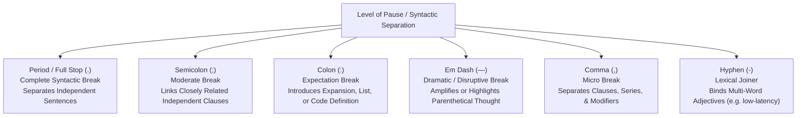
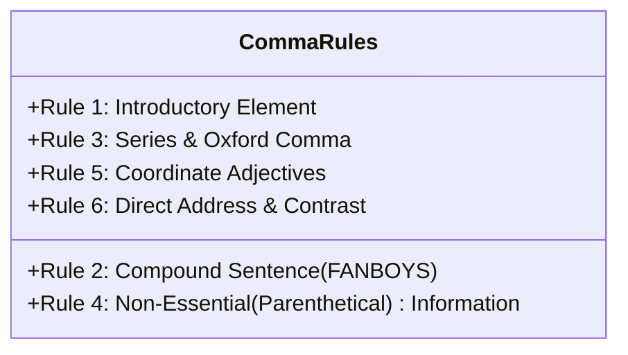
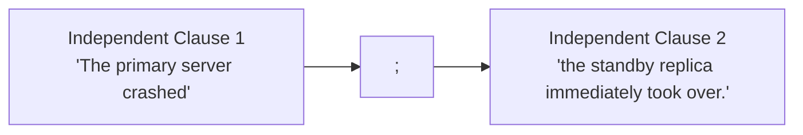
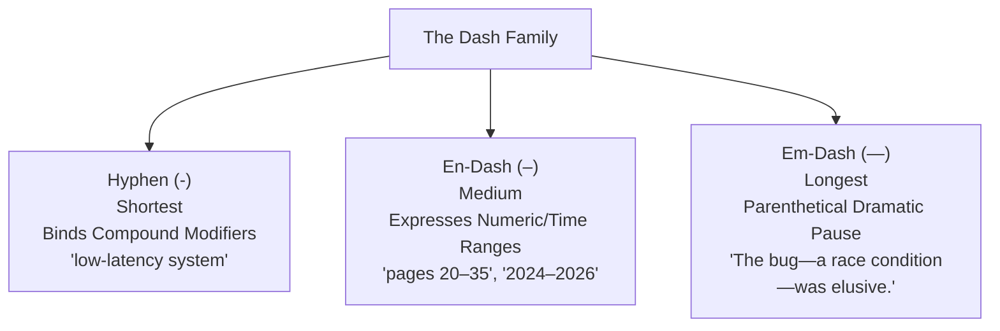
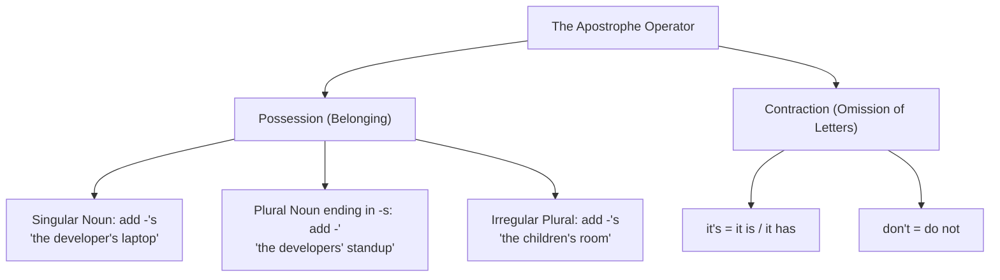

# Punctuation Mastery 🛑🚦

> **Level:** CEFR A1–B2 (Mechanical Precision)  
> **Primary References:** Michael Swan (*Practical English Usage*, §26, 293–298, 340, 342); Raymond Murphy (*English Grammar in Use*, Units 81, 95)  
> **Core Concept:** Punctuation marks are the syntax operators, circuit breakers, and traffic lights of written English. Misplaced punctuation crashes comprehension just as misplaced semicolons crash compilers.

---

## 1. The Punctuation Hierarchy & Decision Matrix

---

## 2. The Period / Full Stop (`.`)

### Rules of Usage
1. **Clause Termination:** Terminates all declarative and imperative sentences.
2. **Abbreviations:** Used in traditional abbreviations (*e.g., i.e., etc.*), though modern British English increasingly omits them (*eg, ie*).
3. **Decimal Marker:** In English mathematics and software engineering, a period is the decimal separator ($3.14159$), unlike continental European comma usage ($3,14159$).

---

## 3. The Comma (`,`) — The Six Cardinal Rules

The comma is the most misused punctuation mark in the English language. Follow these six strict rules:

### Rule 1: After Introductory Clauses or Long Phrases
When a dependent adverbial clause or long prepositional phrase begins a sentence, set it off with a comma:
- *[Because the Redis cache was invalid]**,** the database absorbed all read traffic.*
- *[In accordance with our zero-trust architecture guidelines]**,** all RPC calls must be encrypted.*
> [!NOTE]
> If the dependent clause follows the main clause, **no comma** is typically used:
> - *The database absorbed all read traffic [because the Redis cache was invalid].*

### Rule 2: Before Coordinating Conjunctions (FANBOYS) in Compound Sentences
When linking two independent clauses with *for, and, nor, but, or, yet, so*, place a comma before the conjunction:
- *The microservice received the request**, but** it failed to validate the bearer token.*

### Rule 3: Separating Items in a Series (The Oxford / Serial Comma)
Use commas to separate three or more parallel items. **Always include the Oxford comma** (the comma before *and/or* in the final item) in technical writing to prevent costly semantic ambiguity:
- Ambiguous: *We tested the auth service, logging worker and payment gateway.*
- Precise (Oxford Comma): *We tested the auth service**,** logging worker**, and** payment gateway.*

### Rule 4: Surrounding Non-Essential (Parenthetical) Information
Non-defining relative clauses and appositives must be enclosed by paired commas:
- *PostgreSQL**, which was chosen for its ACID guarantees,** performed flawlessly.*  
  (Omitting the clause does not alter the fundamental sentence truth).
- Contrast with defining clauses (no commas):  
  *Databases **that lack ACID guarantees** are unacceptable for financial transactions.*

### Rule 5: Between Coordinate Adjectives
Place a comma between adjectives modifying the same noun if they are of equal rank (test: can you insert *and* between them? Can you reverse their order?):
- *We need a **clean, maintainable** codebase.* (*clean and maintainable* $\to$ Valid $\to$ requires comma).
- *We deployed a **new relational** database.* (*new and relational* $\to$ Invalid order $\to$ no comma).

### Rule 6: To Express Direct Contrast
- *The bottleneck was in the network layer**, not in the CPU execution.*

---

## 4. The Semicolon (`;`)

The semicolon indicates a pause stronger than a comma but softer than a full stop.

### 1. Linking Closely Related Independent Clauses
Use a semicolon between two independent clauses when their thoughts are so intimately bound that a period would disrupt logical flow:
- *The deployment script did not fail**;** it simply timed out waiting for the database lock.*

### 2. Pairing with Conjunctive Adverbs
When connecting clauses using *however, therefore, furthermore, consequently, nevertheless, in contrast*:

$$\mathbf{Indep\ Clause}_1 + \mathbf{;} + \mathbf{Conjunctive\ Adverb} + \mathbf{,} + \mathbf{Indep\ Clause}_2$$

- *The service handled peak load without errors**; however,** memory consumption grew steadily.*

### 3. The "Super-Comma" in Complex Internal Lists
When list items already contain internal commas, use semicolons to prevent parser confusion:
- *The conference featured speakers from Berlin**, Germany;** Tokyo**, Japan;** and San Francisco**, California.*
- *The pipeline performs linting with Flake8**,** Black**,** and isort**;** testing with Pytest and Hypothesis**;** and deployment with Helm.*

---

## 5. The Colon (`:`)

> [!IMPORTANT]
> **The Colon Invariant:** In English, a colon **must always** be preceded by a grammatically complete **Independent Clause**. Never place a colon after a preposition (*such as, including*) or a verb (*are, is*).

- ❌ *The required dependencies are: Docker, Python, and Git.* (Syntax Error: Predicate interrupted)
- ✅ *Install the three required dependencies: Docker, Python, and Git.* (Valid: Complete main clause before colon)

### Legitimate Uses of the Colon
1. **Introducing a Formal List or Enumeration:**
   - *The microservice requires three environment variables: `DATABASE_URL`, `PORT`, and `SECRET_KEY`.*
2. **Introducing an Amplifying Explanation or Apposition:**
   - *The postmortem identified one primary vulnerability: unauthenticated administrative endpoints.*
3. **Introducing a Direct Block Quote or Code Snippet:**
   - *The lead architect stated the principle clearly: "Never trade correctness for speed."*

---

## 6. The Dash Family: Hyphen (`-`) vs En-Dash (`–`) vs Em-Dash (`—`)

### 1. The Hyphen (`-`)
- **Compound Adjectives Before a Noun:** When two or more words act as a single modifier preceding a noun, bind them with a hyphen:
  - *a **high-throughput** architecture* vs. *an architecture with **high throughput*** (no hyphen after noun).
  - *a **zero-downtime** deployment* vs. *a deployment with **zero downtime***.
  - *a **thread-safe** collection* vs. *the collection is **thread safe***.
- **Hyphen Invariant:** Never hyphenate an adverb ending in `-ly`:
  - ✅ *a **highly scalable** service* (Not *highly-scalable*).
- **Prefixes for Clarity:** *re-sign* (sign again) vs. *resign* (quit); *pre-existing*.

### 2. The En-Dash (`–`)
Used exclusively to represent ranges, intervals, or paired equal partnerships:
- *Read chapters 3–5.*
- *The 2024–2026 technical roadmap.*
- *The client–server paradigm.*

### 3. The Em-Dash (`—`)
Creates an emphatic, dramatic break in thought, often replacing parentheses or colons:
- *The system crashed due to a silent defect—a memory leak in the connection pool—that had evaded unit tests.*

---

## 7. The Apostrophe (`'`) — Possession vs. Contraction

> [!CAUTION]
> **The Greengrocer's Apostrophe (Syntax Bug):**
> Never use an apostrophe to form standard plurals!
> - ❌ *We deployed five new **API's**.*
> - ✅ *We deployed five new **APIs**.*
> - ❌ *The **1990's**.*
> - ✅ *The **1990s**.*

### The Great *Its* vs. *It's* Bug
| Word Form | Grammatical Classification | Meaning | Production Example |
| :--- | :--- | :--- | :--- |
| **`It's`** | Contraction | *It is* or *It has* | *It's running on port 8080.* |
| **`Its`** | Possessive Determiner | Belonging to *it* | *The database lost its primary connection.* |

---

## 8. Dual-Domain Practical Examples

### Everyday Conversational English
1. *I packed my passport, tickets, and foreign currency.* (Oxford Comma)
2. *Although it was late, we decided to watch another episode.* (Introductory dependent clause)
3. *She loves reading novels; her brother prefers non-fiction.* (Semicolon connecting independent clauses)
4. *Remember the golden rule: treat others with respect.* (Colon introducing explanation)
5. *He bought a well-made wooden chair.* (Hyphenated compound adjective)
6. *That's my sister's dog.* (Singular possessive)
7. *They visited the Smith family—a truly lovely group—last weekend.* (Em dashes for parenthetical thought)

### Professional Software Engineering Context
8. *When the CPU load spiked beyond 90%, the horizontal pod autoscaler provisioned three replica instances.*  
   $\to$ **Introductory dependent clause comma**.
9. *The cache expired, so the backend query hit the database directly.*  
   $\to$ **Comma before coordinating conjunction *so***.
10. *The framework supports PostgreSQL, MySQL, and SQLite.*  
    $\to$ **Oxford comma** ensuring each engine is treated as an isolated entity.
11. *The microservice is stateless; therefore, any instance can handle any incoming request.*  
    $\to$ **Semicolon + conjunctive adverb + comma**.
12. *Configure the application using the following properties: `host`, `port`, and `ssl_enabled`.*  
    $\to$ **Valid colon** preceded by a complete independent clause.
13. *We designed a low-latency, fault-tolerant message queue.*  
    $\to$ **Hyphenated compound adjectives** before noun + coordinate comma.
14. *The server closed its socket connection.*  
    $\to$ **Possessive *its*** (no apostrophe).
15. *The developers' workstations were upgraded with 64 GB of RAM.*  
    $\to$ **Plural possessive *developers'*** (apostrophe after plural `-s`).

---

## 9. Common Mistakes & Diagnostic Anti-Patterns

| Bug (Defective Punctuation) | Patch (Fixed Punctuation) | Root Cause Diagnostic |
| :--- | :--- | :--- |
| ❌ *The system has lost it's connection.* | ✅ *The system has lost **its** connection.* | **Its/It's confusion:** *Its* is possessive; *it's* is a contraction for *it is*. |
| ❌ *The tools required are: Git, Docker and Pytest.* | ✅ *The required tools are Git, Docker, and Pytest.* | **Colon after linking verb:** Never separate a verb from its complement with a colon. |
| ❌ *We built a highly-scalable service.* | ✅ *We built a **highly scalable** service.* | **Hyphenating `-ly` adverb:** Adverbs ending in `-ly` never take a hyphen. |
| ❌ *The server crashed, however we recovered quickly.* | ✅ *The server crashed**; however,** we recovered quickly.* | **Conjunctive adverb comma splice:** *However* cannot join two independent clauses with only commas. |
| ❌ *All engineer's must push their changes.* | ✅ *All **engineers** must push their changes.* | **Greengrocer's apostrophe:** Plural noun erroneously punctuated as possessive. |

---

## 10. Self-Assessment Practice Exercises

### Section A: Punctuation Correction
Punctuate each sentence correctly (fix misplaced commas, semicolons, colons, hyphens, and apostrophes):

1. Although the test suite passed the build was rejected.
2. The database lost it's replication stream yesterday.
3. We need three things, speed reliability and scalability.
4. The deployment succeeded however the smoke tests failed.
5. We deployed a multi region distributed database.
6. All container's must expose port 8080.
7. The company updated it's privacy policy for all user's accounts.
8. The backend developers laptop was stolen from the office.

### Section B: Technical Writing Optimization
Apply the Oxford comma, compound adjective hyphens, and semicolons to improve clarity:

9. *We implemented a real time fault tolerant event processing pipeline.*
10. *The pipeline executes linting, unit testing and deployment.*
11. *The cluster is stable we can proceed with the migration.*
12. *Our stack includes Python for the backend TypeScript for the frontend and PostgreSQL for persistence.*

---

## 11. Comprehensive Answer Key & Explanations

1. **Patched:** *Although the test suite passed**,** the build was rejected.*  
   *Rule:* Introductory dependent clause requires a comma.
2. **Patched:** *The database lost **its** replication stream yesterday.*  
   *Rule:* *Its* is possessive; *it's* means *it is*.
3. **Patched:** *We need three things**:** speed**,** reliability**,** and scalability.*  
   *Rule:* Complete independent clause before colon; Oxford comma between list items.
4. **Patched:** *The deployment succeeded**; however,** the smoke tests failed.*  
   *Rule:* Two independent clauses joined by conjunctive adverb *however* require a semicolon before and comma after.
5. **Patched:** *We deployed a **multi-region**, distributed database.*  
   *Rule:* Hyphenate compound modifier *multi-region*; comma between coordinate adjectives.
6. **Patched:** *All **containers** must expose port 8080.*  
   *Rule:* Simple plural; remove the apostrophe.
7. **Patched:** *The company updated **its** privacy policy for all **users'** accounts.*  
   *Rule:* Possessive *its*; plural possessive *users'* (accounts belonging to multiple users).
8. **Patched:** *The backend **developer's** laptop was stolen from the office.*  
   *Rule:* Singular possessive (*developer's*).
9. **Patched:** *We implemented a **real-time**, **fault-tolerant** event processing pipeline.*  
   *Rule:* Hyphenate multi-word compound adjectives preceding the noun.
10. **Patched:** *The pipeline executes linting**,** unit testing**, and** deployment.*  
    *Rule:* Oxford comma prevents ambiguity.
11. **Patched:** *The cluster is stable**;** we can proceed with the migration.* (or *. We can...*)  
    *Rule:* Fixes run-on sentence.
12. **Patched:** *Our stack includes Python for the backend**;** TypeScript for the frontend**;** and PostgreSQL for persistence.*  
    *Rule:* Use semicolons as super-commas to divide complex list items containing internal prepositions.

---

## 12. Revision Flashcards & Key Takeaways

- **The Oxford Comma Invariant:** Always place a comma before the coordinating conjunction in technical lists (*A, B, and C*).
- **The Colon Precondition:** A colon MUST follow a complete independent thought. Never put a colon after *is, are, including, such as*.
- **The Semicolon Bridge:** Use `;` to connect two complete sentences that share immediate logical continuity, especially before *however, therefore*.
- **Hyphenating Modifiers:** If two words combine to modify a noun before that noun, hyphenate them (*zero-downtime deployment*); if they follow the noun, do not hyphenate (*the deployment had zero downtime*).
- **`Its` vs `It's`:** *It's* = *it is*. *Its* = belonging to it.
