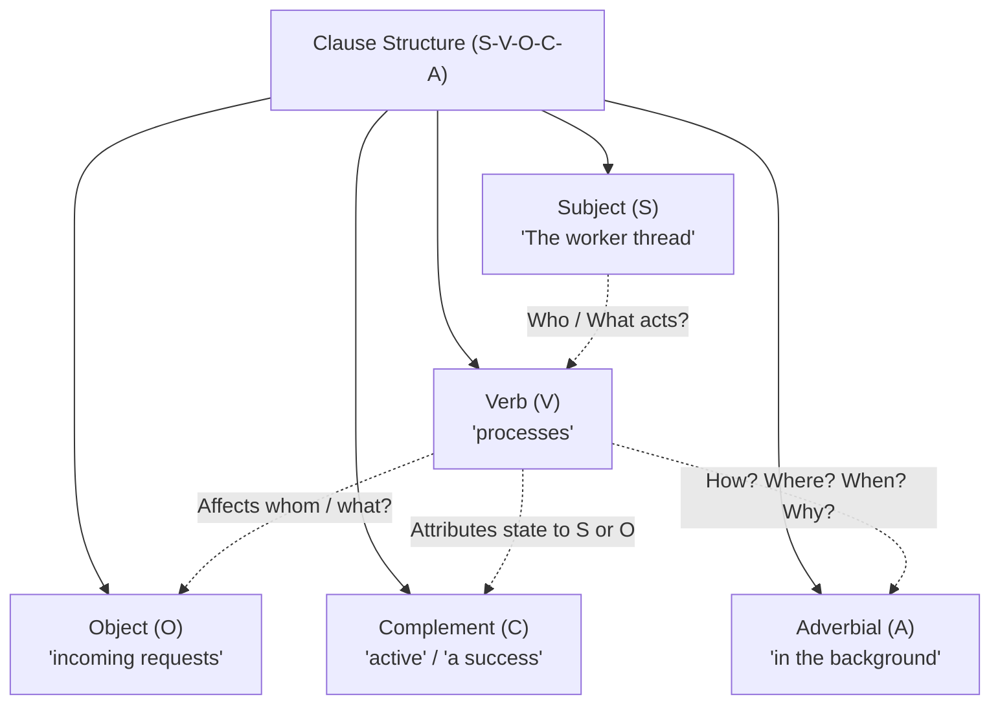
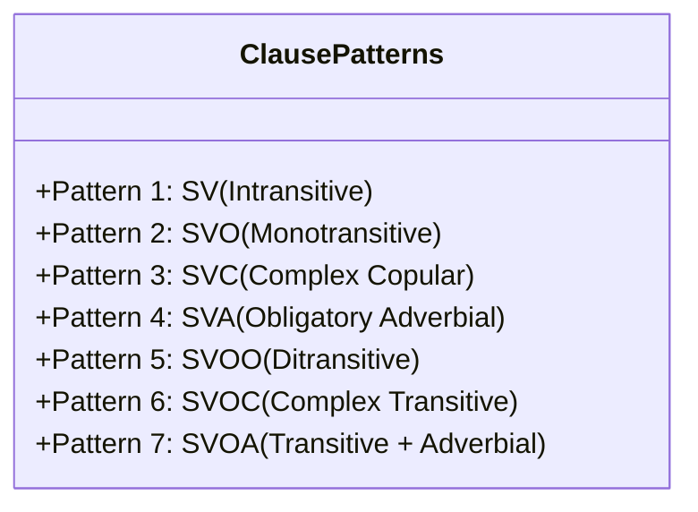
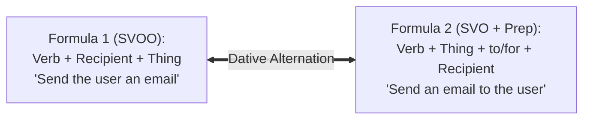

# Sentence Elements and Word Order (S-V-O-C-A) 📐

> **Level:** CEFR A1–A2 (Core Syntax)  
> **Primary References:** Michael Swan (*Practical English Usage*, §7, 10, 19, 215); Raymond Murphy (*English Grammar in Use*, Units 109–110)  
> **Key Law:** English is a configurational, fixed-word-order language. Sentence meaning depends on syntactic position, not case inflections.

---

## 1. Intent & Architectural Overview

In English, every grammatically complete clause is constructed from five fundamental functional elements:

$$\text{Clause} = \mathbf{S} + \mathbf{V} + (\mathbf{O}) + (\mathbf{C}) + (\mathbf{A})$$

1. **Subject ($\mathbf{S}$):** The entity performing the action or being characterized.
2. **Verb ($\mathbf{V}$):** The finite verbal predicator denoting action, event, or state.
3. **Object ($\mathbf{O}$):** The entity affected by the action (Direct Object $\mathbf{O_d}$ or Indirect Object $\mathbf{O_i}$).
4. **Complement ($\mathbf{C}$):** The element completing the meaning of the Subject ($\mathbf{C_s}$) or Object ($\mathbf{C_o}$).
5. **Adverbial ($\mathbf{A}$):** Circumstantial modifiers detailing time, place, manner, degree, or reason.

---

## 2. The Five Sentence Elements in Detail

### 1. The Subject ($\mathbf{S}$)
- Typically a noun, pronoun, or noun phrase (and occasionally a gerund or noun clause).
- Governs number and person agreement with the finite verb:
  - *The **microservice** ($\mathbf{S_{sg}}$) **restarts** ($\mathbf{V_{sg}}$).*
  - *The **microservices** ($\mathbf{S_{pl}}$) **restart** ($\mathbf{V_{pl}}$).*
- In canonical declarative English, the subject **must precede** the verb.

### 2. The Finite Verb ($\mathbf{V}$)
- The obligatory structural pivot of the clause.
- Must be inflected for tense (past, present) and agreement.
- Determines which complements or objects are required (valency).

### 3. The Object ($\mathbf{O}$)
- **Direct Object ($\mathbf{O_d}$):** Receives the direct impact of a transitive verb.
  - *The compiler flags [a syntax error] ($\mathbf{O_d}$).*
- **Indirect Object ($\mathbf{O_i}$):** The recipient or beneficiary of the direct object.
  - *The payment gateway sent [the merchant] ($\mathbf{O_i}$) [a settlement webhook] ($\mathbf{O_d}$).*

### 4. The Complement ($\mathbf{C}$)
Unlike objects (which refer to distinct entities), complements describe or identify an existing element.
- **Subject Complement ($\mathbf{C_s}$):** Follows linking verbs (*be, become, seem, look, remain*):
  - *The cluster is [unstable] ($\mathbf{C_s}$ - Adjective).*
  - *Python is [an interpreted language] ($\mathbf{C_s}$ - Noun Phrase).*
- **Object Complement ($\mathbf{C_o}$):** Describes or identifies the direct object:
  - *The developer found the legacy codebase [unmaintainable] ($\mathbf{C_o}$).*
  - *The committee appointed Sarah [Lead Architect] ($\mathbf{C_o}$).*

### 5. The Adverbial ($\mathbf{A}$)
- Adds circumstantial context: Manner (*how*), Place (*where*), Time (*when*), Reason (*why*).
- Unlike S, V, O, and C, adverbials are often optional and syntactically mobile.
  - *[Yesterday] ($\mathbf{A}$), the worker processed transactions [efficiently] ($\mathbf{A}$) [in the datacenter] ($\mathbf{A}$).*

---

## 3. The Seven Canonical English Clause Patterns

Every basic independent clause in English maps into one of seven fundamental syntactic blueprints:

| Pattern | Code Formula | Syntactic Description | Production Example |
| :---: | :--- | :--- | :--- |
| **1** | $\mathbf{S + V}$ | Intransitive Verb (no object) | *The background daemon **terminated**.* |
| **2** | $\mathbf{S + V + O_d}$ | Monotransitive Verb + Direct Object | *The load balancer **routes** HTTP traffic.* |
| **3** | $\mathbf{S + V + C_s}$ | Linking Verb + Subject Complement | *The network latency **remains** minimal.* |
| **4** | $\mathbf{S + V + A}$ | Verb + Obligatory Adverbial | *The database cluster **resides** in us-east-1.* |
| **5** | $\mathbf{S + V + O_i + O_d}$ | Ditransitive (Two Objects) | *The system **granted** the user administrative access.* |
| **6** | $\mathbf{S + V + O_d + C_o}$ | Complex Transitive + Object Complement | *The QA team **considers** the build production-ready.* |
| **7** | $\mathbf{S + V + O_d + A}$ | Monotransitive + Obligatory Adverbial | *The script **placed** the artifact into the S3 bucket.* |

---

## 4. The Dative Alternation (SVOO vs SVO + Preposition)

Ditransitive verbs (Pattern 5) permit two equivalent syntactic formulations:

$$\mathbf{S + V + O_i + O_d} \iff \mathbf{S + V + O_d + \text{Preposition} + O_i}$$

1. **Pattern A ($\mathbf{S + V + O_i + O_d}$):**
   - *The engineer handed **the manager** ($\mathbf{O_i}$) **the postmortem report** ($\mathbf{O_d}$).*
2. **Pattern B ($\mathbf{S + V + O_d + \text{to/for} + O_i}$):**
   - *The engineer handed **the postmortem report** ($\mathbf{O_d}$) **to the manager** ($\text{Prep Phrase}$).*

> [!IMPORTANT]
> **The Pronoun Invariant:** When the direct object is a personal pronoun (*it, them*), Pattern B is mandatory:
> - ✅ *I sent **it** to the manager.*
> - ❌ *I sent the manager **it**.* (Unnatural in modern English)

---

## 5. Strict English Word Order Rules

### Law 1: The Verb-Object Adjacency Invariant
In English, an adverbial **must never** be placed between a transitive verb and its direct object. The verb and its direct object must remain adjacent:

$$\mathbf{V} + \mathbf{A} + \mathbf{O_d} \quad \mathbf{[SYNTAX\ ERROR]}$$
$$\mathbf{V} + \mathbf{O_d} + \mathbf{A} \quad \mathbf{[VALID]}$$

- ❌ *The script executes [every morning] [the backup job].*
- ✅ *The script executes [the backup job] [every morning].*

### Law 2: Standard Adverbial Order (M-P-T)
When multiple adverbials appear at the end of a sentence, the default canonical order is **Manner $\to$ Place $\to$ Time**:

$$\mathbf{S} + \mathbf{V} + \mathbf{O} + \mathbf{A_{Manner}} + \mathbf{A_{Place}} + \mathbf{A_{Time}}$$

- *The daemon wrote log files [silently] ($\mathbf{A_{manner}}$) [to the disk] ($\mathbf{A_{place}}$) [at midnight] ($\mathbf{A_{time}}$).*

---

## 6. Dual-Domain Practical Examples

### Everyday Conversational English
1. *The train arrived.* ($\mathbf{SV}$)
2. *She bought a new laptop.* ($\mathbf{SVO}$)
3. *He looked exhausted after the journey.* ($\mathbf{SVC}$)
4. *They live in London.* ($\mathbf{SVA}$)
5. *Could you pass me the salt?* ($\mathbf{SVOO}$)
6. *The committee elected Mark chairperson.* ($\mathbf{SVOC}$)
7. *She put the keys on the kitchen table.* ($\mathbf{SVOA}$)
8. *We thoroughly enjoyed the concert yesterday.* ($\mathbf{A_{mid}} + \mathbf{V} + \mathbf{O} + \mathbf{A_{end}}$)

### Professional Software Engineering Context
9. *The database crashed during peak traffic.*  
   $\to \mathbf{S}$ (*The database*) + $\mathbf{V}$ (*crashed*) + $\mathbf{A}$ (*during peak traffic*). Pattern: $\mathbf{SVA}$.
10. *The CI pipeline builds the Docker image.*  
    $\to \mathbf{S}$ (*The CI pipeline*) + $\mathbf{V}$ (*builds*) + $\mathbf{O_d}$ (*the Docker image*). Pattern: $\mathbf{SVO}$.
11. *The API response appears completely valid.*  
    $\to \mathbf{S}$ (*The API response*) + $\mathbf{V_{link}}$ (*appears*) + $\mathbf{C_s}$ (*completely valid*). Pattern: $\mathbf{SVC}$.
12. *The authorization layer gives authenticated clients temporary access tokens.*  
    $\to \mathbf{S}$ + $\mathbf{V}$ + $\mathbf{O_i}$ (*authenticated clients*) + $\mathbf{O_d}$ (*temporary access tokens*). Pattern: $\mathbf{SVOO}$.
13. *The architects deemed the microservice architecture scalable.*  
    $\to \mathbf{S}$ + $\mathbf{V}$ + $\mathbf{O_d}$ (*the microservice architecture*) + $\mathbf{C_o}$ (*scalable*). Pattern: $\mathbf{SVOC}$.
14. *The deployment script copied the compiled binary to the remote server.*  
    $\to \mathbf{S}$ + $\mathbf{V}$ + $\mathbf{O_d}$ (*the compiled binary*) + $\mathbf{A}$ (*to the remote server*). Pattern: $\mathbf{SVOA}$.
15. *The engineer investigated the latency issue yesterday with great care.*  
    $\to$ Correct adverbial sequencing: Direct object immediately follows verb (*investigated the latency issue*).

---

## 7. Common Mistakes & Diagnostic Anti-Patterns

| Bug (Incorrect Syntax) | Patch (Correct Syntax) | Root Cause Diagnostic |
| :--- | :--- | :--- |
| ❌ *We discussed thoroughly the pull request.* | ✅ *We discussed the pull request thoroughly.* | **Adverb splitting verb and object:** *thoroughly* cannot separate transitive verb *discussed* from object *pull request*. |
| ❌ *Is necessary to restart the container.* | ✅ *It is necessary to restart the container.* | **Missing dummy subject:** English requires an overt dummy subject (*It*). |
| ❌ *The engineer gave to the tester the APK.* | ✅ *The engineer gave the APK to the tester.* | **Misplaced dative phrase:** Dative PP belongs after the direct object. |
| ❌ *The server behaves strange.* | ✅ *The server behaves strangely.* | *Behave* is modified by an adverb of manner (*strangely*), not an adjective. |
| ❌ *I yesterday deployed the patch.* | ✅ *Yesterday I deployed the patch.* / *I deployed the patch yesterday.* | Time adverbials cannot split subject and verb in affirmative statements. |

---

## 8. Self-Assessment Practice Exercises

### Section A: Identify the Clause Pattern
Classify each sentence as **SV, SVO, SVC, SVA, SVOO, SVOC,** or **SVOA**:

1. The transaction timed out.
2. The proxy server forwards client requests.
3. The load balancer seems overloaded.
4. The cloud provider charges customers twenty dollars monthly.
5. The developers consider Docker indispensable.
6. The database engine resides on a dedicated machine.
7. The monitoring tool placed the alerts into the Slack channel.

### Section B: Sentence Reordering (Fixing Word Order)
Reconstruct the scrambled sentence elements into grammatically correct English word order:

8. `[the database] [analyzed] [carefully] [the database administrator]`
9. `[to the client] [the server] [an encrypted payload] [transmitted]`
10. `[is] [to test edge cases] [vital] [it]`
11. `[in the cloud] [stored] [securely] [they] [the cryptographic keys]`
12. `[yesterday] [the code] [reviewed] [the senior engineer] [at the office] [thoroughly]`

---

## 9. Comprehensive Answer Key & Explanations

1. **SV** — *The transaction* ($\mathbf{S}$) + *timed out* ($\mathbf{V}$). Intransitive phrasal verb.
2. **SVO** — *The proxy server* ($\mathbf{S}$) + *forwards* ($\mathbf{V}$) + *client requests* ($\mathbf{O_d}$).
3. **SVC** — *The load balancer* ($\mathbf{S}$) + *seems* ($\mathbf{V_{link}}$) + *overloaded* ($\mathbf{C_s}$).
4. **SVOO** — *The cloud provider* ($\mathbf{S}$) + *charges* ($\mathbf{V}$) + *customers* ($\mathbf{O_i}$) + *twenty dollars* ($\mathbf{O_d}$) + *monthly* ($\mathbf{A}$).
5. **SVOC** — *The developers* ($\mathbf{S}$) + *consider* ($\mathbf{V}$) + *Docker* ($\mathbf{O_d}$) + *indispensable* ($\mathbf{C_o}$).
6. **SVA** — *The database engine* ($\mathbf{S}$) + *resides* ($\mathbf{V}$) + *on a dedicated machine* ($\mathbf{A}$).
7. **SVOA** — *The monitoring tool* ($\mathbf{S}$) + *placed* ($\mathbf{V}$) + *the alerts* ($\mathbf{O_d}$) + *into the Slack channel* ($\mathbf{A}$).
8. **Reordered:** *The database administrator analyzed the database carefully.* (or *Carefully, the database administrator analyzed the database.*)  
   *Rule:* Verb *analyzed* and object *the database* must remain contiguous.
9. **Reordered:** *The server transmitted an encrypted payload to the client.* (or *The server transmitted the client an encrypted payload.*)
10. **Reordered:** *It is vital to test edge cases.*  
    *Rule:* Requires dummy preparatory *It* as subject.
11. **Reordered:** *They stored the cryptographic keys securely in the cloud.*  
    *Rule:* $\mathbf{SVO}$ + Manner (*securely*) + Place (*in the cloud*).
12. **Reordered:** *The senior engineer reviewed the code thoroughly at the office yesterday.*  
    *Rule:* $\mathbf{SVO}$ + Manner (*thoroughly*) + Place (*at the office*) + Time (*yesterday*).

---

## 10. Revision Flashcards & Key Takeaways

- **The Big Five Elements:** Every clause is formed from Subject, Verb, Object, Complement, Adverbial ($\mathbf{S-V-O-C-A}$).
- **The 7 Canonical Patterns:** SV, SVO, SVC, SVA, SVOO, SVOC, SVOA.
- **The Golden Adjacency Rule:** Never insert an adverb between a verb and its direct object (*read quickly the book* $\to$ *read the book quickly*).
- **Adverbial Hierarchy (M-P-T):** When stacking adverbials at clause end, follow **Manner $\to$ Place $\to$ Time** (*ran smoothly in production yesterday*).
- **Complements vs Objects:** Objects are separate entities impacted by actions; complements characterize or complete the identity of the Subject or Object.
